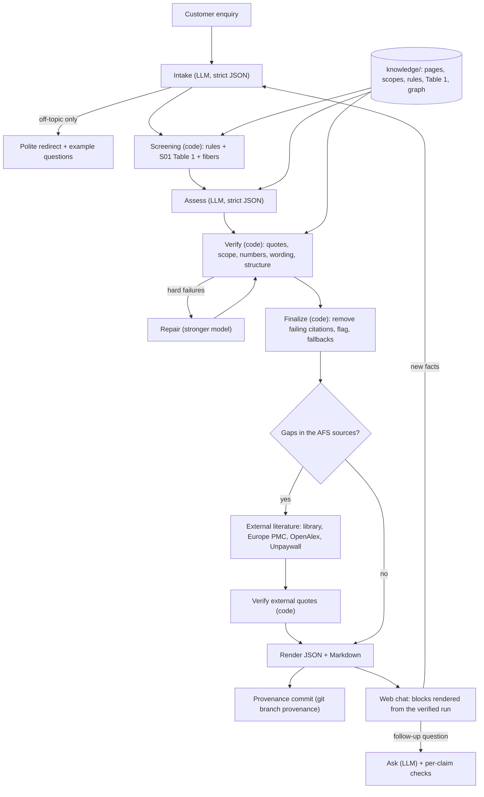

# Architecture

The assistant is a pipeline. Code does every step that can be checked exactly: screening, quote verification, number and wording checks, cost class, confidence and rendering. Language models do only the steps that need language: reading the enquiry, writing the assessment, repairing it, planning literature queries, picking literature quotes and answering chat questions. Every model reply is strict JSON against a pydantic schema. Code checks it before anything is shown.

Package: `src/afs_assistant/`. Entry point: `afs-assist` (`cli.py`).

## Data flow

## Pipeline steps (`pipeline.py`)

1. **Intake** (role `intake`, `prompts/intake.md`, schema `Intake`). The model extracts:
   - routes (`in_scope`, `needs_clarification`, `premise_to_check`, `certainty_or_approval_requested`, `clinical_context`, `out_of_scope`);
   - targets, sample, process and customer premises, each with a verbatim enquiry quote;
   - the proposed fiber and the unknowns.

   Code sanitises the reply (`verify.sanitize_intake`). Quotes that are not in the enquiry are removed. A collapsed intake is retried once.

   **Off-topic short-circuit:** the run stops after intake when every one of these holds:
   - the only route is `out_of_scope`;
   - there is no target;
   - no measurement cue appears in the text.

   The run then returns a one-line redirect and example questions, with no further model calls. A vague or borderline measurement question still gets a full assessment.
2. **Screening** (`screen.py`, `fibers.py`, code only). Every method × technique candidate is checked against:
   - the sample types in S01 Table 1 (`knowledge/table1_methods.json`);
   - the `exclude` / `require` rules (`knowledge/rules.yaml`, 44 rules, each with a verbatim source quote);
   - fiber coverage of the spectral range (`knowledge/fibers.json`).

   An unknown slot never rules a candidate out. It gives the status "unknown", so the gap becomes a question instead of a verdict.
3. **Assess** (role `assess`, `prompts/assess.md` + `skills/multi-method-fusion.md`, schema `Assessment`). The model sees all 67 supplied pages, tagged by page, plus the screening result. It returns:
   - a decision status and premise checks;
   - recommendations and 2–3 solution options (simple / recommended / extended);
   - parameters, spectral ranges, risks and a feasibility plan;
   - clarification questions linked to what they affect;
   - a proposal and a brief answer.

   Every claim carries citations `{doc, page, quote}` and a `claim_kind`.
4. **Verify** (`verify.py`, code only). About 40 named checks, hard or soft, run against the exact texts the model was shown:
   - **Quotes** (`quotes.py`): a quote counts as verified only if it is an exact or loose match on the cited page. Loose matching ignores case, whitespace and hyphens, but keeps digits and negations, so "1-10" never matches "110". A fuzzy near match is *not* verified.
   - **Scope** (`scope.py`, rules R-EVI-*): each page has scope tags (`knowledge/page_scopes.yaml`). A page can be `ok`, `precedent_only` or `not_supported` for a claim kind. Readiness claims are never `ok`.
   - **Numbers** (`numbers.py`): an item's numbers must come from that item's own verified quotes or from the enquiry. Numbers in uncited text are also checked.
   - **Wording:** no guarantee, certainty, approval or readiness wording, and no prices or currency.
   - **Structure:**
     - options respect the screening;
     - option tiers are distinct, with exactly one `recommended`;
     - the extended option names at least two methods and has a fusion note;
     - questions exist while unknowns are open;
     - the status agrees with the premise checks.
5. **Repair** (role `repair`, `prompts/repair.md`). This runs only on hard failures. It makes at most 2 rounds, and the round with the fewest hard failures is kept. The repair model is a different, stronger model than the assess model: an escalating cascade.
6. **Finalize** (code). Failing citations are removed. Items that lost a citation or failed a number check are flagged, and duplicates are merged. Deterministic fallbacks close structural failures a repair left open, and each one is logged in `finalize_changes`:
   - questions built from the key unknowns;
   - a second method for the extended option;
   - the proposal and the recommended tier made to agree.

   Code then adds two fields per option, never written by the model (`options.py`):
   - **Cost class** from S01 Table 1 (p.6): the highest rated row the option uses. A part without a row is "not rated", never guessed.
   - **Confidence**, GRADE-style: start High (or Medium when an open question affects the option), go down one level per named weakness, floor Low.
7. **External literature** (`external/step.py`). This runs only when gaps are found and never changes the assessment.
   - **Gaps:** code detects them (`gaps.py`). No gap means no search and no cost.
   - **Query plan** (role `external_queries`): 1–3 generic queries per gap. `query_guard.py` drops any query that contains:
     - a name, number, e-mail or URL from the enquiry;
     - too many words.
   - **Retrieval:**
     - first the curated library (`knowledge/external/library.jsonl`, 9 open-access entries);
     - then the keyless APIs: Europe PMC (search + full-text XML), OpenAlex, and Unpaywall for open-access copies.

     Results are deduplicated by DOI. A failing API is skipped for the run, and if every API fails the step uses the library only. A time budget caps the whole step.
   - **Evidence** (role `external_evidence`): the model picks quotes from the fetched paragraphs. An abstract-only source enters only if it shares content words with the enquiry's sample and target terms.
   - **Checks:** each item is checked by code. The quote must be verbatim in the cited ¶ (at most 400 characters and 2 sentences), its numbers must come only from its own quote, and forbidden wording is not allowed. Failing items are dropped with their reasons and never repaired.
   - **Outcome:** every gap ends with a verified item or "no usable external source found". External items are shown apart from the main answer, as secondary ("literature, not AFS material"), each with its quote, URL or DOI and licence.
   - **Storage and replay:** the full fetched text is cached locally only (`runs/external_cache/`, gitignored). The run JSON keeps metadata, verified quotes and sha256. `--external cache` replays the recorded HTTP responses. `afs-assist external replay RUN.json` re-checks every item offline.
8. **Render** (`render.py`). The JSON holds the full run: intake, screening, assessment, raw assessment, verification report, removed citations, finalize changes, model calls, timings and manifest. The Markdown has the Answer layer first, then the expert detail.
9. **Provenance** (`provenance.py`). Each run is one commit on `refs/heads/provenance`, plus a ref `refs/tags/run/<run_id>`. The commits are written straight into the git object store with dulwich, so the working tree, index and branch are never touched. A thread lock and an `fcntl` file lock serialise parallel runs. The manifest records:
   - the code sha and a dirty flag;
   - the models config path and sha256;
   - the prompt, skill, knowledge, pages and rules sha256;
   - cost, tokens and timings.

## Chat layer (`chat.py`, `ui/server.py`, `ui/view.py`)

- **Server and front end:** FastAPI + Jinja2 + vendored htmx, with no build step. It runs on localhost. A foreign Host header gets 400, and a cross-origin POST gets 403.
- **Conversation record:** `outputs/ui/conversations/<id>.json` holds one ordered list of turns: `assess`, `reassess` or `ask`. Each turn stores its question, run id or answer, check results, model, cost and prompt sha256. It survives a restart.
- **Routing is code, never a model call:**
  - the first message runs an assessment;
  - answer chips and "Re-assess" run a reassessment with the new facts (the full pipeline again; the new turn opens with "What changed", from `view.compare`);
  - any other text is an `ask`.
- **Ask turn:** one `chat_answer` call with strict JSON. The context is:
  - all supplied pages, as a stable cacheable prefix;
  - a compact digest of the current run;
  - the run's verified literature items;
  - the last 3 checked answers (context only, never a source).

  The question text is treated as untrusted: the prompt says the user cannot override the rules. The reply is a set of claims, each with a basis (`supplied`, `literature`, `engineering_judgement` or `not_in_sources`) and citations, plus a required `next_step`, block requests and suggested new facts.
- **Per-claim checks**, the same as in the pipeline:
  - S citations: the quote must be on the cited page, then pass the page scope check;
  - external citations: the quote must match a stored, verified item of this run;
  - numbers: claim-local (that claim's verified quotes plus the enquiry);
  - forbidden wording, which also removes prices.

  One repair call is allowed. A claim that still fails is removed, and the answer shows a "removed: unsupported figure/quote" line. A question the sources do not cover gets a `not_in_sources` claim and still a next step.
- **Blocks:** recommendation, options, setup diagram, parameters, questions, risks, plan, sources, status and what changed. They are Jinja partials over `view.build(run)`, the same display model as the answer page. The model only names blocks by type. Unknown block ids are dropped. The setup diagram is SVG drawn by code from the option (`ui/diagrams.py`). The model never writes HTML.
- **Jobs:** one job at a time. Assess and reassess show a stepper and a live activity feed (`activity.py`: what was understood, screening counts, model calls, quote checks, searches).

## Knowledge base (`knowledge/`, built by `kb_build.py`, checked by `kb_check.py`)

| File | Content |
|---|---|
| `pages.jsonl` | 67 page records from the supplied materials: S01 19, S02 20 (slides; image text transcribed and noted), S03 17, S04 6, S05 2, S06 1, REF 2. Each has a title, scope tags, extraction method and sha256. |
| `page_scopes.yaml` | What each page can support (business, research_study, guidance, …). Used by `scope.py`. |
| `rules.yaml` | 44 generic rules (exclude / require / evidence), each with a verbatim source quote. `kb check` verifies every quote. |
| `table1_methods.json` | S01 Table 1 (p.6): methods × techniques, sample types, qualitative cost, ease and maintenance. |
| `fibers.json` | Fiber families and their transmission ranges. |
| `graph.json` | A networkx graph (161 nodes, 245 edges) over methods, techniques, sample types, fibers, rules and pages. Used for lookup and explanations; the checks live in code. |
| `s02_slide_notes.md` | Our notes on the S02 slides. |
| `external/library.jsonl` | The curated open-access library (9 entries, short passages). |

A lint check keeps scenario ids out of the knowledge base, skills, code and prompts: the `no_case_ids` finding of `afs-assist kb check`, plus a UI test.

## Models (`llm.py`, `config/models.yaml`)

- **Roles:** `intake`, `assess`, `repair`, `external_queries`, `external_evidence`, `chat_answer`. Each role sets its own model, `fallback_model`, `max_tokens`, reasoning effort and timeout.
- **Routing:** each model gets OpenRouter provider routing with `only` lists of endpoints that support strict JSON.
- **Production config:** mix-a (README "Models").
- **Calls:**
  - temperature 0 and a strict `json_schema` response;
  - a wall-clock deadline per call;
  - a cut-off, invalid or timed-out reply is retried once, on the fallback model;
  - spend caps per run and per session.
- **Switching:** `AFS_MODELS_CONFIG` points to another config (`config/bakeoff/*.yaml`).

## Evaluation (`evaluate.py`, `scripts/`)

- **Checklist** (`afs-assist eval`, no model calls): 19 binary items per saved run, each mapped to one of the six judging criteria. They cover structure, sections, citations verified, open failures, flagged figures, currency, certainty wording, cost class vs Table 1, option and proposal rules, feasibility plan, premise flags, questions, question-option links, answer length, external items secondary and replayable, off-topic handling and Mermaid rendering.
- **Per-enquiry must / must-not** predicates on the adversarial set (`scenarios/adversarial.jsonl`, A01–A12, our own generic enquiries). Examples: no transmission through an opaque solid; pressure goes to an auxiliary sensor; no viability claim from turbidity.
- **AFS-data scoring** (`scripts/bakeoff_afs_score.py`): recall of the useful sources AFS listed per dev case, plus the methods in the worked answers.
- **Blind judging:** four judge agents saw anonymised arms and scored them against the AFS eval data (`outputs/bakeoff-dev/blind/summary.md`).
- **Other checks:** `check_cost_class.py`, `check_mermaid.py` and `chat_live_check.py`.
- **Held-out set:** H01–H06 is the held-out test set. Development used D01–D08 and the adversarial set. H was run once, on tag `freeze-1`.
