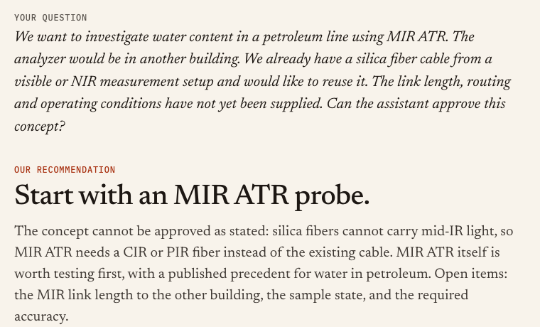
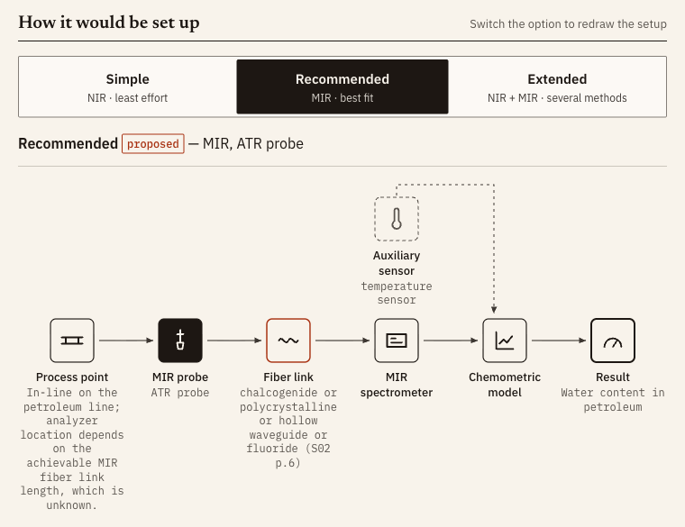
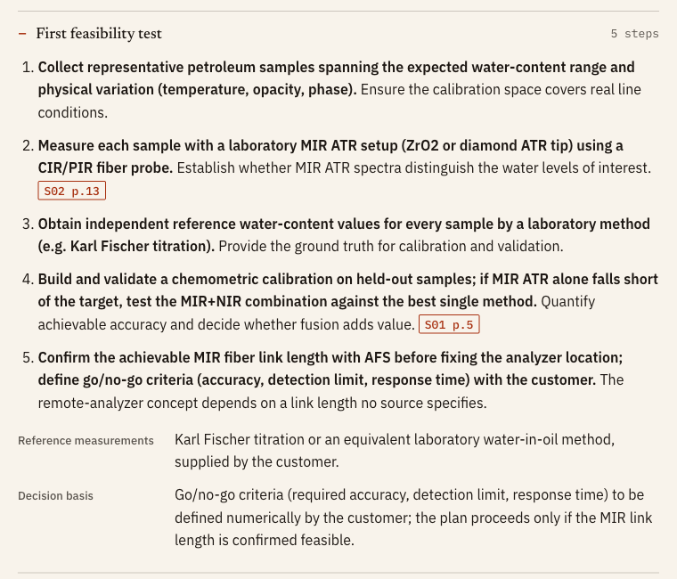
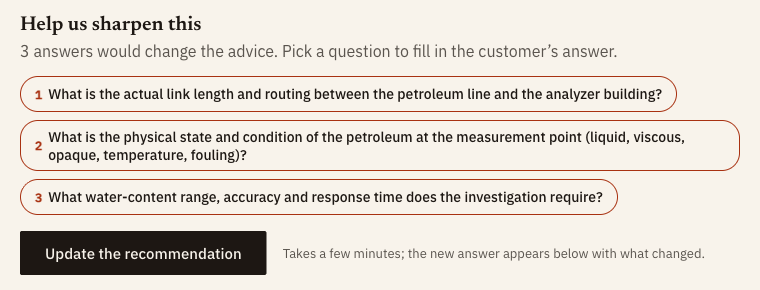
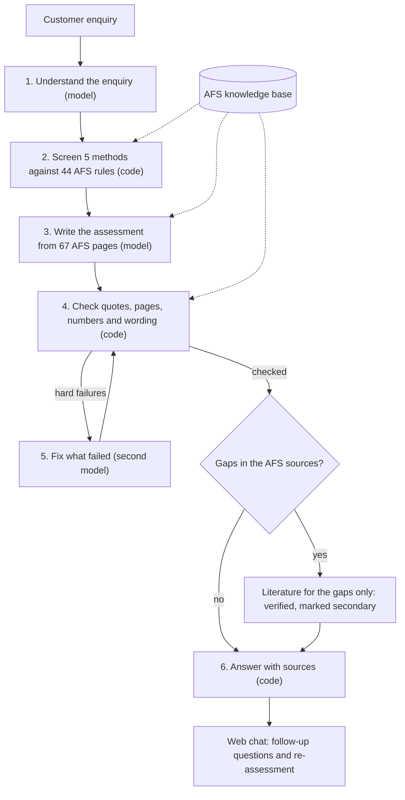

# AFS Spectroscopy Assistant

**A customer enquiry goes in. A cited first technical assessment comes out.**

[](pyproject.toml)
[](https://docs.astral.sh/uv/)
[](src/afs_assistant/ui/)
[](LICENSE)
[](tests/)

The assistant reads an in-line spectroscopy enquiry of the kind Art Fiber Systems (AFS) receives: "we want to follow X in our process; which method and probe should we test first?". It answers with a first technical assessment that cites the supplied AFS documents page by page. Language models read the enquiry and write the answer; code screens the methods against rules taken from the AFS materials and checks every quote word for word before anything is shown. Built by **Team Helios** (Rakibuzzaman Rahat, Md Mahmud Siddique) for the Art Fiber Systems challenge at the **SchubKI National AI Hackathon 2026**.

<p align="center">
  
</p>
<p align="center"><em>The web chat on a held-out case (H04, unedited): the customer's question and the recommendation.</em></p>

## Contents

- [Highlights](#highlights)
- [Results at a glance](#results-at-a-glance)
- [Screenshots](#screenshots)
- [Requirements](#requirements)
- [Quick start](#quick-start)
- [Command line](#command-line)
- [Architecture](#architecture)
- [Project structure](#project-structure)
- [Limitations and next steps](#limitations-and-next-steps)
- [Documentation](#documentation)
- [Team, license and acknowledgements](#team-license-and-acknowledgements)

## Highlights

- **Method and probe to test first.** It screens five spectroscopy methods (MIR, NIR, Raman, UV-Vis, fluorescence) and their probe techniques against the customer's sample and process.
- **Two or three options, from simple to extended.** Each option carries a relative cost class taken from AFS Table 1 (S01 p.6), never a price, plus a setup sketch.
- **Cited and checked.** Every key claim cites its AFS page (for example `S01 p.10`). Code checks each quote word for word on that page. A quote that fails is removed or labelled.
- **Honest about what is missing.** It asks the clarification questions that would change the advice, gives a decision status, and plans a first feasibility study.
- **Chat follow-ups.** Follow-up questions get checked answers in seconds. New facts trigger a re-assessment that opens with "What changed".
- **Literature only for gaps.** When the AFS documents leave a gap, it searches open scholarly sources. Each item is verified and shown apart, marked as secondary.

## Results at a glance

The six held-out enquiries (H01–H06) were run once on the frozen pipeline (git tag `freeze-1`), and the outputs were not edited.

| Measure | Result |
|---|---|
| Cases answered | 6/6 |
| Quotes verified word for word on the cited page | 120/120 |
| Hard verification failures | 0 |
| Time per case | 97–184 s |
| Model cost, all six cases | $0.288 |
| Cost class in agreement with AFS Table 1 | 6/6 |
| Independent rule-compliance review | PASS WITH CAVEATS, no blocking violation |

- **Full answers:** [outputs/final/](outputs/final/) (`H01.md` … `H06.md`, each with its full run record in `.json`).
- **Short views** (about 550–700 words each, built by code from the run JSON, no model call): [outputs/final/brief/](outputs/final/brief/).
- **Rule-compliance review:** [outputs/final/REVIEW.md](outputs/final/REVIEW.md).
- **Per-case table, development evaluation, model bake-off and reproducibility:** [docs/RESULTS.md](docs/RESULTS.md).

## Screenshots

<table>
  <tr>
    <td width="50%" valign="top"></td>
    <td width="50%" valign="top"></td>
  </tr>
  <tr>
    <td align="center"><em>Setup sketch of the recommended option, drawn by code</em></td>
    <td align="center"><em>The first feasibility test, step by step</em></td>
  </tr>
  <tr>
    <td colspan="2" align="center"></td>
  </tr>
  <tr>
    <td colspan="2" align="center"><em>Clarification questions: only the answers that would change the advice</em></td>
  </tr>
</table>

All screenshots show held-out case H04 in the real app.

## Requirements

| Need | Why |
|---|---|
| Python ≥ 3.12 and [uv](https://docs.astral.sh/uv/) | Environment and all commands (`uv sync`, `uv run …`) |
| macOS or Linux | Developed and tested on macOS. On Windows, run only one `afs-assist` process at a time (the provenance file lock is POSIX only). |
| The organiser materials archive `materials.zip` | Source of the AFS page text. It is **not in this repository** for copyright reasons (see [NOTICE](NOTICE)). |
| An [OpenRouter](https://openrouter.ai/) API key | Only for new assessments and chat answers. Viewing the saved H01–H06 runs needs no key. |
| `CONTACT_EMAIL` (optional) | Sent to Unpaywall and OpenAlex for the literature search. Without it the Unpaywall lookup is skipped. |

## Quick start

1. **Clone and install.**
   ```bash
   git clone https://github.com/sleipnir029/Afs-Spectroscopy-Assistant.git
   cd Afs-Spectroscopy-Assistant
   uv sync
   ```
2. **Add the organiser materials.** Unzip the archive into `resources/`, which gives `resources/materials/S01_Multispectral_Laboratory.pdf` and the other files.
   ```bash
   unzip materials.zip -d resources/
   ```
3. **Build the knowledge base.** This recreates the AFS page text (`knowledge/pages.jsonl`) byte for byte as the saved runs used it, then validates it.
   ```bash
   uv run afs-assist kb build
   uv run afs-assist kb check
   ```
4. **Add your API key** (only for new assessments). Create `.env` in the repository root. It is gitignored; **never commit it**.
   ```text
   OPENROUTER_API_KEY=sk-or-...
   CONTACT_EMAIL=you@example.org     # optional, for Unpaywall / OpenAlex
   ```
5. **Start the web chat** and open <http://127.0.0.1:8765>. Open a saved H01–H06 example, or type a new enquiry.
   ```bash
   uv run afs-assist ui
   ```

The test suite runs offline with fake model clients: `uv run pytest -q`. Without the page text from step 3, the tests that need it are skipped with a hint (357 pass and 535 are skipped in a fresh clone; see [docs/RESULTS.md](docs/RESULTS.md#reproducibility)).

## Command line

| Command | What it does |
|---|---|
| `uv run afs-assist ui [--port 8765]` | Local web chat: open saved runs, assess a new enquiry, ask follow-ups, re-assess. |
| `uv run afs-assist assess --text "..."` (or `--file enquiry.txt`) `[--out DIR]` | Assess one enquiry and print the Markdown; with `--out`, also write `.json` and `.md`. |
| `uv run afs-assist run --set dev\|adversarial [--only ID,ID] [--workers 4]` | Assess a scenario set in parallel into `outputs/<set>/`. |
| `uv run afs-assist eval [--set dev\|adversarial]` | Deterministic checklist over the saved runs (no model call). |
| `uv run afs-assist brief outputs/final` | Build the short views from saved run JSON (no model call). |
| `uv run afs-assist kb build` / `kb check` | Rebuild or validate `knowledge/`. |
| `uv run afs-assist external replay outputs/final/H01.json` | Re-check a run's literature quotes offline against the cached text. |
| `uv run pytest -q` | Offline test suite; needs no API key. |

`assess`, `run` and `ui` take `--external live|cache|off` for the literature step: `live` searches the scholarly APIs, `cache` answers from recorded responses only, `off` skips it. The held-out set (`run --set final`) refuses to run without an explicit confirmation flag; it was run once.

## Architecture

Models write. Code checks. Each model reply is strict JSON against a schema, and code checks it before anything reaches the user.



| Role | Job | Model | Backup |
|---|---|---|---|
| Reader | Understand the enquiry; plan and pick literature quotes | Gemini 3.5 Flash-Lite | GLM-5.3-Flash |
| Writer | Write the assessment draft; answer chat questions | GLM-5.3-Flash | Gemini 3.8 Flash |
| Fixer | Rewrite when the checks find hard failures | Gemini 3.8 Flash | GLM-5.3-Flash |

All models run through OpenRouter at temperature 0 ([config/models.yaml](config/models.yaml)). A cut-off, invalid or timed-out reply is retried on the backup model. In a blind comparison of seven model setups, this mix was 3–6× faster than the other top setups at close to the best quality, for about $0.03 per case ([docs/RESULTS.md](docs/RESULTS.md#model-bake-off)).

**The AFS knowledge base.** `kb build` turns the organiser PDFs, slide deck, reference document and method table into 67 page-text records and S01 Table 1 (methods, sample types, relative cost classes). Our committed files add page scopes, fiber transmission limits and 44 rules, each tied to a verbatim AFS quote that `kb check` finds on its page. Screening applies the rules, Table 1 and fiber limits in code. The writer sees all 67 pages, tagged by page, and the checker matches every quote against the same text.

Full detail: [ARCHITECTURE.md](ARCHITECTURE.md).

## Project structure

```text
src/afs_assistant/   pipeline, checks, CLI and web chat (FastAPI + htmx)
prompts/             prompts for each model role
skills/              guidance for the writer (multi-method fusion)
knowledge/           derived AFS knowledge: rules, page scopes, Table 1, fibers
config/              model configurations (production and bake-off arms)
scenarios/           enquiry sets: development, adversarial, held-out
outputs/             saved runs, short views, evaluations, bake-offs
tests/               offline test suite
scripts/             evaluation and maintenance scripts
docs/                results, slides, demo video, reviews, screenshots
resources/           organiser materials (local only, not in git)
```

## Limitations and next steps

- **Full answers are long** (about 3,000 words). The code-built short view helps; next is a short customer reply.
- **A quote found on the page is not yet proof** that it supports the claim. Next is a second checker for support.
- **Confidence is mostly "Low"**. Next is a confidence rating that tracks the facts more closely.
- **A run takes 1.5–3 minutes**. Next is a faster fixing step.
- **A re-assessment is a fresh model run**, so it can change the method for reasons other than the new fact.

The full list, including two known slips in the held-out outputs, is in [docs/RESULTS.md](docs/RESULTS.md#known-limitations).

## Documentation

| Document | Content |
|---|---|
| [ARCHITECTURE.md](ARCHITECTURE.md) | Components, data flow, checks, chat layer, how to extend |
| [docs/RESULTS.md](docs/RESULTS.md) | How to read an output, models, results, bake-off, reproducibility, limitations |
| [docs/slides/slides.pdf](docs/slides/slides.pdf) | 8-slide presentation |
| [docs/video/demo.mp4](docs/video/demo.mp4) | Demo video (3:27): the real app during a live run |
| [docs/review-final/](docs/review-final/) | Final independent reviews of outputs, code, deliverables and repository |
| [DEVIATIONS.md](DEVIATIONS.md) | Every change from the plan, with its reason |
| [STATUS.md](STATUS.md) | Timestamped project log |

## Team, license and acknowledgements

**Team Helios:** Rakibuzzaman Rahat and Md Mahmud Siddique, SchubKI National AI Hackathon 2026, Art Fiber Systems challenge.

- **Code and documentation:** MIT License ([LICENSE](LICENSE)).
- **Organiser and publisher materials** are not distributed and remain the property of their holders. Short verbatim quotes in `knowledge/` and `outputs/` are citations for the challenge. S03 is open access under CC BY 4.0. See [NOTICE](NOTICE).
- **Third-party components:** IBM Plex and Newsreader fonts (SIL Open Font License 1.1) and htmx 2.0.4 (0BSD), self-hosted in `src/afs_assistant/ui/static/`.
- **Provenance:** commit hashes in this public repository differ from the `code_sha` recorded in the run manifests, because the organiser page text was filtered out of the history; [docs/commit-map.txt](docs/commit-map.txt) maps each original hash to its public one.
