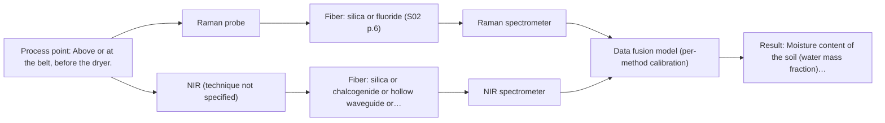

# First technical assessment: Moisture and organic content of soil on a conveyor

## Answer

**Customer request (our summary):** Customer wants in-line fiber optic measurement on a conveyor belt at a remediation site to sort excavated soil by moisture and organic content before drying. Soil is lumpy, dark, and variable. They ask whether a fiber optic measurement above or on the belt can give a continuous reading and which method to test first.

### Brief answer

NIR diffuse reflection is the method to test first: it suits an opaque, strongly scattering solid and can be used above the belt without contact. A single probe looking at the belt surface is the simplest alternative. Whether NIR can separate moisture from organic content, and how the reading should be mounted, is still open; the expected ranges and required accuracy, the reference method and the belt geometry need answers first.

### Proposal

- **Best current option:** O2 (recommended)
- **Basis:** supplied AFS sources
- **What would change it:** If the trial shows that NIR alone cannot separate moisture from organic content, or that the site cannot hold a stable standoff above the belt, the choice moves to the on-belt probe (O1) or to the NIR+Raman combination (O3). Answers on the expected ranges, required accuracy and reference method decide whether NIR is enough.
- **Next step:** Agree the numerical moisture and organic-content targets and the reference method with the site, then run a first NIR reflection trial on representative belt samples in both geometries.

**Secondary evidence (external, not AFS material):** G1: E02 ¶31, E05 ¶65; G2: no usable external source found; G3: no usable external source found; G4: no usable external source found. See Expert detail.

**Decision status:** Provisional feasibility assessment

### Solution options

| ID | Tier | Methods | Confidence | Cost class, S01 Table 1 (p.6) | Ease of use | Maintenance | Performance fit | Sources |
|---|---|---|---|---|---|---|---|---|
| O1 | Simple | M2 NIR, diffuse reflection probe | Low: open question: Q1, Q2 (starts at Medium); precedent only | average cost (row 8) | one probe, one spectrometer, simple mounting | window cleaning against mud and dust | one method answers both sorting targets | [1: S01 p.17] [2: S01 p.7] |
| O2 | Recommended | M1 NIR, diffuse reflection at a distance | Medium: open question: Q1, Q2 (starts at Medium) | average cost (row 10) | non-contact above belt, no wear | periodic window cleaning, fixed standoff distance | non-contact continuous reading above the belt | [3: S01 p.10] [4: S01 p.5] [5: S01 p.10] [6: S01 p.10] [7: S01 p.17] |
| O3 | Extended (multi-method) | M3 Raman probe + NIR (combination) | Low: open question: Q1, Q2 (starts at Medium); multi-method, fusion benefit not yet shown | high cost (rows 10, 12) | two instruments, synchronised, more setup | two calibrations, two probe checks | adds molecular detail if NIR alone is not enough | [8: S01 p.15] [9: S01 p.8] [10: S01 p.8] [11: S01 p.8] [12: REF §5] [13: S01 p.7] [14: S01 p.16] [15: S01 p.11] |

*Confidence rates the basis of the advice (how much is known and cited), not a predicted accuracy or probability of success. It starts at High, or at Medium when a key question on the method or the option is open, and drops one level per weakness listed (floor Low).*

*Cost class is the relative rating in S01 Table 1 (p.6) for the in-line method+technique rows named (the highest one for a multi-method option); it is not a price.*

### Setup sketch

*Recommended option O2; drawn by code from the option, a schematic, not a configuration.*

### Key questions

1. What moisture and organic-content ranges do you expect on the belt, and what accuracy or resolution does the sorting decision need?
2. How is organic content defined and measured at your site (for example loss on ignition or total organic carbon), and what reference method can be used for calibration?
3. What headroom and mounting space is available above the belt, what is the belt speed and typical lump size, and how severe are dust and ambient light?

## Expert detail

**Customer enquiry**

> We process excavated soil on a conveyor belt at a remediation site and want to sort it by moisture and organic content before it reaches the dryer. The soil is lumpy, dark and varies a lot from load to load. Could a fiber optic measurement above or on the belt give us a continuous reading, and which method would you test first?

**Decision status:** Provisional feasibility assessment. A shortlist can be justified: NIR diffuse reflection fits an opaque, strongly scattering solid and covers both stated targets in principle, with the on-belt geometry as the alternative and a NIR+Raman combination as a later hypothesis. No supplied source covers soil on a conveyor belt, and the ranges, required accuracy, reference method and belt geometry are still open, so this is a provisional assessment.

### Parameters

| ID | Parameter | Kind | Need | Measured by | Why | Sources |
|---|---|---|---|---|---|---|
| P1 | Moisture content of the soil (water mass fraction) | quantitative | required | Spectroscopy: NIR | It is one of the two stated sorting criteria, and the NIR -OH overtone bands are the natural probe for it. | [5: S01 p.10] |
| P2 | Organic content of the soil (for example loss on ignition or total organic carbon) | quantitative | required | Spectroscopy: NIR | It is the second stated sorting criterion, and organic matter contributes C-H overtone bands in the NIR region. | [5: S01 p.10] |
| P3 | Lump size and surface state of the belt layer | quantitative | optional | Not measurable in-line by spectroscopy; alternative: sieve or image analysis of the reference samples | Scatter from lumps and a rough surface can mimic a composition change in diffuse reflection, so it should be recorded with the reference samples to interpret model errors. | [2: S01 p.7] |

### Solution option details

- **O1 cost drivers:** probe, spectrometer, reference samples, calibration work
- **O2 cost drivers:** standoff optics, spectrometer, calibration and reference data
- **O3 cost drivers:** second spectrometer, combined probe, fusion modelling, extra reference data
- **O3 combining methods:** The two blocks (NIR reflection and Raman) are fused at low level into one augmented matrix, each block scaled so that it does not dominate the model. Both probes must look at the same spot on the belt and the data must be brought to a common time step, and each block needs its own calibration and diagnostics. The fused model must beat the best single-method model on independent loads, otherwise the second instrument is not kept.

*Extended (multi-method) option O3; drawn by code from the option, a schematic, not a configuration.*

### Premise check

- **Precedent only:** A fiber optic measurement above or on the belt can provide a continuous reading. Sources show fiber probes used in-line on flowing material, for example a NIR reflection probe flush-mounted in a pipe or vat, and remote NIR measurement via fiber probes; none covers soil on a conveyor belt, so this is a reason to test, not proof. [1: S01 p.17]
- **Precedent only:** Optical measurement can sort the soil by moisture and organic content before the dryer. NIR is used in-line for a natural, variable product (dairy), and NIR overtones include -OH and -CH groups, so a test is justified; no source covers soil or this sorting step. [16: S01 p.17]

### Requirements

**Stated by the customer**

- "We process excavated soil on a conveyor belt at a remediation site"
- "sort it by moisture and organic content before it reaches the dryer"
- "The soil is lumpy, dark and varies a lot from load to load"
- "Could a fiber optic measurement above or on the belt give us a continuous reading"
- "which method would you test first"
- "moisture"
- "organic content"

**Key unknowns**

- Expected moisture and organic-content ranges and the accuracy or resolution the sorting decision needs.
- How organic content is defined and measured at the site (for example loss on ignition or total organic carbon) and which reference method is available.
- Space and headroom above the belt, working distance, belt speed, typical lump size, dust load and ambient light.
- Whether the belt surface layer represents the bulk load well enough for the sorting decision.
- Required update rate or response time for the sorting control.
- Whether the soil contains fluorescent material that would interfere with the Raman combination.

### Clarification questions (most decision-relevant first)

Q1. What moisture and organic-content ranges do you expect on the belt, and what accuracy or resolution does the sorting decision need? *Why it matters:* These values become the go/no-go criteria and decide whether one method is enough. *(affects: method)*
Q2. How is organic content defined and measured at your site (for example loss on ignition or total organic carbon), and what reference method can be used for calibration? *Why it matters:* The calibration and its validation must be built on that reference value. *(affects: method)*
Q3. What headroom and mounting space is available above the belt, what is the belt speed and typical lump size, and how severe are dust and ambient light? *Why it matters:* These decide whether a non-contact measurement above the belt is practical at the required working distance. *(affects: installation)*
Q4. Must the reading come from the belt surface or from the whole layer, and how quickly must it update for the sorting control? *Why it matters:* Surface versus bulk sampling and the update rate change the measurement geometry and the feasibility of continuous sorting. *(affects: technique)*
Q5. Does the soil contain fluorescent material, and may the Raman fluorescence background be checked on your samples? *Why it matters:* A strong fluorescence background would remove the Raman combination from consideration. *(affects: M3)*

### Recommendation

- **M1 · Primary candidate: NIR, diffuse reflection at a distance.** NIR diffuse reflection is the single method to test first: it suits an opaque, strongly scattering solid, can be measured without contact at a distance through a fiber probe, and the -OH and -CH overtone bands cover both stated targets. Its bands overlap, so a site-specific chemometric calibration is required. *Conditions:* The probe must be held at a fixed, agreed working distance above the belt, and dust, ambient light and lump size must be checked at that distance. [3: S01 p.10] [4: S01 p.5] [5: S01 p.10] [6: S01 p.10] [7: S01 p.17]
- **M2 · Comparison candidate: NIR, diffuse reflection probe.** The same NIR method with the probe at or very close to the belt surface is the geometry to compare with M1: it removes standoff-distance and ambient-light effects but sits in the dust and mud stream. It uses the same spectrometer and the same calibration approach. *Conditions:* Applies where a stable standoff above the belt cannot be provided, or as the on-belt alternative geometry to compare against M1. [1: S01 p.17] [2: S01 p.7]
- **M3 · Conditional candidate: Raman probe + NIR (combination).** Raman added to the NIR measurement is the combination to test if NIR alone cannot separate moisture from organic content; the two techniques report different chemical information and Raman tolerates water. Raman signals are weak and can be swamped by fluorescence from dark, organic-rich soil, so the background must be checked. *Conditions:* Only after the single-method NIR tests, and only if the soil does not swamp the Raman signal with fluorescence. [8: S01 p.15] [13: S01 p.7] [14: S01 p.16] [15: S01 p.11] Later hypothesis, after single-method tests.
- **M4 · Not recommended: MIR, ATR probe.** MIR-ATR is the measurement a reader would expect for a chemical fingerprint, but ATR needs tight contact with liquid, paste or soft solid samples, which lumpy soil on a moving belt cannot give, and it probes only a surface layer a few micrometres deep. [17: S04 p.4] [18: S01 p.10] [19: S01 p.13]

### Measurement concept

- **Probe and geometry:** Non-contact NIR diffuse-reflection probe looking at the belt surface at a fixed, agreed working distance; the on-belt probe variant is the comparison geometry. ATR is excluded for this solid feed.
- **Location:** Above or at the belt, before the dryer.
- **Fiber link:** The fiber family and any achievable link length are not stated for this duty in the sources and must be agreed with the supplier; no length should be assumed. [3: S01 p.10]

### Spectral range

- **NIR:** Nominal NIR range 780-2500 nm; the usable range depends on the instrument, fiber and probe actually selected. [5: S01 p.10] [20: REF §5]
- **Raman:** Raman is reported as a Raman shift (cm-1) with the laser excitation wavelength stated separately; the excitation wavelength for this case is not yet fixed. [21: S01 p.11]

### Risks and uncertainty

- The belt surface layer may not represent the bulk load, so a surface reading could mis-sort a whole batch. *(rules: R-GEN-5)* [2: S01 p.7]
- Dust, mud build-up and ambient light at the measurement point can degrade the signal and demand frequent cleaning, and no source gives a fouling or standoff figure for this duty. *(rules: R-MIR-3, R-GEO-6)* *(no verified source: engineering judgement)*
- Moisture and organic content both change the NIR scatter and the overlapping overtone bands, so the calibration may confuse one with the other. *(rules: R-GEO-6, R-NIR-2, R-CAL-1)* [22: REF §5]
- If the soil fluoresces, the Raman comparison is compromised and the combination hypothesis cannot be tested as planned. *(rules: R-RAM-1)* [15: S01 p.11]

### First feasibility experiment

1. **Collect representative samples across the expected moisture and organic-content range, from several loads and both fine and lumpy material, and record the belt state (speed, layer thickness) at sampling.** Representative samples across the real variation. [23: REF §3]
2. **Measure every sample with NIR diffuse reflection in both planned geometries (probe above the belt and probe at the belt surface), and take Raman spectra on the same marked spots to check signal strength and fluorescence background.** Compare geometries and check the second method on real material. [9: S01 p.8] [15: S01 p.11]
3. **Determine independent reference values on the same samples (oven drying for moisture, loss on ignition or the site's method for organic content) and use them for all model building and validation.** Independent reference measurements. [23: REF §3]
4. **Build one chemometric model per method from the site reference values, validate on held-out loads (not held-out spots on the same load), and check that the model does not key on lump size or surface wetness.** Model building and honest validation. [6: S01 p.10] [22: REF §5]
5. **Go/no-go: compare the validated error against the sorting accuracy the site sets for moisture and organic content (no performance figures are given in the sources); if NIR alone does not meet them, test the NIR+Raman fusion against the best single-method model.** Go/no-go basis set by the customer. [23: REF §3] [12: REF §5]

**Reference measurements:** Oven drying for moisture and loss on ignition or the site's method for organic content, on the same samples, with the exact reference method to be confirmed by the site.

**Decision basis:** The site's own numerical criteria for moisture and organic-content accuracy and update rate.

### Assumptions

- One NIR reflection measurement can see both targets in principle, via -OH (water) and -CH (organic) overtone bands.
- The material at the belt surface is representative enough of the load for a sorting decision.
- The site can supply reference values for moisture and organic content on the same samples.

### Not covered by the supplied sources

- No supplied source covers spectroscopic measurement of excavated soil, on a conveyor belt or elsewhere.
- No source gives accuracy, detection limits, response time, standoff distance or penetration depth for moisture or organic content in soil.
- No source covers the sorting decision or the actuation at a remediation site.

### Further notes

- **Chemometrics:** NIR bands in this matrix overlap and the feed changes from load to load, so the sorting needs a chemometric calibration built on the site reference values, validated on held-out loads and re-checked when the feed changes; scatter correction for the physical state of the soil is part of that work.
- **Real-time tracking:** The target is a continuous reading on the belt; the required update rate must be agreed with the site, and if the Raman combination is added, the two data streams have to be brought to a common time step before fusion.
- **Future direction:** Once the informative wavelengths for this feed are known, the measurement could move towards a compact, application-specific sensor, which the sources describe as the usual step after laboratory trials on the object.

### Secondary evidence (external, not AFS material)

*Found by a literature search for gaps the supplied AFS sources leave open. Not AFS material and not proof for this case; every quote below was verified verbatim against the fetched text.*

**G1 · multi-method:** Combining several spectroscopy methods (data fusion) (The two blocks (NIR reflection and Raman) are fused at low level into one augmented matrix, each block scaled so that it does not dominate the model. Both probes must look at the same spot on the belt and the data must be brought to a common time step, and each block needs its own calibration and diagnostics. The fused model must beat the best single-method model on independent loads, otherwise the second instrument is not kept.)

- **E02 ¶31** Low-level data fusion is described as the simplest way to combine inputs by rearranging variables from different sources into one new data matrix. *How it applies:* This could inform O3 by suggesting a simple concatenated NIR-Raman matrix as a first fusion test, but the source does not show that fusion improves soil moisture or organic predictions. *Limits and transfer risks:* The source is a general process analytical technology review, not soil, conveyor belt, or remediation; transfer to lumpy dark soil and in-line timing is uncertain. *(supports O3)*
  > "Low-level data fusion (LLDF) is considered the simplest method to achieve a combination of inputs. In this case, the data is rearranged into a new data matrix, where the variables coming from different sources are placed one after the other."
  > Challenges and Opportunities of Implementing Data Fusion in Process Analytical Technology-A Review. (2022) · Molecules (Basel, Switzerland) · doi:10.3390/molecules27154846 · https://europepmc.org/article/PMC/PMC9369811 · retrieved 2026-10-17, full text, licence: cc by, via curated library
- **E05 ¶65** In frozen seafood, combining NIR and Raman spectra improved prediction of TBARS values compared with single-modality models because the techniques provided complementary information on water, lipids, and molecular structure. *How it applies:* This could support testing NIR-Raman fusion for O3, but the source does not prove it will work on soil; it suggests checking whether the fused model beats the best single method on independent loads. *Limits and transfer risks:* The evidence is from frozen seafood, not excavated soil; matrix, analytes, sample presentation, and laboratory/offline context differ from an in-line conveyor belt. *(supports O3)*
  > "Guo et al. [53] reported that combining NIR and Raman spectra improved the non-destructive prediction of TBARS values in salmon flesh compared with single-modality models because the two techniques provide complementary information on water, lipids, and molecular structural changes."
  > Quality Assessment in Frozen Seafood: Advances in Sensing Technologies and Artificial Intelligence. (2026) · Foods (Basel, Switzerland) · doi:10.3390/foods15162799 · https://europepmc.org/article/PMC/PMC13512416 · retrieved 2026-10-17, full text, licence: cc by, via europepmc

**G2 · not in the supplied sources:** No supplied source covers spectroscopic measurement of excavated soil, on a conveyor belt or elsewhere.

- No usable external source found.

**G3 · not in the supplied sources:** No source gives accuracy, detection limits, response time, standoff distance or penetration depth for moisture or organic content in soil.

- No usable external source found.

**G4 · not in the supplied sources:** No source covers the sorting decision or the actuation at a remediation site.

- No usable external source found.

### Evidence (verified quotes)

1. ✓ **S01 p.17** (application precedent): "the probe is flush-mounted into a pipe or vat to interact directly with the flowing medium."
2. ✓ **S01 p.7** (general): "Morphological factors, such as sample inhomogeneity (e.g., biological tissue) or process turbulence, must also be considered when selecting a measurement technique."
3. ✓ **S01 p.10** (general): "high light scattering by solid and dispersed samples, which enables measurements using diffuse reflectance, including measurements without direct contact with the sample, at a distance."
4. ✓ **S01 p.5** (general): "making it ideal for online applications, including remote measurements via fiber optic probes."
5. ✓ **S01 p.10** (general): "NIR spectra (780-2500 nm) contain predominantly overtones and component bands of fundamental vibrations of molecules and atomic groups, such as -OH, -NH2=NH, -CH3, =CH2, ≥CH, etc., found in many organic and inorganic compounds."
6. ✓ **S01 p.10** (general): "The broad absorption bands observed in this region overlap, suggesting the use of chemometrics for quantitative and qualitative analysis of spectral data."
7. ✓ **S01 p.17** (application precedent): "NIR Reflection is primarily used for opaque or highly concentrated dairy products, such as yogurt, butter, or whole milk concentrates."
8. ✓ (precedent only) **S01 p.15** (method gain): "NIR detects hydrogen bonds and asymmetric polar groups, while Raman provides information on the molecular backbone and symmetrical non-polar groups."
9. ✓ **S01 p.8** (general): "It is crucial that the spectral information obtained by different methods-Mid-IR, NIR, Raman, and fluorescence spectra-is collected from the same small, even pinpoint, area of the sample."
10. ✓ **S01 p.8** (general): "Ultimately, the measurement data must be normalized to a common time step."
11. ✓ **S01 p.8** (general): "Variables obtained from different spectral methods are not equivalent."
12. ✓ **REF §5** (general): "compare with the best single method."
13. ✓ **S01 p.7** (general): "The analysis of such systems may require a combination of two or even more spectral methods."
14. ✓ **S01 p.16** (general): "Raman is particularly well-suited for aqueous environments, as it exhibits low absorbance for water molecules compared to infrared methods."
15. ✓ **S01 p.11** (general): "superposition of luminescence (fluorescence), which has a significantly higher intensity."
16. ✓ **S01 p.17** (application precedent): "The use of Near-Infrared (NIR) spectroscopy for the inline monitoring of milk is a cornerstone of modern dairy"
17. ✓ **S04 p.4** (general): "suitability of analyzed samples for ATR measurements, which is true for liquid or soft solid samples and their components, allowing a tight contact with the probe head."
18. ✓ **S01 p.10** (general): "ATR fiber probes (Fig.1) enable the analysis of liquids and solid elastic samples"
19. ✓ **S01 p.13** (general): "typically at a depth of few microns"
20. ✓ **REF §5** (general): "It is not a product specification: actual spectral coverage, fiber length, component ratings, detection limits and accuracy depend on the configuration and the sample."
21. ✓ **S01 p.11** (general): "The Raman shift is used as the horizontal (spectral) axis in Raman spectroscopy"
22. ✓ **REF §5** (general): "physical variation; calibration specific to the matrix."
23. ✓ **REF §3** (general): "Representative samples or process states, independent reference measurements, what is compared, and the basis for the go / no-go decision."

### Verification

- Citations verified: 42 of 42 (exact or whitespace/hyphen-tolerant match on the cited page, scope checked).
- Hard check failures before deterministic corrections: 0; still open: 0; soft warnings: 4; repair rounds: 1.
- Removed 3 intake item(s) not quoted verbatim from the enquiry:
  - intake.process[2]: enquiry_quote not found verbatim in the enquiry
  - intake.process[3]: enquiry_quote not found verbatim in the enquiry
  - intake.process[4]: enquiry_quote not found verbatim in the enquiry
- External evidence (live): 2 quote(s) verified verbatim (exact or whitespace/hyphen-tolerant, at most 400 characters and 2 sentences, against the cited paragraph); 0 item(s) dropped.
- External search: 6 query(ies), 45 hit(s), 5 source(s) (3 from the curated library).
- External step: 2 model call(s), 51.6 s extra (cost in the run JSON).

*Run A01-20261017T231620Z · models deepseek/deepseek-v4.1-flash*
