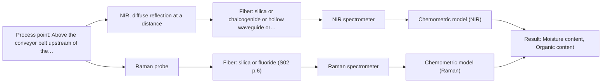
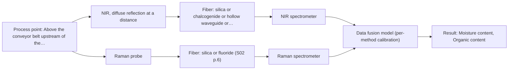

# First technical assessment: Moisture and organic content of soil on a conveyor

## Answer

**Customer request (our summary):** The customer wants to know if continuous fiber optic measurement above or on a conveyor belt can monitor moisture and organic content in lumpy, dark, and highly variable excavated soil, and which method they should test first.

### Brief answer

Yes in principle: a non-contact NIR diffuse-reflection head above the belt is the first method to test, since NIR reads water O-H bands remotely and suits fiber-probe online use. Raman is the second test for organic content, with a fused NIR + Raman model only if single methods fall short. No supplied source covers soil, so feasibility on dark, lumpy material is unproven; accuracy targets, belt geometry and reference methods are still open.

### Proposal

- **Best current option:** O2 (recommended)
- **Basis:** engineering judgement
- **What would change it:** If the remote NIR signal on dark lumpy soil is too weak or the required accuracy for organic content is high, the choice moves to the fused NIR + Raman option (O3) or rules Raman out entirely; belt geometry answers from Q2 may force a near-contact variant.
- **Next step:** Run a bench trial on representative soil loads with a remote NIR diffuse-reflection head and parallel lab reference measurements, before any belt installation.

**Secondary evidence (external, not AFS material):** G1: E05 ¶29, E02 ¶31; G2: no usable external source found; G3: no usable external source found; G4: no usable external source found. See Expert detail.

**Decision status:** Provisional feasibility assessment

### Solution options

| ID | Tier | Methods | Confidence | Cost class, S01 Table 1 (p.6) | Ease of use | Maintenance | Performance fit | Sources |
|---|---|---|---|---|---|---|---|---|
| O1 | Simple | M1 NIR, diffuse reflection at a distance | Medium: open question: Q3 (starts at Medium) | average cost (row 10) | Simple fixed head, no sample contact | Occasional window or optics cleaning | Fits moisture tracking only, before dryer | [1: S01 p.5] [2: S01 p.10] [3: S03 p.7] |
| O2 | Recommended | M1 NIR, diffuse reflection at a distance; M2 Raman probe | Medium: open question: Q3 (starts at Medium) | high cost (rows 10, 12) | Two instruments, moderate integration effort | Per-instrument calibration and diagnostics | Covers both targets with tested single methods | [1: S01 p.5] [2: S01 p.10] [3: S03 p.7] [4: S01 p.16] [5: S01 p.11] |
| O3 | Extended (multi-method) | M3 NIR, diffuse reflection at a distance + Raman (combination) | Low: open question: Q3 (starts at Medium); multi-method, fusion benefit not yet shown | high cost (rows 10, 12) | Most complex, two synchronized channels | Two calibrations, fused model upkeep | Only if fusion beats best single method | [6: S01 p.8] [7: S01 p.8] [8: S01 p.15] [9: S01 p.11] [10: S01 p.7] |

*Confidence rates the basis of the advice (how much is known and cited), not a predicted accuracy or probability of success. It starts at High, or at Medium when a key question on the method or the option is open, and drops one level per weakness listed (floor Low).*

*Cost class is the relative rating in S01 Table 1 (p.6) for the in-line method+technique rows named (the highest one for a multi-method option); it is not a price.*

### Setup sketch

*Recommended option O2; drawn by code from the option, a schematic, not a configuration.*

### Key questions

1. What accuracy and sorting thresholds do you need for moisture and organic content, and what go/no-go criteria should the trial meet?
2. What are the belt speed, belt width and the possible standoff distance and angle for a measurement head above the belt?
3. Which reference laboratory methods can you run for moisture and organic content (e.g. oven drying, loss on ignition), and at what sampling rate?

## Expert detail

**Customer enquiry**

> We process excavated soil on a conveyor belt at a remediation site and want to sort it by moisture and organic content before it reaches the dryer. The soil is lumpy, dark and varies a lot from load to load. Could a fiber optic measurement above or on the belt give us a continuous reading, and which method would you test first?

**Decision status:** Provisional feasibility assessment. A method shortlist can be justified from the sources, but no supplied source covers soil on a belt, so the recommendation rests on stated assumptions and must be confirmed by a trial on representative samples.

### Parameters

| ID | Parameter | Kind | Need | Measured by | Why | Sources |
|---|---|---|---|---|---|---|
| P1 | Moisture content | quantitative | required | Spectroscopy: NIR | Moisture is one of the two sorting targets and the main driver of dryer load. | [3: S03 p.7] |
| P2 | Organic content | quantitative | required | Spectroscopy: Raman | Organic content is the second sorting target and may correlate with NIR and Raman spectral features that must be tested. | *(no verified source: engineering judgement)* |
| P3 | Particle size / lumpiness state | qualitative | optional | Not measurable in-line by spectroscopy; alternative: sieve analysis and visual logging of grabbed samples | Lump size and surface state control scattering and surface representativeness, so it should be logged during the trial to explain model errors. | *(no verified source: engineering judgement)* |

### Solution option details

- **O1 cost drivers:** One NIR spectrometer, remote reflection probe head, mounting, initial calibration samples
- **O2 cost drivers:** NIR and Raman spectrometers with probes, chemometric model building, reference lab sampling campaign
- **O3 cost drivers:** Second spectrometer, synchronisation and fusion software, larger validation campaign
- **O3 combining methods:** Low-level fusion: synchronized NIR reflection and Raman spectra merged into one augmented matrix for a PLS-type model. Both probes must view the same belt spot and the data must be normalized to a common time step, with block scaling so neither method dominates. The fused model must beat the best single-method model on independent loads, otherwise the extra instrument is dropped.

*Extended (multi-method) option O3; drawn by code from the option, a schematic, not a configuration.*

### Premise check

- **Precedent only:** A fiber-optic measurement above or on the belt can give a continuous reading for this material. Remote fiber-probe online measurement is shown for other media (dairy, process lines), never for soil; it is a reason to test, not proof for this application. [11: S01 p.5] [12: S01 p.17]
- **Not covered:** Dark, lumpy, strongly absorbing soil will still return a usable diffuse-reflection signal. No supplied source addresses dark, absorbing granular solids; the screening marks contact diffuse reflection as unknown and this must be tested on real soil. *(no verified source: engineering judgement)*
- **Precedent only:** NIR spectroscopy can track moisture in granular organic-bearing material. NIR water O-H bands and NIR moisture sensing are documented for other matrices (tissue, starch/flour/sugar), supporting a test on soil but not proving performance on it. [3: S03 p.7] [13: S02 p.12]

### Requirements

**Stated by the customer**

- Continuous reading of moisture and organic content on excavated soil on a conveyor belt, before the dryer.
- Soil is lumpy, dark, and varies strongly from load to load.

**Key unknowns**

- Required accuracy and decision thresholds for sorting (go/no-go basis).
- Belt speed, geometry and feasible standoff distance for a non-contact head.
- Available reference methods for moisture and organic content (e.g. oven drying, loss on ignition).
- Particle size distribution and surface wetness of the lumps.
- Whether the organic fraction contains a usable fluorescent indicator.

### Clarification questions (most decision-relevant first)

Q1. What accuracy and sorting thresholds do you need for moisture and organic content, and what go/no-go criteria should the trial meet? *Why it matters:* The go/no-go criteria and the choice between a single method and a combination depend entirely on the required accuracy. *(affects: status)*
Q2. What are the belt speed, belt width and the possible standoff distance and angle for a measurement head above the belt? *Why it matters:* Standoff and speed determine whether a remote reflection head, a near-contact probe or a side-looking geometry is realistic. *(affects: installation)*
Q3. Which reference laboratory methods can you run for moisture and organic content (e.g. oven drying, loss on ignition), and at what sampling rate? *Why it matters:* Calibration and validation of any spectral model need independent reference values on the same material. *(affects: method)*
Q4. What is the particle size range of the lumps, and how wet or crusted are the lump surfaces when they reach the belt? *Why it matters:* Particle size and surface state drive scattering, penetration depth and how representative a surface measurement is of the lump interior. *(affects: technique)*

### Recommendation

- **M1 · Primary candidate: NIR, diffuse reflection at a distance.** NIR diffuse reflection is the only screened option that passes for a non-contact reading over a moving bed, and NIR water O-H bands plus documented NIR moisture sensing make it the natural first test. Its usable range depends on the spectrometer, fiber and probe selected, and a chemometric calibration against lab references is mandatory. [1: S01 p.5] [2: S01 p.10] [3: S03 p.7]
- **M2 · Comparison candidate: Raman probe.** Raman gives a molecular fingerprint that can address organic content specifically, and it tolerates water better than infrared methods. Its weak signal and possible fluorescence background must be checked on the dark soil itself. *Conditions:* Test after or alongside M1 on the same samples; expect possible fluorescence interference from organic matter. [4: S01 p.16] [5: S01 p.11]
- **M3 · Conditional candidate: NIR, diffuse reflection at a distance + Raman (combination).** If NIR alone cannot separate moisture from organic-content variation in the calibration, a fused NIR + Raman model is the next hypothesis, since the two methods carry complementary information. Any fusion gain must be demonstrated against the best single method on independent loads. *Conditions:* Only if the single-method NIR calibration misses the required accuracy for organic content (Q1). [9: S01 p.11] [10: S01 p.7] Later hypothesis, after single-method tests.
- **M4 · Not recommended: MIR, ATR probe.** ATR needs tight contact and suits liquids, pastes and soft solids, and it samples only a surface layer of a few micrometres, so it cannot read a moving bed of lumpy soil. A reader might expect MIR-ATR for moisture, but the screening fails it for this sample. [14: S04 p.4] [15: S01 p.13]
- **M5 · Not recommended: NIR, transmission/transflection probe.** Transmission or transflection through a lumpy, opaque bed fails because light cannot penetrate the sample; the screening fails it for this solid, opaque material. [16: S01 p.18]

### Measurement concept

- **Probe and geometry:** Non-contact NIR diffuse-reflection head (illumination fibers and collection fibers in one housing) mounted above the belt at a fixed standoff, looking at the top surface of the bed; a Raman probe at the same spot is a later comparison.
- **Location:** Above the conveyor belt upstream of the dryer.
- **Fiber link:** Vis-NIR silica fibers cover the NIR range; for any Raman extension, metal-coated silica fibers avoid polymer-jacket fluorescence. No link length can be stated from the sources for this configuration. [17: S02 p.6] [18: S02 p.7]

### Spectral range

- **NIR:** Nominal NIR range 780-2500 nm; the usable range depends on the spectrometer, Vis-NIR silica fiber and probe head actually selected. [19: S01 p.10]
- **Raman:** Raman is reported as Raman shift in cm-1 with the laser excitation wavelength stated separately; the working range depends on the chosen laser and probe. [20: S01 p.11]

### Risks and uncertainty

- Dark, wet, absorbing lumps may reflect too little light for a remote NIR head at practical standoff, which no supplied source rules in or out. *(rules: R-GEO-6)* *(no verified source: engineering judgement)*
- A surface reflection reading sees only the outer layer of each lump, so surface wetness or crusting may not represent the lump interior. *(rules: R-GEO-6, R-GEN-5)* [21: S01 p.17]
- Load-to-load variation in mineralogy and particle size can shift the calibration, which is matrix-specific and must be re-validated after material changes. *(rules: R-CAL-1)* *(no verified source: engineering judgement)*
- Raman on dark soil may be swamped by fluorescence from the organic matter, eliminating M2 and M3. *(rules: R-RAM-1)* *(no verified source: engineering judgement)*

### First feasibility experiment

1. **Collect representative soil samples across varying moisture levels, organic content, and lump sizes from multiple site loads.** Capture the full chemical, mineralogical, and physical variability expected in the field. [22: REF §3]
2. **Perform non-contact NIR diffuse reflection and Raman probe measurements on static and agitated soil samples.** Evaluate diffuse reflection signal intensity on dark absorbing soil and assess potential fluorescence background. *(no verified source: engineering judgement)*
3. **Measure moisture and organic content on the same sample aliquots using independent reference laboratory methods.** Establish primary analytical reference values for multivariate calibration. *(no verified source: engineering judgement)*
4. **Construct and validate multivariate calibration models on held-out sample batches, testing single methods before data fusion.** Assess whether single-method NIR or Raman meets performance requirements on independent loads. *(no verified source: engineering judgement)*

**Reference measurements:** Standard laboratory reference procedures such as oven drying for moisture determination and loss-on-ignition or combustion analysis for total organic content.

**Decision basis:** Agreement of predicted moisture and organic content with laboratory reference values against customer-specified sorting criteria, while confirming sufficient optical signal from dark soil.

### Assumptions

- The organic content target means total organic matter, not one specific compound.
- A fixed head above the belt with a stable standoff is mechanically possible (Q2).
- Laboratory reference measurements on grabbed belt samples are available (Q3).

### Not covered by the supplied sources

- No supplied source describes spectroscopy of excavated or remediation soil; all precedents are dairy, pharma, bioprocess or tissue.
- No source gives achievable accuracy, standoff distance or acquisition rate for reflection measurement of dark granular solids on a belt.

### Further notes

- **Chemometrics:** Both moisture and organic content will require PLS-type calibration models against independent lab references; with strong load-to-load variation, validate on held-out loads and re-validate after any change in soil source, per the matrix-specific calibration limits of NIR and Raman.
- **Real-time tracking:** The goal is a continuous reading on a moving bed; acquisition rate must match belt speed so each spectrum corresponds to a defined belt section, and scatter-correction preprocessing (e.g. SNV/MSC-type) should be tested because physical variation can mimic composition change.
- **Future direction:** If the trial succeeds, a simplified multi-wavelength LED-type sensor in the informative NIR bands could later replace the full spectrometer for routine sorting, following the published LED-sensor simplification approach.

### Secondary evidence (external, not AFS material)

*Found by a literature search for gaps the supplied AFS sources leave open. Not AFS material and not proof for this case; every quote below was verified verbatim against the fetched text.*

**G1 · multi-method:** Combining several spectroscopy methods (data fusion) (Low-level fusion: synchronized NIR reflection and Raman spectra merged into one augmented matrix for a PLS-type model. Both probes must view the same belt spot and the data must be normalized to a common time step, with block scaling so neither method dominates. The fused model must beat the best single-method model on independent loads, otherwise the extra instrument is dropped.)

- **E05 ¶29** Multi-sensor fusion does not automatically improve results, as effectiveness depends on mutual correction and complementarity among sensors rather than their sheer number. *How it applies:* This suggests that before committing to a multi-method setup, testing should verify whether combining NIR and Raman actually improves predictions over a single method. *Limits and transfer risks:* The cited study evaluated food and biological samples rather than heterogeneous excavated soil on an industrial conveyor belt, so complementarity may differ. *(supports O3)*
  > "It is noteworthy that the effectiveness of multi-sensor fusion does not increase proportionally with the number of sensors; rather, it hinges on mutual correction and complementarity among different sensors."
  > Advancing Egg Freshness Evaluation with Integrated AI and Spectroscopy. (2026) · Foods (Basel, Switzerland) · doi:10.3390/foods15132259 · https://europepmc.org/article/PMC/PMC13361683 · retrieved 2026-10-18, full text, licence: cc by, via europepmc
- **E02 ¶31** Low-level data fusion rearranges data from different sources into a new augmented matrix where variables are placed sequentially. *How it applies:* This provides a baseline approach for data alignment if synchronized NIR and Raman spectra are tested together on the belt. *Limits and transfer risks:* This concept comes from general pharmaceutical and analytical data reviews rather than a moving, lumpy solid material stream. *(supports O3)*
  > "Low-level data fusion (LLDF) is considered the simplest method to achieve a combination of inputs. In this case, the data is rearranged into a new data matrix, where the variables coming from different sources are placed one after the other."
  > Challenges and Opportunities of Implementing Data Fusion in Process Analytical Technology-A Review. (2022) · Molecules (Basel, Switzerland) · doi:10.3390/molecules27154846 · https://europepmc.org/article/PMC/PMC9369811 · retrieved 2026-10-17, full text, licence: cc by, via curated library

**G2 · not in the supplied sources:** No supplied source describes spectroscopy of excavated or remediation soil; all precedents are dairy, pharma, bioprocess or tissue.

- No usable external source found.

**G3 · not in the supplied sources:** No source gives achievable accuracy, standoff distance or acquisition rate for reflection measurement of dark granular solids on a belt.

- No usable external source found.

**G4 · premise not covered:** Dark, lumpy, strongly absorbing soil will still return a usable diffuse-reflection signal.

- No usable external source found.

### Evidence (verified quotes)

1. ✓ **S01 p.5** (general): "NIR spectroscopy, with its relatively large penetration depth (up to several millimetres) even into dense solid samples due to low absorption and strong scattering, allows the use of ordinary glass for optics"
2. ✓ **S01 p.10** (general): "The broad absorption bands observed in this region overlap, suggesting the use of chemometrics for quantitative and qualitative analysis of spectral data."
3. ✓ **S03 p.7** (general): "the latter is known to include intensive second overtones of O-H bond vibrations in both lipids and water"
4. ✓ **S01 p.16** (general): "Raman is particularly well-suited for aqueous environments, as it exhibits low absorbance for water molecules compared to infrared methods."
5. ✓ **S01 p.11** (general): "superposition of luminescence (fluorescence), which has a significantly higher intensity."
6. ✓ **S01 p.8** (general): "the data from each method must be obtained simultaneously."
7. ✓ **S01 p.8** (general): "the measurement data must be normalized to a common time step."
8. ✓ **S01 p.15** (application precedent): "Data processing for pharmaceutical tasks relies on "low-level data fusion," where the synchronized NIR and Raman spectra are merged into a single augmented matrix."
9. ✓ **S01 p.11** (general): "This property makes mid-IR and Raman spectra complementary, that is, they complement each other."
10. ✓ (precedent only) **S01 p.7** (method gain): "The analysis of such systems may require a combination of two or even more spectral methods."
11. ✓ **S01 p.5** (general): "making it ideal for online applications, including remote measurements via fiber optic probes."
12. ✓ **S01 p.17** (application precedent): "the probe is flush-mounted into a pipe or vat to interact directly with the flowing medium."
13. ✓ **S02 p.12** (application precedent): "IoT Concept of NIR-LED Fiber Sensor to control Moisture Level"
14. ✓ **S04 p.4** (general): "suitability of analyzed samples for ATR measurements, which is true for liquid or soft solid samples and their components, allowing a tight contact with the probe head."
15. ✓ **S01 p.13** (general): "typically at a depth of few microns"
16. ✓ **S01 p.18** (general): "it fails when the milk becomes too "thick" or fat-rich, as the light cannot penetrate the sample."
17. ✓ **S02 p.6** (general): "350 nm Standard VIS-NIR Silica Fibers Al/Cu-coated VIS-NIR Silica Fibers 2400 nm"
18. ✓ **S02 p.7** (general): "Free of Polymer jacket fluorescence for Raman and Fluo- Spectroscopy"
19. ✓ **S01 p.10** (general): "NIR spectra (780-2500 nm) contain predominantly overtones and component bands of fundamental vibrations"
20. ✓ **S01 p.11** (general): "The Raman shift is used as the horizontal (spectral) axis in Raman spectroscopy"
21. ✓ **S01 p.17** (general): "the method is sensitive to the surface characteristics and fat globule size."
22. ✓ **REF §3** (general): "Representative samples or process states, independent reference measurements, what is compared, and the basis for the go / no-go decision."

### Verification

- Citations verified: 24 of 24 (exact or whitespace/hyphen-tolerant match on the cited page, scope checked).
- Hard check failures before deterministic corrections: 0; still open: 0; soft warnings: 1; repair rounds: 1.
- Corrected deterministically after verification (1):
  - ⚠ recommendations[2].combined_with: combined_with normalised to ['Raman'] (duplicates and the entry's own method removed)
- External evidence (live): 2 quote(s) verified verbatim (exact or whitespace/hyphen-tolerant, at most 400 characters and 2 sentences, against the cited paragraph); 0 item(s) dropped.
- External search: 3 query(ies), 25 hit(s), 5 source(s) (3 from the curated library).
- External step: 2 model call(s), 5.6 s extra (cost in the run JSON).

*Run A01-20261018T094733Z-12db · models google/gemini-3.5-flash-lite, google/gemini-3.8-flash, z-ai/glm-5.3-flash*
