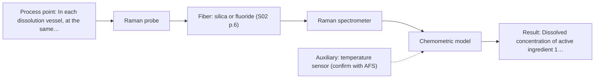
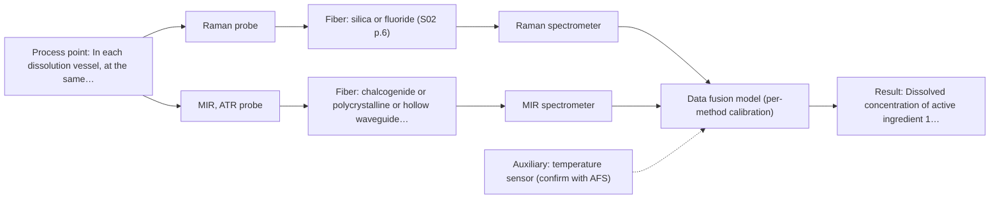

# First technical assessment: Two active ingredients during tablet dissolution

## Answer

**Customer request (our summary):** Customer wants to replace or supplement manual HPLC sampling in dissolution testing with in-line fiber probes to follow dissolution of two active ingredients over time.

### Brief answer

A feasibility verdict is not possible from the available information alone; it needs a trial on your samples. Test single-method fiber probes first - Raman, mid-IR ATR, and UV-Vis ATR if both actives absorb - against your HPLC reference. Still open: whether one method can resolve both actives, and whether a probe can be fitted without changing the test.

### Proposal

- **Best current option:** O2 (recommended)
- **Basis:** engineering judgement
- **What would change it:** Answers on the actives and the medium, and the trial results, would change the choice: a weak or fluorescent Raman response and a clear, low-absorbance medium would favour MIR ATR or UV-Vis, while overlap that no single method resolves would move the case to the combined Raman + MIR ATR option.
- **Next step:** Run the single-method trial on representative dissolution samples against the existing HPLC reference before any probe is installed in a vessel.

**Secondary evidence (external, not AFS material):** G1: E01 ¶12; G2: no usable external source found; G3: E02 ¶31, E02 ¶36; G4: no usable external source found. See Expert detail.

**Decision status:** Provisional feasibility assessment

### Solution options

| ID | Tier | Methods | Confidence | Cost class, S01 Table 1 (p.6) | Ease of use | Maintenance | Performance fit | Sources |
|---|---|---|---|---|---|---|---|---|
| O1 | Simple | M2 MIR, ATR probe | Low: open question: Q1 (starts at Medium); uncited auxiliary sensor | high cost (row 2) | One contact probe, simple sampling | Crystal cleaning and fouling checks | Single probe with sharp, selective mid-IR bands | [1: S01 p.9] [2: S01 p.5] [3: S01 p.11] |
| O2 | Recommended | M1 Raman probe | Low: open question: Q1 (starts at Medium); uncited auxiliary sensor | high cost (row 12) | Single immersion probe, no reagents | Laser, probe and calibration checks | Best fit for an aqueous medium and two actives | [4: S01 p.16] [5: S01 p.12] |
| O3 | Extended (multi-method) | M1 Raman probe; M2 MIR, ATR probe | Low: open question: Q1 (starts at Medium); uncited auxiliary sensor; multi-method, fusion benefit not yet shown | high cost (rows 2, 12) | Two instruments, one combined probe | Two calibrations and two diagnostics | Adds mid-IR selectivity if one method fails | [6: S01 p.8] [7: S01 p.9] [4: S01 p.16] [5: S01 p.12] [1: S01 p.9] [2: S01 p.5] [3: S01 p.11] |

*Confidence rates the basis of the advice (how much is known and cited), not a predicted accuracy or probability of success. It starts at High, or at Medium when a key question on the method or the option is open, and drops one level per weakness listed (floor Low).*

*Cost class is the relative rating in S01 Table 1 (p.6) for the in-line method+technique rows named (the highest one for a multi-method option); it is not a price.*

### Setup sketch

*Recommended option O2; drawn by code from the option, a schematic, not a configuration.*

### Key questions

1. What are the two active ingredients, and at what concentrations do they appear in the dissolution medium?
2. What is the dissolution medium (buffer, pH, surfactants), and is it clear or turbid during the run?
3. Do both actives absorb in the UV-Vis region, and does any component of the formulation fluoresce?

## Expert detail

**Customer enquiry**

> In our quality control laboratory we run dissolution tests on a tablet that releases two active ingredients. Today we draw samples from each vessel by hand at fixed times and analyse them by HPLC. We would like fiber probes in the vessels to follow how much of each ingredient has dissolved over time. Is that feasible, and what should we check first?

**Decision status:** Provisional feasibility assessment. Raman, mid-IR ATR and UV-Vis ATR are each plausible single-method candidates for a dissolution medium, so a conditional shortlist is defensible. However, the two actives, the medium and the required performance are unknown, and no supplied source covers in-line probes in a dissolution vessel, so the shortlist stays conditional on the answers to the questions below.

### Parameters

| ID | Parameter | Kind | Need | Measured by | Why | Sources |
|---|---|---|---|---|---|---|
| P1 | Dissolved concentration of active ingredient 1 | quantitative | required | Spectroscopy: Raman | It is one of the two quantities the dissolution profile must report over time. | *(no verified source: engineering judgement)* |
| P2 | Dissolved concentration of active ingredient 2 | quantitative | required | Spectroscopy: Raman | It is the second quantity the profile must report, and both actives must be separated in the same measurement. | *(no verified source: engineering judgement)* |
| P3 | Temperature of the dissolution medium | quantitative | required | Auxiliary sensor: temperature sensor (engineering judgement: confirm availability with AFS) | Dissolution rate and the vibrational spectra both depend on temperature, so it is needed to compare runs and interpret the spectra. | *(no verified source: engineering judgement)* |
| P4 | Turbidity (optical density) of the dissolution medium | quantitative | optional | Auxiliary sensor: turbidity sensor (engineering judgement: confirm availability with AFS) | It decides whether a transmission path or a short ATR path is usable, and it changes during the run as excipients dissolve, so it should be available from the apparatus or from a separate turbidity reading. | *(no verified source: engineering judgement)* |

### Solution option details

- **O1 cost drivers:** Mid-IR spectrometer, ATR probe, mid-IR fiber, calibration
- **O2 cost drivers:** Raman spectrometer, laser, fiber probe, calibration
- **O3 cost drivers:** Two spectrometers, combined probe, data fusion, two calibrations
- **O3 combining methods:** Low-level fusion of the two spectral blocks, with one calibration per method as the baseline. Both probes must look at the same small volume and the two data streams must be aligned to a common time step. The fused model must beat the best single method on held-out runs, otherwise the extra instrument is not kept.

*Extended (multi-method) option O3; drawn by code from the option, a schematic, not a configuration.*

### Premise check

- **Precedent only:** In-line fiber probes in the vessels can follow how much of each of the two active ingredients has dissolved over time. A source shows in-line fiber-probe determination of active-ingredient concentration in pharmaceutical manufacturing, which is a reason to test the same approach here, but it is not a dissolution vessel and not a two-active tablet. [8: S01 p.14]
- **Precedent only:** Both active ingredients can be measured simultaneously in the dissolution medium. A source shows Raman detecting several dissolved species in one aqueous reactor measurement, which supports the idea, but it is a bioprocess precedent and not proof for a two-active dissolution medium. [9: S01 p.16]
- **Not covered:** In-line fiber probes can be installed in the dissolution vessels without disrupting the quality-control dissolution test. No supplied source addresses probe installation in a dissolution apparatus or the effect of a probe on the official test. *(no verified source: engineering judgement)*

### Requirements

**Stated by the customer**

- "In our quality control laboratory"
- "we run dissolution tests"
- "on a tablet"
- "that releases two active ingredients"
- "Today we draw samples from each vessel by hand at fixed times"
- "analyse them by HPLC"
- "fiber probes in the vessels"
- "follow how much of each ingredient has dissolved over time"
- "Is that feasible"
- "what should we check first"
- "two active ingredients"
- "how much of each ingredient has dissolved over time"
- "dissolution tests on a tablet that releases two active ingredients"

**Key unknowns**

- Identity and concentration range of the two active ingredients.
- Dissolution medium composition (buffer, pH, surfactants) and its optical clarity during the run.
- Whether both actives absorb in the UV-Vis region and whether any component fluoresces.
- Required accuracy, precision, detection limit and sampling interval.
- Vessel geometry and whether a probe can be fitted without changing the official test.
- Excipient load, undissolved particles and probe fouling/cleaning.

### Clarification questions (most decision-relevant first)

Q1. What are the two active ingredients, and at what concentrations do they appear in the dissolution medium? *Why it matters:* Their structure and concentration decide which method can see them and at what sensitivity. *(affects: method)*
Q2. What is the dissolution medium (buffer, pH, surfactants), and is it clear or turbid during the run? *Why it matters:* It sets the spectral background and whether a transmission path or a short ATR path is usable. *(affects: technique)*
Q3. Do both actives absorb in the UV-Vis region, and does any component of the formulation fluoresce? *Why it matters:* It decides whether the UV-Vis entry (M3) applies and whether fluorescence background will limit Raman. *(affects: M3)*
Q4. What accuracy, precision, sampling interval and detection limit must the in-line measurement meet, and are there regulatory requirements for the dissolution test? *Why it matters:* These are the go/no-go criteria and they can rule a method in or out. *(affects: status)*
Q5. Can a probe be placed in each vessel without changing the official dissolution test, and how will probes be cleaned between runs? *Why it matters:* Installation, cleaning and fouling decide whether in-line measurement is compatible with the quality-control test. *(affects: installation)*

### Recommendation

- **M1 · Primary candidate: Raman probe.** Raman tolerates an aqueous medium better than infrared methods and its response is linear over a wide concentration range, so a time-resolved profile of a dissolved active is a reasonable hypothesis to test. It also gives a molecular fingerprint that can support quantification of more than one dissolved species. *Conditions:* Applies if both actives give distinguishable Raman bands above the fluorescence background of the medium and excipients. [4: S01 p.16] [5: S01 p.12]
- **M2 · Comparison candidate: MIR, ATR probe.** Mid-IR gives well-defined absorption bands and high selectivity, which helps to separate two structurally similar actives, and an ATR probe keeps the probed layer thin enough for an aqueous medium. Mid-IR and Raman spectra are complementary, so this is the natural cross-check on the primary method. *Conditions:* Applies if the medium and actives tolerate contact with the ATR crystal and undissolved excipient particles do not foul it. [1: S01 p.9] [2: S01 p.5] [3: S01 p.11]
- **M3 · Conditional candidate: UV-Vis, ATR probe.** UV-Vis is very sensitive where the actives absorb, and a short ATR path can measure media that a transmission cell finds too optically dense. It applies only if both actives have usable UV-Vis absorbance; their bands may overlap, so quantification would rest on chemometrics. *Conditions:* Applies only if both actives absorb in the UV-Vis region and the medium is optically dense or scattering enough to favour ATR over a transmission path. [10: S01 p.5] [11: S01 p.5] [12: S01 p.16]

### Measurement concept

- **Probe and geometry:** Single immersion probe per vessel; ATR contact geometry for MIR and UV-Vis, a Raman immersion probe for the Raman route. No geometry is fixed until the medium's optical state is known.
- **Location:** In each dissolution vessel, at the same sampling position for every method and for the reference sample.
- **Fiber link:** Fiber family and usable length follow from the method chosen and the probe configuration; no link length is assumed here. [13: S01 p.10]

### Spectral range

- **Raman:** Raman shift is reported in cm-1 and the laser excitation wavelength is stated separately; the usable range depends on the instrument, fiber and probe actually selected. [14: S01 p.11] [15: REF §5]
- **MIR:** Nominal mid-IR range 4000-400 cm-1; usable coverage is set by the fiber and ATR crystal selected. [1: S01 p.9]
- **UV-Vis:** Nominal UV-Vis range depends on the target absorbance and the setup; the usable range is set by the instrument, fiber and probe selected. [16: REF §3]

### Risks and uncertainty

- One method may not separate the two actives if their spectra overlap strongly, which is why the combined option is kept as a later hypothesis. *(rules: R-CMB-1)* [17: REF §5]
- The Raman signal may be weak or swamped by fluorescence from the medium, actives or excipients at the concentrations used. *(rules: R-RAM-1)* [18: S01 p.11]
- An ATR probe samples only a thin surface layer and can foul with undissolved excipient particles, biasing readings during the run. *(rules: R-MIR-3)* [19: S01 p.13]
- The calibration is specific to the sample matrix, so a change of medium, surfactant or excipient lot can invalidate it. *(rules: R-CAL-1)* [20: REF §5]

### First feasibility experiment

1. **Assemble representative samples across the expected chemical and physical variation: dissolution medium spiked with each active over the expected concentration range, plus timed samples from real dissolution runs, including the early turbid phase if undissolved excipients are present.** Representative samples and process states. [21: REF §3]
2. **Measure every sample with the single methods first - Raman and MIR ATR, and UV-Vis ATR if both actives absorb - before any combination is tried.** Single methods before any combination. *(no verified source: engineering judgement)*
3. **Take independent reference values with the existing HPLC method on split samples at the same time points.** Independent reference measurement. [22: REF §3]
4. **Compare each single method with the HPLC reference and fix numerical go/no-go criteria with the customer; only if no single method resolves both actives, test a combined Raman + MIR ATR probe at the same spot and on a common time step against the best single method.** Comparison and go/no-go basis. [23: REF §3] [24: S01 p.8] [17: REF §5]
5. **Validate the chosen model on held-out runs or batches that were not used for calibration.** Validation on held-out runs. *(no verified source: engineering judgement)*

**Reference measurements:** HPLC reference on split samples at the same time points

**Decision basis:** Provisional shortlist; final method depends on answers to the clarification questions.

### Assumptions

- The dissolution medium is water-based, as is typical for dissolution testing; this is not yet stated by the customer.
- The two actives are present in the medium at concentrations above the detection capability of at least one of the shortlisted methods; not yet known.
- A probe can be placed in each vessel without altering the official dissolution test; not yet confirmed.

### Not covered by the supplied sources

- In-line fiber-probe measurement inside a dissolution test vessel: no supplied source covers this application.
- Regulatory acceptance of an in-line fiber measurement for quality-control dissolution testing: not covered.
- Fitting a probe to a dissolution apparatus and its effect on the official test: not covered.

### Further notes

- **Chemometrics:** Quantifying either active from these methods needs a chemometric calibration built on reference values from the customer's own medium, because the model is specific to the sample matrix and must be re-validated when the medium or excipient lot changes.
- **Real-time tracking:** The probes are meant to give a continuous, time-resolved profile of both actives during each run, which is the reason for replacing fixed-time manual sampling.
- **Future direction:** If a full-spectrum method proves workable, a reduced-channel sensor for routine control could be a later development step.

### Secondary evidence (external, not AFS material)

*Found by a literature search for gaps the supplied AFS sources leave open. Not AFS material and not proof for this case; every quote below was verified verbatim against the fetched text.*

**G1 · auxiliary sensor:** In-line measurement of Temperature of the dissolution medium with temperature sensor

- **E01 ¶12** The source notes that OH band temperature sensitivity is a severe drawback for aqueous NIR and MIR measurements, making tempered sample holders necessary. *How it applies:* For MIR ATR (O1), this suggests temperature control of the sample is important; a temperature sensor could help monitor or control the dissolution medium. *Limits and transfer risks:* The statement concerns NIR/MIR aqueous measurements and tempered sample holders, not an in-line temperature sensor in a dissolution vessel. *(supports O1)*
  > "Additionally, the temperature sensitivity of the OH bands is a severe drawback for measuring aqueous solution in NIR and MIR, which makes tempered sample holders necessary [29]."
  > A critical review of recent trends, and a future perspective of optical spectroscopy as PAT in biopharmaceutical downstream processing. (2020) · Analytical and bioanalytical chemistry · doi:10.1007/s00216-020-02407-z · https://europepmc.org/article/PMC/PMC7072065 · retrieved 2026-10-17, full text, licence: cc by, via curated library

**G2 · auxiliary sensor:** In-line measurement of Turbidity (optical density) of the dissolution medium with turbidity sensor

- No usable external source found.

**G3 · multi-method:** Combining several spectroscopy methods (data fusion) (Low-level fusion of the two spectral blocks, with one calibration per method as the baseline. Both probes must look at the same small volume and the two data streams must be aligned to a common time step. The fused model must beat the best single method on held-out runs, otherwise the extra instrument is not kept.)

- **E02 ¶31** Low-level data fusion is described as the simplest way to combine inputs by rearranging variables from different sources into one new data matrix. *How it applies:* Supports O3's low-level fusion baseline; test that Raman and MIR variables are placed in a common matrix and aligned to a common time step. *Limits and transfer risks:* This is a general PAT review, not a dissolution study or a specific probe setup; it does not detail time alignment or small-volume sampling. *(supports O3)*
  > "Low-level data fusion (LLDF) is considered the simplest method to achieve a combination of inputs. In this case, the data is rearranged into a new data matrix, where the variables coming from different sources are placed one after the other."
  > Challenges and Opportunities of Implementing Data Fusion in Process Analytical Technology-A Review. (2022) · Molecules (Basel, Switzerland) · doi:10.3390/molecules27154846 · https://europepmc.org/article/PMC/PMC9369811 · retrieved 2026-10-17, full text, licence: cc by, via curated library
- **E02 ¶36** The source reports that in some cases instrument complementarity alone did not improve prediction of several CQAs, citing a Raman and FT-IR food study. *How it applies:* For O3, this is a reason to verify on held-out runs that the fused model beats the best single method before keeping the extra instrument. *Limits and transfer risks:* The cited study is food analytical, not dissolution; it used Raman and FT-IR, not necessarily Raman and MIR ATR, and was laboratory-based. *(supports O3)*
  > "In some situations, instrument complementarity (not data complementarity) was not sufficient to improve the performance of predictive several CQAs, as shown by a Raman and FT-IR data based food analytical study [73]."
  > Challenges and Opportunities of Implementing Data Fusion in Process Analytical Technology-A Review. (2022) · Molecules (Basel, Switzerland) · doi:10.3390/molecules27154846 · https://europepmc.org/article/PMC/PMC9369811 · retrieved 2026-10-17, full text, licence: cc by, via curated library

**G4 · not in the supplied sources:** In-line fiber-probe measurement inside a dissolution test vessel: no supplied source covers this application.

- No usable external source found.

### Evidence (verified quotes)

1. ✓ **S01 p.9** (general): "Vibrational spectroscopy in the mid-IR range (4000-400 cm-1) is one of the most informative methods of chemical analysis."
2. ✓ **S01 p.5** (general): "strong absorption in the mid-IR region limits the corresponding spectral method to the analysis of very thin samples (usually less than 50 μm), but it opens up the possibility of using attenuated total reflectance (ATR)"
3. ✓ **S01 p.11** (general): "This property makes mid-IR and Raman spectra complementary, that is, they complement each other."
4. ✓ **S01 p.16** (general): "Raman is particularly well-suited for aqueous environments, as it exhibits low absorbance for water molecules compared to infrared methods."
5. ✓ **S01 p.12** (general): "dependence on concentration is linear over a wide range of intensities."
6. ✓ **S01 p.8** (general): "Ultimately, the measurement data must be normalized to a common time step."
7. ✓ **S01 p.9** (general): "One of the challenges of multispectral analysis is the need to simultaneously connect at least two independently operating measuring instruments."
8. ✓ **S01 p.14** (application precedent): "The primary objective is to determine "blend potency" - the precise concentration and uniformity of the Active Pharmaceutical Ingredient (API) - directly within the production line, specifically in the feed frame of a rotary tablet press."
9. ✓ **S01 p.16** (application precedent): "Raman spectroscopy can be used in the same reactor to provide a "molecular fingerprint" for direct detection of specific metabolites like glucose, acetate, or lactate."
10. ✓ **S01 p.5** (general): "It has very high sensitivity, especially in the UV region (190-360 nm)"
11. ✓ **S01 p.5** (general): "the strong overlap of spectral signals in UV spectra complicates the analysis of real samples"
12. ✓ **S01 p.16** (general): "extremely short path length that enables the measurement of "black" or highly scattering fluids without dilution."
13. ✓ **S01 p.10** (general): "ATR fiber probes (Fig.1) enable the analysis of liquids and solid elastic samples"
14. ✓ **S01 p.11** (general): "The Raman shift is used as the horizontal (spectral) axis in Raman spectroscopy"
15. ✓ **REF §5** (general): "It is not a product specification: actual spectral coverage, fiber length, component ratings, detection limits and accuracy depend on the configuration and the sample."
16. ✓ **REF §3** (general): "A nominal method range is not the range of a specific instrument, fiber or probe."
17. ✓ **REF §5** (general): "compare with the best single method."
18. ✓ **S01 p.11** (general): "superposition of luminescence (fluorescence), which has a significantly higher intensity."
19. ✓ **S01 p.13** (general): "typically at a depth of few microns"
20. ✓ **REF §5** (general): "calibration specific to the matrix."
21. ✓ **REF §3** (general): "Representative samples or process states, independent reference measurements, what is compared, and the basis for the go / no-go decision."
22. ✓ **REF §3** (general): "independent reference measurements"
23. ✓ **REF §3** (general): "the basis for the go / no-go decision."
24. ✓ **S01 p.8** (general): "It is crucial that the spectral information obtained by different methods-Mid-IR, NIR, Raman, and fluorescence spectra-is collected from the same small, even pinpoint, area of the sample."

### Verification

- Citations verified: 26 of 26 (exact or whitespace/hyphen-tolerant match on the cited page, scope checked).
- Hard check failures before deterministic corrections: 0; still open: 0; soft warnings: 1; repair rounds: 1.
- External evidence (live): 3 quote(s) verified verbatim (exact or whitespace/hyphen-tolerant, at most 400 characters and 2 sentences, against the cited paragraph); 0 item(s) dropped.
- External search: 6 query(ies), 0 hit(s), 3 source(s) (3 from the curated library).
- External step: 2 model call(s), 123.4 s extra (cost in the run JSON).

*Run A02-20261017T231620Z · models deepseek/deepseek-v4.1-flash*
