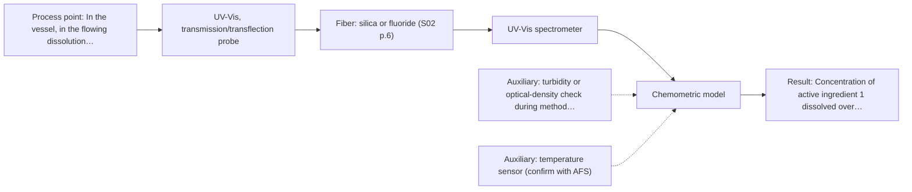
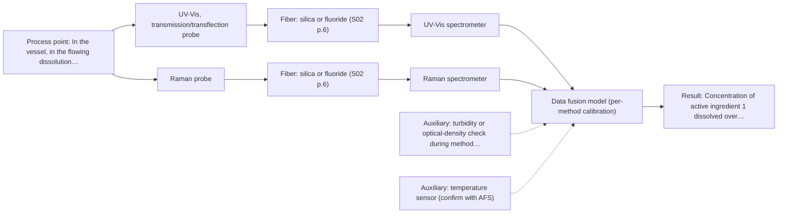

# First technical assessment: Two active ingredients during tablet dissolution

## Answer

**Customer request (our summary):** The customer wants to know if fiber probes can be used in dissolution vessels to monitor the release of two active ingredients over time.

### Brief answer

Yes, in-vessel fiber monitoring is worth testing, but nothing in the supplied material covers dissolution testing specifically, so this is a feasibility question, not an off-the-shelf answer. Test a UV-Vis transmission probe first, with Raman as comparison, calibrating both against your existing HPLC samples. Open points: medium clarity, spectral separation of the two actives, and the accuracy you require.

### Proposal

- **Best current option:** O2 (recommended)
- **Basis:** engineering judgement
- **What would change it:** If the medium turns out turbid or strongly absorbing, the geometry moves to ATR or reflection; if the two actives overlap in UV-Vis, the extended UV-Vis plus Raman option becomes the lead.
- **Next step:** Run feasibility tests measuring spectra of each active ingredient and placebo medium in the vessel, with parallel HPLC reference sampling.

**Secondary evidence (external, not AFS material):** G1: no usable external source found; G2: no usable external source found; G3: E04 ¶1; G4: no usable external source found. See Expert detail.

**Decision status:** Provisional feasibility assessment

### Solution options

| ID | Tier | Methods | Confidence | Cost class, S01 Table 1 (p.6) | Ease of use | Maintenance | Performance fit | Sources |
|---|---|---|---|---|---|---|---|---|
| O1 | Simple | M2 Raman probe | Medium: open question: Q2 (starts at Medium) | high cost (row 12) | Probe in vessel, straightforward operation | Low; probe window cleaning between runs | Aqueous-tolerant molecular specificity for hard-to-separate actives | [1: S01 p.16] [2: S01 p.11] |
| O2 | Recommended | M1 UV-Vis, transmission/transflection probe | Low: open question: Q2 (starts at Medium); sample clarity unknown; uncited auxiliary sensor | low cost (row 16) | Simple immersion probe, fast acquisition | Low; pathlength fixed, routine cleaning | High sensitivity for concentration profiling if medium stays clear | [3: S01 p.5] [4: S01 p.5] [5: S01 p.18] |
| O3 | Extended (multi-method) | M3 UV-Vis, transmission/transflection probe + Raman (combination) | Low: open question: Q2 (starts at Medium); sample clarity unknown; uncited auxiliary sensor; multi-method, fusion benefit not yet shown | high cost (rows 12, 16) | Two instruments and probes to operate | Higher; two calibrations and two diagnostics to maintain | Covers overlapping actives that one method cannot separate | [6: S01 p.8] [7: S01 p.8] [8: S01 p.7] [9: S01 p.11] |

*Confidence rates the basis of the advice (how much is known and cited), not a predicted accuracy or probability of success. It starts at High, or at Medium when a key question on the method or the option is open, and drops one level per weakness listed (floor Low).*

*Cost class is the relative rating in S01 Table 1 (p.6) for the in-line method+technique rows named (the highest one for a multi-method option); it is not a price.*

### Setup sketch

*Recommended option O2; drawn by code from the option, a schematic, not a configuration.*

### Key questions

1. What is the dissolution medium (aqueous or organic, with surfactants or excipients), and how optically clear is it during the test?
2. Do the two active ingredients have distinct, non-overlapping absorption (or Raman) features in the medium, and at what concentrations must each be quantified?
3. What accuracy do you need against HPLC, and is the goal a development tool or a GMP replacement for the manual HPLC sampling?

## Expert detail

**Customer enquiry**

> In our quality control laboratory we run dissolution tests on a tablet that releases two active ingredients. Today we draw samples from each vessel by hand at fixed times and analyse them by HPLC. We would like fiber probes in the vessels to follow how much of each ingredient has dissolved over time. Is that feasible, and what should we check first?

**Decision status:** Provisional feasibility assessment. Fiber-probe monitoring of liquids in vessels is supported as a demonstrated approach, but nothing in the supplied material covers dissolution testing specifically, and the optical properties of the medium and the spectral separation of the two ingredients are unknown, so the shortlist is conditional.

### Parameters

| ID | Parameter | Kind | Need | Measured by | Why | Sources |
|---|---|---|---|---|---|---|
| P1 | Concentration of active ingredient 1 dissolved over time | quantitative | required | Spectroscopy: UV-Vis | This is the first of the two quantities the customer wants to follow in the vessel. | *(no verified source: engineering judgement)* |
| P2 | Concentration of active ingredient 2 dissolved over time | quantitative | required | Spectroscopy: UV-Vis | This is the second quantity the customer wants to follow; its separability from P1 decides the method choice. | *(no verified source: engineering judgement)* |
| P3 | Medium optical clarity / turbidity and excipient background | qualitative | required | Auxiliary sensor: turbidity or optical-density check during method development (engineering judgement: confirm availability with AFS) | It decides whether transmission is viable or an ATR/reflection geometry is needed, and whether scatter correction is required. | *(no verified source: engineering judgement)* |
| P4 | HPLC reference concentrations of both actives at the fixed sampling times | quantitative | required | Reference lab method: HPLC (existing customer method) | The independent reference values are needed to build and validate any calibration model. | *(no verified source: engineering judgement)* |
| P5 | Medium temperature | quantitative | optional | Auxiliary sensor: temperature sensor (engineering judgement: confirm availability with AFS) | Temperature affects both spectra and dissolution kinetics, so it should be logged to explain model variability; it is normally already controlled in dissolution tests. | *(no verified source: engineering judgement)* |

### Solution option details

- **O1 cost drivers:** Raman spectrometer and laser, probe, calibration samples
- **O2 cost drivers:** UV-Vis spectrometer, transmission probes per vessel, HPLC-referenced calibration
- **O3 cost drivers:** Two spectrometers, fused calibration development, synchronisation software
- **O3 combining methods:** Low-level fusion: UV-Vis and Raman probes must sample the same vessel region and their data synchronised to a common time step. Start with one model per method, then fuse (e.g. concatenated, block-scaled spectra) and validate against HPLC on held-out runs. The fused model must beat the best single method, otherwise drop the second instrument.

*Extended (multi-method) option O3; drawn by code from the option, a schematic, not a configuration.*

### Premise check

- **Not covered:** Fiber probes can sit directly in the vessels and follow dissolution over time. No supplied source covers fiber probes in dissolution vessels or dissolution testing specifically; this must be tested experimentally. *(no verified source: engineering judgement)*
- **Not covered:** The two active ingredients can be distinguished spectroscopically in the dissolution medium. No supplied source addresses the spectral separation of two specific actives in a dissolution vessel; this must be established experimentally. *(no verified source: engineering judgement)*

### Requirements

**Stated by the customer**

- Follow the dissolved amount of each of two active ingredients over time in dissolution vessels
- Replace or complement manual sampling with HPLC analysis at fixed time points

**Key unknowns**

- Composition and optical clarity of the dissolution medium (aqueous? turbid? excipients?)
- Whether the two ingredients have spectrally separable signals in the medium
- Required accuracy and whether the result must be GMP-comparable to HPLC
- Vessel geometry, number of vessels and where a probe could be mounted
- Whether excipients or the tablet matrix release interfering or scattering material

### Clarification questions (most decision-relevant first)

Q1. What is the dissolution medium (aqueous or organic, with surfactants or excipients), and how optically clear is it during the test? *Why it matters:* It decides whether a transmission/transflection probe can be used or whether an ATR or reflection geometry is needed. *(affects: technique)*
Q2. Do the two active ingredients have distinct, non-overlapping absorption (or Raman) features in the medium, and at what concentrations must each be quantified? *Why it matters:* Spectral overlap of the two actives decides whether one method suffices or a second method is needed. *(affects: method)*
Q3. What accuracy do you need against HPLC, and is the goal a development tool or a GMP replacement for the manual HPLC sampling? *Why it matters:* It sets the calibration effort and the validation burden, and hence whether the project is feasible in one step. *(affects: status)*
Q4. How many vessels run per test, and where could a probe enter each vessel without disturbing the flow and sampling? *Why it matters:* It determines the installation concept and whether multiplexing or one probe per vessel is needed. *(affects: installation)*
Q5. How fast do the concentrations change, and at what time resolution must the profile be followed? *Why it matters:* It sets the required acquisition speed and the synchronisation needs if two methods are combined. *(affects: technique)*

### Recommendation

- **M1 · Primary candidate: UV-Vis, transmission/transflection probe.** UV-Vis transmission probes with a defined 1-10 mm pathlength are the natural first test for following dissolved actives in a vessel, provided the medium stays clear enough for light to pass. Its high sensitivity suits concentration profiling, but overlapping signals mean a chemometric calibration against HPLC is required. *Conditions:* Only if the dissolution medium is sufficiently transparent at the wavelengths of interest; otherwise switch to an ATR or reflection geometry. [3: S01 p.5] [4: S01 p.5] [5: S01 p.18]
- **M2 · Comparison candidate: Raman probe.** Raman passed screening and tolerates aqueous media well, giving molecular specificity that can separate structurally different actives where UV bands overlap. Its weak signal and possible fluorescence background from excipients must be checked on real samples. [1: S01 p.16] [2: S01 p.11]
- **M3 · Conditional candidate: UV-Vis, transmission/transflection probe + Raman (combination).** If the two actives overlap in UV-Vis, adding Raman in the same vessel is the natural second method, since the two carry complementary molecular information. Any fusion gain is a hypothesis that must beat the best single method. *Conditions:* Only if single-method UV-Vis (or Raman) cannot separate the two ingredients in the feasibility test. [8: S01 p.7] [9: S01 p.11] Later hypothesis, after single-method tests.
- **M4 · Not recommended: fluorescence probe.** Fluorescence only works if a fluorescent species or a justified indicator is present, and none has been identified for these two actives. Its low selectivity also makes it unsuitable as a standalone quantification of two actives. [10: S01 p.5]

### Measurement concept

- **Probe and geometry:** Immersion transmission or transflection fiber probe with a fixed short pathlength inserted into each dissolution vessel; ATR or reflection geometry as fallback if the medium is too opaque.
- **Location:** In the vessel, in the flowing dissolution medium, away from the tablet and the manual sampling port.
- **Fiber link:** Silica fibers cover the UV-Vis/NIR ranges needed here; the usable range depends on the selected probe and spectrometer, not on the nominal method range. [11: S01 p.5]

### Spectral range

- **UV-Vis:** Nominal UV-Vis sensitivity is highest in the UV region (190-360 nm); the actual usable range depends on the selected spectrometer, fibers and probe. [3: S01 p.5]
- **Raman:** Raman is reported as Raman shift in cm-1 with the laser excitation wavelength stated separately; the excitation wavelength for this application is not yet chosen. [12: S01 p.11]

### Risks and uncertainty

- The dissolution medium or released excipients may scatter or absorb so strongly that transmission fails and the geometry must change. *(rules: R-GEO-2, R-GEN-5)* [13: S01 p.18]
- The two actives may overlap spectrally, so a single method cannot quantify both and a second method or a more elaborate model is needed. *(rules: R-UV-1, R-NIR-2)* [4: S01 p.5]
- The calibration is matrix-specific and must be rebuilt if the formulation, medium or vessel conditions change. *(rules: R-CAL-1)* [14: REF §5]
- Probe fouling or bubble formation on the optical surfaces in the vessel could bias the concentration profile over the test duration. *(rules: R-MIR-3)* [15: REF §5]

### First feasibility experiment

1. **Collect representative dissolution media and placebo excipient solutions covering the expected variation (medium batch, temperature, expected turbidity).** Establish the optical background and whether a transmission geometry is viable. *(no verified source: engineering judgement)*
2. **Measure spectra of each active ingredient separately in the medium across the expected concentration range, then in combination, with a UV-Vis transmission probe and, in parallel, a Raman probe.** Test single methods first and check whether the two actives are spectrally separable. *(no verified source: engineering judgement)*
3. **Run full dissolution tests with the fiber probe(s) in the vessel while drawing the usual manual samples at the fixed time points.** Provide independent HPLC reference values across the whole release profile for calibration. *(no verified source: engineering judgement)*
4. **Build per-method calibration models against the HPLC references and validate them on held-out dissolution runs or batches.** Quantify each method's accuracy before considering any combination. *(no verified source: engineering judgement)*
5. **Only if a single method cannot separate the two actives, test a fused UV-Vis + Raman model and require it to beat the best single method on the held-out runs.** Confirm or reject the combination hypothesis with customer-defined go/no-go criteria. *(no verified source: engineering judgement)*

**Reference measurements:** HPLC on the manually drawn samples at the existing fixed time points serves as the independent reference.

**Decision basis:** Go/no-go criteria (acceptable deviation from HPLC per ingredient, per time point) must be defined by the customer; they are not stated in the enquiry.

### Assumptions

- The dissolution medium is a liquid in which the actives dissolve molecularly (standard dissolution testing).
- The existing HPLC method can quantify each ingredient independently and can serve as the reference.

### Not covered by the supplied sources

- Dissolution testing itself, USP apparatus geometry, and fiber-optic dissolution systems are not covered by the supplied material.
- No source gives accuracy, detection limits or response times for this application; these must come from the feasibility test.

### Further notes

- **Chemometrics:** Both UV-Vis and Raman will need multivariate calibration (e.g. PLS) against the HPLC references, with validation on held-out dissolution runs; the sources stress that overlapping UV/NIR signals require chemometrics and that calibrations are matrix-specific.
- **Real-time tracking:** The goal is a time-resolved dissolution profile per vessel; acquisition conditions must be chosen so the time resolution matches the release kinetics, and if two methods are combined their data must be synchronised to a common time step.
- **Future direction:** Once a validated model exists, a compact LED-based multi-wavelength sensor concept could replace the full spectrometer for routine QC use, as shown for other applications in the sources.

### Secondary evidence (external, not AFS material)

*Found by a literature search for gaps the supplied AFS sources leave open. Not AFS material and not proof for this case; every quote below was verified verbatim against the fetched text.*

**G1 · auxiliary sensor:** In-line measurement of Medium optical clarity / turbidity and excipient background with turbidity or optical-density check during method development

- No usable external source found.

**G2 · auxiliary sensor:** In-line measurement of Medium temperature with temperature sensor

- No usable external source found.

**G3 · multi-method:** Combining several spectroscopy methods (data fusion) (Low-level fusion: UV-Vis and Raman probes must sample the same vessel region and their data synchronised to a common time step. Start with one model per method, then fuse (e.g. concatenated, block-scaled spectra) and validate against HPLC on held-out runs. The fused model must beat the best single method, otherwise drop the second instrument.)

- **E04 ¶1** In a study comparing UV and Raman spectroscopy for in-line monitoring, data fusion techniques did not improve prediction accuracy above the prediction accuracy of the UV-based PLS model. *How it applies:* This suggests that combining sensors may not always outperform a single well-performing sensor like UV-Vis, so rigorous validation against reference methods is essential to justify the added complexity. *Limits and transfer risks:* The cited study investigated monoclonal antibody downstream processing rather than dissolution testing, so matrix effects and process dynamics differ significantly. *(supports O3)*
  > "Furthermore, data fusion strategies were investigated by combining both sensors in hierarchical PLS models or in CNNs. Among the tested options, UV spectroscopy alone allowed for the most precise and accurate prediction of the mAb concentration."
  > Comparison of UV- and Raman-based monitoring of the Protein A load phase and evaluation of data fusion by PLS models and CNNs (2021) · Biotechnology and Bioengineering · doi:10.1002/bit.27894 · https://doi.org/10.1002/bit.27894 · retrieved 2026-10-18, abstract only, licence: cc-by-nc, via openalex

**G4 · not in the supplied sources:** Dissolution testing itself, USP apparatus geometry, and fiber-optic dissolution systems are not covered by the supplied material.

- No usable external source found.

### Evidence (verified quotes)

1. ✓ **S01 p.16** (general): "Raman is particularly well-suited for aqueous environments, as it exhibits low absorbance for water molecules compared to infrared methods."
2. ✓ **S01 p.11** (general): "superposition of luminescence (fluorescence), which has a significantly higher intensity."
3. ✓ **S01 p.5** (general): "It has very high sensitivity, especially in the UV region (190-360 nm)"
4. ✓ **S01 p.5** (general): "the strong overlap of spectral signals in UV spectra complicates the analysis of real samples"
5. ✓ **S01 p.18** (general): "the precise control of the optical pathlength (usually 1 - 10 mm); if the pathlength is too wide, the signal is lost to absorption; if too narrow, the sample represents a negligible volume."
6. ✓ **S01 p.8** (general): "the data from each method must be obtained simultaneously."
7. ✓ **S01 p.8** (general): "Ultimately, the measurement data must be normalized to a common time step."
8. ✓ (precedent only) **S01 p.7** (method gain): "The analysis of such systems may require a combination of two or even more spectral methods."
9. ✓ **S01 p.11** (general): "This property makes mid-IR and Raman spectra complementary, that is, they complement each other."
10. ✓ **S01 p.5** (general): "However, most chemicals do not exhibit this property."
11. ✓ **S01 p.5** (general): "Immersible fiber optic probes operating in various spectral regions from UV to mid-IR are increasingly being used for measuring liquid and soft or powdered solid samples."
12. ✓ **S01 p.11** (general): "The Raman shift is used as the horizontal (spectral) axis in Raman spectroscopy"
13. ✓ **S01 p.18** (general): "it fails when the milk becomes too "thick" or fat-rich, as the light cannot penetrate the sample."
14. ✓ **REF §5** (general): "physical variation; calibration specific to the matrix."
15. ✓ **REF §5** (general): "Usable range limited by fiber and crystal; contact, fouling, compatibility."

### Verification

- Citations verified: 17 of 17 (exact or whitespace/hyphen-tolerant match on the cited page, scope checked).
- Hard check failures before deterministic corrections: 0; still open: 0; soft warnings: 2; repair rounds: 1.
- External evidence (live): 1 quote(s) verified verbatim (exact or whitespace/hyphen-tolerant, at most 400 characters and 2 sentences, against the cited paragraph); 0 item(s) dropped.
- External search: 5 query(ies), 40 hit(s), 5 source(s) (3 from the curated library).
- External step: 2 model call(s), 7.0 s extra (cost in the run JSON).

*Run A02-20261018T094733Z-843e · models google/gemini-3.5-flash-lite, google/gemini-3.8-flash, z-ai/glm-5.3-flash*
