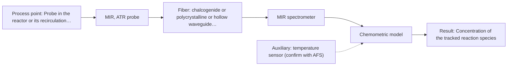

# First technical assessment: Mid-infrared probe with a long fiber link

## Answer

**Customer request (our summary):** Customer wants to follow a solvent-based batch reaction using a mid-infrared ATR probe, with the spectrometer located about 150 m away in an analyser house for safety, and asks which fiber would carry the mid-infrared signal and what signal loss to expect.

### Brief answer

Test mid-infrared ATR first: it suits a liquid solvent stream in contact with the crystal and is the customer's own method. The open point is the link — only chalcogenide, polycrystalline or hollow-waveguide fibers carry mid-infrared, and no source states an achievable mid-infrared length or loss figure, so the 150 m link and its loss stay open. If the medium is clear, NIR over silica fibers is the alternative.

### Proposal

- **Best current option:** O2 (recommended)
- **Basis:** supplied AFS sources
- **What would change it:** If a mid-infrared fiber link near 150 m cannot be supplied, or if the medium turns out clear enough for a defined NIR pathlength, the choice would move to the NIR option. A tracked species that mid-infrared cannot see would have the same effect.
- **Next step:** Ask AFS for the achievable mid-infrared fiber type, length and measured loss for this link, and obtain the tracked species and required spectral window from the customer.

**Secondary evidence (external, not AFS material):** G1: E05 ¶1, E05 ¶2; G2: no usable external source found; G3: no usable external source found; G4: no usable external source found. See Expert detail.

**Decision status:** Provisional feasibility assessment

### Solution options

| ID | Tier | Methods | Confidence | Cost class, S01 Table 1 (p.6) | Ease of use | Maintenance | Performance fit | Sources |
|---|---|---|---|---|---|---|---|---|
| O1 | Simple | M2 NIR, transmission/transflection probe | Low: open question: Q1, Q3 (starts at Medium); sample clarity unknown | average cost (row 7) | standard silica probe, glass optics | probe cleaning, periodic recalibration | only source-stated route for long cable runs | [1: S01 p.5] [2: S02 p.7] [3: S01 p.18] [4: S01 p.18] |
| O2 | Recommended | M1 MIR, ATR probe | Low: open question: Q1, Q3 (starts at Medium); a parameter is not measurable in-line | high cost (row 2) | contact ATR probe, one spectrometer | ATR crystal cleaning, link checks | best chemical fit for a liquid reaction | [5: S01 p.10] [6: S01 p.9] [7: S01 p.5] |

*Confidence rates the basis of the advice (how much is known and cited), not a predicted accuracy or probability of success. It starts at High, or at Medium when a key question on the method or the option is open, and drops one level per weakness listed (floor Low).*

*Cost class is the relative rating in S01 Table 1 (p.6) for the in-line method+technique rows named (the highest one for a multi-method option); it is not a price.*

### Setup sketch

*Recommended option O2; drawn by code from the option, a schematic, not a configuration.*

### Key questions

1. Which species or spectral band must be followed, and over what concentration range?
2. Can a mid-infrared fiber link of about 150 m between the reactor and the analyser house be supplied, and what loss does it show?
3. How transparent is the reaction medium, and could a defined optical pathlength be used?

## Expert detail

**Customer enquiry**

> We want to follow a reaction in a solvent-based batch reactor with a mid-infrared ATR probe. For safety reasons the spectrometer has to stay in the analyser house, about 150 m from the reactor. Which fiber would carry the mid-infrared signal that far, and how much signal loss should we expect?

**Decision status:** Provisional feasibility assessment. The shortlist rests on two assumptions: a liquid medium that can make tight ATR contact, and a mid-infrared fiber link of about 150 m that the sources do not establish. Until the tracked species and the link are confirmed, the assessment stays provisional.

### Parameters

| ID | Parameter | Kind | Need | Measured by | Why | Sources |
|---|---|---|---|---|---|---|
| P1 | Concentration of the tracked reaction species | quantitative | required | Spectroscopy: MIR | The reaction can only be followed if the species to quantify is defined. | *(no verified source: engineering judgement)* |
| P2 | Solvent identity and matrix composition | qualitative | required | Reference lab method: customer's existing laboratory batch assay | The solvent sets the background bands and interferences in the mid-infrared spectrum and the calibration matrix. | *(no verified source: engineering judgement)* |
| P3 | Reaction temperature | quantitative | optional | Auxiliary sensor: temperature sensor (engineering judgement: confirm availability with AFS) | Batch temperature should be available because reaction progress and spectral comparability over a batch depend on it. | *(no verified source: engineering judgement)* |
| P4 | Throughput of the mid-infrared fiber link | quantitative | required | Not measurable in-line by spectroscopy; alternative: throughput measurement on the installed link (reference spectrum through the full fiber run) | The enquiry asks for the expected signal loss, and no source gives an attenuation figure, so it has to be measured on the installed link. | *(no verified source: engineering judgement)* |

### Solution option details

- **O1 cost drivers:** NIR spectrometer, silica probe, long cable installation
- **O2 cost drivers:** MIR spectrometer, ATR probe, mid-infrared fiber link

### Premise check

- **Not covered:** A fiber can carry the mid-infrared signal about 150 m from the reactor to the analyser house. The sources list fibers that transmit mid-infrared (chalcogenide, polycrystalline, hollow waveguide), but the only stated long cables are low-OH silica for the visible and near-infrared; the mid-infrared fiber examples given are short laboratory runs. No source states an achievable mid-infrared link length. [8: S02 p.6] [2: S02 p.7] [9: S02 p.10]
- **Not covered:** The expected signal loss over that fiber link can be estimated from the sources. No supplied page gives an attenuation or loss figure for a mid-infrared fiber or cable. The only statement about coupling behaviour is qualitative (hollow waveguides couple poorly to FTIR spectrometers, polycrystalline fibers much better). *(no verified source: engineering judgement)*
- **Precedent only:** Mid-infrared ATR is suitable for following the reaction. Fiber ATR probes are described for liquids and for in-line process analysis, and a published example uses MIR-ATR in-line for polymer extrusion. That is a reason to test the method, not proof that it works for this reaction. [5: S01 p.10] [10: S02 p.14]

### Requirements

**Stated by the customer**

- "follow a reaction"
- "solvent-based batch reactor"
- "mid-infrared ATR probe"
- "For safety reasons the spectrometer has to stay in the analyser house"
- "about 150 m from the reactor"
- "Which fiber would carry the mid-infrared signal that far"
- "how much signal loss should we expect"

**Key unknowns**

- Tracked species or spectral band, and its concentration range
- Required spectral window for the tracked bands
- Solvent identity and interfering absorption bands
- Medium optical density and transparency (decides whether the NIR alternative is viable)
- Mid-infrared fiber type, achievable length and link loss available from AFS
- Reference method and accuracy / response-time targets

### Clarification questions (most decision-relevant first)

Q1. Which species or spectral band must be followed, and over what concentration range? *Why it matters:* It decides the required mid-infrared window and whether MIR-ATR can see the reaction at all. *(affects: method)*
Q2. Can a mid-infrared fiber link of about 150 m between the reactor and the analyser house be supplied, and what loss does it show? *Why it matters:* No source states an achievable mid-infrared link length or attenuation, so this decides whether the planned installation is feasible and replaces the loss figure the enquiry asks for. *(affects: installation)*
Q3. How transparent is the reaction medium, and could a defined optical pathlength be used? *Why it matters:* It decides whether the NIR transmission/transflection alternative, which uses the only cables stated for long runs, is viable. *(affects: method)*
Q4. Which spectral range must be covered for the tracked bands? *Why it matters:* The usable range depends on the fiber and crystal actually selected, so it narrows the mid-infrared fiber choice. *(affects: installation)*
Q5. What reference method and what accuracy and response-time targets define a successful measurement? *Why it matters:* They set the go/no-go criteria for the feasibility tests. *(affects: M1)*

### Recommendation

- **M1 · Primary candidate: MIR, ATR probe.** MIR-ATR suits a liquid solvent stream in contact with the crystal, and fiber ATR probes are used for in-line process analysis. Mid-infrared spectra show well-defined absorption bands, which helps to resolve the reaction bands. *Conditions:* Applies if the reaction medium is a liquid or soft solid that makes tight contact with the ATR crystal and does not foul it. [5: S01 p.10] [6: S01 p.9] [7: S01 p.5]
- **M2 · Conditional candidate: NIR, transmission/transflection probe.** Low-OH silica fibers are the only family with stated 100-300 m cables, and transmission or transflection is the geometry for transparent or semi-transparent liquids. This makes NIR the alternative to test if a mid-infrared link near 150 m is not available. *Conditions:* Applies only if the medium is clear enough for a defined pathlength and the tracked species has usable NIR bands. [2: S02 p.7] [3: S01 p.18] [4: S01 p.18]

### Measurement concept

- **Probe and geometry:** Immersion ATR fiber probe at the reactor port (primary); a transmission/transflection probe as the conditional alternative.
- **Location:** Probe in the reactor or its recirculation line; spectrometer in the analyser house, about 150 m away.
- **Fiber link:** Mid-infrared light needs chalcogenide, polycrystalline or hollow-waveguide fibers; silica fibers reach only about 2400 nm. No achievable mid-infrared link length or loss is stated in the sources. [11: S02 p.6] [12: S02 p.6]

### Spectral range

- **MIR:** Nominal mid-infrared range 4000-400 cm-1 (2.5-25 µm); the usable range depends on the fiber, crystal and probe selected. [6: S01 p.9]
- **NIR:** Nominal near-infrared range 780-2500 nm; the usable range depends on the instrument, fiber and probe selected. [13: S01 p.10]

### Risks and uncertainty

- No source states an achievable length or attenuation for a mid-infrared fiber link, so the about 150 m separation may not be feasible and the loss cannot be quantified yet. *(rules: R-FIB-2)* [2: S02 p.7]
- The mid-infrared fiber family must match the required spectral window, which is unknown until the tracked bands are defined. *(rules: R-GEN-1)* [12: S02 p.6]
- Hollow waveguides couple poorly to FTIR spectrometers, so that link could lose signal, while polycrystalline fibers couple much better. *(rules: R-FIB-3)* [14: S02 p.10]
- ATR samples only a surface layer a few micrometres deep, so fouling or a non-representative layer on the crystal could distort the reaction trend. *(rules: R-MIR-3)* [15: S01 p.13]

### First feasibility experiment

1. **Collect representative batch samples or process states across the expected composition and temperature range (solvent, start, middle and end of the batch).** Cover the expected chemical and physical variation. [16: REF §3]
2. **Measure every sample with an independent reference method (the customer's existing batch assay) to give reference values.** Independent reference measurements. *(no verified source: engineering judgement)*
3. **Acquire MIR-ATR spectra on all samples under the same contact conditions; build a calibration model and validate it on held-out batches.** Single method first, with validation on held-out runs. *(no verified source: engineering judgement)*
4. **Repeat with NIR transmission/transflection on the same samples and compare the two single-method models; test a combined model only if neither single method is sufficient.** Compare against the best single method before combining. [17: REF §5]
5. **Measure the throughput of the installed reactor-to-analyser-house link and compare it with a short-link measurement; the go/no-go thresholds (accuracy, response time, minimum signal) are set by the customer.** Basis for the go/no-go decision, with numerical criteria from the customer. *(no verified source: engineering judgement)*

**Reference measurements:** Independent laboratory analysis of the same samples with the customer's existing batch assay.

**Decision basis:** Customer-defined accuracy and response-time targets versus the reference method, plus the measured throughput of the real fiber link.

### Assumptions

- The reaction medium is a liquid that can make tight contact with the ATR crystal.
- The spectrometer stays in the analyser house and the link is about 150 m.
- The tracked species has an absorption band in the usable mid-infrared window of the fiber and probe selected.

### Not covered by the supplied sources

- An achievable length for a mid-infrared fiber link (only low-OH silica cables are stated for long runs).
- An expected signal-loss or attenuation figure for a mid-infrared fiber link of about 150 m.

### Further notes

- **Chemometrics:** Following the reaction quantitatively will need a calibration model specific to the solvent matrix, validated on independent batches; the same applies to the NIR alternative.
- **Real-time tracking:** In-line fiber probes give near-real-time results without sampling; the achievable acquisition rate depends on the instrument and the fiber link actually installed.
- **Future direction:** If a long mid-infrared link proves difficult, a multiplexed analyzer close to the reactor, or a compact spectral sensor at the measuring point, could be considered later.

### Secondary evidence (external, not AFS material)

*Found by a literature search for gaps the supplied AFS sources leave open. Not AFS material and not proof for this case; every quote below was verified verbatim against the fetched text.*

**G1 · auxiliary sensor:** In-line measurement of Reaction temperature with temperature sensor

- **E05 ¶1** FBG-based sensors are increasingly used for temperature and strain monitoring in fission and fusion facilities, but their long-term mechanical reliability under intense gamma-neutron fields is not well understood. *How it applies:* This could inform considering an FBG temperature sensor for in-line reaction temperature, but the reliability question suggests testing the sensor assembly under the actual process conditions before relying on it. *Limits and transfer risks:* The source concerns nuclear fission and fusion facilities and metal-packaged FBG assemblies, not solvent-based batch reactors or ATR probes; transfer to a chemical process temperature sensor is uncertain. *(supports O2)*
  > "Fiber Bragg grating (FBG)-based sensors are increasingly used for temperature and strain monitoring in both fission and fusion facilities, whereas their long-term mechanical reliability under intense γ-neutron fields remains insufficiently understood."
  > Mechanical Testing of Metal-Packaged FBG-Based Sensors Before and After High-Fluence Reactor Irradiation. (2026) · Sensors (Basel, Switzerland) · doi:10.3390/s26144328 · https://europepmc.org/article/PMC/PMC13417401 · retrieved 2026-10-17, full text, licence: cc by, via europepmc
- **E05 ¶2** FBG sensors are described as compact, immune to electromagnetic interference, remotely interrogable, and stable at elevated temperatures, making them suitable for harsh nuclear environments. *How it applies:* This could support evaluating a fiber-optic temperature sensor with remote interrogation for in-line reaction temperature, but the harsh-environment claim is from nuclear applications and would need process-specific testing. *Limits and transfer risks:* The quote is about harsh nuclear environments, not solvent-based batch reactions; the sensor packaging, radiation context, and measurement matrix differ from the customer's process. *(supports O2)*
  > "Their compact geometry, immunity to electromagnetic interference, remote interrogation capability, and stability at elevated temperatures make them suitable for harsh nuclear environments."
  > Mechanical Testing of Metal-Packaged FBG-Based Sensors Before and After High-Fluence Reactor Irradiation. (2026) · Sensors (Basel, Switzerland) · doi:10.3390/s26144328 · https://europepmc.org/article/PMC/PMC13417401 · retrieved 2026-10-17, full text, licence: cc by, via europepmc

**G2 · not in the supplied sources:** An achievable length for a mid-infrared fiber link (only low-OH silica cables are stated for long runs).

- No usable external source found.

**G3 · not in the supplied sources:** An expected signal-loss or attenuation figure for a mid-infrared fiber link of about 150 m.

- No usable external source found.

**G4 · premise not covered:** A fiber can carry the mid-infrared signal about 150 m from the reactor to the analyser house.

- No usable external source found.

### Evidence (verified quotes)

1. ✓ **S01 p.5** (general): "making it ideal for online applications, including remote measurements via fiber optic probes."
2. ✓ **S02 p.7** (general): "Robust 100-300m cables made with Silica fibers of low OH-content (<0.1ppm OH) enable remote industrial process-control"
3. ✓ **S01 p.18** (general): "Transmission is the preferred method for transparent or semi-transparent liquids, such as skim milk, whey, or permeate."
4. ✓ **S01 p.18** (general): "the precise control of the optical pathlength (usually 1 - 10 mm)"
5. ✓ **S01 p.10** (general): "ATR fiber probes (Fig.1) enable the analysis of liquids and solid elastic samples"
6. ✓ **S01 p.9** (general): "Vibrational spectroscopy in the mid-IR range (4000-400 cm-1) is one of the most informative methods of chemical analysis."
7. ✓ **S01 p.5** (general): "strong absorption in the mid-IR region limits the corresponding spectral method to the analysis of very thin samples (usually less than 50 μm), but it opens up the possibility of using attenuated total reflectance (ATR)"
8. ✓ **S02 p.6** (general): "1100 nm Chalcogenide As-S IR Fibers 6500 nm"
9. ✓ **S02 p.10** (general): "1.25 Meter Silver Halide - straight run"
10. ✓ **S02 p.14** (application precedent): "NIR-Reflex & MIR-ATR-spectroscopy to control polymer extrusion in-line"
11. ✓ **S02 p.6** (general): "350 nm Standard VIS-NIR Silica Fibers Al/Cu-coated VIS-NIR Silica Fibers 2400 nm"
12. ✓ **S02 p.6** (general): "3000 nm Polycrystalline Infrared Fibers 17 μm"
13. ✓ **S01 p.10** (general): "NIR spectra (780-2500 nm) contain predominantly overtones and component bands of fundamental vibrations"
14. ✓ **S02 p.10** (general): "too low NA>0.1 - which results in very poor coupling efficiency with FTIR-spectrometers"
15. ✓ **S01 p.13** (general): "typically at a depth of few microns"
16. ✓ **REF §3** (general): "Representative samples or process states, independent reference measurements, what is compared, and the basis for the go / no-go decision."
17. ✓ **REF §5** (general): "compare with the best single method."

### Verification

- Citations verified: 23 of 23 (exact or whitespace/hyphen-tolerant match on the cited page, scope checked).
- Hard check failures before deterministic corrections: 0; still open: 0; soft warnings: 0; repair rounds: 1.
- External evidence (live): 2 quote(s) verified verbatim (exact or whitespace/hyphen-tolerant, at most 400 characters and 2 sentences, against the cited paragraph); 0 item(s) dropped.
- External search: 6 query(ies), 45 hit(s), 5 source(s) (3 from the curated library).
- External step: 2 model call(s), 36.4 s extra (cost in the run JSON).

*Run A03-20261017T231620Z · models deepseek/deepseek-v4.1-flash*
