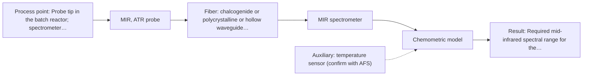

# First technical assessment: Mid-infrared probe with a long fiber link

## Answer

**Customer request:** We want to follow a reaction in a solvent-based batch reactor with a mid-infrared ATR probe. For safety reasons the spectrometer has to stay in the analyser house, about 150 m from the reactor. Which fiber would carry the mid-infrared signal that far, and how much signal loss should we expect?

### Brief answer

MIR-ATR is a sensible method for your reactor liquid, but the supplied material does not show any mid-infrared fiber working at 150 m. Long-reach cables are only stated for silica fibers, which do not transmit mid-IR, and MIR fibers appear only as short laboratory samples. Test MIR-ATR with a fibre-link feasibility trial depending on your required wavelength range, with Raman over silica fiber as the comparison option.

### Proposal

- **Best current option:** O2 (recommended)
- **Basis:** engineering judgement
- **What would change it:** If no mid-infrared fiber can deliver acceptable signal at 150 m for the required spectral range, the choice moves to O1 (Raman over silica fiber) or to relocating the spectrometer closer to the reactor. The required wavelength range and whether the distance is fixed are the deciding answers.
- **Next step:** Run the bench feasibility trial: measure representative reaction samples with a short MIR-ATR probe and test candidate MIR fibers at increasing lengths toward 150 m, with Raman as the comparison method.

**Secondary evidence (external, not AFS material):** G1: no usable external source found; G2: no usable external source found; G3: no usable external source found; G4: no usable external source found. See Expert detail.

**Decision status:** Insufficient information for a method choice

### Solution options

| ID | Tier | Methods | Confidence | Cost class, S01 Table 1 (p.6) | Ease of use | Maintenance | Performance fit | Sources |
|---|---|---|---|---|---|---|---|---|
| O1 | Simple | M2 Raman probe | Low: open question: Q3 (starts at Medium); uncited auxiliary sensor; status: insufficient information | high cost (row 12) | Standard silica fiber link, straightforward installation | Low; no fragile MIR fiber or crystal | Fits the 150 m distance with stated 100-300 m silica cables | [1: S02 p.7] [2: S01 p.16] [3: S01 p.11] |
| O2 | Recommended | M1 MIR, ATR probe | Low: open question: Q1, Q2, Q3 (starts at Medium); uncited auxiliary sensor; status: insufficient information | high cost (row 2) | Established ATR probe concept, but unproven link length | ATR crystal cleaning and fouling checks needed | Best chemical specificity for reaction components, pending fibre-link proof | [4: S01 p.10] [5: S01 p.10] [6: S01 p.9] [7: S02 p.6] |

*Confidence rates the basis of the advice (how much is known and cited), not a predicted accuracy or probability of success. It starts at High, or at Medium when a key question on the method or the option is open, and drops one level per weakness listed (floor Low).*

*Cost class is the relative rating in S01 Table 1 (p.6) for the in-line method+technique rows named (the highest one for a multi-method option); it is not a price.*

### Setup sketch

*Recommended option O2; drawn by code from the option, a schematic, not a configuration.*

### Key questions

1. Which mid-infrared wavelength range does the reaction monitoring actually need?
2. Is the 150 m distance fixed, or could the spectrometer be placed closer to the reactor (e.g. at the reactor wall with only the data link remote)?
3. Which species and concentration ranges must be followed, in which solvent, and at what process temperature and pressure?

## Expert detail

**Customer enquiry**

> We want to follow a reaction in a solvent-based batch reactor with a mid-infrared ATR probe. For safety reasons the spectrometer has to stay in the analyser house, about 150 m from the reactor. Which fiber would carry the mid-infrared signal that far, and how much signal loss should we expect?

**Decision status:** Insufficient information for a method choice. MIR-ATR is a sound method for a solvent-based reactor liquid, but no supplied source shows a mid-infrared fiber link of 150 m or a loss figure for one, so the fibre choice and expected loss cannot be answered from the material provided.

### Parameters

| ID | Parameter | Kind | Need | Measured by | Why | Sources |
|---|---|---|---|---|---|---|
| P1 | Target reaction species and concentration ranges | quantitative | required | Reference lab method: off-line FTIR or GC/HPLC as agreed | Needed to check that the chosen method and spectral range actually contain bands for the species to be followed. | *(no verified source: engineering judgement)* |
| P2 | Solvent identity and composition | qualitative | required | Reference lab method: off-line FTIR | The solvent dominates the MIR spectrum and determines ATR compatibility and calibration matrix. | *(no verified source: engineering judgement)* |
| P3 | Process temperature at the probe | quantitative | required | Auxiliary sensor: temperature sensor (engineering judgement: confirm availability with AFS) | Temperature shifts band positions and affects probe and fiber material selection. | *(no verified source: engineering judgement)* |
| P4 | Required mid-infrared spectral range for the reaction bands | quantitative | required | Spectroscopy: MIR | It decides which fiber family (CIR, PIR or hollow waveguide) can be used and whether the 150 m link is feasible. | [8: S02 p.6] |

### Solution option details

- **O1 cost drivers:** Raman spectrometer and laser, probe, fluorescence-background screening, calibration effort
- **O2 cost drivers:** MIR spectrometer, ATR probe, specialty MIR fiber at 150 m, link feasibility trial, calibration

### Premise check

- **Not covered:** A mid-infrared fiber can carry the signal 150 m from reactor to analyser house. Long cables (100-300 m) are stated only for low-OH silica fibers, which do not transmit mid-IR; the MIR fiber and hollow-waveguide examples in the sources are short laboratory lengths, and no source states an achievable MIR link length or its loss. [1: S02 p.7] [9: S02 p.10]
- **Supported:** MIR-ATR is a suitable in-line technique for a liquid reaction mixture in a reactor. ATR fiber probes are described for in-line, in-process liquid analysis without sampling. [4: S01 p.10]

### Requirements

**Stated by the customer**

- Follow a reaction in a solvent-based batch reactor with a mid-infrared ATR probe.
- Spectrometer must stay in the analyser house about 150 m from the reactor for safety reasons.
- Customer asks which fiber would carry the mid-infrared signal that far and what signal loss to expect.

**Key unknowns**

- Whether a 150 m mid-infrared fiber link is technically achievable; no source states an MIR link length.
- The mid-infrared spectral range the reaction monitoring needs, which decides between CIR, PIR fibers or hollow waveguides.
- Target species, concentration ranges and solvent composition, which decide the method and calibration.
- Process temperature and pressure at the probe.
- Required measurement response time.

### Clarification questions (most decision-relevant first)

Q1. Which mid-infrared wavelength range does the reaction monitoring actually need? *Why it matters:* The fiber family and its achievable length depend on the required range. *(affects: technique, M1)*
Q2. Is the 150 m distance fixed, or could the spectrometer be placed closer to the reactor (e.g. at the reactor wall with only the data link remote)? *Why it matters:* A shorter optical link, or a fibre-coupled sensing head with remote electronics, changes the whole installation concept. *(affects: installation, M1, O2)*
Q3. Which species and concentration ranges must be followed, in which solvent, and at what process temperature and pressure? *Why it matters:* This decides whether MIR-ATR can see the targets, which crystal and probe design fit, and what calibration is needed. *(affects: method, M1, M2)*
Q4. What measurement response time does the reaction monitoring require? *Why it matters:* Acquisition speed influences the spectrometer and probe choice and any later multi-method synchronisation. *(affects: technique)*

### Recommendation

- **M1 · Primary candidate: MIR, ATR probe.** MIR-ATR fiber probes are described for in-line liquid analysis without sampling, and MIR spectra give well-defined, selective bands for reaction components. It stays the first method to test, but only together with a fibre-link feasibility check, because no supplied source demonstrates a 150 m mid-infrared fiber link. *Conditions:* Proceed only if a fibre (CIR, PIR or hollow waveguide) for the required spectral range can be sourced and tested at the required length with acceptable signal loss. [5: S01 p.10] [6: S01 p.9] [7: S02 p.6]
- **M2 · Comparison candidate: Raman probe.** Raman probes use silica fibers, for which robust 100-300 m cables are explicitly stated, so the 150 m distance is not a blocker; Raman also tolerates water and gives complementary bands. It is the benchmark against which the MIR-ATR option must prove itself given the link uncertainty. *Conditions:* Check fluorescence background of the solvent and reaction mixture on real samples before relying on it. [1: S02 p.7] [2: S01 p.16] [3: S01 p.11]

### Measurement concept

- **Probe and geometry:** Immersion MIR-ATR fiber probe (e.g. diamond or ZrO2 ATR tip) in the reactor liquid for M1; Raman immersion probe for M2.
- **Location:** Probe tip in the batch reactor; spectrometer in the analyser house about 150 m away.
- **Fiber link:** M1 requires a mid-infrared fiber (CIR, PIR or hollow waveguide per the required range); no source states an achievable length or loss for such a link at 150 m, so this must be tested. M2 uses low-OH silica fiber, for which long cables are stated for remote process control. [8: S02 p.6]

### Spectral range

- **MIR:** Nominal mid-IR range 4000-400 cm-1; the usable range depends on the selected fiber and ATR crystal, which must be matched to the reaction bands. [10: S01 p.9]
- **Raman:** Raman shift in cm-1 with laser excitation (e.g. 785 nm in the pharma example) stated separately; excitation and probe design determine the usable shift range. [11: S01 p.15]

### Risks and uncertainty

- A 150 m mid-infrared fiber link may not be achievable with acceptable signal loss; the sources show MIR fibers only at short laboratory lengths. *(rules: R-FIB-2)* [12: S02 p.9]
- Hollow waveguides couple poorly to FTIR spectrometers, so the fiber choice interacts with the spectrometer type. *(rules: R-FIB-3)* [13: S02 p.10]
- ATR samples only a surface layer a few micrometres deep, so crystal fouling and surface representativeness are risks in a reacting batch. *(rules: R-MIR-3)* [14: S01 p.13]
- Any calibration will be specific to this solvent/matrix and must be re-validated if the formulation changes. *(rules: R-CAL-1)* [15: REF §5]

### First feasibility experiment

1. **Collect representative reaction-mixture samples across the expected conversion range (start, mid, end points) in the actual solvent.** Cover the chemical variation the model must handle. *(no verified source: engineering judgement)*
2. **Record independent reference concentrations for each sample with a laboratory method (e.g. off-line FTIR, GC or HPLC as agreed with the customer).** Provide the reference data for calibration and validation. *(no verified source: engineering judgement)*
3. **On the bench, measure the samples with a short (lab-length) MIR-ATR fiber probe and, in parallel, a Raman probe; identify which bands track the reaction.** Test each single method on its own before any combination or long-link commitment. *(no verified source: engineering judgement)*
4. **Test candidate mid-infrared fibers (CIR, PIR, hollow waveguide) for the required wavelength range at increasing lengths up to the installed length, measuring throughput against the bench baseline.** Establish whether the 150 m link delivers usable signal; this is the deciding experiment for M1. *(no verified source: engineering judgement)*
5. **Build and validate the calibration on held-out batches, and apply the customer's go/no-go criteria (e.g. acceptable prediction error and signal-to-noise at the analyser house) before specifying the in-line installation.** Confirm the chosen method meets the customer's performance requirements. *(no verified source: engineering judgement)*

**Reference measurements:** Independent laboratory analysis (e.g. off-line FTIR, GC or HPLC, to be agreed) of each representative sample.

**Decision basis:** Customer-defined go/no-go criteria: minimum acceptable signal throughput at 150 m for the MIR link, and a maximum prediction error for the reaction species, both to be set by the customer.

### Assumptions

- The reaction mixture is a liquid suitable for ATR contact at the probe tip.
- The 150 m distance is an optical fiber path length; the actual routing length may be longer and must be confirmed.

### Not covered by the supplied sources

- Achievable length and signal loss for a mid-infrared fiber link of about 150 m; the sources show MIR fibers only at short laboratory lengths.
- Attenuation figures (dB/km or dB/m) for CIR, PIR fibers or hollow waveguides.

### Further notes

- **Chemometrics:** Quantitative reaction following will need a calibration model built on representative samples with independent reference values, validated on held-out batches; the calibration is specific to this solvent matrix.
- **Real-time tracking:** In-line, time-resolved tracking of the batch reaction is the goal; acquisition conditions should be chosen so the measurement rate matches the reaction kinetics.
- **Future direction:** If the MIR link proves infeasible at 150 m, a fibre-coupled sensing head near the reactor with remote data communication, or a compact LED/sensor approach, could be evaluated later.

### Secondary evidence (external, not AFS material)

*Found by a literature search for gaps the supplied AFS sources leave open. Not AFS material and not proof for this case; every quote below was verified verbatim against the fetched text.*

**G1 · decision status:** insufficient information: MIR-ATR is a sound method for a solvent-based reactor liquid, but no supplied source shows a mid-infrared fiber link of 150 m or a loss figure for one, so the fibre choice and expected loss cannot be answered from the material provided.

- No usable external source found.

**G2 · auxiliary sensor:** In-line measurement of Process temperature at the probe with temperature sensor

- No usable external source found.

**G3 · not in the supplied sources:** Achievable length and signal loss for a mid-infrared fiber link of about 150 m; the sources show MIR fibers only at short laboratory lengths.

- No usable external source found.

**G4 · not in the supplied sources:** Attenuation figures (dB/km or dB/m) for CIR, PIR fibers or hollow waveguides.

- No usable external source found.

### Evidence (verified quotes)

1. ✓ **S02 p.7** (performance figure): "Robust 100-300m cables made with Silica fibers of low OH-content (<0.1ppm OH) enable remote industrial process-control"
2. ✓ **S01 p.16** (general): "Raman is particularly well-suited for aqueous environments, as it exhibits low absorbance for water molecules compared to infrared methods."
3. ✓ **S01 p.11** (general): "superposition of luminescence (fluorescence), which has a significantly higher intensity."
4. ✓ **S01 p.10** (general): "Probe-based analysis is gaining widespread use in online analysis, such as in-line, in-process (chemical, biotechnological, natural) environments"
5. ✓ **S01 p.10** (general): "ATR fiber probes (Fig.1) enable the analysis of liquids and solid elastic samples"
6. ✓ **S01 p.9** (general): "Vibrational spectroscopy in the mid-IR range (4000-400 cm-1) is one of the most informative methods of chemical analysis."
7. ✓ **S02 p.6** (performance figure): "3000 nm Polycrystalline Infrared Fibers 17 μm"
8. ✓ **S02 p.6** (general): "Transmission for Different Fibers in 0.2-18μm - used for Fiber Probes"
9. ✓ (precedent only) **S02 p.10** (performance figure): "1.25 Meter Silver Halide - straight run"
10. ✓ **S01 p.9** (general): "Vibrational spectroscopy in the mid-IR range (4000-400 cm-1)"
11. ✓ **S01 p.15** (general): "Raman spectrometer and Raman fiber probe for contact measurements with 785 nm excitation wavelength"
12. ✓ (precedent only) **S02 p.9** (performance figure): "HWG-750-2m PIR 600/700 -2m"
13. ✓ **S02 p.10** (general): "too low NA>0.1 - which results in very poor coupling efficiency with FTIR-spectrometers"
14. ✓ **S01 p.13** (general): "typically at a depth of few microns"
15. ✓ **REF §5** (general): "Weak signal, fluorescence background; calibration specific to the matrix."

### Verification

- Citations verified: 19 of 19 (exact or whitespace/hyphen-tolerant match on the cited page, scope checked).
- Hard check failures before deterministic corrections: 0; still open: 0; soft warnings: 3; repair rounds: 1.
- External evidence (live): 0 quote(s) verified verbatim (exact or whitespace/hyphen-tolerant, at most 400 characters and 2 sentences, against the cited paragraph); 1 item(s) dropped.
- External search: 3 query(ies), 30 hit(s), 5 source(s) (3 from the curated library).
- External step: 2 model call(s), 11.1 s extra (cost in the run JSON).
  - ⚠ dropped G1 E04 ¶21: figure not in its own quote: 150 m, 150 m

*Run A03-20261018T094733Z-c4ff · models google/gemini-3.5-flash-lite, google/gemini-3.8-flash, z-ai/glm-5.3-flash*
