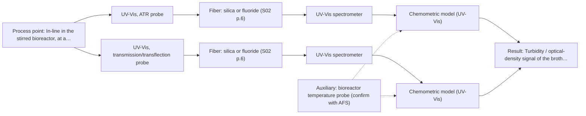
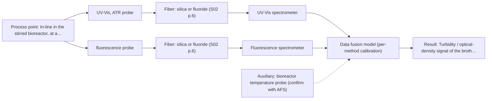

# First technical assessment: Viable cell concentration with a UV-Vis probe

## Answer

**Customer request (our summary):** The customer asks if a UV-Vis fiber probe can continuously measure viable cell concentration in a stirred bioreactor containing mammalian cells.

### Brief answer

A UV-Vis fiber probe cannot directly measure viable cell concentration: turbidity only correlates with total cell density and cannot distinguish live from dead cells. What is realistic is a calibrated UV-Vis proxy - ATR geometry for dense broth, transmission only if the culture stays clear - validated against your reference counts on representative samples. Open points: whether total biomass suffices, your OD range, and the accuracy you require versus manual counting.

### Proposal

- **Best current option:** O2 (recommended)
- **Basis:** supplied AFS sources
- **What would change it:** If the customer confirms that live/dead discrimination is essential, the UV-Vis proxy alone is insufficient and the fluorescence extension (O3) or an alternative route must be evaluated; if the broth stays clear at all times, transmission alone may suffice.
- **Next step:** Run the off-line feasibility test: UV-Vis ATR (and transmission if clear) spectra of representative broth samples against reference viable counts, with customer-defined go/no-go criteria.

**Secondary evidence (external, not AFS material):** G1: no usable external source found; G2: E05 ¶29, E01 ¶82; G3: no usable external source found; G4: no usable external source found. See Expert detail.

**Decision status:** Premise not supported by the sources

### Solution options

| ID | Tier | Methods | Confidence | Cost class, S01 Table 1 (p.6) | Ease of use | Maintenance | Performance fit | Sources |
|---|---|---|---|---|---|---|---|---|
| O1 | Simple | M1 UV-Vis, ATR probe | Low: open question: Q1, Q2 (starts at Medium); a customer premise is contradicted, status: premise not supported | average cost (row 14) | Single probe, straightforward immersion measurement | ATR crystal cleaning and fouling checks | Fits turbid dense broth where transmission fails | [1: S01 p.16] [2: S01 p.16] |
| O2 | Recommended | M1 UV-Vis, ATR probe; M2 UV-Vis, transmission/transflection probe | Low: open question: Q1, Q2 (starts at Medium); sample clarity unknown; a customer premise is contradicted, status: premise not supported | average cost (rows 14, 16) | Two probe geometries tested, one selected | Standard probe cleaning; no consumables | Covers both clear and dense broth across the whole run | [1: S01 p.16] [2: S01 p.16] [3: S01 p.16] |
| O3 | Extended (multi-method) | M1 UV-Vis, ATR probe; M3 fluorescence probe + UV-Vis (combination) | Low: open question: Q1, Q2 (starts at Medium); fluorescent target unknown; a customer premise is contradicted, status: premise not supported; multi-method, fusion benefit not yet shown | average cost (rows 14, 19) | Two instruments and probes to operate | Per-method calibration and diagnostics required | Adds metabolic-state information turbidity cannot give | [4: S01 p.8] [5: S01 p.8] [1: S01 p.16] [2: S01 p.16] [6: S01 p.12] [7: S01 p.16] |

*Confidence rates the basis of the advice (how much is known and cited), not a predicted accuracy or probability of success. It starts at High, or at Medium when a key question on the method or the option is open, and drops one level per weakness listed (floor Low).*

*Cost class is the relative rating in S01 Table 1 (p.6) for the in-line method+technique rows named (the highest one for a multi-method option); it is not a price.*

### Setup sketch

*Recommended option O2; drawn by code from the option, a schematic, not a configuration.*

### Key questions

1. Do you need viable cell density specifically (live cells only), or would total biomass/cell density meet the control goal?
2. What optical density range does the culture span from inoculation to harvest, at the wavelengths you would measure?
3. What accuracy versus your manual cell count would you accept, and can you keep periodic reference counts during calibration and validation runs?

## Expert detail

**Customer enquiry**

> We grow mammalian cells in a stirred bioreactor and want a UV-Vis fiber probe to measure the viable cell concentration continuously, so we can stop taking manual samples for cell counting. Would this work in our culture medium?

**Decision status:** Premise not supported by the sources. The sources state that cell-suspension turbidity only correlates with cell density and that optical density is not a viable cell count, so a UV-Vis probe cannot directly deliver viable cell concentration; it can only serve as a calibrated proxy to be validated against reference counts.

### Parameters

| ID | Parameter | Kind | Need | Measured by | Why | Sources |
|---|---|---|---|---|---|---|
| P1 | Viable cell concentration | quantitative | required | Reference lab method: trypan blue exclusion count or automated viability counter (customer's standard method, off-line samples) | It is the target variable and the reference against which any spectral proxy must be calibrated and validated. | *(no verified source: engineering judgement)* |
| P2 | Turbidity / optical-density signal of the broth | quantitative | required | Spectroscopy: UV-Vis | It is the quantity the UV-Vis probe actually measures and the input of the proxy calibration to cell density. | [2: S01 p.16] |
| P3 | Optical regime of the broth (clear vs highly scattering at the measurement wavelengths) | qualitative | required | Spectroscopy: UV-Vis | It decides whether transmission/transflection is usable or the ATR geometry is needed. | [3: S01 p.16] |
| P4 | Process temperature | quantitative | optional | Auxiliary sensor: bioreactor temperature probe (engineering judgement: confirm availability with AFS) | It should be available from the bioreactor and may shift spectral signals, so it should be logged during calibration. | *(no verified source: engineering judgement)* |

### Solution option details

- **O1 cost drivers:** One UV-Vis spectrometer, one ATR probe, calibration samples and reference counts
- **O2 cost drivers:** Second probe geometry, extended calibration across the OD range, reference counting effort
- **O3 cost drivers:** Second spectrometer, combined or paired probes, fused-model development and validation
- **O3 combining methods:** Low-level fusion: UV-Vis turbidity and fluorescence spectra from the same sampling spot, synchronised to a common time step, with one calibration block per method before any joined model. A combined or co-located probe arrangement is needed because separate alternating probes cannot guarantee the same measurement point. The fused model must beat the best single-method model on held-out runs, otherwise the fluorescence channel should be dropped.

*Extended (multi-method) option O3; drawn by code from the option, a schematic, not a configuration.*

### Premise check

- **Contradicted:** A UV-Vis fiber probe can directly measure viable cell concentration continuously. The guidance states optical density is not a viable cell count; UV-Vis turbidity is at best a biomass proxy that needs its own calibration against reference counts. [8: REF §5] [2: S01 p.16]
- **Precedent only:** Optical monitoring of biomass-related signals in bioprocesses is an established direction worth testing. The sources describe UV/Vis as a low-cost tool for real-time biomass monitoring in bioreactors; this is a published example, not proof for this customer's medium and cells. [9: S01 p.16]
- **Precedent only:** Fluorescence could add viability-related information in a bioreactor. Fluorescence is reported for intrinsic fluorophores such as NADH in bioprocesses, but no fluorescent species has been identified in this customer's medium, so it remains a hypothesis. [7: S01 p.16]

### Requirements

**Stated by the customer**

- Measure viable cell concentration continuously in a stirred mammalian-cell bioreactor.
- Replace manual sampling for cell counting.

**Key unknowns**

- Whether the target is total cell density, viable cell density, or viability percentage
- Optical density / turbidity range of the culture over the run
- Required accuracy and how it compares to the manual counting method
- Fluorescent species present in the medium (e.g. NADH, riboflavin)
- Sterilisation, cleaning and fouling constraints for an in-line probe
- Whether periodic reference cell counts remain available for calibration and validation

### Clarification questions (most decision-relevant first)

Q1. Do you need viable cell density specifically (live cells only), or would total biomass/cell density meet the control goal? *Why it matters:* UV-Vis turbidity cannot distinguish live from dead cells, so only a calibrated proxy for total biomass is realistic without a second method. *(affects: method, M1)*
Q2. What optical density range does the culture span from inoculation to harvest, at the wavelengths you would measure? *Why it matters:* It decides between a transmission/transflection probe for clear broth and an ATR probe for dense, highly scattering broth. *(affects: technique, M1, M2)*
Q3. What accuracy versus your manual cell count would you accept, and can you keep periodic reference counts during calibration and validation runs? *Why it matters:* The proxy calibration and the go/no-go criteria must be defined against the reference counting method the customer trusts. *(affects: status)*
Q4. What are the sterilisation, cleaning and fouling constraints at the intended probe location in the bioreactor? *Why it matters:* Probe contact and fouling determine which in-line technique and installation are realistic. *(affects: installation, M1)*
Q5. Are there known fluorescent cofactors or components in your medium (such as NADH, tryptophan, or riboflavin) that correlate with metabolic activity or viability? *Why it matters:* Fluorescence spectroscopy can only be considered if a specific fluorescent species or indicator is present in the medium. *(affects: method, M3)*

### Recommendation

- **M1 · Primary candidate: UV-Vis, ATR probe.** The only UV-Vis technique that passes screening for this turbid, heterogeneous broth: the evanescent-wave path stays short even in dense, highly scattering cell suspensions. It measures a turbidity/absorbance proxy that must be calibrated against reference viable counts, not a direct cell count. [1: S01 p.16] [2: S01 p.16]
- **M2 · Conditional candidate: UV-Vis, transmission/transflection probe.** For clear, low-optical-density broth a defined path length gives higher sensitivity than ATR, but transmission saturates once the culture becomes dense or highly scattering. *Conditions:* Applicable only if the culture stays optically clear enough at the measurement wavelengths over the whole run. [3: S01 p.16]
- **M3 · Conditional candidate: fluorescence probe + UV-Vis (combination).** Intrinsic fluorophores such as NADH are reported as bioprocess viability-state indicators and could add information a turbidity proxy lacks, but no fluorescent species has been identified in this medium yet. *Conditions:* Only if a defined fluorescent species or justified indicator is identified in the medium, and only as a later hypothesis after the single-method UV-Vis tests. [6: S01 p.12] [7: S01 p.16]

### Measurement concept

- **Probe and geometry:** Immersion UV-Vis ATR probe in the bioreactor as the primary geometry; a transmission/transflection probe tested in parallel only if the broth stays optically clear.
- **Location:** In-line in the stirred bioreactor, at a well-mixed position away from baffles and the impeller zone.
- **Fiber link:** Silica fiber for the UV-Vis range; length to be confirmed with AFS since only silica cable lengths are stated in the sources. [10: S01 p.16]

### Spectral range

- **UV-Vis:** UV-Vis sensitivity is highest in the UV region (190-360 nm); the usable range depends on the selected light source, fiber and probe, and must be confirmed for the actual configuration. [11: S01 p.5]

### Risks and uncertainty

- The turbidity proxy reflects total scattering biomass and cannot separate viable from dead cells or debris, so it may not answer the viability question at all. *(rules: R-UV-2)* [8: REF §5]
- The calibration is specific to the medium and cell line; changes in medium composition, antifoam or passage number can shift it and require re-validation. *(rules: R-CAL-1)* *(no verified source: engineering judgement)*
- Probe fouling by cells and deposits on an ATR crystal can drift the signal during long runs. *(rules: R-MIR-3)* *(no verified source: engineering judgement)*
- Overlapping absorption from medium components in UV-Vis mixtures means chemometric calibration is needed, not a simple single-wavelength reading. *(rules: R-UV-1)* [12: S01 p.5]

### First feasibility experiment

1. **Collect representative broth samples across the full expected variation: early lag phase (clear), mid exponential, dense late phase, plus medium-only and killed-cell controls.** Cover the chemical and optical range the in-line probe will see. *(no verified source: engineering judgement)*
2. **Measure each sample with the UV-Vis ATR probe and, if the broth is clear enough, a transmission/transflection probe; record spectra at fixed conditions.** Compare the two geometries on the same samples before choosing one. *(no verified source: engineering judgement)*
3. **Obtain independent reference viable cell counts for every sample (e.g. trypan blue exclusion counting or an automated viability counter) performed by the customer's standard method.** Provide the reference the spectral proxy is calibrated against. *(no verified source: engineering judgement)*
4. **Build a chemometric regression from spectra to reference counts, then validate on held-out samples from separate runs or batches.** Test whether the proxy predicts viable counts, not just fits the calibration set. *(no verified source: engineering judgement)*
5. **Go/no-go: the customer defines the acceptable deviation of the in-line prediction from their reference count and the acceptable drift over a full run; only then consider continuous in-line installation.** Make the decision criterion explicit and owned by the customer. *(no verified source: engineering judgement)*

**Reference measurements:** Viable cell concentration by the customer's counting method on every calibration and validation sample.

**Decision basis:** Customer-defined agreement between in-line prediction and reference viable counts, on held-out runs.

### Assumptions

- The culture is an aqueous mammalian-cell suspension in standard medium, as stated.
- Periodic manual or automated reference cell counts remain available during a feasibility phase.
- No fluorescent species or fluorophore indicator has yet been identified in the customer's culture medium.

### Not covered by the supplied sources

- Whether UV-Vis or any optical method can distinguish viable from dead mammalian cells in-line in this customer's medium
- Achievable in-line accuracy for viable cell density in a stirred bioreactor with the described probes

### Further notes

- **Chemometrics:** A regression model from UV-Vis spectra to reference viable counts is needed; it is matrix-specific and must be validated on held-out runs, with the customer's counting method as the reference data source.
- **Real-time tracking:** Continuous in-line tracking is the stated goal, but it should only be installed after the off-line feasibility phase shows the proxy meets the customer's accuracy criteria over a full run.
- **Future direction:** If a viability-specific measurement proves necessary, a fluorescence channel targeting intrinsic fluorophores such as NADH could be evaluated later as an addition to the UV-Vis proxy.

### Secondary evidence (external, not AFS material)

*Found by a literature search for gaps the supplied AFS sources leave open. Not AFS material and not proof for this case; every quote below was verified verbatim against the fetched text.*

**G1 · auxiliary sensor:** In-line measurement of Process temperature with bioreactor temperature probe

- No usable external source found.

**G2 · multi-method:** Combining several spectroscopy methods (data fusion) (Low-level fusion: UV-Vis turbidity and fluorescence spectra from the same sampling spot, synchronised to a common time step, with one calibration block per method before any joined model. A combined or co-located probe arrangement is needed because separate alternating probes cannot guarantee the same measurement point. The fused model must beat the best single-method model on held-out runs, otherwise the fluorescence channel should be dropped.)

- **E05 ¶29** Multimodal fusion technology demonstrates value in spectral analysis by combining inputs, but the effectiveness of sensor fusion does not increase proportionally with the number of sensors and relies on complementarity. *How it applies:* When combining UV-Vis and fluorescence data streams, evaluate whether the added channel provides independent information rather than just increasing system complexity. *Limits and transfer risks:* The cited findings relate to egg and food quality evaluation rather than mammalian cell bioreactors, so fusion performance and sensor complementarity must be validated on actual bioprocess data. *(supports O3)*
  > "It is noteworthy that the effectiveness of multi-sensor fusion does not increase proportionally with the number of sensors; rather, it hinges on mutual correction and complementarity among different sensors."
  > Advancing Egg Freshness Evaluation with Integrated AI and Spectroscopy. (2026) · Foods (Basel, Switzerland) · doi:10.3390/foods15132259 · https://europepmc.org/article/PMC/PMC13361683 · retrieved 2026-10-18, full text, licence: cc by, via europepmc
- **E01 ¶82** Before fusing data from multiple sources, evaluating the contribution and complementarity of each dataset is essential. *How it applies:* Perform individual model evaluations for the UV-Vis and fluorescence channels before constructing the joint low-level fusion model. *Limits and transfer risks:* The reference discusses general PAT data fusion and specific analytical studies, meaning specific feature contributions may differ in a stirred mammalian cell bioreactor. *(supports O3)*
  > "Before fusing data from multiple sources, it is essential to evaluate the contribution of each dataset to the model and its complementarity."
  > Challenges and Opportunities of Implementing Data Fusion in Process Analytical Technology-A Review. (2022) · Molecules (Basel, Switzerland) · doi:10.3390/molecules27154846 · https://europepmc.org/article/PMC/PMC9369811 · retrieved 2026-10-17, full text, licence: cc by, via curated library

**G3 · not in the supplied sources:** Whether UV-Vis or any optical method can distinguish viable from dead mammalian cells in-line in this customer's medium

- No usable external source found.

**G4 · not in the supplied sources:** Achievable in-line accuracy for viable cell density in a stirred bioreactor with the described probes

- No usable external source found.

### Evidence (verified quotes)

1. ✓ **S01 p.16** (general): "extremely short path length that enables the measurement of "black" or highly scattering fluids without dilution."
2. ✓ **S01 p.16** (general): "cell suspension turbidity correlates well with cell density."
3. ✓ **S01 p.16** (general): "transmission setup becomes saturated because the light cannot penetrate the bulk of the sample."
4. ✓ (precedent only) **S01 p.8** (method gain): "collected from the same small, even pinpoint, area of the sample."
5. ✓ (precedent only) **S01 p.8** (method gain): "the measurement data must be normalized to a common time step."
6. ✓ **S01 p.12** (general): "Fluorescence spectroscopy can be used for multispectral measurements, for example, in combination with Mid-IR or NIR spectroscopy."
7. ✓ **S01 p.16** (application precedent): "critical cofactors and amino acids like NADH, tryptophan, and riboflavin."
8. ✓ **REF §5** (general): "optical density is not a viable cell count."
9. ✓ **S01 p.16** (application precedent): "UV/Vis spectroscopy can be deployed as a low-cost, robust tool for real-time biomass monitoring"
10. ✓ **S01 p.16** (general): "a UV-ATR (Attenuated Total Reflection) probe is used."
11. ✓ **S01 p.5** (general): "It has very high sensitivity, especially in the UV region (190-360 nm)"
12. ✓ **S01 p.5** (general): "the strong overlap of spectral signals in UV spectra complicates the analysis of real samples"

### Verification

- Citations verified: 17 of 17 (exact or whitespace/hyphen-tolerant match on the cited page, scope checked).
- Hard check failures before deterministic corrections: 0; still open: 0; soft warnings: 3; repair rounds: 1.
- Corrected deterministically after verification (1):
  - ⚠ clarification_questions[2].affects: affects normalised to ['status']; dropped ['P1'] (not method, technique, installation, status, an M id or an O id)
- External evidence (live): 2 quote(s) verified verbatim (exact or whitespace/hyphen-tolerant, at most 400 characters and 2 sentences, against the cited paragraph); 0 item(s) dropped.
- External search: 4 query(ies), 35 hit(s), 5 source(s) (3 from the curated library).
- External step: 2 model call(s), 6.2 s extra (cost in the run JSON).

*Run A04-20261018T094733Z-704c · models google/gemini-3.5-flash-lite, google/gemini-3.8-flash, z-ai/glm-5.3-flash*
