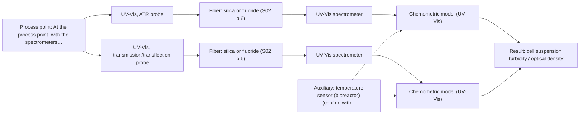
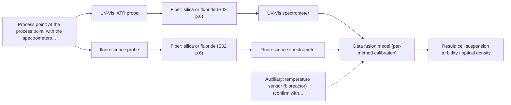

# First technical assessment: Viable cell concentration with a UV-Vis probe

## Answer

**Customer request (our summary):** Customer wants to use an in-line UV-Vis fiber probe to continuously measure viable cell concentration in a stirred mammalian cell bioreactor culture medium, and asks whether this would work in their medium.

### Brief answer

An in-line UV-Vis probe can be trialled for tracking biomass in your bioreactor, but the sources do not support it as a viable cell count: optical density is not a viable cell count. Whether it suits your medium depends on your cell density range and how turbid the medium is, and on whether you need viability or only a growth trend. Start with a UV-Vis probe test on representative samples against your existing off-line counts.

### Proposal

- **Best current option:** O2 (recommended)
- **Basis:** engineering judgement
- **What would change it:** If the customer confirms that viability, not biomass, must be reported and a fluorophore is present in the medium, the combined option (O3) becomes the better fit. If the suspension stays optically clear at the working cell density, the transmission geometry (M2) is preferred over ATR.
- **Next step:** Run the feasibility plan on representative medium and cell suspensions, with the customer's off-line counts as reference, and set the go/no-go against the accuracy and response time the customer states.

**Secondary evidence (external, not AFS material):** G1: E05 ¶1, E04 ¶2727; G2: E02 ¶31, E02 ¶82; G3: E04 ¶203; G4: E03 ¶27. See Expert detail.

**Decision status:** Premise not supported by the sources

### Solution options

| ID | Tier | Methods | Confidence | Cost class, S01 Table 1 (p.6) | Ease of use | Maintenance | Performance fit | Sources |
|---|---|---|---|---|---|---|---|---|
| O1 | Simple | M1 UV-Vis, ATR probe | Low: open question: Q2 (starts at Medium); a parameter is not measurable in-line; a customer premise is contradicted, status: premise not supported | average cost (row 14) | one probe, one spectrometer | crystal cleaning and fouling check | tests whether UV-Vis tracks the biomass | [1: S01 p.16] [2: S01 p.16] |
| O2 | Recommended | M1 UV-Vis, ATR probe; M2 UV-Vis, transmission/transflection probe | Low: open question: Q2 (starts at Medium); sample clarity unknown; a parameter is not measurable in-line; a customer premise is contradicted, status: premise not supported | average cost (rows 14, 16) | one method, geometry chosen after the density test | probe cleaning and periodic model revalidation | covers low- and high-density states of the batch | [1: S01 p.16] [2: S01 p.16] [3: S01 p.18] [4: S01 p.16] |
| O3 | Extended (multi-method) | M1 UV-Vis, ATR probe; M3 fluorescence probe + UV-Vis (combination) | Low: open question: Q2 (starts at Medium); fluorescent target unknown; a parameter is not measurable in-line; a customer premise is contradicted, status: premise not supported; multi-method, fusion benefit not yet shown | average cost (rows 14, 19) | two channels, one combined probe head | two calibrations and two sets of diagnostics | adds metabolic information to the biomass signal | [5: S01 p.8] [6: S01 p.8] [7: S01 p.8] [8: S01 p.9] [9: REF §5] [1: S01 p.16] [2: S01 p.16] [10: S01 p.16] [11: S01 p.12] |

*Confidence rates the basis of the advice (how much is known and cited), not a predicted accuracy or probability of success. It starts at High, or at Medium when a key question on the method or the option is open, and drops one level per weakness listed (floor Low).*

*Cost class is the relative rating in S01 Table 1 (p.6) for the in-line method+technique rows named (the highest one for a multi-method option); it is not a price.*

### Setup sketch

*Recommended option O2; drawn by code from the option, a schematic, not a configuration.*

### Key questions

1. What cell density range must be covered over the batch, and how transparent, turbid or opaque is the medium at those densities?
2. Must the measurement report viable cells specifically, or is a total biomass trend enough?
3. Which off-line method defines your viable cell count today, and what accuracy, response time and update interval do you need?

## Expert detail

**Customer enquiry**

> We grow mammalian cells in a stirred bioreactor and want a UV-Vis fiber probe to measure the viable cell concentration continuously, so we can stop taking manual samples for cell counting. Would this work in our culture medium?

**Decision status:** Premise not supported by the sources. The enquiry asks whether a UV-Vis probe can give viable cell concentration, and the supplied material states that optical density is not a viable cell count, so the central premise does not hold as asked. A UV-Vis biomass measurement can still be tested, so the shortlist below is conditional on the open questions.

### Parameters

| ID | Parameter | Kind | Need | Measured by | Why | Sources |
|---|---|---|---|---|---|---|
| P1 | viable cell concentration | quantitative | required | Reference lab method: the customer's existing off-line cell counting method | It is the target value the measurement must deliver. | *(no verified source: engineering judgement)* |
| P2 | cell suspension turbidity / optical density | quantitative | required | Spectroscopy: UV-Vis | It is the optical signal the in-line probe actually records and the basis of the biomass correlation. | [12: S01 p.16] |
| P3 | viability (share of live cells) | quantitative | required | Not measurable in-line by spectroscopy; alternative: off-line viability assay used alongside the customer's counting method | The stated target is viable cells, and the optical density signal does not give a viable cell count. | [13: REF §5] |
| P4 | temperature at the probe | quantitative | optional | Auxiliary sensor: temperature sensor (bioreactor) (engineering judgement: confirm availability with AFS) | Should be available from the bioreactor control system; it is used to check spectral stability at the measurement point rather than as a target. | *(no verified source: engineering judgement)* |

### Solution option details

- **O1 cost drivers:** one UV-Vis spectrometer, one ATR probe, trial samples and reference counts
- **O2 cost drivers:** UV-Vis spectrometer, two probe geometries tested, calibration samples and reference counts
- **O3 cost drivers:** two spectrometers or channels, combined probe head, data fusion modelling
- **O3 combining methods:** Low-level fusion of the UV-Vis and fluorescence blocks is the starting hypothesis, with block scaling so that neither block dominates; the two methods sample different depths, so the information must come from the same small spot. Acquisition rates differ, so both blocks must be normalised to a common time step and each block keeps its own calibration and diagnostics. The fused model must beat the best single-method model on held-out runs, otherwise the extra channel is dropped.

*Extended (multi-method) option O3; drawn by code from the option, a schematic, not a configuration.*

### Premise check

- **Contradicted:** A UV-Vis fiber probe can measure viable cell concentration continuously. The material describes UV-Vis as a biomass/turbidity measurement (a proxy for cell density), and separately states that optical density is not a viable cell count. [13: REF §5]
- **Not covered:** The proposed UV-Vis measurement is suitable for the customer's culture medium. No supplied page addresses mammalian culture media, their absorbance/fluorescence background, or the cell densities involved; the medium composition and optical regime are unknown in the intake. *(no verified source: engineering judgement)*
- **Precedent only:** The in-line optical measurement can replace manual sampling for cell counting. There is a documented precedent for UV/Vis turbidity as a real-time biomass signal in cell suspensions, which is a reason to test it, not proof that it replaces a cell count here. [1: S01 p.16]

### Requirements

**Stated by the customer**

- "We grow mammalian cells"
- "in a stirred bioreactor"
- "our culture medium"
- "taking manual samples for cell counting"
- "viable cell concentration"

**Key unknowns**

- Cell density range over the batch and the resulting optical density at the probe (decides the geometry).
- Whether viability must be reported or a biomass trend is sufficient.
- Medium composition and its absorbance/fluorescence background at the chosen wavelengths.
- Required accuracy, response time and update interval, and the off-line reference method for the cell count.
- Probe installation (in situ port or bypass), sterilisation, cleaning and fouling over a run.
- Bubbles, aggregates, microcarriers or cell clumps at the measurement point.

### Clarification questions (most decision-relevant first)

Q1. What cell density range must be covered over the batch, and how transparent, turbid or opaque is the medium at those densities? *Why it matters:* This decides whether a transmission/transflection geometry can be used at all or whether the ATR geometry is needed. *(affects: technique)*
Q2. Must the measurement report viable cells specifically, or is a total biomass trend enough? *Why it matters:* The turbidity signal tracks cell density as a biomass proxy and does not by itself give a viable cell count. *(affects: method)*
Q3. Which off-line method defines your viable cell count today, and what accuracy, response time and update interval do you need? *Why it matters:* The reference method and the required accuracy and response time are the basis for the go/no-go decision, and those numbers have to come from the customer. *(affects: status)*
Q4. How should the probe be installed (in situ port in the vessel or a bypass/flow cell), and what sterilisation, cleaning and fouling conditions apply? *Why it matters:* Installation and cleaning determine the probe, window and fiber design, and can change the measurement spot. *(affects: installation)*
Q5. What does the medium contain (serum, phenol red, antifoam, microcarriers), does it hold any fluorescent species such as phenol red, serum components, NADH or riboflavin, and are bubbles, aggregates or cell clumps expected at the probe? *Why it matters:* These can add background absorbance, fluorescence or scattering that mimics a change in cell density, shifts the calibration, and decides whether a fluorescence channel is worth testing at all. *(affects: technique)*

### Recommendation

- **M1 · Primary candidate: UV-Vis, ATR probe.** UV-Vis turbidity is a documented route to real-time biomass monitoring in cell suspensions, and the sources give a UV-ATR probe as the geometry for high-optical-density, highly scattering fluids without dilution. It is also the method family the customer proposed, so it can be tested first on their own samples. *Conditions:* Applies where the medium at the working cell density is too turbid for a transmission path and the near-crystal layer still represents the stirred suspension well enough to follow the biomass trend. [1: S01 p.16] [2: S01 p.16]
- **M2 · Conditional candidate: UV-Vis, transmission/transflection probe.** If the suspension is optically thin at the working cell density, a transmission or transflection probe with a controlled 1-10 mm path samples the whole cross-section and can be more representative than ATR. Transmission saturates once the medium becomes too turbid, so this geometry would only cover the lower-density part of the batch. *Conditions:* Applies only if the optical density at the target cell density still transmits enough light for a defined pathlength (Q1). [3: S01 p.18] [4: S01 p.16]
- **M3 · Conditional candidate: fluorescence probe + UV-Vis (combination).** Fluorescence would add a sensitive channel for intrinsic fluorophores such as NADH, tryptophan and riboflavin that the turbidity signal does not report, and the sources describe fluorescence as usable in combination with another spectroscopic method. It is only worth testing if a fluorescent species is present in the medium and metabolic or viability-related information is needed. *Conditions:* Applies only if the customer needs more than a biomass trend and a fluorescent species is present or can be justified in the medium (Q2, Q5). [10: S01 p.16] [11: S01 p.12] Later hypothesis, after single-method tests.

### Measurement concept

- **Probe and geometry:** Start with an ATR fiber probe at the vessel wall or in a bypass; keep a transmission/transflection probe as the alternative if the suspension is optically thin.
- **Location:** At the process point, with the spectrometers remote from the vessel (Q4 decides in situ versus bypass).
- **Fiber link:** UV-Vis silica fibers carry the measurement; the achievable link length is a configuration question for AFS, not a value assumed here. [14: S01 p.3]

### Spectral range

- **UV-Vis:** Nominal method range: ultraviolet and visible absorption, with the UV part around 190-360 nm; the usable range depends on the instrument, fiber and probe actually selected, so no exact range is claimed here. [15: S01 p.5] [16: REF §3]

### Risks and uncertainty

- The signal is turbidity-based, so it follows total cell density rather than viability and may not deliver the viable cell count the customer asked for. *(rules: R-UV-2)* [13: REF §5]
- At high cell density the transmission path saturates, while an ATR probe sees only a thin layer at the crystal, so the sampled volume may not represent the stirred bulk. *(rules: R-MIR-3, R-GEN-4)* [17: S01 p.16] [4: S01 p.16]
- Medium components, bubbles, microcarriers or aggregates can add absorbance or scattering that mimics a change in cell density, and the calibration is specific to the matrix. *(rules: R-CAL-1, R-GEN-5)* [18: S01 p.7] [19: REF §5]
- Fouling, sterilisation and cleaning of the probe inside a stirred bioreactor are not covered by the supplied sources and can change the optical signal over a run. *(rules: R-MIR-3)* *(no verified source: engineering judgement)*

### First feasibility experiment

1. **Collect representative samples across the batch: cell-free medium and cell suspensions from inoculation density to harvest density, including the highest and lowest expected states, kept at process temperature.** Representative samples across the expected chemical and physical variation. [20: REF §3]
2. **Measure every sample off-line with the customer's existing counting method, at the same time as the spectral measurement, as the independent reference.** Independent reference measurements. *(no verified source: engineering judgement)*
3. **Record UV-Vis spectra in both candidate geometries (ATR, and transmission or transflection where the optical density allows) plus the medium blank, and record Raman spectra on the same samples as a separate single method.** Single methods first; combinations only after. *(no verified source: engineering judgement)*
4. **Build a calibration of the UV-Vis signal against the reference counts and check whether the turbidity signal alone predicts the count; evaluate Raman separately, without fusing.** What is compared and how the models are built. [21: S01 p.5]
5. **Validate on held-out runs or batches, not only on further samples from the same run, and apply the customer's required accuracy, response time and update interval as the go/no-go criteria.** Validation on held-out runs or batches and a customer-based go/no-go basis. [20: REF §3]

**Reference measurements:** The customer's existing off-line cell counting, run on the same samples at the same times.

**Decision basis:** The customer's stated accuracy, response time and update interval (Q3). No numerical criterion is assumed here.

### Assumptions

- The culture is a liquid suspension that can be brought into contact with an ATR crystal or a transmission window.
- Manual cell counting remains available as the reference during the trial.
- The batch covers a range of cell densities, so both low- and high-density states can be sampled.
- No fluorescent species has been confirmed in the medium yet; the fluorescence option stays conditional until Q5 is answered.

### Not covered by the supplied sources

- Whether an in-line UV-Vis probe can report viable cell concentration in a mammalian culture medium: the material covers biomass-related turbidity and UV-ATR for high-optical-density fluids, but not viability in mammalian media.
- Probe sterilisation, autoclaving and clean-in-place/steam-in-place compatibility inside a stirred bioreactor, and fouling behaviour over a batch.
- Expected accuracy, detection limit or response time for an in-line cell concentration measurement.

### Further notes

- **Chemometrics:** The UV-Vis signal is broad and overlapping, so the link to off-line counts has to be built as a calibration model, and that model is specific to the sample matrix; it needs re-validation if the medium or cell line changes.
- **Real-time tracking:** The request is for continuous in-line tracking, so the acquisition rate and update interval should match the process dynamics, and spectra must be time-stamped against the reference samples.
- **Future direction:** Once the informative UV-Vis regions are known, a compact multi-wavelength or LED-based in-line sensor could be a later extension; the sources describe such LED analyzers as a development route, and it would need its own validation.

### Secondary evidence (external, not AFS material)

*Found by a literature search for gaps the supplied AFS sources leave open. Not AFS material and not proof for this case; every quote below was verified verbatim against the fetched text.*

**G1 · auxiliary sensor:** In-line measurement of temperature at the probe with temperature sensor (bioreactor)

- **E05 ¶1** The review states that optical fiber sensors for bioreactor parameters briefly cover temperature monitoring. *How it applies:* This supports considering an optical fiber temperature sensor at the probe location alongside the UV-Vis measurement, so temperature can be logged with the spectra. *Limits and transfer risks:* The source is an abstract-only review with emphasis on pH and dissolved oxygen; it does not show integration with a UV-Vis probe or performance in a stirred mammalian bioreactor. *(supports O2)*
  > "This review summarizes recent progress in optical fiber sensors for key bioreactor parameters, with an emphasis on pH and dissolved oxygen (DO), and briefly covers temperature and pressure monitoring."
  > Optical Fiber pH and Dissolved Oxygen Sensors for Bioreactor Monitoring: A Review (2025) · Sensors · doi:10.3390/s26010010 · https://doi.org/10.3390/s26010010 · retrieved 2026-10-17, abstract only, licence: cc-by, via openalex
- **E04 ¶2727** The source describes a multi-sensor chip that includes measurement of temperature (T sensor), pH (ISFET), and dissolved oxygen concentration. *How it applies:* This indicates that temperature sensing can be combined with other in-line sensors in a bioreactor sensor array, which is relevant to adding temperature at the probe. *Limits and transfer risks:* The work is on a micro bioreactor sensor chip, not a stirred mammalian bioreactor or a UV-Vis fiber probe, so integration and scale differ. *(supports O2)*
  > "measurement of temperature (T sensor), pH (ISFET), dissolved oxygen concentration"
  > Integrated sensor array for on-line monitoring micro bioreactors (2007) · doi:10.3990/1.9789036525930 · https://ris.utwente.nl/ws/files/6040573/thesis_Krommenhoek.pdf · retrieved 2026-10-17, full text, licence: other-oa, via openalex

**G2 · multi-method:** Combining several spectroscopy methods (data fusion) (Low-level fusion of the UV-Vis and fluorescence blocks is the starting hypothesis, with block scaling so that neither block dominates; the two methods sample different depths, so the information must come from the same small spot. Acquisition rates differ, so both blocks must be normalised to a common time step and each block keeps its own calibration and diagnostics. The fused model must beat the best single-method model on held-out runs, otherwise the extra channel is dropped.)

- **E02 ¶31** Low-level data fusion is described as the simplest way to combine inputs by rearranging variables from different sources into a new data matrix. *How it applies:* This matches the starting hypothesis of low-level fusion of UV-Vis and fluorescence blocks; it informs how the fused matrix could be built before testing whether it improves over the best single method. *Limits and transfer risks:* The source is a general PAT data-fusion review, not a UV-Vis/fluorescence bioreactor study, and it does not address block scaling or differing acquisition rates. *(supports O3)*
  > "Low-level data fusion (LLDF) is considered the simplest method to achieve a combination of inputs. In this case, the data is rearranged into a new data matrix, where the variables coming from different sources are placed one after the other."
  > Challenges and Opportunities of Implementing Data Fusion in Process Analytical Technology-A Review. (2022) · Molecules (Basel, Switzerland) · doi:10.3390/molecules27154846 · https://europepmc.org/article/PMC/PMC9369811 · retrieved 2026-10-17, full text, licence: cc by, via curated library
- **E02 ¶82** The source says that before fusing data from multiple sources, the contribution of each dataset and its complementarity should be evaluated. *How it applies:* This supports testing each block's contribution and requiring the fused model to beat the best single-method model on held-out runs before keeping the extra channel. *Limits and transfer risks:* The recommendation is general and does not specify UV-Vis and fluorescence blocks, block scaling, or a common time step for different acquisition rates. *(supports O3)*
  > "Before fusing data from multiple sources, it is essential to evaluate the contribution of each dataset to the model and its complementarity."
  > Challenges and Opportunities of Implementing Data Fusion in Process Analytical Technology-A Review. (2022) · Molecules (Basel, Switzerland) · doi:10.3390/molecules27154846 · https://europepmc.org/article/PMC/PMC9369811 · retrieved 2026-10-17, full text, licence: cc by, via curated library

**G3 · not in the supplied sources:** Whether an in-line UV-Vis probe can report viable cell concentration in a mammalian culture medium: the material covers biomass-related turbidity and UV-ATR for high-optical-density fluids, but not viability in mammalian media.

- **E04 ¶203** The source refers to spectroscopy as a technique for on-line monitoring of viable cell concentrations. *How it applies:* This suggests that spectroscopy-based on-line viable cell monitoring is a recognized topic, so an in-line UV-Vis probe could be evaluated for viable cell concentration in the customer's medium. *Limits and transfer risks:* The source is a micro bioreactor sensor-array thesis and does not specify UV-Vis, mammalian cells, or the customer's medium; it is not evidence that the probe will work here.
  > "spectroscopy as a technique for on-line monitoring of viable cell concentrations."
  > Integrated sensor array for on-line monitoring micro bioreactors (2007) · doi:10.3990/1.9789036525930 · https://ris.utwente.nl/ws/files/6040573/thesis_Krommenhoek.pdf · retrieved 2026-10-17, full text, licence: other-oa, via openalex

**G4 · not in the supplied sources:** Probe sterilisation, autoclaving and clean-in-place/steam-in-place compatibility inside a stirred bioreactor, and fouling behaviour over a batch.

- **E03 ¶27** The source notes that accurate measurement may not be possible because the probe window can be contaminated by a binder added during the process. *How it applies:* This highlights probe-window fouling as a risk to watch over a batch, so fouling behaviour should be tested for the UV-Vis probe in the medium. *Limits and transfer risks:* The example is a pharmaceutical process with a binder, not a mammalian cell culture or a UV-Vis fiber probe, and it does not cover sterilisation, autoclaving, CIP, or SIP.
  > "However, an accurate measurement may not be possible because of contamination of the probe window due to the addition of a binder during the process, which is a disadvantage."
  > Process Analytical Technology Tools for Monitoring Pharmaceutical Unit Operations: A Control Strategy for Continuous Process Verification. (2021) · Pharmaceutics · doi:10.3390/pharmaceutics13060919 · https://europepmc.org/article/PMC/PMC8234957 · retrieved 2026-10-17, full text, licence: cc by, via curated library

### Evidence (verified quotes)

1. ✓ **S01 p.16** (application precedent): "UV/Vis spectroscopy can be deployed as a low-cost, robust tool for real-time biomass monitoring, as cell suspension turbidity correlates well with cell density."
2. ✓ **S01 p.16** (general): "In these high-OD scenarios, a UV-ATR (Attenuated Total Reflection) probe is used."
3. ✓ **S01 p.18** (general): "the precise control of the optical pathlength (usually 1 - 10 mm); if the pathlength is too wide, the signal is lost to absorption; if too narrow, the sample represents a negligible volume."
4. ✓ **S01 p.16** (general): "the signal in a standard transmission setup becomes saturated because the light cannot penetrate the bulk of the sample."
5. ✓ **S01 p.8** (general): "It is crucial that the spectral information obtained by different methods-Mid-IR, NIR, Raman, and fluorescence spectra-is collected from the same small, even pinpoint, area of the sample."
6. ✓ **S01 p.8** (general): "Ultimately, the measurement data must be normalized to a common time step."
7. ✓ **S01 p.8** (general): "Variables obtained from different spectral methods are not equivalent."
8. ✓ **S01 p.9** (general): "One of the challenges of multispectral analysis is the need to simultaneously connect at least two independently operating measuring instruments."
9. ✓ (precedent only) **REF §5** (method gain): "compare with the best single method."
10. ✓ **S01 p.16** (general): "critical cofactors and amino acids like NADH, tryptophan, and riboflavin."
11. ✓ **S01 p.12** (general): "Fluorescence spectroscopy can be used for multispectral measurements, for example, in combination with Mid-IR or NIR spectroscopy."
12. ✓ **S01 p.16** (general): "cell suspension turbidity correlates well with cell density."
13. ✓ **REF §5** (general): "optical density is not a viable cell count."
14. ✓ **S01 p.3** (general): "It allows for in-process analysis, i.e., directly in the process flow or reactor without sampling, eliminating delays and the risk of sample contamination."
15. ✓ **S01 p.5** (performance figure): "It has very high sensitivity, especially in the UV region (190-360 nm)"
16. ✓ **REF §3** (general): "A nominal method range is not the range of a specific instrument, fiber or probe."
17. ✓ **S01 p.16** (general): "ATR relies on the evanescent wave that penetrates only a few micrometers into the medium at the crystal interface"
18. ✓ **S01 p.7** (general): "Morphological factors, such as sample inhomogeneity (e.g., biological tissue) or process turbulence, must also be considered when selecting a measurement technique."
19. ✓ **REF §5** (general): "physical variation; calibration specific to the matrix."
20. ✓ **REF §3** (general): "Representative samples or process states, independent reference measurements, what is compared, and the basis for the go / no-go decision."
21. ✓ **S01 p.5** (general): "the strong overlap of spectral signals in UV spectra complicates the analysis of real samples"

### Verification

- Citations verified: 26 of 26 (exact or whitespace/hyphen-tolerant match on the cited page, scope checked).
- Hard check failures before deterministic corrections: 0; still open: 0; soft warnings: 2; repair rounds: 1.
- Corrected deterministically after verification (1):
  - ⚠ recommendations[2].combined_with: combined_with normalised to ['UV-Vis'] (duplicates and the entry's own method removed)
- External evidence (live): 6 quote(s) verified verbatim (exact or whitespace/hyphen-tolerant, at most 400 characters and 2 sentences, against the cited paragraph); 0 item(s) dropped.
- External search: 6 query(ies), 15 hit(s), 5 source(s) (3 from the curated library).
- External step: 2 model call(s), 95.2 s extra (cost in the run JSON).

*Run A04-20261017T231620Z · models deepseek/deepseek-v4.1-flash*
