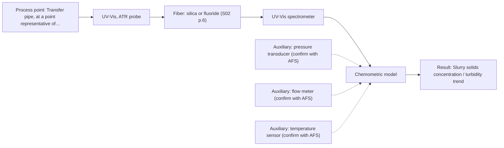

# First technical assessment: Pressure, flow and blockage of a slurry pipe

## Answer

**Customer request (our summary):** The customer wants to know if fiber optic products can measure the line pressure and flow rate of a slurry in a transfer pipe, and provide early warning of pipe blockage.

### Brief answer

Fiber-optic spectroscopy cannot measure line pressure or flow rate; those need standard pressure and flow sensors. What could be tested is an early blockage warning from an optical trend in the slurry (UV-Vis ATR, with NIR reflection as comparison), but that is an unproven hypothesis. We would need your slurry composition, opacity, pipe details and required accuracy to design that trial.

### Proposal

- **Best current option:** O2 (recommended)
- **Basis:** engineering judgement
- **What would change it:** If the slurry turns out to be too abrasive or opaque for any contact probe, or if the optical trend shows no relation to blockage onset in the trial, the spectroscopy part drops and only the pressure and flow sensors remain.
- **Next step:** Answer the clarification questions (slurry composition and opacity, required pressure/flow accuracy, pipe details) and then run the laboratory trend trial on representative samples.

**Secondary evidence (external, not AFS material):** G1: E04 ¶10; G2: no usable external source found; G3: no usable external source found; G4: no usable external source found. See Expert detail.

**Decision status:** Outside the supported scope

### Solution options

| ID | Tier | Methods | Confidence | Cost class, S01 Table 1 (p.6) | Ease of use | Maintenance | Performance fit | Sources |
|---|---|---|---|---|---|---|---|---|
| O1 | Simple | M2 NIR, diffuse reflection probe | Low: sample clarity unknown; status: outside supported scope | average cost (row 8) | Simple probe trial, minimal installation work | Probe window cleaning between runs | Fits as a low-effort check whether an optical trend exists at all | [1: S01 p.17] [2: S01 p.5] |
| O2 | Recommended | M1 UV-Vis, ATR probe | Low: uncited auxiliary sensor; status: outside supported scope | average cost (row 14) | Standard sensors plus one flush-mounted probe | Pressure/flow sensors low upkeep; probe needs fouling checks | Fits because sensors answer pressure and flow while the probe trial addresses blockage warning | [3: S01 p.16] [4: S01 p.16] |

*Confidence rates the basis of the advice (how much is known and cited), not a predicted accuracy or probability of success. It starts at High, or at Medium when a key question on the method or the option is open, and drops one level per weakness listed (floor Low).*

*Cost class is the relative rating in S01 Table 1 (p.6) for the in-line method+technique rows named (the highest one for a multi-method option); it is not a price.*

### Setup sketch

*Recommended option O2; drawn by code from the option, a schematic, not a configuration.*

### Key questions

1. What is the slurry made of, what solid loading and particle size do you expect, and how opaque is it?
2. What accuracy and response time do you need for line pressure and flow rate, and over what pressure and temperature ranges?
3. What are the pipe material and diameter, and where could a probe or sensor be mounted and serviced?

## Expert detail

**Customer enquiry**

> We need to know the line pressure and the flow rate of a slurry in our transfer pipe, and we want an early warning when the pipe starts to block. Could your fiber optic products help with this?

**Decision status:** Outside the supported scope. Line pressure and flow rate are physical process quantities that optical spectroscopy as described in the supplied sources cannot measure; they belong to pressure and flow instrumentation, not to the fiber-optic spectroscopic methods covered here. A spectroscopic contribution is conceivable only for the blockage early warning, as a hypothesis to test.

### Parameters

| ID | Parameter | Kind | Need | Measured by | Why | Sources |
|---|---|---|---|---|---|---|
| P1 | Line pressure | quantitative | required | Auxiliary sensor: pressure transducer (engineering judgement: confirm availability with AFS) | It is a stated target and the reference against which any blockage warning must be validated. | *(no verified source: engineering judgement)* |
| P2 | Flow rate | quantitative | required | Auxiliary sensor: flow meter (engineering judgement: confirm availability with AFS) | It is a stated target and the second reference for validating a blockage warning. | *(no verified source: engineering judgement)* |
| P3 | Slurry solids concentration / turbidity trend | quantitative | required | Spectroscopy: UV-Vis | It is the candidate spectroscopic early-warning indicator for blockage and must be referenced to lab data. | [4: S01 p.16] |
| P4 | Temperature at the measurement point | quantitative | optional | Auxiliary sensor: temperature sensor (engineering judgement: confirm availability with AFS) | It should be available because temperature shifts spectra and slurry viscosity, both of which can confound the trend. | *(no verified source: engineering judgement)* |

### Solution option details

- **O1 cost drivers:** One trial probe and spectrometer, lab reference solids measurements, staff time
- **O2 cost drivers:** Pressure transducer and flow meter, UV-ATR probe and spectrometer, in-line trial and validation effort

### Premise check

- **Not covered:** Fiber-optic spectroscopy products can measure line pressure and flow rate in the pipe. No supplied source describes spectroscopic measurement of pressure or flow rate; the sources cover chemical and morphological information from spectra (S01 p.4). These quantities require dedicated pressure and flow sensors. [5: S01 p.4]
- **Precedent only:** An optical trend in the slurry could serve as an early warning of pipe blockage. The sources show turbidity-type optical signals tracking a physical process variable (cell density in suspensions) and ATR handling highly scattering fluids; this is a reason to test a solids/turbidity trend as a blockage indicator, not proof for this slurry. [4: S01 p.16] [3: S01 p.16]

### Requirements

**Stated by the customer**

- Measure line pressure in the transfer pipe
- Measure slurry flow rate
- Early warning when the pipe starts to block

**Key unknowns**

- Slurry composition, solid loading and optical opacity
- Required accuracy and response time for pressure and flow
- Pipe material, diameter and possible probe access points
- Whether any chemical variable of the slurry is also of interest
- Temperature range and fouling behaviour at the measurement point

### Clarification questions (most decision-relevant first)

Q1. What is the slurry made of, what solid loading and particle size do you expect, and how opaque is it? *Why it matters:* It decides whether an ATR or reflection probe can see a usable optical signal and whether transmission is hopeless. *(affects: technique)*
Q2. What accuracy and response time do you need for line pressure and flow rate, and over what pressure and temperature ranges? *Why it matters:* These quantities will come from pressure and flow sensors, so their specification drives the instrument selection, not spectroscopy. *(affects: installation)*
Q3. What are the pipe material and diameter, and where could a probe or sensor be mounted and serviced? *Why it matters:* It determines whether a contact probe is feasible and how fouling and abrasion can be managed. *(affects: installation)*
Q4. Is there a chemical variable of the slurry (e.g. concentration of a dissolved component) you would also want tracked? *Why it matters:* If yes, a spectroscopic method could serve that target alongside the blockage trend; if no, spectroscopy has only the speculative blockage-indicator role. *(affects: method)*

### Recommendation

- **M1 · Primary candidate: UV-Vis, ATR probe.** Spectroscopy cannot deliver pressure or flow, so the only spectroscopic role worth testing first is a solids/turbidity trend as a possible early blockage indicator; a UV-ATR probe tolerates highly scattering, opaque fluids where transmission saturates. Any warning value of that trend is a hypothesis to be checked against independently measured pressure and flow. *Conditions:* The slurry must tolerate probe contact, and the trend must be validated against reference pressure/flow data during real throttling or blockage events. [3: S01 p.16] [4: S01 p.16]
- **M2 · Comparison candidate: NIR, diffuse reflection probe.** NIR diffuse reflection is the standard fiber-probe geometry for opaque, scattering media and could provide the same trend information with deeper penetration than ATR. It is a comparison to the UV-Vis ATR trial, not an alternative route to pressure or flow. [1: S01 p.17] [2: S01 p.5]

### Measurement concept

- **Probe and geometry:** For the spectroscopic trial: a UV-ATR fiber probe (very short evanescent path, a few micrometres) or an NIR diffuse-reflection probe inserted flush into the pipe wall; both sample only near the wall.
- **Location:** Transfer pipe, at a point representative of the flow and accessible for cleaning; exact position to be agreed once pipe details are known.
- **Fiber link:** Silica fibers cover the UV-Vis and NIR ranges; the required link length is unknown and must be confirmed for the selected cable type. [6: S01 p.16] [7: S02 p.7]

### Spectral range

- **UV-Vis:** UV-Vis works from the hard ultraviolet to visible; the UV region 190-360 nm is noted as highly sensitive, but the usable range depends on the selected source, probe and fibers. [8: S01 p.5]
- **NIR:** Nominal NIR range 780-2500 nm; the usable range depends on the instrument, fiber and probe actually selected. [9: S01 p.10]

### Risks and uncertainty

- A solids/turbidity trend may not change early enough, or at all, before a blockage develops, so the early-warning value is unproven. *(rules: R-EVI-2)* *(no verified source: engineering judgement)*
- An ATR crystal in an abrasive slurry is exposed to fouling and wear, and it reads only a surface layer a few micrometres deep. *(rules: R-MIR-3, R-GEN-5)* [10: S01 p.13]
- Reflection signals are sensitive to surface characteristics and particle size, so physical variation can mimic a composition or blockage change. *(rules: R-GEO-6)* [11: S01 p.17]
- Pressure and flow must come from dedicated sensors; no spectroscopic route to them exists in the supplied material, so the core request stays outside this assessment. *(no verified source: engineering judgement)*

### First feasibility experiment

1. **Obtain representative slurry samples spanning the expected variation in solids loading, particle size and composition.** Cover the physical and chemical variation the in-line probe will see. *(no verified source: engineering judgement)*
2. **Record UV-Vis ATR and NIR diffuse-reflection spectra of these samples in the laboratory.** Test single methods first and see whether an optical trend tracks solids loading. *(no verified source: engineering judgement)*
3. **Measure solids concentration (and any target chemical variable) by an independent laboratory reference method for each sample.** Provide the reference data any calibration or trend interpretation needs. *(no verified source: engineering judgement)*
4. **If the lab result is promising, run an in-line trial with the probe plus independent pressure and flow sensors, and compare the optical trend against pressure/flow records during controlled flow restriction.** Check whether the optical signal actually precedes or tracks blockage onset. *(no verified source: engineering judgement)*
5. **Validate on held-out runs or batches and agree numerical go/no-go criteria (e.g. required warning lead time and false-alarm tolerance) with the customer before the trial.** Give the decision an objective basis defined by the customer. *(no verified source: engineering judgement)*

**Reference measurements:** Solids concentration by laboratory method; line pressure and flow rate from calibrated pressure and flow sensors during the in-line trial.

**Decision basis:** Go/no-go on whether the optical trend detects the customer-defined blockage onset condition with the agreed lead time and false-alarm tolerance; those numerical criteria must come from the customer.

### Assumptions

- The customer has no existing pressure or flow instrumentation on this line; if they do, those sensors are the direct answer for two of the three targets.
- The blockage of concern is driven by solids settling, agglomeration or concentration changes that an optical probe near the wall could plausibly see.

### Not covered by the supplied sources

- Any spectroscopic or fiber-optic measurement of pressure or flow rate
- Fiber-optic methods for detecting pipe fouling or blockage directly

### Further notes

- **Chemometrics:** If the optical trend is to become a quantitative indicator, a calibration against laboratory-measured solids concentration will be needed, and NIR/reflection calibrations are specific to the matrix, so they must be built and validated on this slurry.
- **Real-time tracking:** The blockage early warning is inherently a continuous, time-resolved trend question; the optical signal would need to be tracked in-line and correlated with pressure and flow records over time.
- **Future direction:** If the trial succeeds, the same probe could later be extended with additional spectral methods at the same point, but only after the single-method trend is proven.

### Secondary evidence (external, not AFS material)

*Found by a literature search for gaps the supplied AFS sources leave open. Not AFS material and not proof for this case; every quote below was verified verbatim against the fetched text.*

**G1 · decision status:** outside supported scope: Line pressure and flow rate are physical process quantities that optical spectroscopy as described in the supplied sources cannot measure; they belong to pressure and flow instrumentation, not to the fiber-optic spectroscopic methods covered here. A spectroscopic contribution is conceivable only for the blockage early warning, as a hypothesis to test.

- **E04 ¶10** Distributed fiber optic sensing techniques using FBG systems can address pipeline issues such as blockages and structural integrity monitoring. *How it applies:* This suggests testing distributed fiber sensing as a complementary method specifically for early blockage warning, while keeping pressure and flow measurement to dedicated standard instrumentation. *Limits and transfer risks:* The cited study evaluates structural health monitoring in composite pipelines using numerical models and FBG sensors, which may differ significantly from metallic or industrial slurry transfer pipes.
  > "Nikles and Briffod [19] introduced a technique to address the impact of blockages in hydrocarbon pipelines using a Fiber Bragg grating (FBG) sensing system which provides distributed sensing capabilities."
  > Structural Health Monitoring of Composite Pipelines Utilizing Fiber Optic Sensors and an AI-Based Algorithm-A Comprehensive Numerical Study. (2023) · Sensors (Basel, Switzerland) · doi:10.3390/s23083887 · https://europepmc.org/article/PMC/PMC10144920 · retrieved 2026-10-18, full text, licence: cc by, via europepmc

**G2 · auxiliary sensor:** In-line measurement of Line pressure with pressure transducer

- No usable external source found.

**G3 · auxiliary sensor:** In-line measurement of Flow rate with flow meter

- No usable external source found.

**G4 · auxiliary sensor:** In-line measurement of Temperature at the measurement point with temperature sensor

- No usable external source found.

### Evidence (verified quotes)

1. ✓ **S01 p.17** (general): "NIR Reflection is primarily used for opaque or highly concentrated dairy products, such as yogurt, butter, or whole milk concentrates."
2. ✓ **S01 p.5** (general): "making it ideal for online applications, including remote measurements via fiber optic probes."
3. ✓ **S01 p.16** (general): "extremely short path length that enables the measurement of "black" or highly scattering fluids without dilution."
4. ✓ **S01 p.16** (application precedent): "cell suspension turbidity correlates well with cell density."
5. ✓ **S01 p.4** (general): "Spectral analysis provides information about the chemistry and morphology of the sample being studied"
6. ✓ **S01 p.16** (general): "ATR relies on the evanescent wave that penetrates only a few micrometers into the medium at the crystal interface"
7. ✓ **S02 p.7** (performance figure): "Robust 100-300m cables made with Silica fibers of low OH-content (<0.1ppm OH) enable remote industrial process-control"
8. ✓ **S01 p.5** (general): "It has very high sensitivity, especially in the UV region (190-360 nm)"
9. ✓ **S01 p.10** (general): "NIR spectra (780-2500 nm) contain predominantly overtones and component bands of fundamental vibrations"
10. ✓ **S01 p.13** (general): "typically at a depth of few microns"
11. ✓ **S01 p.17** (general): "the method is sensitive to the surface characteristics and fat globule size."

### Verification

- Citations verified: 14 of 14 (exact or whitespace/hyphen-tolerant match on the cited page, scope checked).
- Hard check failures before deterministic corrections: 0; still open: 0; soft warnings: 1; repair rounds: 1.
- External evidence (live): 1 quote(s) verified verbatim (exact or whitespace/hyphen-tolerant, at most 400 characters and 2 sentences, against the cited paragraph); 0 item(s) dropped.
- External search: 2 query(ies), 20 hit(s), 5 source(s) (3 from the curated library).
- External step: 2 model call(s), 4.9 s extra (cost in the run JSON).

*Run A05-20261018T094733Z-f840 · models google/gemini-3.5-flash-lite, google/gemini-3.8-flash, z-ai/glm-5.3-flash*
