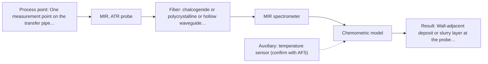

# First technical assessment: Pressure, flow and blockage of a slurry pipe

## Answer

**Customer request (our summary):** Customer asks whether fiber optic products can measure line pressure and flow rate of a slurry in a transfer pipe, and provide early warning of pipe blockage.

### Brief answer

Line pressure and flow rate are not spectroscopic quantities, so fiber-optic spectroscopy cannot measure them; conventional pressure and flow sensors are needed. For blockage, an optical probe could be tested as a proxy: mid-IR ATR first, Raman as a comparison, and NIR reflection only if the slurry is optically thick. Whether any method sees blockage early enough is unknown and needs a lab trial on your slurry.

### Proposal

- **Best current option:** O2 (recommended)
- **Basis:** engineering judgement, with secondary external support E02 ¶34 (not AFS material)
- **What would change it:** If the lab trial shows the slurry is transparent, or that Raman detects a blockage-related change better than mid-IR ATR, the single-method choice would change. If pressure and flow are the real priority, no optical method applies and conventional sensors are needed.
- **Next step:** Run a feasibility trial on representative slurry samples with the single methods, starting with a mid-IR ATR probe.

**Secondary evidence (external, not AFS material):** G1: no usable external source found; G2: E03 ¶12; G3: E05 ¶4; G4: E01 ¶8, E02 ¶34. See Expert detail.

**Decision status:** Outside the supported scope

### Solution options

| ID | Tier | Methods | Confidence | Cost class, S01 Table 1 (p.6) | Ease of use | Maintenance | Performance fit | Sources |
|---|---|---|---|---|---|---|---|---|
| O1 | Simple | M2 Raman probe | Low: open question: Q1, Q3 (starts at Medium); status: outside supported scope | high cost (row 12) | one probe, standard silica fibers | probe cleaning; watch laser and fluorescence | water-tolerant fingerprint of the bulk slurry | [1: S01 p.16] |
| O2 | Recommended | M1 MIR, ATR probe | Low: open question: Q1, Q3 (starts at Medium); status: outside supported scope | high cost (row 2) | flush ATR probe, tight contact needed | crystal cleaning; watch abrasion and fouling | selective fingerprint of the wall-adjacent layer | [2: S04 p.4] [3: S01 p.9] |

*Confidence rates the basis of the advice (how much is known and cited), not a predicted accuracy or probability of success. It starts at High, or at Medium when a key question on the method or the option is open, and drops one level per weakness listed (floor Low).*

*Cost class is the relative rating in S01 Table 1 (p.6) for the in-line method+technique rows named (the highest one for a multi-method option); it is not a price.*

### Setup sketch

*Recommended option O2; drawn by code from the option, a schematic, not a configuration.*

### Key questions

1. What are the solid and liquid phases of the slurry, their particle size distribution and the solids concentration?
2. Is the slurry optically transparent, or thick and strongly scattering?
3. What exactly counts as a blockage, and how much warning time before it occurs is needed?

## Expert detail

**Customer enquiry**

> We need to know the line pressure and the flow rate of a slurry in our transfer pipe, and we want an early warning when the pipe starts to block. Could your fiber optic products help with this?

**Decision status:** Outside the supported scope. The customer's first two targets, line pressure and flow rate, are non-optical process variables that no supplied source covers; fiber-optic spectroscopy here reports chemical and morphological information, not pressure or flow. A spectroscopic indicator of blockage onset can only be a hypothesis, so the shortlist is conditional.

### Parameters

| ID | Parameter | Kind | Need | Measured by | Why | Sources |
|---|---|---|---|---|---|---|
| P1 | Line pressure | quantitative | required | Not measurable in-line by spectroscopy; alternative: a pressure transmitter | It is a stated target, but optical spectra report chemical and morphological information, not pressure. | [4: S01 p.4] |
| P2 | Flow rate | quantitative | required | Not measurable in-line by spectroscopy; alternative: a flow meter | It is a stated target and is not a spectroscopic quantity. | *(no verified source: engineering judgement)* |
| P3 | Wall-adjacent deposit or slurry layer at the probe (blockage precursor) | qualitative | required | Spectroscopy: MIR | A contact ATR probe sees only a thin layer at the crystal, so it senses material building up at the pipe wall, where blockage begins. | [5: S01 p.13] |
| P4 | Change in bulk slurry composition or scattering | qualitative | required | Spectroscopy: Raman | A Raman probe samples a larger volume than ATR, so it senses changes in the bulk slurry rather than only at the wall. | *(no verified source: engineering judgement)* |
| P5 | Process temperature | quantitative | optional | Auxiliary sensor: temperature sensor (engineering judgement: confirm availability with AFS) | It is unknown and should be available because it affects the spectra and the choice of probe and fiber. | *(no verified source: engineering judgement)* |

### Solution option details

- **O1 cost drivers:** Raman spectrometer, laser, fiber probe and chemometric model
- **O2 cost drivers:** FTIR spectrometer, mid-IR fibers, ATR probe and chemometric model

### Premise check

- **Not covered:** Fiber-optic products can measure the line pressure and flow rate of the slurry. No supplied source describes an optical or spectroscopic measurement of pressure or flow rate; the sources describe chemical and morphological information from spectra, so this part of the request lies outside the material. *(no verified source: engineering judgement)*
- **Not covered:** Fiber-optic products can give early warning when the pipe starts to block. No supplied source addresses blockage, deposition or fouling detection, so early warning of blockage is not covered. *(no verified source: engineering judgement)*
- **Precedent only:** A slurry in a transfer pipe can be monitored in-line with fiber-optic probes. Fiber probes are shown being used in-line on a flowing process stream, which is a reason to test a slurry, not proof that it works for this slurry or this blockage question. [6: S02 p.14]

### Requirements

**Stated by the customer**

- "We need to know the line pressure and the flow rate of a slurry in our transfer pipe"
- "we want an early warning when the pipe starts to block"
- "Could your fiber optic products help with this?"
- "line pressure"
- "flow rate"
- "early warning when the pipe starts to block"

**Key unknowns**

- Slurry composition (solid and liquid phases), particle size distribution and solids concentration.
- Whether the slurry is optically transparent or thick and strongly scattering.
- What counts as blockage (pressure drop, flow reduction, wall deposit) and the required warning lead time.
- Operating temperature and pressure ranges, pipe diameter and material, and the available probe access point.
- Slurry abrasiveness and fouling tendency, and what cleaning is possible at the measurement point.
- Required accuracy for line pressure and flow, and the existing reference instrumentation.

### Clarification questions (most decision-relevant first)

Q1. What are the solid and liquid phases of the slurry, their particle size distribution and the solids concentration? *Why it matters:* These decide which optical method and probe geometry can see the slurry at all. *(affects: method)*
Q2. Is the slurry optically transparent, or thick and strongly scattering? *Why it matters:* This decides the technique: transmission or transflection for a clear liquid, diffuse reflection for an opaque, scattering one. *(affects: technique)*
Q3. What exactly counts as a blockage, and how much warning time before it occurs is needed? *Why it matters:* It sets what the optical measurement must detect and how early, which shapes the method choice. *(affects: method)*
Q4. What are the operating temperature and pressure ranges, the pipe diameter and material, and the available probe access point? *Why it matters:* These decide probe, fiber and installation feasibility at the pipe. *(affects: installation)*
Q5. Is the slurry abrasive or prone to fouling, and what cleaning is possible at the measurement point? *Why it matters:* This decides whether a contact probe is viable and how much maintenance it would need. *(affects: installation)*

### Recommendation

- **M1 · Primary candidate: MIR, ATR probe.** ATR is a common in-line route for liquids and pastes and samples only a thin layer at the crystal, so a flush ATR probe would sense the layer next to the pipe wall, where deposits start. Mid-IR gives well-defined, selective absorption bands. *Conditions:* The slurry must wet the ATR crystal and must not abrade or foul it. [2: S04 p.4] [3: S01 p.9]
- **M2 · Comparison candidate: Raman probe.** Raman gives a molecular fingerprint and tolerates water better than infrared methods, so it is a natural single-method comparison for a likely aqueous slurry. Its signal is weak and can be swamped by fluorescence. *Conditions:* Check the fluorescence background on real slurry samples. [1: S01 p.16]
- **M3 · Conditional candidate: NIR, diffuse reflection probe.** NIR reflection is the most common in-line fiber-probe method and suits opaque, strongly scattering samples, so it would fit an optically thick slurry. Whether this slurry is scattering or transparent is unknown. *Conditions:* Applies only if the slurry is optically thick and scattering rather than transparent. [7: S01 p.10] [8: S01 p.17]

### Measurement concept

- **Probe and geometry:** A single in-line fiber probe at the pipe wall: a flush ATR head for MIR, or a Raman probe for the comparison. Geometry (contact ATR versus a windowed reflection or Raman probe) depends on the answers to Q1 and Q2.
- **Location:** One measurement point on the transfer pipe, chosen where deposits or solids build-up would show first; access for cleaning must be confirmed (Q4, Q5).
- **Fiber link:** Mid-IR needs chalcogenide or polycrystalline fibers or hollow waveguides; Raman and NIR use silica fibers. No fiber length, product code or rating is stated in the sources and none is assumed here. [9: S02 p.6] [10: S02 p.6]

### Spectral range

- **MIR:** Nominal mid-IR range 4000-400 cm-1 (about 2.5-25 µm). The usable range depends on the instrument, fiber and ATR crystal actually selected. [3: S01 p.9]
- **Raman:** The Raman shift (cm-1) is the spectral axis; the laser excitation wavelength is stated separately and is not fixed yet. [11: S01 p.11]
- **NIR:** Nominal NIR range 780-2500 nm. The usable range depends on the instrument, fiber and probe actually selected. [12: S01 p.10]

### Risks and uncertainty

- Line pressure and flow rate cannot be obtained from optical spectra, so the shortlist addresses only a possible blockage proxy, not the customer's first two targets. *(rules: R-GEN-1)* *(no verified source: engineering judgement)*
- If the slurry is optically thick or highly scattering, a contact ATR or Raman probe may see only a thin or local volume that does not represent the bulk stream. *(rules: R-MIR-3, R-CMB-2, R-GEN-5)* [5: S01 p.13]
- A fluorescence background or an unrepresentative probe spot could make a spectral change look like blockage when it is not. *(rules: R-RAM-1)* [13: S01 p.11]
- Abrasion, fouling or deposits on the probe crystal or window could cause false signals and extra maintenance. *(rules: R-MIR-3, R-CAL-1)* *(no verified source: engineering judgement)*

### First feasibility experiment

1. **Collect representative slurry samples or process states across the expected composition, particle-size, temperature and flow variation, including a near-blockage state.** Representative samples or process states [14: REF §3]
2. **Measure every sample with the single methods first (MIR ATR, then Raman) through a fiber probe at controlled temperature, and record the raw spectra.** Single methods first *(no verified source: engineering judgement)*
3. **Obtain independent reference values for each sample: solids concentration and composition by a laboratory method, and the blockage state from the existing process instrumentation.** Independent reference measurements [15: REF §3]
4. **Build one chemometric model per method and validate it on held-out runs or batches.** Validation on held-out data *(no verified source: engineering judgement)*
5. **Agree the numeric go/no-go criteria with the customer (required warning lead time and acceptable false-alarm rate) before the trial starts.** Go/no-go basis from the customer [16: REF §3]

**Reference measurements:** Solids concentration and composition by a laboratory method, and the blockage state from existing process instrumentation.

**Decision basis:** Numeric criteria set by the customer (warning lead time, false-alarm rate); a method passes only if its model detects the blockage state on held-out runs.

### Assumptions

- The slurry is a flowing, heterogeneous dispersion of solids in a liquid and is measured at one point on the pipe wall.
- The customer accepts that line pressure and flow rate are measured by conventional sensors, not by fiber-optic spectroscopy.
- The blockage question is reframed as detecting a change in the slurry or the wall-adjacent layer at the probe.

### Not covered by the supplied sources

- Whether fiber-optic products can measure line pressure or flow rate (no supplied source covers optical pressure or flow measurement).
- Whether fiber-optic spectroscopy can give early warning of pipe blockage or deposition (no supplied source covers this).

### Further notes

- **Chemometrics:** Both candidate methods need chemometric models: MIR and Raman calibrations are specific to the sample matrix, and a blockage indicator would most likely be a classification model built on labelled samples. Reference data for the blockage state must come from the process, not from the spectra.
- **Real-time tracking:** The early-warning goal is an in-line, time-resolved measurement: spectra would be acquired continuously at the probe and tracked against the model. The acquisition rate and the required warning lead time would have to be matched to the process.
- **Future direction:** A later step could combine mid-IR ATR and Raman in one multispectral probe, since their spectra are complementary; any gain would still have to be shown against the best single method on independent runs.

### Secondary evidence (external, not AFS material)

*Found by a literature search for gaps the supplied AFS sources leave open. Not AFS material and not proof for this case; every quote below was verified verbatim against the fetched text.*

**G1 · decision status:** outside supported scope: The customer's first two targets, line pressure and flow rate, are non-optical process variables that no supplied source covers; fiber-optic spectroscopy here reports chemical and morphological information, not pressure or flow. A spectroscopic indicator of blockage onset can only be a hypothesis, so the shortlist is conditional.

- No usable external source found.

**G2 · auxiliary sensor:** In-line measurement of Process temperature with temperature sensor

- **E03 ¶12** Temperature sensitivity of OH bands in aqueous solutions in NIR and MIR makes tempered sample holders necessary. *How it applies:* For the MIR ATR option, this suggests temperature control or measurement may be needed to reduce spectral interference from an aqueous slurry. *Limits and transfer risks:* The source is a review of biopharmaceutical downstream processing, not a slurry pipe; tempered sample holders are not the same as an in-line process temperature sensor. *(supports O2)*
  > "Additionally, the temperature sensitivity of the OH bands is a severe drawback for measuring aqueous solution in NIR and MIR, which makes tempered sample holders necessary [29]."
  > A critical review of recent trends, and a future perspective of optical spectroscopy as PAT in biopharmaceutical downstream processing. (2020) · Analytical and bioanalytical chemistry · doi:10.1007/s00216-020-02407-z · https://europepmc.org/article/PMC/PMC7072065 · retrieved 2026-10-17, full text, licence: cc by, via curated library

**G3 · not in the supplied sources:** Whether fiber-optic products can measure line pressure or flow rate (no supplied source covers optical pressure or flow measurement).

- **E05 ¶4** The source lists pressure among parameters that fiber optic sensors can sense. *How it applies:* This suggests pressure sensing is within broader fiber-optic sensor technology, but it does not show line pressure or flow rate measurement in a slurry pipe. *Limits and transfer risks:* The source is an introductory paper and the quoted fragment does not cover flow, slurry, line pressure, or a specific product.
  > "sensing different parameters like strain, temperature, pressure in"
  > Fiber Optic Sensors (2008) · Zenodo (CERN European Organization for Nuclear Research) · doi:10.5281/zenodo.1076165 · https://zenodo.org/record/1076166 · retrieved 2026-10-17, full text, licence: other-oa, via openalex

**G4 · not in the supplied sources:** Whether fiber-optic spectroscopy can give early warning of pipe blockage or deposition (no supplied source covers this).

- **E01 ¶8** For a continuous process at a fixed probe location, online monitoring focuses on drift and out-of-specification detection rather than resolving rapidly changing composition. *How it applies:* This could inform a test of whether a fixed-probe spectroscopic system can flag out-of-specification states that might accompany blockage onset, but it does not address deposition or slurry blockage directly. *Limits and transfer risks:* The source concerns reactive liquid-liquid extraction in lithium recycling, not a slurry transfer pipe; transfer to in-line slurry monitoring is uncertain.
  > "In contrast, a continuous process at a fixed probe location is intended to operate in a steady-state window, which simplifies the model design: calibrations can be narrower and centered on the operational envelope, validation can rely on independent steady-state runs, and online monitoring focuses on drift and out-of-specification detection rather than resolving the rapidly changing composition."
  > Process Analytical Technology-Integrated FT-IR and Raman Spectroscopies for Efficient Reactive Liquid-Liquid Extraction Processing in Lithium Recycling. (2025) · ACS omega · doi:10.1021/acsomega.5c05705 · https://europepmc.org/article/PMC/PMC12573149 · retrieved 2026-10-17, full text, licence: cc by, via curated library
- **E02 ¶34** ATR-FTIR combined with PCA was reported as valuable for real-time reaction monitoring and identifying faulty batches. *How it applies:* This could support testing MIR ATR with multivariate analysis for abnormal-state detection, as a possible analogue to early blockage warning, but blockage itself is not measured. *Limits and transfer risks:* The work is on polysiloxane formation, not slurry flow or pipe deposition; laboratory or process conditions may differ from in-line pipe conditions. *(supports O2)*
  > "The combination of ATR-FTIR measurements and PCA proved to be a valuable tool for real-time reaction monitoring and identifying faulty batches."
  > A Process Analytical Concept for In-Line FTIR Monitoring of Polysiloxane Formation. (2020) · Polymers · doi:10.3390/polym12112473 · https://europepmc.org/article/PMC/PMC7693933 · retrieved 2026-10-17, full text, licence: cc by, via curated library

### Evidence (verified quotes)

1. ✓ **S01 p.16** (general): "Raman is particularly well-suited for aqueous environments, as it exhibits low absorbance for water molecules compared to infrared methods."
2. ✓ **S04 p.4** (general): "suitability of analyzed samples for ATR measurements, which is true for liquid or soft solid samples and their components, allowing a tight contact with the probe head."
3. ✓ **S01 p.9** (general): "Vibrational spectroscopy in the mid-IR range (4000-400 cm-1) is one of the most informative methods of chemical analysis."
4. ✓ **S01 p.4** (general): "Spectral analysis provides information about the chemistry and morphology of the sample being studied: the concentrations of its components, their distribution, and particle sizes."
5. ✓ **S01 p.13** (general): "typically at a depth of few microns"
6. ✓ **S02 p.14** (application precedent): "NIR-Reflex & MIR-ATR-spectroscopy to control polymer extrusion in-line"
7. ✓ **S01 p.10** (general): "Near-IR vibrational spectroscopy (NIR) is the most common online analysis method performed using fiber optic probes."
8. ✓ **S01 p.17** (general): "NIR Reflection is primarily used for opaque or highly concentrated dairy products, such as yogurt, butter, or whole milk concentrates."
9. ✓ **S02 p.6** (general): "1100 nm Chalcogenide As-S IR Fibers 6500 nm"
10. ✓ **S02 p.6** (general): "350 nm Standard VIS-NIR Silica Fibers Al/Cu-coated VIS-NIR Silica Fibers 2400 nm"
11. ✓ **S01 p.11** (general): "The Raman shift is used as the horizontal (spectral) axis in Raman spectroscopy"
12. ✓ **S01 p.10** (general): "NIR spectra (780-2500 nm) contain predominantly overtones and component bands of fundamental vibrations"
13. ✓ **S01 p.11** (general): "superposition of luminescence (fluorescence), which has a significantly higher intensity."
14. ✓ **REF §3** (general): "Representative samples or process states"
15. ✓ **REF §3** (general): "independent reference measurements"
16. ✓ **REF §3** (general): "the basis for the go / no-go decision"

### Verification

- Citations verified: 20 of 20 (exact or whitespace/hyphen-tolerant match on the cited page, scope checked).
- Hard check failures before deterministic corrections: 0; still open: 0; soft warnings: 1; repair rounds: 1.
- External evidence (live): 4 quote(s) verified verbatim (exact or whitespace/hyphen-tolerant, at most 400 characters and 2 sentences, against the cited paragraph); 0 item(s) dropped.
- External search: 6 query(ies), 45 hit(s), 5 source(s) (3 from the curated library).
- External step: 2 model call(s), 62.9 s extra (cost in the run JSON).

*Run A05-20261017T233522Z · models deepseek/deepseek-v4.1-flash*
