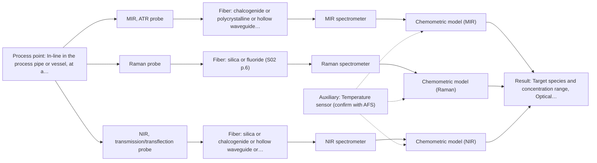
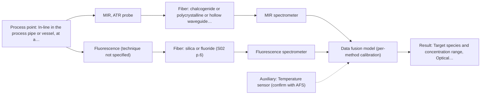

# First technical assessment: Vague one-line request

## Answer

**Customer request (our summary):** The customer is asking if we can measure their liquid sample in-line.

### Brief answer

In-line fiber-optic measurement of a liquid is feasible in principle, but the target species, optical clarity and process conditions are unknown, so no single method can be confirmed yet. We suggest a multi-method lab trial comparing MIR-ATR, Raman and (if the liquid is clear) NIR transmission on your samples with independent reference analyses. Please tell us what to measure, how clear and aqueous the liquid is, and the process temperature, pressure and required accuracy.

### Proposal

- **Best current option:** O2 (recommended)
- **Basis:** supplied AFS sources
- **What would change it:** Answers to Q1-Q3 could move the primary method to NIR transmission (clear liquid) or Raman (aqueous, fluorescent matrix), and a confirmed fluorophore plus insufficient single-method performance would promote the combined option O3.
- **Next step:** Answer the clarification questions and supply representative liquid samples for a multi-method lab trial with independent reference analyses.

**Secondary evidence (external, not AFS material):** G1: no usable external source found; G2: E01 ¶12; G3: E02 ¶36; G4: no usable external source found. See Expert detail.

**Decision status:** Insufficient information for a method choice

### Solution options

| ID | Tier | Methods | Confidence | Cost class, S01 Table 1 (p.6) | Ease of use | Maintenance | Performance fit | Sources |
|---|---|---|---|---|---|---|---|---|
| O1 | Simple | M1 MIR, ATR probe | Low: open question: Q1 (starts at Medium); uncited auxiliary sensor and a parameter is not measurable in-line; status: insufficient information | high cost (row 2) | Single immersion probe, straightforward installation | Crystal cleaning and fouling checks needed | Fits unknown liquids since ATR needs contact, not transparency | [1: S01 p.10] [2: S01 p.9] |
| O2 | Recommended | M1 MIR, ATR probe; M2 Raman probe; M3 NIR, transmission/transflection probe | Low: open question: Q1 (starts at Medium); sample clarity unknown; uncited auxiliary sensor and a parameter is not measurable in-line; status: insufficient information | high cost (rows 2, 7, 12) | Lab trial before any hardware commitment | None during trial; maintenance defined after method selection | Fits the unknown case by letting data select the best single method | [3: S02 p.20] [1: S01 p.10] [2: S01 p.9] [4: S01 p.16] [5: S01 p.11] [6: S01 p.18] [7: S01 p.18] |
| O3 | Extended (multi-method) | M4 MIR, ATR probe + Fluorescence (combination) | Low: open question: Q1 (starts at Medium); fluorescent target unknown; uncited auxiliary sensor and a parameter is not measurable in-line; status: insufficient information; multi-method, fusion benefit not yet shown | at least high cost (row 2); Fluorescence row not identified | Combined probe reduces alignment effort | Two spectrometer blocks, each with its own calibration and diagnostics | Fits only if one method cannot separate the target from interferences | [8: S01 p.8] [9: S01 p.8] [10: S01 p.7] [11: S04 p.1] |

*Confidence rates the basis of the advice (how much is known and cited), not a predicted accuracy or probability of success. It starts at High, or at Medium when a key question on the method or the option is open, and drops one level per weakness listed (floor Low).*

*Cost class is the relative rating in S01 Table 1 (p.6) for the in-line method+technique rows named (the highest one for a multi-method option); it is not a price.*

### Setup sketch

*Recommended option O2; drawn by code from the option, a schematic, not a configuration.*

### Key questions

1. Which species should be measured, and is the goal quantitative concentration tracking or qualitative detection/classification?
2. Is the liquid optically clear or turbid/scattering, and is it aqueous?
3. What are the temperature, pressure and fouling conditions at the in-line measurement point?

## Expert detail

**Customer enquiry**

> Can you measure our liquid in-line?

**Decision status:** Insufficient information for a method choice. The enquiry states only that the sample is a liquid and should be measured in-line; without the target species, optical clarity and process conditions, no single method can be justified, so a conditional shortlist and deciding questions are given instead.

### Parameters

| ID | Parameter | Kind | Need | Measured by | Why | Sources |
|---|---|---|---|---|---|---|
| P1 | Target species and concentration range | quantitative | required | Reference lab method: Customer or contract lab analytical method (e.g. HPLC, titration) | The analyte's spectral bands and concentration range decide which method and technique can measure it. | *(no verified source: engineering judgement)* |
| P2 | Optical clarity / turbidity of the liquid | qualitative | required | Not measurable in-line by spectroscopy; alternative: Visual inspection and lab turbidity/OD measurement on samples | Clear liquids suit transmission probes while turbid ones require ATR or reflection geometries. | *(no verified source: engineering judgement)* |
| P3 | Process temperature at the measurement point | quantitative | required | Auxiliary sensor: Temperature sensor (engineering judgement: confirm availability with AFS) | Temperature shifts spectra and affects probe material choice, so it must be known or compensated. | *(no verified source: engineering judgement)* |
| P4 | Presence of fluorescent components | qualitative | optional | Reference lab method: Lab fluorescence scan of the liquid | It should be known because it decides whether the combined MIR-ATR + fluorescence option (M4) is worth testing. | *(no verified source: engineering judgement)* |

### Solution option details

- **O1 cost drivers:** One MIR spectrometer with ATR fiber probe, calibration samples, reference analyses
- **O2 cost drivers:** Multi-method lab trial on representative samples plus independent reference analyses
- **O3 cost drivers:** Combined ATR/fluorescence probe, two spectrometers, fused-model development and validation
- **O3 combining methods:** Fusion level: start with one model per method, then concatenate synchronized spectra with block scaling. Both channels must sample the same spot via the combined probe and be normalized to a common time step. The fused model must beat the best single method on held-out batches, otherwise the second instrument is dropped.

*Extended (multi-method) option O3; drawn by code from the option, a schematic, not a configuration.*

### Premise check

- **Precedent only:** In-line fiber-optic measurement of liquids is feasible in principle. The sources show in-line fiber-probe analysis of liquids as an established concept, which is a reason to test, not proof for this customer's liquid. [12: S01 p.17]
- **Not covered:** One spectroscopy method will be enough for this liquid. No supplied source addresses this specific liquid; whether one method suffices depends on the unknown target and matrix. *(no verified source: engineering judgement)*

### Requirements

**Stated by the customer**

- "liquid"
- "in-line"

**Key unknowns**

- Target species and whether the measurement is quantitative or qualitative
- Optical clarity of the liquid (clear vs. turbid/scattering)
- Whether the liquid is aqueous
- Process temperature and pressure at the measurement point
- Required accuracy, detection limit and response time
- Presence of a fluorescent component

### Clarification questions (most decision-relevant first)

Q1. Which species should be measured, and is the goal quantitative concentration tracking or qualitative detection/classification? *Why it matters:* The target determines which spectral range and method carry the information, and whether a chemometric calibration is needed. *(affects: method)*
Q2. Is the liquid optically clear or turbid/scattering, and is it aqueous? *Why it matters:* Clear liquids suit transmission/transflection probes, while turbid or strongly absorbing liquids push toward ATR or Raman. *(affects: technique)*
Q3. What are the temperature, pressure and fouling conditions at the in-line measurement point? *Why it matters:* These decide probe material and installation, and ATR contact probes are exposed to fouling and compatibility limits. *(affects: installation)*
Q4. What accuracy, detection limit and response time does the process control need? *Why it matters:* Trace-level targets may exceed what NIR can detect and change the method ranking. *(affects: method)*
Q5. Is an independent lab reference method available for calibration and validation samples? *Why it matters:* Quantitative in-line use requires reference data to build and validate the chemometric model. *(affects: status)*

### Recommendation

- **M1 · Primary candidate: MIR, ATR probe.** ATR fiber probes are made for in-line analysis of liquids without sampling, and mid-IR gives well-defined, selective absorption bands. It passed screening for a liquid of unknown optical regime because it needs only contact, not transparency. *Conditions:* The liquid must allow tight contact with the ATR crystal and the crystal material must resist the process medium. [1: S01 p.10] [2: S01 p.9]
- **M2 · Comparison candidate: Raman probe.** Raman probes handle liquids and tolerate water far better than infrared absorption, making it a strong second candidate especially if the liquid is aqueous. Its weak signal and possible fluorescence background must be checked on the real sample. [4: S01 p.16] [5: S01 p.11]
- **M3 · Conditional candidate: NIR, transmission/transflection probe.** NIR transmission or transflection is the preferred geometry for transparent or semi-transparent liquids and is the most common online fiber-probe method. It stays conditional because transmission fails if the liquid is too opaque or strongly absorbing. *Conditions:* Applies only if Q2 shows the liquid is clear and transparent enough for transmission measurement. [6: S01 p.18] [7: S01 p.18]
- **M4 · Conditional candidate: MIR, ATR probe + Fluorescence (combination).** If the liquid contains a fluorescent component, a combined ATR-plus-fluorescence probe could add complementary information, as shown for tissue and liquid samples. Any fusion gain is a hypothesis to test against the best single method after the single-method trials. *Conditions:* Applies only if a relevant fluorophore is confirmed (Q on fluorescent components) and the single methods prove insufficient. [10: S01 p.7] [11: S04 p.1]
- **M5 · Not recommended: fluorescence probe.** Fluorescence alone is not recommended as a first method because no fluorescent species or indicator in the liquid has been identified, and most chemicals do not fluoresce. It remains relevant only inside the combined option M4. [13: S01 p.5]

### Measurement concept

- **Probe and geometry:** Immersion ATR fiber probe (primary candidate) or transmission/transflection probe for clear liquids; Raman fiber probe as comparison; all inserted directly into the liquid stream.
- **Location:** In-line in the process pipe or vessel, at a representative and accessible point; exact location to be fixed with the customer.
- **Fiber link:** Silica fibers cover the Vis-NIR ranges; mid-IR requires CIR or PIR fibers, whose achievable link length is an open question for AFS. [14: S02 p.6] [15: S02 p.6]

### Spectral range

- **MIR:** Nominal mid-IR range 4000-400 cm-1 (2.5-25 µm); the usable range depends on the selected fiber (CIR or PIR), crystal and spectrometer. [16: S01 p.9]
- **NIR:** Nominal NIR range 780-2500 nm; the usable range depends on the instrument, fiber and probe actually selected. [17: S01 p.10]
- **Raman:** Raman shift in cm-1 with the laser excitation wavelength (e.g. 785 nm in the cited pharma example) stated separately; exact coverage depends on the chosen spectrometer and probe. [18: S01 p.15]

### Risks and uncertainty

- The unknown target species may lie outside the spectral range or sensitivity of the primary method chosen. *(rules: R-NIR-4)* [19: S01 p.16]
- If the liquid is turbid or strongly absorbing, transmission-based options fail and the ranking changes. *(rules: R-GEO-2)* *(no verified source: engineering judgement)*
- ATR crystal contact brings fouling, corrosion and surface-representativeness risks in a flowing process liquid. *(rules: R-MIR-3)* *(no verified source: engineering judgement)*
- Any quantitative result needs a matrix-specific chemometric calibration with independent reference data, which may not exist yet. *(rules: R-CAL-1)* *(no verified source: engineering judgement)*

### First feasibility experiment

1. **Obtain representative liquid samples spanning the expected variation in composition, temperature and turbidity.** Cover the chemical and physical variation the in-line method must handle. *(no verified source: engineering judgement)*
2. **Measure each sample with the candidate single methods (MIR-ATR, Raman, and NIR transmission if clear) using lab spectrometers and fiber probes.** Compare which method carries the target information before any in-line hardware is chosen. [3: S02 p.20]
3. **Run independent reference lab measurements (e.g. the customer's existing analytical method) on the same samples.** Provide the ground truth for calibration and validation. *(no verified source: engineering judgement)*
4. **Build and validate chemometric models per method on held-out samples or batches; only then test a combined MIR-ATR + fluorescence option if a fluorophore is present.** Single methods first; a fusion gain must be demonstrated against the best single method. [20: REF §3]
5. **Agree go/no-go criteria with the customer (e.g. required accuracy and detection limit) and evaluate each method against them.** The customer's own numerical requirements decide which option proceeds to in-line installation. *(no verified source: engineering judgement)*

**Reference measurements:** Independent lab analysis of the same samples by the customer's or a contract laboratory.

**Decision basis:** Go/no-go against customer-defined accuracy, detection limit and response-time criteria (Q4/Q5).

### Assumptions

- The liquid is compatible with at least one fiber-probe material and the process point allows probe insertion.
- Standard lab-to-process transfer of the tested method is possible; no in-line-specific effects are assumed before testing.

### Not covered by the supplied sources

- Any performance figure (accuracy, detection limit, response time) for this customer's liquid
- Achievable mid-IR fiber link length for an in-line installation

### Further notes

- **Chemometrics:** Quantitative in-line use will require a calibration or classification model built on representative samples with independent reference values, validated on held-out runs; NIR and Raman calibrations are matrix-specific and must be re-validated after any matrix change.
- **Real-time tracking:** Once a validated model exists, the fiber-probe setup supports continuous in-line tracking of the target with results in near real time, which is the stated goal of the enquiry.
- **Future direction:** After the method is proven, a compact customized spectral fiber sensor or IoT-style sensor for the specific measurement point could replace the lab spectrometer, following the OMS pathway described in the sources.

### Secondary evidence (external, not AFS material)

*Found by a literature search for gaps the supplied AFS sources leave open. Not AFS material and not proof for this case; every quote below was verified verbatim against the fetched text.*

**G1 · decision status:** insufficient information: The enquiry states only that the sample is a liquid and should be measured in-line; without the target species, optical clarity and process conditions, no single method can be justified, so a conditional shortlist and deciding questions are given instead.

- No usable external source found.

**G2 · auxiliary sensor:** In-line measurement of Process temperature at the measurement point with Temperature sensor

- **E01 ¶12** The temperature sensitivity of the OH bands is a severe drawback for measuring aqueous solution in NIR and MIR, which makes tempered sample holders necessary. *How it applies:* Since temperature variations affect aqueous bands in MIR and NIR, monitoring process temperature concurrently at the measurement point should be tested to correct for spectral shifts. *Limits and transfer risks:* The cited study addresses general spectral characteristics rather than the specific customer matrix or instrument, so temperature compensation models must be validated on the customer's actual process fluid. *(supports O2)*
  > "Additionally, the temperature sensitivity of the OH bands is a severe drawback for measuring aqueous solution in NIR and MIR, which makes tempered sample holders necessary [29]."
  > A critical review of recent trends, and a future perspective of optical spectroscopy as PAT in biopharmaceutical downstream processing. (2020) · Analytical and bioanalytical chemistry · doi:10.1007/s00216-020-02407-z · https://europepmc.org/article/PMC/PMC7072065 · retrieved 2026-10-17, full text, licence: cc by, via curated library

**G3 · multi-method:** Combining several spectroscopy methods (data fusion) (Fusion level: start with one model per method, then concatenate synchronized spectra with block scaling. Both channels must sample the same spot via the combined probe and be normalized to a common time step. The fused model must beat the best single method on held-out batches, otherwise the second instrument is dropped.)

- **E02 ¶36** Instrument complementarity was not always sufficient to improve the predictive performance of several critical quality attributes when fusing Raman and FT-IR data. *How it applies:* When combining methods such as MIR ATR and Raman, one must verify that the fused model actually outperforms single-method models on held-out batches before committing to multi-method integration. *Limits and transfer risks:* The cited finding stems from a specific food analytical study combining Raman and FT-IR, which may not translate to the customer's specific chemical system or liquid matrix. *(supports O3)*
  > "In some situations, instrument complementarity (not data complementarity) was not sufficient to improve the performance of predictive several CQAs, as shown by a Raman and FT-IR data based food analytical study [73]."
  > Challenges and Opportunities of Implementing Data Fusion in Process Analytical Technology-A Review. (2022) · Molecules (Basel, Switzerland) · doi:10.3390/molecules27154846 · https://europepmc.org/article/PMC/PMC9369811 · retrieved 2026-10-17, full text, licence: cc by, via curated library

**G4 · not in the supplied sources:** Any performance figure (accuracy, detection limit, response time) for this customer's liquid

- No usable external source found.

### Evidence (verified quotes)

1. ✓ **S01 p.10** (general): "ATR fiber probes (Fig.1) enable the analysis of liquids and solid elastic samples"
2. ✓ **S01 p.9** (general): "Vibrational spectroscopy in the mid-IR range (4000-400 cm-1) is one of the most informative methods of chemical analysis."
3. ✓ **S02 p.20** (general): "1. Multi-Method Lab Trials AFS tests your process using all key fiber optic spectroscopy methods."
4. ✓ **S01 p.16** (general): "Raman is particularly well-suited for aqueous environments, as it exhibits low absorbance for water molecules compared to infrared methods."
5. ✓ **S01 p.11** (general): "superposition of luminescence (fluorescence), which has a significantly higher intensity."
6. ✓ **S01 p.18** (general): "Transmission is the preferred method for transparent or semi-transparent liquids, such as skim milk, whey, or permeate."
7. ✓ **S01 p.18** (general): "it fails when the milk becomes too "thick" or fat-rich, as the light cannot penetrate the sample."
8. ✓ **S01 p.8** (general): "collected from the same small, even pinpoint, area of the sample."
9. ✓ **S01 p.8** (general): "the measurement data must be normalized to a common time step."
10. ✓ (precedent only) **S01 p.7** (method gain): "The analysis of such systems may require a combination of two or even more spectral methods."
11. ✓ **S04 p.1** (application precedent): "A multispectral fiber optic probe has been developed that enables simultaneous analysis of various liquid and solid samples using attenuated total reflection mid-infrared spectroscopy and fluorimetry."
12. ✓ **S01 p.17** (application precedent): "The use of Near-Infrared (NIR) spectroscopy for the inline monitoring of milk is a cornerstone of modern dairy "Process Analytical Technology" (PAT)."
13. ✓ **S01 p.5** (general): "However, most chemicals do not exhibit this property."
14. ✓ **S02 p.6** (general): "350 nm Standard VIS-NIR Silica Fibers Al/Cu-coated VIS-NIR Silica Fibers 2400 nm"
15. ✓ **S02 p.6** (general): "3000 nm Polycrystalline Infrared Fibers 17 μm"
16. ✓ **S01 p.9** (general): "Vibrational spectroscopy in the mid-IR range (4000-400 cm-1)"
17. ✓ **S01 p.10** (general): "NIR spectra (780-2500 nm) contain predominantly overtones and component bands of fundamental vibrations"
18. ✓ **S01 p.15** (general): "Raman spectrometer and Raman fiber probe for contact measurements with 785 nm excitation wavelength"
19. ✓ **S01 p.16** (general): "may lack the sensitivity to detect trace compounds below 0.1 percent."
20. ✓ **REF §3** (general): "Representative samples or process states, independent reference measurements, what is compared, and the basis for the go / no-go decision."

### Verification

- Citations verified: 21 of 21 (exact or whitespace/hyphen-tolerant match on the cited page, scope checked).
- Hard check failures before deterministic corrections: 0; still open: 0; soft warnings: 2; repair rounds: 1.
- ⚠ Intake incomplete after 2 attempt(s): no target left after checking the quotes against the enquiry
- External evidence (live): 2 quote(s) verified verbatim (exact or whitespace/hyphen-tolerant, at most 400 characters and 2 sentences, against the cited paragraph); 0 item(s) dropped.
- External search: 2 query(ies), 20 hit(s), 5 source(s) (3 from the curated library).
- External step: 2 model call(s), 7.6 s extra (cost in the run JSON).

*Run A06-20261018T094733Z-4489 · models google/gemini-3.5-flash-lite, google/gemini-3.8-flash, z-ai/glm-5.3-flash*
