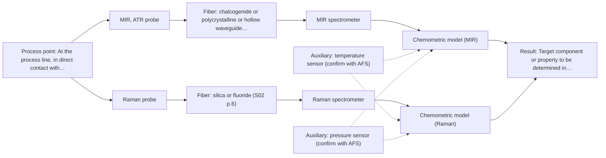

# First technical assessment: Vague one-line request

## Answer

**Customer request:** Can you measure our liquid in-line?

### Brief answer

Nothing in the enquiry yet says what the liquid is or what should be measured, so no method can be confirmed. The first trial worth running is mid-IR ATR with a fiber probe, compared on the same samples with a Raman probe. NIR transmission can be added if the liquid turns out to be transparent. The questions on target, optical behaviour, accuracy and process conditions decide the final configuration.

### Proposal

- **Best current option:** O2 (recommended)
- **Basis:** engineering judgement, with secondary external support E02 ¶8, E02 ¶19 (not AFS material)
- **What would change it:** If the liquid turns out to be transparent or semi-transparent and the target is a major component, the NIR transmission or transflection arm (M2) becomes the cheapest first test. If the target is a trace component or the liquid is opaque, the MIR-ATR arm carries the trial and Raman stays a comparison; fusing the two methods into one model is only worth testing if no single method meets the agreed criteria.
- **Next step:** Answer the questions on target, optical behaviour, accuracy and process conditions so that a single-method trial on representative samples can be specified.

**Secondary evidence (external, not AFS material):** G1: E02 ¶8, E02 ¶19; G2: E03 ¶12, E05 ¶9; G3: no usable external source found; G4: no usable external source found. See Expert detail.

**Decision status:** Insufficient information for a method choice

### Solution options

| ID | Tier | Methods | Confidence | Cost class, S01 Table 1 (p.6) | Ease of use | Maintenance | Performance fit | Sources |
|---|---|---|---|---|---|---|---|---|
| O1 | Simple | M1 MIR, ATR probe | Low: open question: Q1, Q3 (starts at Medium); uncited auxiliary sensor; status: insufficient information | high cost (row 2) | one contact probe, one spectrometer | crystal cleaning, periodic recalibration | most informative single method for an unknown liquid | [1: S01 p.9] [2: S01 p.10] [3: S04 p.4] |
| O2 | Recommended | M1 MIR, ATR probe; M3 Raman probe | Low: open question: Q1, Q3 (starts at Medium); uncited auxiliary sensor; status: insufficient information | high cost (rows 2, 12) | two instruments, one shared sample set | two calibrations, two probe types | MIR and Raman complement each other on more liquids | [1: S01 p.9] [2: S01 p.10] [3: S04 p.4] [4: S01 p.11] [5: S01 p.16] [6: S01 p.11] |

*Confidence rates the basis of the advice (how much is known and cited), not a predicted accuracy or probability of success. It starts at High, or at Medium when a key question on the method or the option is open, and drops one level per weakness listed (floor Low).*

*Cost class is the relative rating in S01 Table 1 (p.6) for the in-line method+technique rows named (the highest one for a multi-method option); it is not a price.*

### Setup sketch

*Recommended option O2; drawn by code from the option, a schematic, not a configuration.*

### Key questions

1. Which component(s) or property should the in-line measurement determine, and over what concentration or value range?
2. How does the liquid behave optically at the measurement point - clear and transparent, turbid, opaque or strongly absorbing - and is it water-based?
3. What accuracy, precision and response time are required, and which reference method (and accuracy) is used today to check the liquid?

## Expert detail

**Customer enquiry**

> Can you measure our liquid in-line?

**Decision status:** Insufficient information for a method choice. The sources describe the physics and the probe families, but none of them can decide the method for a liquid whose target and matrix are not stated. This assessment is therefore a conditional shortlist with the deciding questions listed.

### Parameters

| ID | Parameter | Kind | Need | Measured by | Why | Sources |
|---|---|---|---|---|---|---|
| P1 | Target component or property to be determined in the liquid | quantitative | required | Spectroscopy: MIR | It defines what any calibration model must predict and whether the chosen method can reach the required level. | *(no verified source: engineering judgement)* |
| P2 | Temperature at the measurement point | quantitative | required | Auxiliary sensor: temperature sensor (engineering judgement: confirm availability with AFS) | Process temperature shifts spectra and sets the probe and fiber hardware that can be used in-line. | *(no verified source: engineering judgement)* |
| P3 | Pressure at the measurement point | quantitative | required | Auxiliary sensor: pressure sensor (engineering judgement: confirm availability with AFS) | Pressure decides the probe body and the process connection that can be installed in the line. | *(no verified source: engineering judgement)* |

### Solution option details

- **O1 cost drivers:** one spectrometer, one ATR fiber probe, sample trial and calibration
- **O2 cost drivers:** two spectrometers, MIR ATR and Raman probes, two calibrations, data alignment

### Premise check

- **Supported:** A liquid can be measured in-line with fiber-optic probes as a general approach. The sources describe probe-based analysis being used in-line in process environments, so the general approach is supported; it says nothing about this customer's liquid. [2: S01 p.10]
- **Not covered:** This particular liquid is suitable for in-line measurement, so the enquiry can be answered yes or no. No supplied source addresses the customer's liquid; target, matrix, optical behaviour and process conditions are not stated, and method choice depends on the analytical task. *(no verified source: engineering judgement)*

### Requirements

**Stated by the customer**

- The material is a liquid.
- The measurement should be in-line.

**Key unknowns**

- Target species or property to be measured, and its range
- Optical behaviour of the liquid (clear, turbid, opaque, strongly absorbing) and whether it is aqueous
- Required accuracy, precision and response time, and the reference method used today
- Process conditions at the measurement point (temperature, pressure, flow) and the exact installation point
- Distance between the instrument location and the measurement point
- Particles, bubbles or multiple phases, and cleaning/fouling requirements

### Clarification questions (most decision-relevant first)

Q1. Which component(s) or property should the in-line measurement determine, and over what concentration or value range? *Why it matters:* The target decides which method can be sensitive and selective enough, so it changes the method choice. *(affects: method)*
Q2. How does the liquid behave optically at the measurement point - clear and transparent, turbid, opaque or strongly absorbing - and is it water-based? *Why it matters:* Transmission geometries fail in thick, opaque or strongly absorbing liquids, while ATR and reflection geometries do not need transparency. *(affects: technique, M2)*
Q3. What accuracy, precision and response time are required, and which reference method (and accuracy) is used today to check the liquid? *Why it matters:* These values are the go/no-go criteria and can rule out methods whose sensitivity is too low. *(affects: method)*
Q4. What are the temperature, pressure and flow rate at the measurement point, and where exactly would the probe be installed? *Why it matters:* Process conditions and the installation point decide the probe and fiber hardware and whether the liquid can contact the probe head. *(affects: installation)*
Q5. What distance is there between where the instrument can stand and the measurement point? *Why it matters:* The fiber link length needed is not stated in the sources and limits the optical layout. *(affects: installation)*
Q6. Does the liquid contain particles, bubbles or more than one phase, and how is the line cleaned (fouling, CIP)? *Why it matters:* Particles and deposits affect contact probes and reflection windows, and the cleaning routine decides how a probe can be mounted. *(affects: technique, installation)*

### Recommendation

- **M1 · Primary candidate: MIR, ATR probe.** Mid-IR spectroscopy is described as one of the most informative methods of chemical analysis, and ATR fiber probes let liquids be measured in-line by contact without requiring a transparent sample. It is therefore the single method to test first on an unknown liquid. *Conditions:* Applies if the liquid can be brought into tight contact with the ATR crystal (liquid or soft solid) and no incompatibility with the crystal or probe materials is expected. [1: S01 p.9] [2: S01 p.10] [3: S04 p.4]
- **M2 · Conditional candidate: NIR, transmission/transflection probe.** NIR is described as the most common online analysis method using fiber probes, and transmission or transflection is preferred for transparent or semi-transparent liquids. It becomes worth testing once the liquid's optical behaviour is known. *Conditions:* Applies only if the liquid is transparent or semi-transparent and the optical pathlength can be controlled at the measurement point. [7: S01 p.10] [8: S01 p.18] [9: S01 p.18]
- **M3 · Comparison candidate: Raman probe.** Mid-IR and Raman spectra are complementary, and Raman tolerates water better than infrared methods, so it is the natural second single method to compare with the MIR-ATR arm on the same samples. Any gain from using the two together would still be a hypothesis to test after the single-method results. *Conditions:* Applies if the liquid's fluorescence background does not swamp the Raman signal. [4: S01 p.11] [5: S01 p.16] [6: S01 p.11]

### Measurement concept

- **Probe and geometry:** A contact ATR fiber probe for the MIR arm (liquid in contact with the crystal) and a Raman fiber probe on the same sample points; a transmission or transflection probe only if the liquid proves transparent.
- **Location:** At the process line, in direct contact with the flowing liquid; the exact installation point is still open (Q4).
- **Fiber link:** MIR light needs infrared-transmitting fibers (chalcogenide or polycrystalline), not silica; the achievable link length is not stated in the sources and is an open question (Q5). [10: S02 p.6] [11: S02 p.6]

### Spectral range

- **MIR:** Nominal mid-IR range 4000-400 cm-1 (2.5-25 µm); the usable range depends on the instrument, fiber and ATR crystal actually selected. [1: S01 p.9]
- **NIR:** Nominal NIR range 780-2500 nm; the usable range depends on the instrument, fiber and probe actually selected. [12: S01 p.10]
- **Raman:** Raman is reported as Raman shift (cm-1), with the laser excitation wavelength stated separately; the excitation wavelength for this case is not yet chosen. [13: S01 p.11]

### Risks and uncertainty

- If the target is a trace component, the sensitivity of NIR may not be sufficient and the shortlist would have to change. *(rules: R-NIR-4)* *(no verified source: engineering judgement)*
- If the measurement point is far from the instrument, the MIR arm may be limited by the fiber link, because no source states an achievable length for a mid-IR link. *(rules: R-FIB-2)* *(no verified source: engineering judgement)*
- If the liquid fluoresces strongly, the Raman signal can be swamped and the comparison arm weakened. *(rules: R-RAM-1)* *(no verified source: engineering judgement)*
- If the liquid fouls or coats the ATR crystal, the few-micrometre surface layer may no longer represent the bulk liquid. *(rules: R-MIR-3)* *(no verified source: engineering judgement)*

### First feasibility experiment

1. **Measure representative samples of the liquid across the expected chemical and physical variation with the MIR-ATR probe first, then with the Raman probe on the same sample points, and keep later runs or batches aside for validation.** Sample set [14: REF §3]

**Reference measurements:** Measure the same samples with the customer's current reference method (to be named in Q3) to obtain reference values for calibration and for the go/no-go comparison.

**Decision basis:** Agree the numerical criteria with the customer before the trial: required accuracy, precision and response time against the reference method; a method passes only if it meets them on held-out runs or batches.

### Assumptions

- The liquid can be brought into contact with a probe head at the measurement point.
- At least one component or property of interest gives a measurable optical signal; this is what the first trial tests.

### Not covered by the supplied sources

- Whether this specific liquid can be measured in-line: no supplied source covers its composition, matrix or optical behaviour.
- An achievable fiber length for a mid-IR link from instrument to process point: no supplied source states one.

### Further notes

- **Chemometrics:** Plan one calibration or classification model per method, built on representative samples with reference values from the customer's method; expect to re-validate after any change of liquid or feedstock.
- **Real-time tracking:** If continuous in-line tracking is wanted later, fix the acquisition rates and a common time step before any joint model is built from two methods.
- **Future direction:** If a few wavelengths prove sufficient for the target, a compact spectral fiber sensor at the same measurement point could later replace a full spectrometer.

### Secondary evidence (external, not AFS material)

*Found by a literature search for gaps the supplied AFS sources leave open. Not AFS material and not proof for this case; every quote below was verified verbatim against the fetched text.*

**G1 · decision status:** insufficient information: The sources describe the physics and the probe families, but none of them can decide the method for a liquid whose target and matrix are not stated. This assessment is therefore a conditional shortlist with the deciding questions listed.

- **E02 ¶8** The source says a continuous process at a fixed probe location is intended to run in a steady-state window, which simplifies model design and allows narrower calibrations centered on the operational envelope. *How it applies:* If the customer's process is continuous and steady-state, this could inform what process details to request and how to scope calibration; if not, the simplification may not apply. *Limits and transfer risks:* The source is about reactive liquid-liquid extraction in lithium recycling, not the customer's liquid or process. *(supports O2)*
  > "In contrast, a continuous process at a fixed probe location is intended to operate in a steady-state window, which simplifies the model design: calibrations can be narrower and centered on the operational envelope, validation can rely on independent steady-state runs, and online monitoring focuses on drift and out-of-specification detection rather than resolving the rapidly changing composition."
  > Process Analytical Technology-Integrated FT-IR and Raman Spectroscopies for Efficient Reactive Liquid-Liquid Extraction Processing in Lithium Recycling. (2025) · ACS omega · doi:10.1021/acsomega.5c05705 · https://europepmc.org/article/PMC/PMC12573149 · retrieved 2026-10-17, full text, licence: cc by, via curated library
- **E02 ¶19** The source says acid concentrations, ionic strength, and temperature were varied to obtain a robust model. *How it applies:* This suggests asking for matrix composition, ionic strength, and temperature range, and considering them in calibration. *Limits and transfer risks:* The source is about nitric and hydrochloric acid in lithium recycling, not the customer's matrix. *(supports O2)*
  > "The concentrations of nitric acid and hydrochloric acid as well as the ionic strength and temperature were varied to obtain a robust model."
  > Process Analytical Technology-Integrated FT-IR and Raman Spectroscopies for Efficient Reactive Liquid-Liquid Extraction Processing in Lithium Recycling. (2025) · ACS omega · doi:10.1021/acsomega.5c05705 · https://europepmc.org/article/PMC/PMC12573149 · retrieved 2026-10-17, full text, licence: cc by, via curated library

**G2 · auxiliary sensor:** In-line measurement of Temperature at the measurement point with temperature sensor

- **E03 ¶12** The source says temperature sensitivity of OH bands is a severe drawback for measuring aqueous solution in NIR and MIR, making tempered sample holders necessary. *How it applies:* For aqueous liquids, temperature at the measurement point may need to be controlled or measured; consider a tempered sample holder or temperature sensor. *Limits and transfer risks:* The quote concerns NIR and MIR, not Raman, and refers to tempered sample holders rather than an in-line installation. *(supports O1)*
  > "Additionally, the temperature sensitivity of the OH bands is a severe drawback for measuring aqueous solution in NIR and MIR, which makes tempered sample holders necessary [29]."
  > A critical review of recent trends, and a future perspective of optical spectroscopy as PAT in biopharmaceutical downstream processing. (2020) · Analytical and bioanalytical chemistry · doi:10.1007/s00216-020-02407-z · https://europepmc.org/article/PMC/PMC7072065 · retrieved 2026-10-17, full text, licence: cc by, via curated library
- **E05 ¶9** In freeze-drying, placing thermocouples or RTDs directly inside sample vials is conventional, but sensor placement can compromise sterility because it is done by hand. *How it applies:* If an auxiliary temperature sensor is inserted into the customer's liquid or sample, this raises a caution to check sterility or contamination and whether the sensor perturbs the sample. *Limits and transfer risks:* The source is about freeze-drying vials, not in-line liquid measurement; manual vial placement may not transfer to an in-line probe.
  > "The conventional method of measuring product temperature during freeze-drying is to place temperature sensors, such as thermocou-ples or electric resistance temperature detectors (RTDs) directly inside the sample vials.5 However, placement of sensors in vials might compromise sterility because the sensor must be placed inside the vial by hand."
  > Evaluation of manometric temperature measurement, a process analytical technology tool for freeze-drying: Part I, product temperature measurement (2006) · AAPS PharmSciTech · doi:10.1208/pt070114 · https://link.springer.com/content/pdf/10.1208/pt070114.pdf · retrieved 2026-10-18, full text, licence: unknown, via openalex

**G3 · auxiliary sensor:** In-line measurement of Pressure at the measurement point with pressure sensor

- No usable external source found.

**G4 · not in the supplied sources:** Whether this specific liquid can be measured in-line: no supplied source covers its composition, matrix or optical behaviour.

- No usable external source found.

### Evidence (verified quotes)

1. ✓ **S01 p.9** (general): "Vibrational spectroscopy in the mid-IR range (4000-400 cm-1) is one of the most informative methods of chemical analysis."
2. ✓ **S01 p.10** (general): "Probe-based analysis is gaining widespread use in online analysis, such as in-line, in-process (chemical, biotechnological, natural) environments"
3. ✓ **S04 p.4** (general): "suitability of analyzed samples for ATR measurements, which is true for liquid or soft solid samples and their components, allowing a tight contact with the probe head."
4. ✓ **S01 p.11** (general): "This property makes mid-IR and Raman spectra complementary, that is, they complement each other."
5. ✓ **S01 p.16** (general): "Raman is particularly well-suited for aqueous environments, as it exhibits low absorbance for water molecules compared to infrared methods."
6. ✓ **S01 p.11** (general): "superposition of luminescence (fluorescence), which has a significantly higher intensity."
7. ✓ **S01 p.10** (general): "Near-IR vibrational spectroscopy (NIR) is the most common online analysis method performed using fiber optic probes."
8. ✓ **S01 p.18** (general): "Transmission is the preferred method for transparent or semi-transparent liquids, such as skim milk, whey, or permeate."
9. ✓ **S01 p.18** (general): "the precise control of the optical pathlength (usually 1 - 10 mm); if the pathlength is too wide, the signal is lost to absorption; if too narrow, the sample represents a negligible volume."
10. ✓ **S02 p.6** (general): "350 nm Standard VIS-NIR Silica Fibers Al/Cu-coated VIS-NIR Silica Fibers 2400 nm"
11. ✓ **S02 p.6** (general): "3000 nm Polycrystalline Infrared Fibers 17 µm"
12. ✓ **S01 p.10** (general): "NIR spectra (780-2500 nm) contain predominantly overtones and component bands of fundamental vibrations"
13. ✓ **S01 p.11** (general): "The Raman shift is used as the horizontal (spectral) axis in Raman spectroscopy"
14. ✓ **REF §3** (general): "Representative samples or process states, independent reference measurements, what is compared, and the basis for the go / no-go decision."

### Verification

- Citations verified: 16 of 16 (exact or whitespace/hyphen-tolerant match on the cited page, scope checked).
- Hard check failures before deterministic corrections: 0; still open: 0; soft warnings: 1; repair rounds: 1.
- ⚠ Intake incomplete after 2 attempt(s): no target left after checking the quotes against the enquiry
- External evidence (live): 4 quote(s) verified verbatim (exact or whitespace/hyphen-tolerant, at most 400 characters and 2 sentences, against the cited paragraph); 0 item(s) dropped.
- External search: 4 query(ies), 35 hit(s), 5 source(s) (3 from the curated library).
- External step: 2 model call(s), 94.0 s extra (cost in the run JSON).

*Run A06-20261018T031621Z · models deepseek/deepseek-v4.1-flash*
