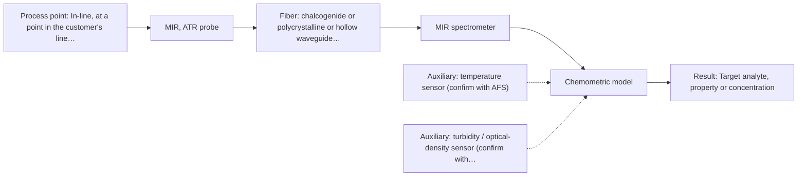
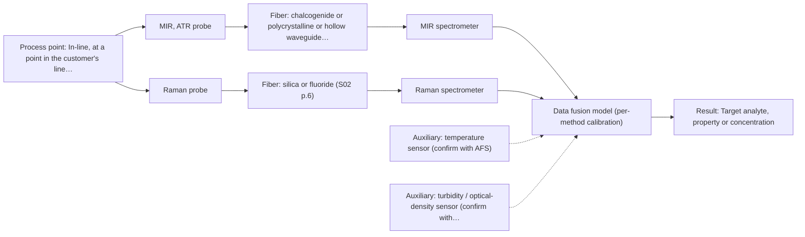

# First technical assessment: Vague one-line request

## Answer

**Customer request (our summary):** Customer asks whether we can measure their liquid in-line. No target, method, or process conditions are stated.

### Brief answer

Not answerable as asked yet: the target, the liquid's optical behaviour and the process conditions are unknown. The first test worth running is MIR ATR, with Raman as a second single method and NIR transmission only if the liquid is clear. Your answers on target and range, optical regime, accuracy and reference method decide whether one method is enough or a combined probe is worth testing.

### Proposal

- **Best current option:** O2 (recommended)
- **Basis:** engineering judgement
- **What would change it:** A named target with its range, the liquid's optical regime and the required accuracy would decide the method: a clear, low-optical-density liquid would move the choice to NIR transmission (M3), while an aqueous sample with a strong fluorescence background would favour Raman or the combined probe (O3).
- **Next step:** Answer the clarification questions, then run a single-method comparison on representative samples of the liquid before any in-line installation.

**Secondary evidence (external, not AFS material):** G1: E03 ¶8, E03 ¶19; G2: E03 ¶19; G3: no usable external source found; G4: E05 ¶29. See Expert detail.

**Decision status:** Insufficient information for a method choice

### Solution options

| ID | Tier | Methods | Confidence | Cost class, S01 Table 1 (p.6) | Ease of use | Maintenance | Performance fit | Sources |
|---|---|---|---|---|---|---|---|---|
| O1 | Simple | M3 NIR, transmission/transflection probe | Low: open question: Q1 (starts at Medium); sample clarity unknown; uncited auxiliary sensor; status: insufficient information | average cost (row 7) | one probe, standard lamp, silica fibers | window cleaning and pathlength control | cheapest route for a clear liquid | [1: S01 p.18] [2: S01 p.18] [3: S01 p.10] [4: S01 p.18] |
| O2 | Recommended | M1 MIR, ATR probe | Low: open question: Q1 (starts at Medium); uncited auxiliary sensor; status: insufficient information | high cost (row 2) | one ATR probe, one spectrometer | crystal cleaning, fouling and deposit checks | well-defined bands, no pathlength setting | [5: S01 p.10] [6: S01 p.10] [7: S01 p.9] |
| O3 | Extended (multi-method) | M1 MIR, ATR probe; M2 Raman probe | Low: open question: Q1 (starts at Medium); uncited auxiliary sensor; status: insufficient information; multi-method, fusion benefit not yet shown | high cost (rows 2, 12) | two spectrometers, combined probe, more setup | per-method calibration and drift checks | complementary MIR and Raman information per sample | [8: S01 p.8] [9: S01 p.8] [10: S01 p.8] [11: S01 p.11] [12: REF §5] [7: S01 p.9] [5: S01 p.10] [6: S01 p.10] [13: S01 p.16] [14: S01 p.11] |

*Confidence rates the basis of the advice (how much is known and cited), not a predicted accuracy or probability of success. It starts at High, or at Medium when a key question on the method or the option is open, and drops one level per weakness listed (floor Low).*

*Cost class is the relative rating in S01 Table 1 (p.6) for the in-line method+technique rows named (the highest one for a multi-method option); it is not a price.*

### Setup sketch

*Recommended option O2; drawn by code from the option, a schematic, not a configuration.*

### Key questions

1. What exactly has to be measured - which component or property, and over what concentration or value range?
2. Is the liquid clear, turbid or opaque, and does it contain particles, colour or gas bubbles?
3. What accuracy and response time are required, and which reference method will be used to verify the results?

## Expert detail

**Customer enquiry**

> Can you measure our liquid in-line?

**Decision status:** Insufficient information for a method choice. The enquiry gives only a liquid and an in-line wish, so the known facts cannot justify a method choice yet. It also asks for confirmation that the liquid is measurable, which the supplied material cannot give: an in-line precedent for other liquids is a reason to test, not proof for this one.

### Parameters

| ID | Parameter | Kind | Need | Measured by | Why | Sources |
|---|---|---|---|---|---|---|
| P1 | Target analyte, property or concentration | quantitative | required | Spectroscopy: MIR | The method choice depends on what has to be measured and over what range. | *(no verified source: engineering judgement)* |
| P2 | Temperature at the measurement point | quantitative | required | Auxiliary sensor: temperature sensor (engineering judgement: confirm availability with AFS) | Spectral features shift with temperature, and the process temperature constrains the probe and fiber choice. | *(no verified source: engineering judgement)* |
| P3 | Optical regime of the liquid (clear, turbid or opaque; optical density) | quantitative | required | Auxiliary sensor: turbidity / optical-density sensor (cited; confirm availability with AFS) | It decides between transmission, transflection, reflection and ATR geometries. | [15: S01 p.16] |

### Solution option details

- **O1 cost drivers:** NIR spectrometer, silica fiber link, transmission or transflexion probe
- **O2 cost drivers:** MIR spectrometer, MIR fiber link, ATR probe and crystal
- **O3 cost drivers:** two spectrometers, combined probe, fusion software, reference data
- **O3 combining methods:** Fusion level: one model per method first, then a joined or score-level model with block scaling, because variables from different methods are not equivalent. Both techniques must look at the same small area of the liquid and the two data streams must be aligned to a common time step. Each method keeps its own calibration and diagnostics, and the fused model must beat the best single method on held-out runs, otherwise the second instrument is dropped.

*Extended (multi-method) option O3; drawn by code from the option, a schematic, not a configuration.*

### Premise check

- **Precedent only:** Their liquid can be measured in-line. The sources show in-line fiber-probe measurement of other liquids, so testing is reasonable; none of them covers the customer's liquid. [16: S01 p.17]
- **Not covered:** The liquid's measurability can be confirmed now. No supplied source assesses this liquid, and the facts given cannot support a readiness statement. [17: REF §3]

### Requirements

**Stated by the customer**

- "liquid"
- "in-line"
- "Can you measure"
- "measure our liquid"

**Key unknowns**

- Target analyte or property to be measured, and its range
- Optical regime of the liquid: clear, turbid or opaque
- Required accuracy and response time
- Matrix composition, interferences, water content and fluorescent species
- Process conditions, installation point and distance to the instrument
- Reference method for validation

### Clarification questions (most decision-relevant first)

Q1. What exactly has to be measured - which component or property, and over what concentration or value range? *Why it matters:* The target decides whether MIR, Raman or NIR can see it at all. *(affects: method)*
Q2. Is the liquid clear, turbid or opaque, and does it contain particles, colour or gas bubbles? *Why it matters:* The optical regime decides between transmission, transflection, reflection and ATR. *(affects: technique)*
Q3. What accuracy and response time are required, and which reference method will be used to verify the results? *Why it matters:* These criteria set the go/no-go basis and can rule methods in or out. *(affects: status)*
Q4. What are the process conditions at the measurement point (temperature, pressure, flow, cleaning), and how is the probe installed (port, line size, distance to the instrument)? *Why it matters:* They constrain the probe, the fiber type and the length of the link. *(affects: installation)*
Q5. Is the liquid water-based, and does it contain a fluorescent species? *Why it matters:* Water content and fluorescence background shift the choice between MIR, Raman and fluorescence. *(affects: method)*

### Recommendation

- **M1 · Primary candidate: MIR, ATR probe.** MIR ATR works on liquids in contact with the crystal, and mid-IR is described as one of the most informative methods of chemical analysis, so it is the first method to test. The nominal mid-IR range is 4000-400 cm-1; the usable range depends on the instrument, fiber and probe actually selected. *Conditions:* Requires the liquid to wet and make tight contact with the ATR crystal. [7: S01 p.9] [5: S01 p.10] [6: S01 p.10]
- **M2 · Comparison candidate: Raman probe.** Raman carries complementary vibrational information to mid-IR and tolerates water, so it is worth testing on the same liquid. The Raman shift (cm-1) is stated separately from the laser excitation wavelength (nm), and the usable range depends on the probe and spectrometer selected. [11: S01 p.11] [13: S01 p.16] [14: S01 p.11]
- **M3 · Conditional candidate: NIR, transmission/transflection probe.** NIR transmission or transflection is preferred for transparent or semi-transparent liquids and is the most common online method with fiber probes. It applies only if the liquid turns out clear; a turbid or opaque liquid would need a reflection geometry instead. *Conditions:* Applies only if the liquid is transparent or semi-transparent at the measurement point. [1: S01 p.18] [3: S01 p.10] [4: S01 p.18]

### Measurement concept

- **Probe and geometry:** Single-method fiber probes at the process point first: an ATR immersion probe (MIR), a Raman contact probe, or a transmission/transflexion probe for a clear liquid. A combined probe is a later hypothesis only.
- **Location:** In-line, at a point in the customer's line or vessel that is still to be named.
- **Fiber link:** The fiber family follows the method: MIR light is not carried by silica fibers. No supplied source states an achievable length for an in-line MIR link, so the link length is an open question for AFS. [18: S02 p.6] [19: S02 p.6]

### Spectral range

- **MIR:** Nominal 4000-400 cm-1; usable range depends on instrument, fiber and probe. [7: S01 p.9] [20: REF §3]
- **NIR:** Nominal 780-2500 nm; usable range depends on instrument, fiber and probe. [21: S01 p.10]
- **Raman:** Raman shift in cm-1, with the laser excitation wavelength stated separately in nm; usable range depends on probe and spectrometer. [14: S01 p.11]

### Risks and uncertainty

- If the target is a trace component, NIR may lack the sensitivity, and the shortlist would move towards MIR or Raman. *(rules: R-NIR-4)* [22: S01 p.16]
- If the liquid is turbid or opaque, NIR transmission fails and reflection or ATR must be used instead. *(rules: R-GEO-2)* [4: S01 p.18]
- If the liquid fluoresces, Raman bands can be swamped by the fluorescence background. *(rules: R-RAM-1)* [23: S01 p.11]
- If the ATR crystal fouls or the liquid deposits on it, the few-micrometre sampling depth may not represent the bulk liquid. *(rules: R-MIR-3)* [24: S01 p.13]

### First feasibility experiment

1. **Collect representative samples or process states of the liquid across the expected variation (composition, temperature, batch), together with the target values and the reference method.** Representativeness [25: REF §3]
2. **Measure the samples with single methods first: MIR ATR (M1) and Raman (M2), and NIR transmission (M3) only if the liquid is clear, keeping the same measurement point and conditions per sample.** Single methods first [26: S01 p.3]
3. **Have an independent reference laboratory measure the same samples for the target parameters, without using the spectra.** Independent reference data *(no verified source: engineering judgement)*
4. **Build one calibration or classification model per method and validate it on held-out runs or batches, not on the samples used to build it.** Validation [27: S03 p.14]
5. **Go/no-go against the customer's own numerical criteria for accuracy, measuring range and response time; test a combined probe only if no single method meets them.** Go/no-go *(no verified source: engineering judgement)*

**Reference measurements:** Independent laboratory values for the target parameters, provided by the customer's own reference method.

**Decision basis:** The customer's own numerical criteria for accuracy, range and response time.

### Assumptions

- The liquid can be brought into contact with a probe at the measurement point.
- At least one target parameter can be named and given a range and an accuracy requirement.
- A reference method exists for that target.

### Not covered by the supplied sources

- Whether this specific liquid can be measured in-line, and with what detection limits or accuracy: no supplied source covers the customer's material.
- Achievable fiber-link length for an in-line MIR (ATR) link: no supplied source states one for MIR fibers.

### Secondary evidence (external, not AFS material)

*Found by a literature search for gaps the supplied AFS sources leave open. Not AFS material and not proof for this case; every quote below was verified verbatim against the fetched text.*

**G1 · decision status:** insufficient information: The enquiry gives only a liquid and an in-line wish, so the known facts cannot justify a method choice yet. It also asks for confirmation that the liquid is measurable, which the supplied material cannot give: an in-line precedent for other liquids is a reason to test, not proof for this one.

- **E03 ¶8** The source states that a continuous process at a fixed probe location is intended to operate in a steady-state window, which simplifies model design, narrows calibration, supports validation by independent steady-state runs, and focuses online monitoring on drift and out-of-specification detection. *How it applies:* This could inform the assessment by prompting questions about whether the customer's process is steady-state and what operational envelope applies, because the source links those conditions to simpler calibration and validation. *Limits and transfer risks:* The source concerns a continuous liquid-liquid extraction process in lithium recycling, so the steady-state assumption and model-design implications may not transfer to a different liquid, matrix, or process scale.
  > "In contrast, a continuous process at a fixed probe location is intended to operate in a steady-state window, which simplifies the model design: calibrations can be narrower and centered on the operational envelope, validation can rely on independent steady-state runs, and online monitoring focuses on drift and out-of-specification detection rather than resolving the rapidly changing composition."
  > Process Analytical Technology-Integrated FT-IR and Raman Spectroscopies for Efficient Reactive Liquid-Liquid Extraction Processing in Lithium Recycling. (2025) · ACS omega · doi:10.1021/acsomega.5c05705 · https://europepmc.org/article/PMC/PMC12573149 · retrieved 2026-10-17, full text, licence: cc by, via curated library
- **E03 ¶19** The source reports that concentrations of nitric acid and hydrochloric acid, ionic strength, and temperature were varied to obtain a robust model. *How it applies:* This could inform the assessment by indicating that concentration ranges, ionic strength, and temperature may need to be known and varied during calibration for a robust model. *Limits and transfer risks:* The source is about acid mixtures in lithium recycling, so the specific variables and their relevance may differ for the customer's liquid and process.
  > "The concentrations of nitric acid and hydrochloric acid as well as the ionic strength and temperature were varied to obtain a robust model."
  > Process Analytical Technology-Integrated FT-IR and Raman Spectroscopies for Efficient Reactive Liquid-Liquid Extraction Processing in Lithium Recycling. (2025) · ACS omega · doi:10.1021/acsomega.5c05705 · https://europepmc.org/article/PMC/PMC12573149 · retrieved 2026-10-17, full text, licence: cc by, via curated library

**G2 · auxiliary sensor:** In-line measurement of Temperature at the measurement point with temperature sensor

- **E03 ¶19** The source reports that temperature was varied together with acid concentrations and ionic strength to obtain a robust model. *How it applies:* This could support including in-line temperature measurement at the measurement point and covering temperature variation in calibration for O2. *Limits and transfer risks:* The source concerns acid mixtures in lithium recycling, so the temperature range and effect may not transfer to the customer's liquid or MIR ATR setup. *(supports O2)*
  > "The concentrations of nitric acid and hydrochloric acid as well as the ionic strength and temperature were varied to obtain a robust model."
  > Process Analytical Technology-Integrated FT-IR and Raman Spectroscopies for Efficient Reactive Liquid-Liquid Extraction Processing in Lithium Recycling. (2025) · ACS omega · doi:10.1021/acsomega.5c05705 · https://europepmc.org/article/PMC/PMC12573149 · retrieved 2026-10-17, full text, licence: cc by, via curated library

**G3 · auxiliary sensor:** In-line measurement of Optical regime of the liquid (clear, turbid or opaque; optical density) with turbidity / optical-density sensor

- No usable external source found.

**G4 · multi-method:** Combining several spectroscopy methods (data fusion) (Fusion level: one model per method first, then a joined or score-level model with block scaling, because variables from different methods are not equivalent. Both techniques must look at the same small area of the liquid and the two data streams must be aligned to a common time step. Each method keeps its own calibration and diagnostics, and the fused model must beat the best single method on held-out runs, otherwise the second instrument is dropped.)

- **E05 ¶29** The source warns that more sensors mean greater risks, that a single sensor failure can propagate through the fusion link, and that multi-sensor systems have a higher probability of failure. *How it applies:* This could inform O3 by prompting failure-mode and diagnostic planning, such as checking each method's calibration and diagnostics and defining fallback to the best single method. *Limits and transfer risks:* The source is about egg freshness evaluation, not in-line liquid measurement, so the risk profile may differ for MIR ATR and Raman in the customer's process. *(supports O3)*
  > "In addition, more sensors also mean greater risks. A failure in a single sensor can propagate through the fusion link, and the probability of failure is higher in multi-sensor systems [89]."
  > Advancing Egg Freshness Evaluation with Integrated AI and Spectroscopy. (2026) · Foods (Basel, Switzerland) · doi:10.3390/foods15132259 · https://europepmc.org/article/PMC/PMC13361683 · retrieved 2026-10-17, full text, licence: cc by, via europepmc

### Evidence (verified quotes)

1. ✓ **S01 p.18** (general): "Transmission is the preferred method for transparent or semi-transparent liquids, such as skim milk, whey, or permeate."
2. ✓ **S01 p.18** (general): "the precise control of the optical pathlength (usually 1 - 10 mm); if the pathlength is too wide, the signal is lost to absorption; if too narrow, the sample represents a negligible volume."
3. ✓ **S01 p.10** (general): "Near-IR vibrational spectroscopy (NIR) is the most common online analysis method performed using fiber optic probes."
4. ✓ **S01 p.18** (general): "it fails when the milk becomes too "thick" or fat-rich, as the light cannot penetrate the sample."
5. ✓ **S01 p.10** (general): "ATR fiber probes (Fig.1) enable the analysis of liquids and solid elastic samples"
6. ✓ **S01 p.10** (general): "Probe-based analysis is gaining widespread use in online analysis, such as in-line, in-process (chemical, biotechnological, natural) environments"
7. ✓ **S01 p.9** (general): "Vibrational spectroscopy in the mid-IR range (4000-400 cm-1) is one of the most informative methods of chemical analysis."
8. ✓ (precedent only) **S01 p.8** (method gain): "It is crucial that the spectral information obtained by different methods-Mid-IR, NIR, Raman, and fluorescence spectra-is collected from the same small, even pinpoint, area of the sample."
9. ✓ (precedent only) **S01 p.8** (method gain): "Ultimately, the measurement data must be normalized to a common time step."
10. ✓ (precedent only) **S01 p.8** (method gain): "If the variables have different units of measurement, the data should be normalized in some way, for example, using an autoscaling algorithm."
11. ✓ **S01 p.11** (general): "This property makes mid-IR and Raman spectra complementary, that is, they complement each other."
12. ✓ (precedent only) **REF §5** (method gain): "compare with the best single method."
13. ✓ **S01 p.16** (general): "Raman is particularly well-suited for aqueous environments, as it exhibits low absorbance for water molecules compared to infrared methods."
14. ✓ **S01 p.11** (general): "The Raman shift is used as the horizontal (spectral) axis in Raman spectroscopy"
15. ✓ **S01 p.16** (general): "the selection of an optical probe is primarily dictated by the sample's optical density (OD) and its ability to attenuate light."
16. ✓ **S01 p.17** (application precedent): "The use of Near-Infrared (NIR) spectroscopy for the inline monitoring of milk"
17. ✓ **REF §3** (general): "If the known facts cannot justify a method choice, say so, ask the questions that would decide it and propose the next step."
18. ✓ **S02 p.6** (general): "350 nm Standard VIS-NIR Silica Fibers Al/Cu-coated VIS-NIR Silica Fibers 2400 nm"
19. ✓ **S02 p.6** (general): "1100 nm Chalcogenide As-S IR Fibers 6500 nm"
20. ✓ **REF §3** (general): "A nominal method range is not the range of a specific instrument, fiber or probe."
21. ✓ **S01 p.10** (general): "NIR spectra (780-2500 nm) contain predominantly overtones and component bands of fundamental vibrations"
22. ✓ **S01 p.16** (general): "may lack the sensitivity to detect trace compounds below 0.1 percent."
23. ✓ **S01 p.11** (general): "the superposition of luminescence (fluorescence), which has a significantly higher intensity."
24. ✓ **S01 p.13** (general): "typically at a depth of few microns"
25. ✓ **REF §3** (general): "Representative samples or process states, independent reference measurements, what is compared, and the basis for the go / no-go decision."
26. ✓ **S01 p.3** (general): "samples of incompletely known composition, in order to select the most suitable method or combination of methods."
27. ✓ **S03 p.14** (general): "A thorough validation, including full, segmented and random-subset CVs, as well as randomization tests, are recommended in any cases for which important conclusions depend on calibration or discrimination models built on limited experimental material."

### Verification

- Citations verified: 34 of 34 (exact or whitespace/hyphen-tolerant match on the cited page, scope checked).
- Hard check failures before deterministic corrections: 0; still open: 0; soft warnings: 5; repair rounds: 1.
- External evidence (live): 4 quote(s) verified verbatim (exact or whitespace/hyphen-tolerant, at most 400 characters and 2 sentences, against the cited paragraph); 1 item(s) dropped.
- External search: 5 query(ies), 40 hit(s), 5 source(s) (3 from the curated library).
- External step: 2 model call(s), 61.3 s extra (cost in the run JSON).
  - ⚠ dropped G4 E05 ¶29: quote not verified (too_long: quote longer than 400 characters (427))

*Run A06-20261017T234208Z · models deepseek/deepseek-v4.1-flash*
