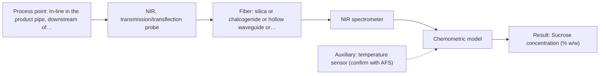

# First technical assessment: Complete enquiry for sugar concentration in a clear solution

## Answer

**Customer request (our summary):** The customer wants a proposed in-line method and probe to monitor sucrose concentration in a clear aqueous solution flowing through a 50 mm pipe.

### Brief answer

For a first trial, we recommend an NIR transmission or transflection probe in the 50 mm pipe, calibrated against your laboratory refractometer across 5 to 15 % w/w sucrose, with a Raman probe as a comparison. Key open items are whether any other dissolved solids are present, the pipe fitting and its CIP rating, and whether your quality limit of plus or minus 0.3 % w/w is achieved.

### Proposal

- **Best current option:** O2 (recommended)
- **Basis:** supplied AFS sources
- **What would change it:** If other dissolved solids are present (Q1), the calibration design and the refractometer reference both need rethinking; if no CIP-rated fitting exists or the analyzer must stay 10 m away and the NIR trial misses the accuracy limit, the Raman comparison or a near-pipe MIR-ATR variant becomes relevant.
- **Next step:** Run the single-method feasibility trial of the NIR transflection/transmission probe with Raman as comparison, calibrated against the refractometer across 5-15 % w/w and 20-30 °C.

**Secondary evidence (external, not AFS material):** G1: E01 ¶19; G2: no usable external source found; G3: no usable external source found; G4: no usable external source found. See Expert detail.

**Decision status:** Provisional feasibility assessment

### Solution options

| ID | Tier | Methods | Confidence | Cost class, S01 Table 1 (p.6) | Ease of use | Maintenance | Performance fit | Sources |
|---|---|---|---|---|---|---|---|---|
| O1 | Simple | M2 Raman probe | Medium: open question: Q1 (starts at Medium) | high cost (row 12) | Single contact probe, no pathlength optimisation | Probe window cleaning, laser checks | Water-tolerant direct sucrose bands for a quick feasibility check | [1: S01 p.16] [2: S01 p.11] |
| O2 | Recommended | M1 NIR, transmission/transflection probe | Low: open question: Q1, Q3 (starts at Medium); uncited auxiliary sensor | average cost (row 7) | Insertion probe or flow cell, standard silica fibers | Window cleaning during daily CIP, calibration checks | Matches clear aqueous stream, 1-minute readings and 10 m remote analyzer | [3: S01 p.5] [4: S01 p.18] [5: S01 p.18] [6: S02 p.7] |

*Confidence rates the basis of the advice (how much is known and cited), not a predicted accuracy or probability of success. It starts at High, or at Medium when a key question on the method or the option is open, and drops one level per weakness listed (floor Low).*

*Cost class is the relative rating in S01 Table 1 (p.6) for the in-line method+technique rows named (the highest one for a multi-method option); it is not a price.*

### Setup sketch

*Recommended option O2; drawn by code from the option, a schematic, not a configuration.*

### Key questions

1. Besides sucrose and water, are any other dissolved solids or additives present in the solution, even in small amounts?
2. What installation fitting exists on the 50 mm pipe (e.g. a flow-through cell or an insertion probe port), and is it rated for daily hot caustic cleaning?
3. What reproducibility does your laboratory refractometer deliver on 5-15 % w/w sucrose at 20-30 °C, and how will grab samples be temperature-controlled for reference measurement?

## Expert detail

**Customer enquiry**

> We produce a clear, colourless aqueous sucrose solution and want to monitor its sucrose concentration in-line. The solution flows through a 50 mm stainless steel pipe at 20 to 30 °C and normal pressure; the expected range is 5 to 15 % w/w and our quality limit is plus or minus 0.3 % w/w. Our laboratory refractometer is the reference method and stays in use. The analyser can stand in a dry, safe room 10 m from the pipe, and the line is cleaned in place with hot caustic once a day. A reading every minute is enough. Please propose a method and probe for a first trial.

**Decision status:** Provisional feasibility assessment. A method shortlist for a first trial can be justified from the stated sample and process facts, but the achievable accuracy, the reference-method fit and the installation fitting are still open and are asked below.

### Parameters

| ID | Parameter | Kind | Need | Measured by | Why | Sources |
|---|---|---|---|---|---|---|
| P1 | Sucrose concentration (% w/w) | quantitative | required | Spectroscopy: NIR | It is the target variable the in-line model must predict within plus or minus 0.3 % w/w. | [7: S01 p.10] |
| P2 | Solution temperature (deg C) | quantitative | required | Auxiliary sensor: temperature sensor (engineering judgement: confirm availability with AFS) | The 20-30 °C process span shifts NIR absorption bands and must be compensated or included in the calibration. | *(no verified source: engineering judgement)* |
| P3 | Presence of other dissolved solids or additives | qualitative | optional | Reference lab method: laboratory analysis of process specification | It should be available from process knowledge and decides whether the matrix-specific calibration and the refractometer reference stay valid. | *(no verified source: engineering judgement)* |

### Solution option details

- **O1 cost drivers:** Raman spectrometer and laser, probe, trial calibration effort
- **O2 cost drivers:** NIR spectrometer, transflection/transmission probe, flow cell or fitting, calibration samples and refractometer reference work

### Premise check

- **Supported:** A clear, colourless aqueous solution is suitable for a transmission/transflection measurement geometry. The sources name transmission as the preferred geometry for transparent or semi-transparent liquids. [4: S01 p.18]
- **Not covered:** The laboratory refractometer is an adequate reference for sucrose % w/w in this solution. No supplied source addresses refractometer accuracy or its specificity to sucrose when other dissolved solids may be present; this must be checked with the customer. *(no verified source: engineering judgement)*
- **Not covered:** An in-line accuracy of plus or minus 0.3 % w/w sucrose is achievable with fiber-optic spectroscopy in this setup. No supplied source gives an accuracy figure for sucrose in water; the feasibility trial must establish this against the customer's own limit. *(no verified source: engineering judgement)*

### Requirements

**Stated by the customer**

- In-line monitoring of sucrose concentration, 5 to 15 % w/w, quality limit plus or minus 0.3 % w/w.
- Reading every minute; analyzer 10 m from the pipe in a dry, safe room; daily hot caustic CIP; laboratory refractometer stays as reference.

**Key unknowns**

- Whether other dissolved solids besides sucrose are present in the solution
- Available installation fitting on the 50 mm pipe (flow cell vs insertion probe) and its CIP compatibility
- Refractometer reproducibility and temperature handling of reference samples
- Whether the 10 m analyzer distance is fixed

### Clarification questions (most decision-relevant first)

Q1. Besides sucrose and water, are any other dissolved solids or additives present in the solution, even in small amounts? *Why it matters:* Both the refractometer reference and an NIR calibration are specific to the matrix, so extra components change the calibration design and could bias the reference. *(affects: method)*
Q2. What installation fitting exists on the 50 mm pipe (e.g. a flow-through cell or an insertion probe port), and is it rated for daily hot caustic cleaning? *Why it matters:* It decides between a transmission/transflection flow cell and an insertion probe and determines whether the probe survives the CIP cycle. *(affects: installation)*
Q3. What reproducibility does your laboratory refractometer deliver on 5-15 % w/w sucrose at 20-30 °C, and how will grab samples be temperature-controlled for reference measurement? *Why it matters:* The reference defines the calibration quality ceiling, and the plus or minus 0.3 % w/w target can only be judged against it. *(affects: status, M1)*
Q4. Is the 10 m analyzer distance fixed, or could a compact analyzer be mounted near the pipe? *Why it matters:* Silica fibers are stated for long remote links, but no source states an achievable length for mid-IR fibers, so a shorter link would keep the MIR-ATR comparison open. *(affects: installation, M3)*

### Recommendation

- **M1 · Primary candidate: NIR, transmission/transflection probe.** NIR with fiber-optic probes is described as ideal for online applications, and transmission is the preferred geometry for transparent liquids such as this aqueous solution. A transflection insertion probe or flow cell in the 50 mm pipe with a silica fiber link to the analyzer 10 m away fits all stated constraints. *Conditions:* The optical pathlength must be selected and controlled for the 5-15 % w/w range, and a chemometric calibration against the refractometer is required. [3: S01 p.5] [4: S01 p.18] [5: S01 p.18] [6: S02 p.7]
- **M2 · Comparison candidate: Raman probe.** Raman tolerates water well and gives direct sucrose bands, so it is a useful single-method benchmark against the NIR calibration in the same trial. Its weak signal and possible fluorescence background must be checked on the real solution. [1: S01 p.16] [2: S01 p.11]
- **M3 · Conditional candidate: MIR, ATR probe.** MIR-ATR probes are used for in-line liquid analysis and mid-IR spectra are highly informative, but the fiber link is the open point: only short laboratory MIR fiber lengths appear in the sources, so a 10 m link is unproven here. *Conditions:* Only if the analyzer can be placed near the pipe or AFS confirms a suitable MIR fiber length, and if the ATR crystal withstands the daily hot caustic CIP. [8: S01 p.10] [9: S01 p.9] [10: S02 p.10]
- **M4 · Not recommended: fluorescence probe.** Fluorescence only measures species that fluoresce, and most chemicals do not; a clear sucrose solution has no stated fluorophore, so it cannot track sucrose directly. [11: S01 p.5]

### Measurement concept

- **Probe and geometry:** NIR transmission or transflection: a flow-through transmission cell or a transflection insertion probe in the 50 mm stainless steel pipe, with a defined pathlength chosen for 5-15 % w/w sucrose.
- **Location:** In-line in the product pipe, downstream of any mixing point, away from air entrainment.
- **Fiber link:** Vis-NIR silica fiber cable from the probe to the analyzer in the dry room about 10 m away; fiber optics allow the analyzer to be located safely away from the process pipe, though the usable range depends on the instrument, fiber and probe selected. [12: S01 p.5] [13: S01 p.15]

### Spectral range

- **NIR:** Nominal NIR range 780-2500 nm; the usable range depends on the spectrometer, the silica fiber and the probe actually selected. [7: S01 p.10]
- **Raman:** Raman is reported as Raman shift in cm-1, with the laser excitation wavelength stated separately; usable range depends on the instrument, laser and probe selected. [14: S01 p.11]

### Risks and uncertainty

- If other dissolved solids are present, both the NIR calibration and the refractometer reference could be biased, since calibrations are specific to the matrix. *(rules: R-CAL-1)* [15: REF §5]
- The 20-30 °C process temperature span shifts NIR water and sucrose bands, so temperature compensation or a temperature-inclusive calibration is needed. *(rules: R-NIR-2)* [16: S01 p.10]
- A wrongly chosen transflection pathlength can lose the signal to absorption at 15 % w/w or under-sample at 5 % w/w. *(rules: R-GEN-4)* [17: S01 p.18]
- Daily hot caustic CIP can attack or foul the probe window or ATR crystal, and ATR-type geometries sample only a surface layer. *(rules: R-MIR-3)* [18: S01 p.13]

### First feasibility experiment

1. **Collect representative samples spanning the full variation: 5-15 % w/w sucrose and the 20-30 °C temperature range, including CIP-cycle boundary conditions.** Cover the chemical and physical variation the calibration must handle. [19: REF §3]
2. **Measure every sample with the NIR transmission/transflection probe and, in parallel, with the Raman probe; record solution temperature with a sensor at each measurement.** Single methods first, on the same samples, so their calibrations can be compared directly. *(no verified source: engineering judgement)*
3. **Measure each sample with the laboratory refractometer as the independent reference, at controlled temperature.** Provide the reference values the spectral calibrations are built and judged against. *(no verified source: engineering judgement)*
4. **Build a preliminary chemometric calibration per single method and test temperature compensation across 20-30 °C.** Quantify prediction error for each single method before considering any combination. *(no verified source: engineering judgement)*
5. **Validate on held-out samples or a separate production run and decide go/no-go against the customer's limit of plus or minus 0.3 % w/w.** The customer's quality limit is the numerical go/no-go basis. *(no verified source: engineering judgement)*

**Reference measurements:** Laboratory refractometer on every calibration and validation sample, at controlled temperature.

**Decision basis:** Prediction error of the validated model on held-out runs must meet the customer's plus or minus 0.3 % w/w limit.

### Assumptions

- The solution contains only sucrose and water unless Q1 says otherwise.
- A suitable CIP-rated fitting can be installed in the 50 mm pipe.
- The 10 m analyzer location is fixed for the trial.

### Not covered by the supplied sources

- Accuracy or detection limit of any method for sucrose % w/w in water, including whether plus or minus 0.3 % w/w is achievable.
- Suitability of a laboratory refractometer as a reference for sucrose % w/w in the presence of other dissolved solids.
- Achievable mid-IR fiber link length for a 10 m installation.

### Further notes

- **Chemometrics:** A PLS calibration against the refractometer reference is needed because NIR bands overlap; it should span 5-15 % w/w and the 20-30 °C temperature range, and be validated on held-out samples before judging the plus or minus 0.3 % w/w limit.
- **Real-time tracking:** A reading every minute is compatible with fiber-probe NIR acquisition; the sources note online measurements require high-speed spectral acquisition and that diode-array analyzers record all wavelengths simultaneously, which suits fast monitoring.
- **Future direction:** If the trial shows the single NIR model meets the limit, a later step could evaluate a compact LED-based NIR sensor at the pipe for a lower-cost permanent installation.

### Secondary evidence (external, not AFS material)

*Found by a literature search for gaps the supplied AFS sources leave open. Not AFS material and not proof for this case; every quote below was verified verbatim against the fetched text.*

**G1 · auxiliary sensor:** In-line measurement of Solution temperature (deg C) with temperature sensor

- **E01 ¶19** The concentrations of nitric acid and hydrochloric acid as well as the ionic strength and temperature were varied to obtain a robust model. *How it applies:* Monitoring or controlling the temperature is important because temperature variations can affect aqueous solution spectra, and it should be tested alongside concentration changes to build a robust calibration. *Limits and transfer risks:* The source discusses acid extraction in recycling rather than sucrose in a clear aqueous solution, so the specific temperature coefficients will not transfer directly. *(supports O2)*
  > "The concentrations of nitric acid and hydrochloric acid as well as the ionic strength and temperature were varied to obtain a robust model."
  > Process Analytical Technology-Integrated FT-IR and Raman Spectroscopies for Efficient Reactive Liquid-Liquid Extraction Processing in Lithium Recycling. (2025) · ACS omega · doi:10.1021/acsomega.5c05705 · https://europepmc.org/article/PMC/PMC12573149 · retrieved 2026-10-17, full text, licence: cc by, via curated library

**G2 · not in the supplied sources:** Accuracy or detection limit of any method for sucrose % w/w in water, including whether plus or minus 0.3 % w/w is achievable.

- No usable external source found.

**G3 · not in the supplied sources:** Suitability of a laboratory refractometer as a reference for sucrose % w/w in the presence of other dissolved solids.

- No usable external source found.

**G4 · not in the supplied sources:** Achievable mid-IR fiber link length for a 10 m installation.

- No usable external source found.

### Evidence (verified quotes)

1. ✓ **S01 p.16** (general): "Raman is particularly well-suited for aqueous environments, as it exhibits low absorbance for water molecules compared to infrared methods."
2. ✓ **S01 p.11** (general): "superposition of luminescence (fluorescence), which has a significantly higher intensity."
3. ✓ **S01 p.5** (general): "making it ideal for online applications, including remote measurements via fiber optic probes."
4. ✓ **S01 p.18** (general): "Transmission is the preferred method for transparent or semi-transparent liquids, such as skim milk, whey, or permeate."
5. ✓ **S01 p.18** (general): "the precise control of the optical pathlength (usually 1 - 10 mm); if the pathlength is too wide, the signal is lost to absorption; if too narrow, the sample represents a negligible volume."
6. ✓ **S02 p.7** (performance figure): "Robust 100-300m cables made with Silica fibers of low OH-content (<0.1ppm OH) enable remote industrial process-control"
7. ✓ **S01 p.10** (general): "NIR spectra (780-2500 nm) contain predominantly overtones and component bands of fundamental vibrations"
8. ✓ **S01 p.10** (general): "ATR fiber probes (Fig.1) enable the analysis of liquids and solid elastic samples"
9. ✓ **S01 p.9** (general): "Vibrational spectroscopy in the mid-IR range (4000-400 cm-1) is one of the most informative methods of chemical analysis."
10. ✓ (precedent only) **S02 p.10** (performance figure): "1.25 Meter Silver Halide - straight run"
11. ✓ **S01 p.5** (general): "However, most chemicals do not exhibit this property."
12. ✓ **S01 p.5** (general): "Immersible fiber optic probes operating in various spectral regions from UV to mid-IR are increasingly being used for measuring liquid and soft or powdered solid samples."
13. ✓ **S01 p.15** (general): "located safely away from the vibration and dust of the manufacturing floor."
14. ✓ **S01 p.11** (general): "The Raman shift is used as the horizontal (spectral) axis in Raman spectroscopy"
15. ✓ **REF §5** (general): "physical variation; calibration specific to the matrix."
16. ✓ **S01 p.10** (general): "The broad absorption bands observed in this region overlap, suggesting the use of chemometrics for quantitative and qualitative analysis of spectral data."
17. ✓ **S01 p.18** (general): "if the pathlength is too wide, the signal is lost to absorption; if too narrow, the sample represents a negligible volume."
18. ✓ **S01 p.13** (general): "typically at a depth of few microns"
19. ✓ **REF §3** (general): "Representative samples or process states, independent reference measurements, what is compared, and the basis for the go / no-go decision."

### Verification

- Citations verified: 25 of 25 (exact or whitespace/hyphen-tolerant match on the cited page, scope checked).
- Hard check failures before deterministic corrections: 0; still open: 0; soft warnings: 2; repair rounds: 1.
- External evidence (live): 1 quote(s) verified verbatim (exact or whitespace/hyphen-tolerant, at most 400 characters and 2 sentences, against the cited paragraph); 1 item(s) dropped.
- External search: 4 query(ies), 35 hit(s), 5 source(s) (3 from the curated library).
- External step: 2 model call(s), 7.7 s extra (cost in the run JSON).
  - ⚠ dropped G1 E02 ¶12: figure not in its own quote: 50 mm

*Run A07-20261018T094847Z-8967 · models google/gemini-3.5-flash-lite, google/gemini-3.8-flash, z-ai/glm-5.3-flash*
