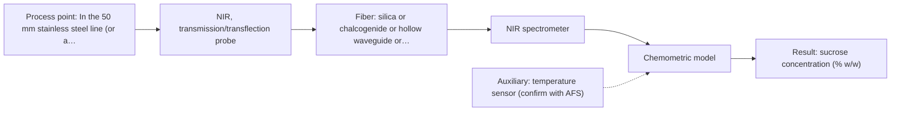
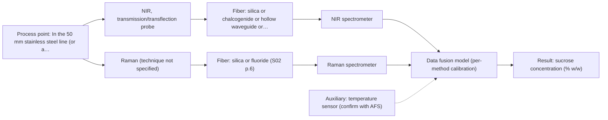

# First technical assessment: Complete enquiry for sugar concentration in a clear solution

## Answer

**Customer request (our summary):** Customer enquiry about in-line monitoring of sucrose concentration in a clear, colourless aqueous solution.

### Brief answer

For this clear aqueous sucrose stream, test NIR transmission or transflection first, with the analyser in the dry room on a silica fiber; a Raman probe is the comparison. Both need a calibration against your refractometer, and the ±0.3 % w/w limit is not yet shown. Still open: other dissolved species, particles or bubbles, and probe survival of the hot caustic clean.

### Proposal

- **Best current option:** O2 (recommended)
- **Basis:** supplied AFS sources
- **What would change it:** A different matrix (other dissolved species, particles or bubbles) or a NIR trial that misses the ±0.3 % w/w limit would move the choice toward Raman or the NIR+Raman combination.
- **Next step:** Run the feasibility trial with an NIR transmission/transflection probe against the existing refractometer.

**Secondary evidence (external, not AFS material):** G1: E02 ¶12; G2: E03 ¶82, E05 ¶29; G3: no usable external source found; G4: no usable external source found. See Expert detail.

**Decision status:** Provisional feasibility assessment

### Solution options

| ID | Tier | Methods | Confidence | Cost class, S01 Table 1 (p.6) | Ease of use | Maintenance | Performance fit | Sources |
|---|---|---|---|---|---|---|---|---|
| O1 | Simple | M2 Raman probe | Low: open question: Q1 (starts at Medium); uncited auxiliary sensor | high cost (row 12) | single contact probe, no pathlength | probe cleaning; laser and detector care | water-tolerant; strong sucrose Raman bands | [1: S01 p.16] [2: S01 p.11] |
| O2 | Recommended | M1 NIR, transmission/transflection probe | Low: open question: Q1 (starts at Medium); uncited auxiliary sensor | average cost (row 7) | standard transmission probe, silica fiber | window cleaning; pathlength check | preferred geometry for clear liquids | [3: S01 p.18] [4: S01 p.10] [5: S02 p.7] |
| O3 | Extended (multi-method) | M3 NIR, transmission/transflection probe + Raman (combination) | Low: open question: Q1 (starts at Medium); uncited auxiliary sensor; multi-method, fusion benefit not yet shown | high cost (rows 7, 12) | two instruments to run and align | two calibrations and diagnostics | adds Raman if NIR falls short | [6: S01 p.8] [7: S01 p.8] [8: S01 p.15] |

*Confidence rates the basis of the advice (how much is known and cited), not a predicted accuracy or probability of success. It starts at High, or at Medium when a key question on the method or the option is open, and drops one level per weakness listed (floor Low).*

*Cost class is the relative rating in S01 Table 1 (p.6) for the in-line method+technique rows named (the highest one for a multi-method option); it is not a price.*

### Setup sketch

*Recommended option O2; drawn by code from the option, a schematic, not a configuration.*

### Key questions

1. Besides sucrose and water, are any other dissolved species, additives or colourants present, and can their levels vary?
2. Is the stream free of bubbles, particles or suspended solids, and is the flow steady?
3. What are the caustic concentration, temperature and duration of the daily clean-in-place, and does the probe stay wetted during cleaning?

## Expert detail

**Customer enquiry**

> We produce a clear, colourless aqueous sucrose solution and want to monitor its sucrose concentration in-line. The solution flows through a 50 mm stainless steel pipe at 20 to 30 °C and normal pressure; the expected range is 5 to 15 % w/w and our quality limit is plus or minus 0.3 % w/w. Our laboratory refractometer is the reference method and stays in use. The analyser can stand in a dry, safe room 10 m from the pipe, and the line is cleaned in place with hot caustic once a day. A reading every minute is enough. Please propose a method and probe for a first trial.

**Decision status:** Provisional feasibility assessment. A clear, single-target aqueous stream allows a method shortlist (NIR transmission/transflection first, Raman as a comparison), but the ±0.3 % w/w limit, the matrix composition and the probe's resistance to the caustic clean are not established by the supplied sources, so the assessment is provisional.

### Parameters

| ID | Parameter | Kind | Need | Measured by | Why | Sources |
|---|---|---|---|---|---|---|
| P1 | sucrose concentration (% w/w) | quantitative | required | Spectroscopy: NIR | It is the monitored quality variable and the target of the whole measurement. | *(no verified source: engineering judgement)* |
| P2 | temperature | quantitative | required | Auxiliary sensor: temperature sensor (engineering judgement: confirm availability with AFS) | Sucrose spectra and refractive properties are temperature-dependent, so the 20-30 °C variation must be compensated for the ±0.3 % w/w target. | *(no verified source: engineering judgement)* |

### Solution option details

- **O1 cost drivers:** Raman spectrometer, laser and fiber probe
- **O2 cost drivers:** NIR spectrometer, flow-through probe, silica cable
- **O3 cost drivers:** two spectrometers, combined probe, data fusion
- **O3 combining methods:** NIR and Raman would be fused, with both probes looking at the same material at the same pipe location and their data aligned to a common time step. Each method keeps its own calibration against the refractometer, and the fused model must beat the best single method on independent batches. A combined or co-located probe is needed because alternating probes cannot guarantee the same spot.

*Extended (multi-method) option O3; drawn by code from the option, a schematic, not a configuration.*

### Premise check

- **Supported:** The analyser can stand 10 m from the pipe and still measure the process. Remote process measurement over long silica-fiber cables is stated for silica fibers, which carry the NIR and Raman ranges. [5: S02 p.7]
- **Not covered:** The ±0.3 % w/w quality limit is assumed to be achievable. No supplied source gives a sucrose accuracy figure for NIR or Raman, so the limit cannot be confirmed from the sources. *(no verified source: engineering judgement)*
- **Not covered:** The probe will tolerate hot caustic cleaning in place once a day. No supplied source addresses caustic clean-in-place compatibility of any probe. *(no verified source: engineering judgement)*

### Requirements

**Stated by the customer**

- "We produce a clear, colourless aqueous sucrose solution"
- "The solution flows through a 50 mm stainless steel pipe at 20 to 30 °C and normal pressure"
- "Our laboratory refractometer is the reference method and stays in use"
- "The analyser can stand in a dry, safe room 10 m from the pipe"
- "the line is cleaned in place with hot caustic once a day"
- "want to monitor its sucrose concentration in-line"
- "expected range is 5 to 15 % w/w"
- "quality limit is plus or minus 0.3 % w/w"
- "A reading every minute is enough"

**Key unknowns**

- Whether other dissolved species, additives or colourants are present, and whether they vary.
- Whether the stream carries bubbles, particles or suspended solids.
- Caustic concentration, temperature and duration of the daily clean-in-place, and whether the probe stays wetted.
- How the probe accesses the process (a port in the 50 mm pipe or a bypass loop).
- Accuracy and repeatability of the laboratory refractometer.
- Whether a 10 m fiber link is acceptable for the method finally chosen.

### Clarification questions (most decision-relevant first)

Q1. Besides sucrose and water, are any other dissolved species, additives or colourants present, and can their levels vary? *Why it matters:* NIR and Raman calibrations are specific to the matrix, so other species could change the method or the calibration scope. *(affects: method)*
Q2. Is the stream free of bubbles, particles or suspended solids, and is the flow steady? *Why it matters:* Scattering and bubbles affect the transmission/transflection geometry and the Raman background. *(affects: technique)*
Q3. What are the caustic concentration, temperature and duration of the daily clean-in-place, and does the probe stay wetted during cleaning? *Why it matters:* The probe and window materials must survive the cleaning cycle without fouling or damage. *(affects: installation)*
Q4. How can a probe reach the process — a port in the 50 mm pipe or a bypass loop? *Why it matters:* This defines the probe geometry and the optical pathlength through the sample. *(affects: installation)*
Q5. What accuracy and repeatability does the laboratory refractometer achieve, and how are reference samples taken? *Why it matters:* The reference limits what can be validated against the ±0.3 % w/w limit. *(affects: status)*

### Recommendation

- **M1 · Primary candidate: NIR, transmission/transflection probe.** Transmission or transflection is the stated preferred geometry for transparent or semi-transparent liquids, and NIR is the most common in-line fiber-probe method. Silica fibers carry NIR light over long cables, so the analyser can sit in the dry room 10 m away. *Conditions:* Applies if the solution stays clear and homogeneous and the sucrose signal is measurable at a controlled pathlength. [3: S01 p.18] [4: S01 p.10] [5: S02 p.7]
- **M2 · Comparison candidate: Raman probe.** Raman tolerates water well and gives a molecular fingerprint, which suits this aqueous stream. Its signal is weak and can be swamped by fluorescence, so it must be checked on the real matrix. *Conditions:* Worth testing if the stream carries no strong fluorescent species or if the NIR trial does not reach ±0.3 % w/w. [1: S01 p.16] [2: S01 p.11]
- **M3 · Conditional candidate: NIR, transmission/transflection probe + Raman (combination).** NIR and Raman carry complementary information and can be fused if one method alone cannot meet the target. This is a later hypothesis, tested only after the single-method trials. *Conditions:* Applies only if the best single method does not reach the ±0.3 % w/w limit. [8: S01 p.15] Later hypothesis, after single-method tests.

### Measurement concept

- **Probe and geometry:** A transmission or transflection fiber probe for NIR, inserted so light crosses a defined layer of the clear solution; a Raman immersion probe as the comparison.
- **Location:** In the 50 mm stainless steel line (or a bypass), with the spectrometer in the dry room 10 m away.
- **Fiber link:** Silica fibers for the NIR and Raman ranges; a mid-IR link length is not stated in the sources. [9: S02 p.6]

### Spectral range

- **NIR:** Nominal NIR range 780-2500 nm; the usable range depends on the instrument, fiber and probe actually selected. [10: S01 p.10]
- **Raman:** Raman is reported as a Raman shift in cm-1; the laser excitation wavelength is stated separately and is not fixed by the method. [11: S01 p.11]

### Risks and uncertainty

- If other dissolved species or additives vary, the NIR or Raman calibration may not hold, because these calibrations are specific to the matrix. *(rules: R-CAL-1)* [12: REF §5]
- Water absorbs strongly in the infrared, so the NIR transmission pathlength must be controlled; too wide loses signal and too narrow samples a negligible volume. *(rules: R-GEN-4)* [13: S01 p.18]
- Raman signals are weak and can be swamped by fluorescence, so the Raman comparison may not work on the real matrix. *(rules: R-RAM-1)* [14: S01 p.11]
- Hot caustic cleaning, fouling or particles could degrade the probe window and the signal; no supplied source addresses caustic compatibility. *(rules: R-MIR-3)* *(no verified source: engineering judgement)*

### First feasibility experiment

1. **Collect or prepare representative sucrose solutions across the 5-15 % w/w range and the 20-30 °C band, including real process samples if possible.** Representative samples across the expected chemical and physical variation. *(no verified source: engineering judgement)*
2. **Measure every sample with the existing laboratory refractometer as the independent reference.** Independent reference measurements. *(no verified source: engineering judgement)*
3. **Record NIR transmission/transflection spectra first, then Raman spectra on the same samples, with the analyser at the 10 m distance over fiber.** Single methods first, with the comparison afterwards. *(no verified source: engineering judgement)*
4. **Build the calibration against the refractometer values and validate on held-out runs or batches.** Validation on held-out runs or batches. *(no verified source: engineering judgement)*
5. **Set the go/no-go on the customer's ±0.3 % w/w limit and the one-reading-per-minute rate.** A go/no-go basis whose numerical criteria come from the customer. [15: REF §3]

**Reference measurements:** The customer's laboratory refractometer, applied to each sample.

**Decision basis:** Customer quality limit of ±0.3 % w/w and a reading every minute.

### Assumptions

- The solution stays clear, colourless and free of bubbles or particles during the trial.
- Only sucrose and water are present at measurable levels; other species are absent or constant.
- A probe can be fitted to the 50 mm line or a bypass with a defined optical path.
- The 20-30 °C variation can be compensated with a temperature reading.

### Not covered by the supplied sources

- Probe compatibility with hot caustic clean-in-place.
- A sucrose accuracy figure that would confirm the ±0.3 % w/w limit.
- An achievable fiber length for a mid-IR (chalcogenide or polycrystalline) link.

### Further notes

- **Chemometrics:** NIR (and Raman) bands are broad and overlapping, so a calibration model must be built against the refractometer reference values; the model is specific to this matrix and must be re-validated if the composition changes.
- **Real-time tracking:** Fiber probes allow online measurement in the process, and a reading every minute is a modest requirement for NIR or Raman.
- **Future direction:** Once the key spectral features for sucrose are identified, a compact optical multisensor could be considered for the final installation.

### Secondary evidence (external, not AFS material)

*Found by a literature search for gaps the supplied AFS sources leave open. Not AFS material and not proof for this case; every quote below was verified verbatim against the fetched text.*

**G1 · auxiliary sensor:** In-line measurement of temperature with temperature sensor

- **E02 ¶12** Temperature sensitivity of OH bands in aqueous NIR and MIR is a severe drawback, making tempered sample holders necessary. *How it applies:* For the NIR transmission/transflection option, this suggests temperature control or measurement may be important; test how temperature changes affect the aqueous sucrose spectra. *Limits and transfer risks:* The source is a review and refers to tempered sample holders, not an in-line temperature sensor; it concerns aqueous solutions generally, not sucrose, and may not transfer to a pipe-mounted probe. *(supports O2)*
  > "Additionally, the temperature sensitivity of the OH bands is a severe drawback for measuring aqueous solution in NIR and MIR, which makes tempered sample holders necessary [29]."
  > A critical review of recent trends, and a future perspective of optical spectroscopy as PAT in biopharmaceutical downstream processing. (2020) · Analytical and bioanalytical chemistry · doi:10.1007/s00216-020-02407-z · https://europepmc.org/article/PMC/PMC7072065 · retrieved 2026-10-17, full text, licence: cc by, via curated library

**G2 · multi-method:** Combining several spectroscopy methods (data fusion) (NIR and Raman would be fused, with both probes looking at the same material at the same pipe location and their data aligned to a common time step. Each method keeps its own calibration against the refractometer, and the fused model must beat the best single method on independent batches. A combined or co-located probe is needed because alternating probes cannot guarantee the same spot.)

- **E03 ¶82** Before fusing data from multiple sources, the contribution and complementarity of each dataset should be evaluated. *How it applies:* For the extended NIR/Raman fusion option, this supports testing whether Raman adds complementary information beyond NIR and whether the fused model beats the best single method on independent batches. *Limits and transfer risks:* The source is a general PAT data-fusion review; it does not address sucrose, co-located NIR/Raman probes, or time alignment in a pipe. *(supports O3)*
  > "Before fusing data from multiple sources, it is essential to evaluate the contribution of each dataset to the model and its complementarity."
  > Challenges and Opportunities of Implementing Data Fusion in Process Analytical Technology-A Review. (2022) · Molecules (Basel, Switzerland) · doi:10.3390/molecules27154846 · https://europepmc.org/article/PMC/PMC9369811 · retrieved 2026-10-17, full text, licence: cc by, via curated library
- **E05 ¶29** A combination of near-infrared transmission spectroscopy with low-resolution proton nuclear magnetic resonance did not yield superior results compared to their individual applications. *How it applies:* For the extended NIR/Raman fusion option, this is a caution that fusion does not always improve performance; require evidence that the fused model outperforms the best single method. *Limits and transfer risks:* The example is from egg freshness evaluation and uses NMR rather than Raman; it does not establish behavior for aqueous sucrose or in-line probes. *(supports O3)*
  > "Thus, the combination of near-infrared transmission spectroscopy with low-resolution proton nuclear magnetic resonance (LRH NMR) technology does not yield superior results compared to their individual applications [88]."
  > Advancing Egg Freshness Evaluation with Integrated AI and Spectroscopy. (2026) · Foods (Basel, Switzerland) · doi:10.3390/foods15132259 · https://europepmc.org/article/PMC/PMC13361683 · retrieved 2026-10-18, full text, licence: cc by, via europepmc

**G3 · not in the supplied sources:** Probe compatibility with hot caustic clean-in-place.

- No usable external source found.

**G4 · not in the supplied sources:** A sucrose accuracy figure that would confirm the ±0.3 % w/w limit.

- No usable external source found.

### Evidence (verified quotes)

1. ✓ **S01 p.16** (general): "Raman is particularly well-suited for aqueous environments, as it exhibits low absorbance for water molecules compared to infrared methods."
2. ✓ **S01 p.11** (general): "superposition of luminescence (fluorescence), which has a significantly higher intensity."
3. ✓ **S01 p.18** (general): "Transmission is the preferred method for transparent or semi-transparent liquids, such as skim milk, whey, or permeate."
4. ✓ **S01 p.10** (general): "Near-IR vibrational spectroscopy (NIR) is the most common online analysis method performed using fiber optic probes."
5. ✓ **S02 p.7** (performance figure): "Robust 100-300m cables made with Silica fibers of low OH-content (<0.1ppm OH) enable remote industrial process-control"
6. ✓ **S01 p.8** (general): "It is crucial that the spectral information obtained by different methods-Mid-IR, NIR, Raman, and fluorescence spectra-is collected from the same small, even pinpoint, area of the sample."
7. ✓ **S01 p.8** (general): "Ultimately, the measurement data must be normalized to a common time step."
8. ✓ (precedent only) **S01 p.15** (method gain): "NIR detects hydrogen bonds and asymmetric polar groups, while Raman provides information on the molecular backbone and symmetrical non-polar groups."
9. ✓ **S02 p.6** (general): "350 nm Standard VIS-NIR Silica Fibers Al/Cu-coated VIS-NIR Silica Fibers 2400 nm"
10. ✓ **S01 p.10** (general): "NIR spectra (780-2500 nm) contain predominantly overtones and component bands of fundamental vibrations"
11. ✓ **S01 p.11** (general): "The Raman shift is used as the horizontal (spectral) axis in Raman spectroscopy"
12. ✓ **REF §5** (general): "Overlapping bands, physical variation; calibration specific to the matrix."
13. ✓ **S01 p.18** (general): "the precise control of the optical pathlength (usually 1 - 10 mm); if the pathlength is too wide, the signal is lost to absorption; if too narrow, the sample represents a negligible volume."
14. ✓ **S01 p.11** (general): "signals, which are several orders of magnitude weaker than IR absorption peaks"
15. ✓ **REF §3** (general): "Representative samples or process states, independent reference measurements, what is compared, and the basis for the go / no-go decision."

### Verification

- Citations verified: 17 of 17 (exact or whitespace/hyphen-tolerant match on the cited page, scope checked).
- Hard check failures before deterministic corrections: 0; still open: 0; soft warnings: 2; repair rounds: 0.
- External evidence (live): 3 quote(s) verified verbatim (exact or whitespace/hyphen-tolerant, at most 400 characters and 2 sentences, against the cited paragraph); 0 item(s) dropped.
- External search: 5 query(ies), 40 hit(s), 5 source(s) (3 from the curated library).
- External step: 2 model call(s), 60.5 s extra (cost in the run JSON).

*Run A07-20261018T004929Z · models deepseek/deepseek-v4.1-flash*
