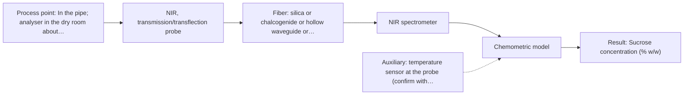

# First technical assessment: Complete enquiry for sugar concentration in a clear solution

## Answer

**Customer request (our summary):** Customer produces a clear, colourless aqueous sucrose solution and wants in-line monitoring of sucrose concentration in a 50 mm stainless steel pipe (20 to 30 °C, normal pressure, 5 to 15 % w/w, quality limit ±0.3 % w/w, one reading per minute). A laboratory refractometer remains the reference method. The analyser would sit in a dry, safe room 10 m from the pipe; the line is CIP-cleaned with hot caustic daily. They ask for a proposed method and probe for a first trial.

### Brief answer

For a clear aqueous stream, test a NIR transmission/transflection probe first, with MIR-ATR as the single-method comparison. What is still open: other species or bubbles in the stream, the pipe port, and whether the refractometer can support a plus or minus 0.3 % w/w check. A calibration on your own matrix is needed.

### Proposal

- **Best current option:** O2 (recommended)
- **Basis:** supplied AFS sources
- **What would change it:** If the stream turns out to contain species that interfere in NIR, or if a 10 m MIR fiber link proves feasible and the NIR trial cannot reach plus or minus 0.3 % w/w, the MIR-ATR route moves up.
- **Next step:** Run a feasibility trial on representative samples across the stated range with a NIR transmission/transflection probe, using the laboratory refractometer as the reference.

**Secondary evidence (external, not AFS material):** G1: E05 ¶1, E02 ¶19; G2: no usable external source found; G3: no usable external source found; G4: E01 ¶4, E03 ¶27. See Expert detail.

**Decision status:** Provisional feasibility assessment

### Solution options

| ID | Tier | Methods | Confidence | Cost class, S01 Table 1 (p.6) | Ease of use | Maintenance | Performance fit | Sources |
|---|---|---|---|---|---|---|---|---|
| O1 | Simple | M2 MIR, ATR probe | Low: open question: Q1 (starts at Medium); uncited auxiliary sensor | high cost (row 2) | single contact probe, no pathlength | clean ATR tip; check CIP compatibility | sharp selective bands in an aqueous stream | [1: S01 p.5] [2: S01 p.5] [3: S01 p.10] |
| O2 | Recommended | M1 NIR, transmission/transflection probe | Low: open question: Q1 (starts at Medium); uncited auxiliary sensor | average cost (row 7) | standard probe, remote silica fiber link | window cleaning; daily CIP compatibility | fits clear stream and 10 m standoff | [4: S01 p.18] [5: S01 p.18] [6: S01 p.10] [7: S02 p.7] |

*Confidence rates the basis of the advice (how much is known and cited), not a predicted accuracy or probability of success. It starts at High, or at Medium when a key question on the method or the option is open, and drops one level per weakness listed (floor Low).*

*Cost class is the relative rating in S01 Table 1 (p.6) for the in-line method+technique rows named (the highest one for a multi-method option); it is not a price.*

### Setup sketch

*Recommended option O2; drawn by code from the option, a schematic, not a configuration.*

### Key questions

1. Besides sucrose and water, are any other dissolved species, additives or impurities present in the stream?
2. Does the stream contain particles, gas bubbles or entrained air?
3. Is there already a measurement port or window in the 50 mm pipe, or can a spool piece be fitted?

## Expert detail

**Customer enquiry**

> We produce a clear, colourless aqueous sucrose solution and want to monitor its sucrose concentration in-line. The solution flows through a 50 mm stainless steel pipe at 20 to 30 °C and normal pressure; the expected range is 5 to 15 % w/w and our quality limit is plus or minus 0.3 % w/w. Our laboratory refractometer is the reference method and stays in use. The analyser can stand in a dry, safe room 10 m from the pipe, and the line is cleaned in place with hot caustic once a day. A reading every minute is enough. Please propose a method and probe for a first trial.

**Decision status:** Provisional feasibility assessment. A method shortlist can be justified from general method properties, but no supplied source covers sucrose in-line or states an achievable accuracy, so the ±0.3 % w/w target and the reference method's uncertainty are assumptions rather than established facts.

### Parameters

| ID | Parameter | Kind | Need | Measured by | Why | Sources |
|---|---|---|---|---|---|---|
| P1 | Sucrose concentration (% w/w) | quantitative | required | Spectroscopy: NIR | It is the target variable the customer wants to monitor in-line. | [8: S01 p.16] |
| P2 | Temperature of the solution at the probe | quantitative | required | Auxiliary sensor: temperature sensor at the probe (engineering judgement: confirm availability with AFS) | The process runs over 20 to 30 °C and the water bands used for the sucrose signal shift with temperature, so readings need temperature compensation. | *(no verified source: engineering judgement)* |

### Solution option details

- **O1 cost drivers:** FTIR spectrometer, MIR fiber link, ATR probe, calibration
- **O2 cost drivers:** NIR spectrometer, silica fiber, transmission probe, calibration

### Premise check

- **Not covered:** An accuracy of plus or minus 0.3 % w/w is achievable in-line for this stream. No supplied source gives an accuracy figure for sucrose, or for any in-line sugar measurement. The target stays a customer requirement to be demonstrated in a trial. *(no verified source: engineering judgement)*
- **Supported:** A 10 m standoff between the pipe and a dry, safe analyser room is compatible with the measurement. Remote process-control over silica fibers at this order of distance is stated. For a MIR link, the achievable length is not stated anywhere in the sources, so that part remains an open question. [7: S02 p.7]
- **Supported:** One reading per minute is sufficient and achievable. Array detectors used in NIR instruments record all wavelengths at once, which is far faster than one reading per minute. [9: S01 p.10]

### Requirements

**Stated by the customer**

- "We produce a clear, colourless aqueous sucrose solution"
- "monitor its sucrose concentration in-line"
- "The solution flows through a 50 mm stainless steel pipe"
- "at 20 to 30 °C"
- "normal pressure"
- "expected range is 5 to 15 % w/w"
- "quality limit is plus or minus 0.3 % w/w"
- "laboratory refractometer is the reference method and stays in use"
- "The analyser can stand in a dry, safe room 10 m from the pipe"
- "line is cleaned in place with hot caustic once a day"
- "A reading every minute is enough"
- "Please propose a method and probe for a first trial"

**Key unknowns**

- Whether other dissolved species, additives or impurities are present besides sucrose and water.
- Whether the stream contains particles, gas bubbles or entrained air.
- Whether a measurement port or window already exists on the 50 mm pipe, or a spool piece can be fitted.
- The uncertainty and measurement conditions of the laboratory refractometer.
- Flow rate and whether the pipe runs full.
- The achievable length of a MIR fiber link for the 10 m standoff (a question for AFS, not the customer).

### Clarification questions (most decision-relevant first)

Q1. Besides sucrose and water, are any other dissolved species, additives or impurities present in the stream? *Why it matters:* Other species change the spectral matrix and can overlap the sucrose signal, which changes the method choice and the calibration. *(affects: method)*
Q2. Does the stream contain particles, gas bubbles or entrained air? *Why it matters:* Scattering and bubbles disturb transmission and ATR readings and decide which measurement geometry is usable. *(affects: technique)*
Q3. Is there already a measurement port or window in the 50 mm pipe, or can a spool piece be fitted? *Why it matters:* The probe type and the installation effort depend on the fitting that is available. *(affects: installation)*
Q4. What is the uncertainty of the laboratory refractometer, and under what conditions (temperature, sampling, calibration) is it used? *Why it matters:* The reference must be clearly better than plus or minus 0.3 % w/w for the trial to show whether the analyser meets the target. *(affects: status)*
Q5. Is the plus or minus 0.3 % w/w limit required of the analyser reading itself, or of its agreement with the reference? *Why it matters:* This sets the accuracy the method must reach and how the trial is judged. *(affects: status)*
Q6. Does the pipe run full, and what is the flow rate? *Why it matters:* A full pipe and a steady flow are needed for a representative transmission or ATR measurement. *(affects: installation)*

### Recommendation

- **M1 · Primary candidate: NIR, transmission/transflection probe.** NIR transmission/transflection is the preferred geometry for transparent liquids and NIR is the most common in-line method run through fiber probes, so a clear aqueous stream is a good fit. Silica fibers carry the signal over the 10 m standoff to the dry analyser room. *Conditions:* Applies while the stream stays clear and free of bubbles and the transmission pathlength can be fixed at a defined value. [4: S01 p.18] [6: S01 p.10] [7: S02 p.7]
- **M2 · Comparison candidate: MIR, ATR probe.** MIR gives sharp, well-defined bands with high selectivity and ATR samples only a very thin layer, which suits an aqueous stream in contact with the crystal. It is the natural second single method to compare against NIR. *Conditions:* Applies if a MIR fiber link and a CIP-compatible ATR interface can be provided for the 10 m standoff, which is an open question. [1: S01 p.5] [2: S01 p.5] [3: S01 p.10]
- **M3 · Conditional candidate: Raman probe.** Raman is well suited to aqueous media because water absorbs little, making it a reasonable fallback if the NIR or MIR route cannot reach the target. Its weak signal and possible fluorescence background have to be checked on the real stream. *Conditions:* Applies only if the single-method NIR or MIR trial cannot reach the accuracy target, or if the stream turns out to contain a fluorescing species. [10: S01 p.16] [11: S01 p.11] [12: S01 p.11]

### Measurement concept

- **Probe and geometry:** NIR transmission or transflection probe through the 50 mm line (a fixed, defined pathlength), with MIR-ATR as the contact alternative; probe in contact with the flowing solution.
- **Location:** In the pipe; analyser in the dry room about 10 m away.
- **Fiber link:** Silica (VIS-NIR) fibers for the NIR route; a MIR fiber family (CIR/PIR) would be needed for the MIR-ATR route, with an unstated achievable length. [7: S02 p.7]

### Spectral range

- **NIR:** nominal method range [13: S01 p.10]

### Risks and uncertainty

- NIR bands are broad and overlapping, so reaching plus or minus 0.3 % w/w depends on a matrix-specific calibration that must be rebuilt if the product changes. *(rules: R-NIR-2, R-CAL-1)* [14: S01 p.10]
- The achievable length of a MIR fiber link for the 10 m standoff is not stated in the supplied sources, so the MIR-ATR comparison may not be installable as described. *(rules: R-FIB-2)* *(no verified source: engineering judgement)*
- An ATR crystal or a transmission window in the pipe can foul or be affected by the daily hot-caustic clean-in-place, which can bias the reading. *(rules: R-MIR-3)* [15: S01 p.13]
- The laboratory refractometer's own uncertainty and sampling may be too large to demonstrate the plus or minus 0.3 % w/w limit, which would limit what the trial can conclude. *(no verified source: engineering judgement)*

### First feasibility experiment

1. **Prepare representative samples or process states across the expected 5-15 % w/w sucrose range and the 20-30 °C window, including any other species, bubbles or turbidity that occur.** Representative variation [16: REF §3]
2. **Measure every sample with the single methods first: NIR transmission/transflection (M1) and MIR-ATR (M2), using the probe and geometry intended for the line.** Single methods first *(no verified source: engineering judgement)*
3. **Measure the reference sucrose value for each sample with the laboratory refractometer under controlled temperature, and record its uncertainty.** Independent reference *(no verified source: engineering judgement)*
4. **Build one calibration model per method and validate it on held-out runs or batches, not on the samples used for calibration.** Held-out validation [17: S03 p.14]
5. **Go/no-go: the customer's plus or minus 0.3 % w/w limit decides whether the single-method route is sufficient.** Go/no-go basis *(no verified source: engineering judgement)*

**Reference measurements:** Laboratory refractometer, kept in use as stated by the customer, measured on every trial sample under controlled temperature.

**Decision basis:** Customer's plus or minus 0.3 % w/w quality limit over the stated 5-15 % w/w range.

### Assumptions

- The stream stays clear and free of bubbles during normal operation.
- A suitable fitting or spool piece can be provided on the 50 mm stainless steel pipe.
- The laboratory refractometer is clearly more accurate than plus or minus 0.3 % w/w under controlled conditions.
- A MIR fiber link of about 10 m can be provided if the MIR-ATR comparison is installed (unstated in the sources).

### Not covered by the supplied sources

- In-line measurement of sucrose in a 5-15 % w/w aqueous stream, and any accuracy figure for it: not covered by the supplied sources.
- The achievable length of a MIR fiber link: no supplied source states an achievable length for MIR fibers.
- Hot-caustic clean-in-place compatibility and cleaning intervals for the probes: not covered.

### Further notes

- **Chemometrics:** The NIR bands of sucrose and water overlap, so a matrix-specific calibration model (for example PLS regression) is needed and must be validated on independent batches before any accuracy claim.
- **Real-time tracking:** One reading per minute is well within the speed of an array-detector NIR instrument, which records all wavelengths at once.
- **Future direction:** If the single-method trial succeeds, a dedicated optical multisensor system for this stream could be considered as a later step.

### Secondary evidence (external, not AFS material)

*Found by a literature search for gaps the supplied AFS sources leave open. Not AFS material and not proof for this case; every quote below was verified verbatim against the fetched text.*

**G1 · auxiliary sensor:** In-line measurement of Temperature of the solution at the probe with temperature sensor at the probe

- **E05 ¶1** The source says product temperature measurement can be used as a PAT method to monitor a process and to obtain process parameters for in-line or off-line optimization. *How it applies:* This supports considering a temperature sensor at the probe as an auxiliary input for model-based monitoring; test whether temperature measurement can be integrated at the pipe probe. *Limits and transfer risks:* The work is on freeze-drying in a lab-scale freeze-dryer with sucrose and PVP model products, not a flowing aqueous sucrose stream in a pipe. *(supports O2)*
  > "The measurement of product temperature is one of the methods that can be adopted, especially in the pharmaceutical industry, to monitor the freeze-drying process and to obtain the values of the process parameters required by mathematical models useful for in-line (or off-line) optimization."
  > On the Use of Temperature Measurements as a Process Analytical Technology (PAT) for the Monitoring of a Pharmaceutical Freeze-Drying Process (2023) · Pharmaceutics · doi:10.3390/pharmaceutics15030861 · https://doi.org/10.3390/pharmaceutics15030861 · retrieved 2026-10-18, abstract only, licence: cc-by, via openalex
- **E02 ¶19** The source says acid concentrations, ionic strength and temperature were varied to obtain a robust model. *How it applies:* This suggests temperature should be varied or measured when building a calibration model for an in-line spectroscopic method; test temperature compensation at the probe. *Limits and transfer risks:* The source concerns nitric and hydrochloric acid and ionic strength in reactive liquid-liquid extraction, not sucrose in water or NIR transmission. *(supports O2)*
  > "The concentrations of nitric acid and hydrochloric acid as well as the ionic strength and temperature were varied to obtain a robust model."
  > Process Analytical Technology-Integrated FT-IR and Raman Spectroscopies for Efficient Reactive Liquid-Liquid Extraction Processing in Lithium Recycling. (2025) · ACS omega · doi:10.1021/acsomega.5c05705 · https://europepmc.org/article/PMC/PMC12573149 · retrieved 2026-10-17, full text, licence: cc by, via curated library

**G2 · not in the supplied sources:** In-line measurement of sucrose in a 5-15 % w/w aqueous stream, and any accuracy figure for it: not covered by the supplied sources.

- No usable external source found.

**G3 · not in the supplied sources:** The achievable length of a MIR fiber link: no supplied source states an achievable length for MIR fibers.

- No usable external source found.

**G4 · not in the supplied sources:** Hot-caustic clean-in-place compatibility and cleaning intervals for the probes: not covered.

- **E01 ¶4** The source says ATR probes allow in-line measurements even in demanding environments and with highly oxidative or corrosive substances, including strong acids and bases. *How it applies:* This could support testing an ATR probe for chemical compatibility with the caustic CIP fluid, but it does not establish hot-caustic CIP intervals. *Limits and transfer risks:* The quote does not mention hot caustic, CIP cycles, cleaning intervals, sucrose, or a stainless steel pipe; it is about reaction mixtures. *(supports O1)*
  > "Attenuated total reflection probes (ATR) allow in-line measurements even in demanding measurement environments and reaction mixtures with highly oxidative and corrosive substances, such as chlorosilanes or strong acids and bases."
  > A Process Analytical Concept for In-Line FTIR Monitoring of Polysiloxane Formation. (2020) · Polymers · doi:10.3390/polym12112473 · https://europepmc.org/article/PMC/PMC7693933 · retrieved 2026-10-17, full text, licence: cc by, via curated library
- **E03 ¶27** The source says contamination of the probe window can prevent accurate measurement. *How it applies:* This supports treating probe-window cleanliness as a risk and testing cleaning effectiveness between CIP cycles; it does not give a cleaning interval. *Limits and transfer risks:* The contamination is from a binder in a pharmaceutical process, not hot caustic CIP or sucrose; the source does not specify probe type or cleaning interval.
  > "However, an accurate measurement may not be possible because of contamination of the probe window due to the addition of a binder during the process, which is a disadvantage."
  > Process Analytical Technology Tools for Monitoring Pharmaceutical Unit Operations: A Control Strategy for Continuous Process Verification. (2021) · Pharmaceutics · doi:10.3390/pharmaceutics13060919 · https://europepmc.org/article/PMC/PMC8234957 · retrieved 2026-10-17, full text, licence: cc by, via curated library

### Evidence (verified quotes)

1. ✓ **S01 p.5** (general): "strong absorption in the mid-IR region limits the corresponding spectral method to the analysis of very thin samples (usually less than 50 μm), but it opens up the possibility of using attenuated total reflectance (ATR)"
2. ✓ **S01 p.5** (general): "Mid-IR band spectra contain well-defined peaks (absorption bands)"
3. ✓ **S01 p.10** (general): "Probe-based analysis is gaining widespread use in online analysis, such as in-line, in-process (chemical, biotechnological, natural) environments"
4. ✓ **S01 p.18** (application precedent): "Transmission is the preferred method for transparent or semi-transparent liquids, such as skim milk, whey, or permeate."
5. ✓ **S01 p.18** (general): "the precise control of the optical pathlength (usually 1 - 10 mm); if the pathlength is too wide, the signal is lost to absorption; if too narrow, the sample represents a negligible volume."
6. ✓ **S01 p.10** (general): "Near-IR vibrational spectroscopy (NIR) is the most common online analysis method performed using fiber optic probes."
7. ✓ **S02 p.7** (performance figure): "Robust 100-300m cables made with Silica fibers of low OH-content (<0.1ppm OH) enable remote industrial process-control"
8. ✓ **S01 p.16** (application precedent): "NIR spectroscopy is effective for tracking major components like glucose or glycerol in the millimolar range but may lack the sensitivity to detect trace compounds below 0.1 percent."
9. ✓ **S01 p.10** (general): "DDA detectors are arrays of photodiodes that allow instantaneous recording of light intensity at all wavelengths simultaneously"
10. ✓ **S01 p.16** (general): "Raman is particularly well-suited for aqueous environments, as it exhibits low absorbance for water molecules compared to infrared methods."
11. ✓ **S01 p.11** (general): "signals, which are several orders of magnitude weaker than IR absorption peaks"
12. ✓ **S01 p.11** (general): "superposition of luminescence (fluorescence), which has a significantly higher intensity."
13. ✓ **S01 p.10** (general): "NIR spectra (780-2500 nm) contain predominantly overtones and component bands of fundamental vibrations"
14. ✓ **S01 p.10** (general): "The broad absorption bands observed in this region overlap, suggesting the use of chemometrics for quantitative and qualitative analysis of spectral data."
15. ✓ **S01 p.13** (general): "typically at a depth of few microns"
16. ✓ **REF §3** (general): "Representative samples or process states, independent reference measurements, what is compared, and the basis for the go / no-go decision."
17. ✓ **S03 p.14** (general): "A thorough validation, including full, segmented and random-subset CVs, as well as randomization tests, are recommended in any cases for which important conclusions depend on calibration or discrimination models built on limited experimental material."

### Verification

- Citations verified: 21 of 21 (exact or whitespace/hyphen-tolerant match on the cited page, scope checked).
- Hard check failures before deterministic corrections: 0; still open: 0; soft warnings: 3; repair rounds: 1.
- External evidence (live): 4 quote(s) verified verbatim (exact or whitespace/hyphen-tolerant, at most 400 characters and 2 sentences, against the cited paragraph); 0 item(s) dropped.
- External search: 6 query(ies), 45 hit(s), 5 source(s) (3 from the curated library).
- External step: 2 model call(s), 53.3 s extra (cost in the run JSON).

*Run A07-20261018T031621Z · models deepseek/deepseek-v4.1-flash*
