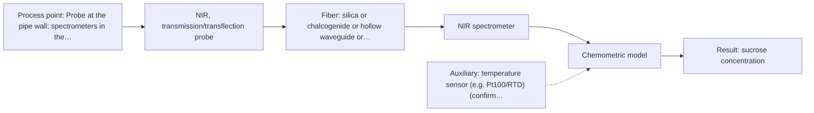
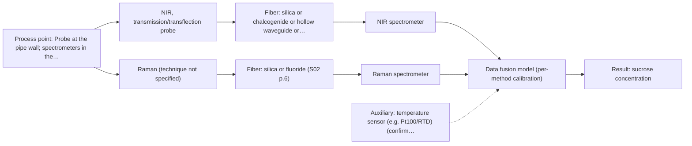

# First technical assessment: Complete enquiry for sugar concentration in a clear solution

## Answer

**Customer request (our summary):** Customer wants in-line monitoring of sucrose concentration in a clear, colourless aqueous solution flowing through a 50 mm stainless steel pipe at 20 to 30 °C and normal pressure, with 5 to 15 % w/w range, ±0.3 % w/w quality limit, lab refractometer reference, analyser 10 m away in a dry safe room, hot caustic CIP once a day, and one reading per minute. They ask for a method and probe for a first trial.

### Brief answer

Test NIR transmission/transflection first: it suits clear liquids and is the common online fibre-probe method, with a chemometric model calibrated against your lab refractometer. Raman is a water-tolerant comparison, and a combined NIR + Raman system is a later hypothesis. Whether plus or minus 0.3 % w/w, one reading a minute and hot-caustic cleaning can be met is not covered by the sources; please confirm interferents, cleaning conditions and flow.

### Proposal

- **Best current option:** O2 (recommended)
- **Basis:** supplied AFS sources
- **What would change it:** If the trial shows NIR cannot reach plus or minus 0.3 % w/w over 5 to 15 % w/w, or if interfering dissolved species are present, the Raman comparison and then the combined option move up. A feasible 10 m MIR link could also bring MIR ATR forward.
- **Next step:** Run the feasibility experiment with representative samples, the NIR transmission probe and the laboratory refractometer, and report the held-out prediction error against the customer's plus or minus 0.3 % w/w.

**Secondary evidence (external, not AFS material):** G1: no usable external source found; G2: E02 ¶31; G3: no usable external source found; G4: E01 ¶20. See Expert detail.

**Decision status:** Provisional feasibility assessment

### Solution options

| ID | Tier | Methods | Confidence | Cost class, S01 Table 1 (p.6) | Ease of use | Maintenance | Performance fit | Sources |
|---|---|---|---|---|---|---|---|---|
| O1 | Simple | M2 Raman probe | Medium: uncited auxiliary sensor | high cost (row 12) | Single probe, no pathlength window | Laser, probe window, fluorescence checks | Water-tolerant, sharp sucrose bands | [1: S01 p.16] [2: S01 p.12] [3: S01 p.11] |
| O2 | Recommended | M1 NIR, transmission/transflection probe | Medium: uncited auxiliary sensor | average cost (row 7) | Standard probe, well-understood online method | Window cleaning, calibration upkeep | Best fit for clear liquid, fibre-friendly | [4: S01 p.18] [5: S02 p.7] [6: S01 p.10] [7: S01 p.10] |
| O3 | Extended (multi-method) | M3 NIR, transmission/transflection probe + Raman (combination) | Low: uncited auxiliary sensor; multi-method, fusion benefit not yet shown | high cost (rows 7, 12) | Two instruments, synchronised data | Two calibrations, two probe checks | Adds water-tolerant Raman bands | [8: S01 p.8] [9: S01 p.8] [10: S01 p.9] [11: REF §5] [12: S01 p.7] [13: S01 p.8] [14: REF §3] |

*Confidence rates the basis of the advice (how much is known and cited), not a predicted accuracy or probability of success. It starts at High, or at Medium when a key question on the method or the option is open, and drops one level per weakness listed (floor Low).*

*Cost class is the relative rating in S01 Table 1 (p.6) for the in-line method+technique rows named (the highest one for a multi-method option); it is not a price.*

### Setup sketch

*Recommended option O2; drawn by code from the option, a schematic, not a configuration.*

## Expert detail

**Customer enquiry**

> We produce a clear, colourless aqueous sucrose solution and want to monitor its sucrose concentration in-line. The solution flows through a 50 mm stainless steel pipe at 20 to 30 °C and normal pressure; the expected range is 5 to 15 % w/w and our quality limit is plus or minus 0.3 % w/w. Our laboratory refractometer is the reference method and stays in use. The analyser can stand in a dry, safe room 10 m from the pipe, and the line is cleaned in place with hot caustic once a day. A reading every minute is enough. Please propose a method and probe for a first trial.

**Decision status:** Provisional feasibility assessment. A shortlist of single methods is justified for a clear, colourless aqueous liquid, with NIR transmission tested first. The customer's accuracy, response-time and cleaning targets are not covered by the sources, so this stays a provisional assessment resting on stated assumptions.

### Parameters

| ID | Parameter | Kind | Need | Measured by | Why | Sources |
|---|---|---|---|---|---|---|
| P1 | sucrose concentration | quantitative | required | Spectroscopy: NIR | It is the target the customer wants monitored in-line. | *(no verified source: engineering judgement)* |
| P2 | solution temperature | quantitative | required | Auxiliary sensor: temperature sensor (e.g. Pt100/RTD) (engineering judgement: confirm availability with AFS) | The stated 20 to 30 °C span can shift vibrational bands and the reference refractometer reading, so it is needed for calibration and compensation. | *(no verified source: engineering judgement)* |

### Solution option details

- **O1 cost drivers:** Raman laser, spectrometer and fibre probe
- **O2 cost drivers:** NIR spectrometer, transmission probe, calibration effort
- **O3 cost drivers:** Two spectrometers, two probes, fusion software
- **O3 combining methods:** Low-level fusion of block-scaled NIR and Raman spectra taken from the same sampling spot, synchronised to a common one-minute time step, with a separate calibration and diagnostics per method. The fused model must beat the best single method on held-out batches before the extra instrument is kept.

*Extended (multi-method) option O3; drawn by code from the option, a schematic, not a configuration.*

### Premise check

- **Not covered:** The quality limit of plus or minus 0.3 % w/w is achievable by the proposed method. No supplied source states an achievable accuracy for sucrose or any aqueous analyte, so the tolerance must be established by the trial. *(no verified source: engineering judgement)*
- **Not covered:** The probe can tolerate in-place cleaning with hot caustic once a day. No supplied source covers caustic compatibility of a probe window or ATR crystal; cleaning compatibility is an open question. *(no verified source: engineering judgement)*
- **Supported:** The analyser can be placed in a dry, safe room 10 m from the pipe without compromising the measurement. Silica-fibre cables of 100-300 m are stated for remote industrial process control, which covers a 10 m run for silica-fibre methods. [5: S02 p.7]

### Requirements

**Stated by the customer**

- In-line sucrose concentration in a clear, colourless aqueous solution.
- Range 5 to 15 % w/w; quality limit plus or minus 0.3 % w/w.
- 50 mm stainless steel pipe, 20 to 30 °C, normal pressure.
- Analyser 10 m from the pipe in a dry, safe room.
- Daily hot-caustic clean-in-place; one reading per minute.
- Laboratory refractometer stays in use as reference.

**Key unknowns**

- Other dissolved species or suspended solids that could interfere with sucrose.
- Whether the 5 to 15 % w/w range is sucrose alone or total dissolved solids.
- Caustic concentration, temperature and contact time during the daily clean-in-place.
- Flow rate and regime, and the exact probe mounting point in the 50 mm pipe.
- Uncertainty of the laboratory refractometer and how reference samples are taken.
- Whether an achievable MIR fibre length supports a 10 m link if MIR ATR is needed.

### Clarification questions (most decision-relevant first)

### Recommendation

- **M1 · Primary candidate: NIR, transmission/transflection probe.** NIR transmission/transflection is the preferred geometry for clear, semi-transparent liquids and the most common online fibre-probe method, so it is the single method to test first. Its broad, overlapping bands require a chemometric calibration. *Conditions:* Applies if no dissolved species are present that NIR cannot resolve from sucrose. [4: S01 p.18] [6: S01 p.10] [7: S01 p.10]
- **M2 · Comparison candidate: Raman probe.** Raman tolerates the aqueous matrix better than infrared methods and its signal is linear with concentration, so it is a useful comparison against NIR. Its weak signal and possible fluorescence background must be checked on the real solution. *Conditions:* Applies if the colourless solution shows no strong fluorescence background. [1: S01 p.16] [2: S01 p.12] [3: S01 p.11]
- **M3 · Comparison candidate: NIR, transmission/transflection probe + Raman (combination).** Combining NIR and Raman is a later hypothesis to test only after the single-method tests, adding water-tolerant Raman information to NIR. Any gain is a hypothesis and must be shown against the best single method. *Conditions:* Applies only if the single NIR and Raman tests each fall short of the customer's plus or minus 0.3 % w/w. [12: S01 p.7] [13: S01 p.8] [14: REF §3] Later hypothesis, after single-method tests.

### Measurement concept

- **Probe and geometry:** A transmission or transflection fibre probe in the 50 mm pipe with a controlled optical pathlength for NIR; a Raman probe is a separate comparison. No configuration is fixed by the sources.
- **Location:** Probe at the pipe wall; spectrometers in the dry room about 10 m away, reached with silica-fibre cables.
- **Fiber link:** Silica fibres are the only family stated for a 100-300 m remote link; MIR would need chalcogenide or polycrystalline fibres, for which no length is stated. [5: S02 p.7] [15: S02 p.6]

### Spectral range

- **NIR:** Nominal NIR range 780-2500 nm; the usable range depends on the instrument, fibre and probe actually selected. [16: S01 p.10]
- **Raman:** Raman is reported as a Raman shift in cm-1, with the laser excitation wavelength stated separately; no excitation wavelength is fixed here. [17: S01 p.11]

### Risks and uncertainty

- NIR water and sucrose bands overlap broadly, so the plus or minus 0.3 % w/w target may not be reachable with NIR alone. *(rules: R-NIR-2, R-GEN-3)* [7: S01 p.10]
- Raman's weak signal and a possible fluorescence background could limit its accuracy on the real solution. *(rules: R-RAM-1)* [3: S01 p.11]
- A probe window or ATR crystal may not survive daily hot-caustic cleaning; no source covers this. *(rules: R-MIR-3)* *(no verified source: engineering judgement)*
- Any unlisted dissolved species or a temperature shift can invalidate a calibration, which is specific to the matrix. *(rules: R-CAL-1)* [18: REF §5]

### First feasibility experiment

1. **Collect representative samples across the expected variation: the full 5 to 15 % w/w sucrose range and 20 to 30 °C, from several production batches, including any expected interferents.** Covers the chemical and physical variation the model must handle. [19: REF §3]
2. **Acquire NIR transmission/transflection spectra in the process geometry with the same probe and a controlled optical pathlength, recording sample temperature.** Single method first, under the real measurement geometry. [20: S01 p.18]
3. **Measure each sample independently with the laboratory refractometer at a controlled temperature as the reference.** Independent reference measurement. *(no verified source: engineering judgement)*
4. **Build a chemometric calibration for sucrose against the refractometer and validate it on held-out batches or runs, not only held-out samples.** Held-out validation on runs or batches. [21: S01 p.5]
5. **Go/no-go: accept NIR if the held-out prediction error stays within the customer's plus or minus 0.3 % w/w across 5 to 15 % w/w; otherwise test the Raman comparison and then the combined option.** Go/no-go basis, with the numerical criterion from the customer. *(no verified source: engineering judgement)*

**Reference measurements:** Laboratory refractometer, already the customer's reference method.

**Decision basis:** Held-out prediction error against the customer's plus or minus 0.3 % w/w over 5 to 15 % w/w.

### Assumptions

- The solution is a single-phase, clear liquid with sucrose as the main dissolved solid.
- The stated 5 to 15 % w/w refers to sucrose and the 20 to 30 °C range holds during measurement.
- The laboratory refractometer can supply reference values across the whole range.

### Not covered by the supplied sources

- An achievable accuracy of plus or minus 0.3 % w/w for in-line sucrose measurement.
- Response time of the candidate methods for a one-reading-per-minute requirement.
- Compatibility of probes or ATR crystals with daily hot-caustic clean-in-place.
- An achievable fibre length for a 10 m MIR link.

### Further notes

- **Chemometrics:** NIR bands are broad and overlapping, so a calibration model (for example PLS) against the refractometer is needed; reference data should span 5 to 15 % w/w and 20 to 30 °C and be validated on held-out batches. A classification or calibration model is built, validated and applied in specialised software.
- **Real-time tracking:** The one-reading-per-minute measurement is a continuous in-line tracking task. If two methods are later fused, their data must be normalised to a common time step.
- **Future direction:** After a successful trial, a compact optical multisensor (LED/filter) focused on this specific stream could be developed.

### Secondary evidence (external, not AFS material)

*Found by a literature search for gaps the supplied AFS sources leave open. Not AFS material and not proof for this case; every quote below was verified verbatim against the fetched text.*

**G1 · auxiliary sensor:** In-line measurement of solution temperature with temperature sensor (e.g. Pt100/RTD)

- No usable external source found.

**G2 · multi-method:** Combining several spectroscopy methods (data fusion) (Low-level fusion of block-scaled NIR and Raman spectra taken from the same sampling spot, synchronised to a common one-minute time step, with a separate calibration and diagnostics per method. The fused model must beat the best single method on held-out batches before the extra instrument is kept.)

- **E02 ¶31** Low-level data fusion is described as the simplest way to combine inputs by placing variables from different sources into a new data matrix. *How it applies:* This supports the O3 approach of low-level fusion of NIR and Raman; the trial should build the fused matrix and compare it with single-method models. *Limits and transfer risks:* This is a general PAT data-fusion review, not a sucrose study or a same-spot synchronised NIR/Raman setup; it does not show that fusion will improve performance. *(supports O3)*
  > "Low-level data fusion (LLDF) is considered the simplest method to achieve a combination of inputs. In this case, the data is rearranged into a new data matrix, where the variables coming from different sources are placed one after the other."
  > Challenges and Opportunities of Implementing Data Fusion in Process Analytical Technology-A Review. (2022) · Molecules (Basel, Switzerland) · doi:10.3390/molecules27154846 · https://europepmc.org/article/PMC/PMC9369811 · retrieved 2026-10-17, full text, licence: cc by, via curated library

**G3 · not in the supplied sources:** An achievable accuracy of plus or minus 0.3 % w/w for in-line sucrose measurement.

- No usable external source found.

**G4 · not in the supplied sources:** Response time of the candidate methods for a one-reading-per-minute requirement.

- **E01 ¶20** Raman spectroscopy is used in upstream processing for its selectivity and low water interference despite relatively long measurement times. *How it applies:* For the Raman option, the relatively long measurement times may affect the required reading cadence; test whether the method can deliver readings at the requested interval. *Limits and transfer risks:* This is an upstream bioprocessing review, not a sucrose measurement or an in-line pipe trial; it gives no exact measurement time or response time. *(supports O1)*
  > "Raman spectroscopy is frequently applied in upstream processing in research and industry due to its high selectivity and low water interference [55] despite the relatively long measurement times."
  > A critical review of recent trends, and a future perspective of optical spectroscopy as PAT in biopharmaceutical downstream processing. (2020) · Analytical and bioanalytical chemistry · doi:10.1007/s00216-020-02407-z · https://europepmc.org/article/PMC/PMC7072065 · retrieved 2026-10-17, full text, licence: cc by, via curated library

### Evidence (verified quotes)

1. ✓ **S01 p.16** (general): "Raman is particularly well-suited for aqueous environments, as it exhibits low absorbance for water molecules compared to infrared methods."
2. ✓ **S01 p.12** (general): "dependence on concentration is linear over a wide range of intensities"
3. ✓ **S01 p.11** (general): "superposition of luminescence (fluorescence), which has a significantly higher intensity."
4. ✓ **S01 p.18** (general): "Transmission is the preferred method for transparent or semi-transparent liquids, such as skim milk, whey, or permeate."
5. ✓ **S02 p.7** (general): "Robust 100-300m cables made with Silica fibers of low OH-content (<0.1ppm OH) enable remote industrial process-control"
6. ✓ **S01 p.10** (general): "Near-IR vibrational spectroscopy (NIR) is the most common online analysis method performed using fiber optic probes."
7. ✓ **S01 p.10** (general): "The broad absorption bands observed in this region overlap, suggesting the use of chemometrics for quantitative and qualitative analysis of spectral data."
8. ✓ (precedent only) **S01 p.8** (method gain): "It is crucial that the spectral information obtained by different methods-Mid-IR, NIR, Raman, and fluorescence spectra-is collected from the same small, even pinpoint, area of the sample."
9. ✓ (precedent only) **S01 p.8** (method gain): "Ultimately, the measurement data must be normalized to a common time step."
10. ✓ **S01 p.9** (general): "One of the challenges of multispectral analysis is the need to simultaneously connect at least two independently operating measuring instruments."
11. ✓ (precedent only) **REF §5** (method gain): "compare with the best single method."
12. ✓ (precedent only) **S01 p.7** (method gain): "The analysis of such systems may require a combination of two or even more spectral methods."
13. ✓ (precedent only) **S01 p.8** (method gain): "Variables obtained from different spectral methods are not equivalent."
14. ✓ **REF §3** (general): "a published application is a reason to test a method, not proof that it will work for a new customer."
15. ✓ **S02 p.6** (general): "350 nm Standard VIS-NIR Silica Fibers Al/Cu-coated VIS-NIR Silica Fibers 2400 nm"
16. ✓ **S01 p.10** (general): "NIR spectra (780-2500 nm) contain predominantly overtones and component bands of fundamental vibrations"
17. ✓ **S01 p.11** (general): "The Raman shift is used as the horizontal (spectral) axis in Raman spectroscopy"
18. ✓ **REF §5** (general): "calibration specific to the matrix."
19. ✓ **REF §3** (general): "Representative samples or process states, independent reference measurements, what is compared, and the basis for the go / no-go decision."
20. ✓ **S01 p.18** (general): "the precise control of the optical pathlength (usually 1 - 10 mm); if the pathlength is too wide, the signal is lost to absorption; if too narrow, the sample represents a negligible volume."
21. ✓ **S01 p.5** (general): "Chemometric algorithms are implemented in specialized software that enables preliminary data preparation (preprocessing), construction, validation, and application of predictive models, specifically calibration or classification models."

### Verification

- Citations verified: 27 of 27 (exact or whitespace/hyphen-tolerant match on the cited page, scope checked).
- Hard check failures before deterministic corrections: 0; still open: 0; soft warnings: 6; repair rounds: 0.
- External evidence (live): 2 quote(s) verified verbatim (exact or whitespace/hyphen-tolerant, at most 400 characters and 2 sentences, against the cited paragraph); 2 item(s) dropped.
- External search: 6 query(ies), 45 hit(s), 5 source(s) (3 from the curated library).
- External step: 2 model call(s), 81.5 s extra (cost in the run JSON).
  - ⚠ dropped G1 E01 ¶12: figure not in its own quote: 50 mm
  - ⚠ dropped G2 E05 ¶29: quote not verified (too_long: quote longer than 400 characters (427))

*Run A07-20261017T234908Z · models deepseek/deepseek-v4.1-flash*
