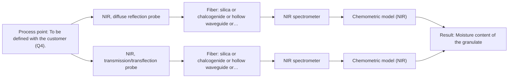

# First technical assessment: Accuracy guarantee, regulatory approval and price

## Answer

**Customer request:** Before we order, please confirm in writing that your NIR system will measure the moisture of our granulate to plus or minus 0.1 % and guarantee that our regulator will approve it for release testing. Please also include the price of the complete system.

### Brief answer

We cannot confirm in writing a ±0.1 % moisture accuracy or promise your regulator's approval: no accuracy figure is supported by the available material, and approval depends on your own validation dossier. Pricing likewise cannot be quoted before the configuration is defined. What we can propose is a feasibility trial: NIR diffuse-reflection spectra on representative granulate samples, calibrated against your reference moisture method and validated on held-out batches. Please share the moisture range, granulate character, reference method and installation point.

### Proposal

- **Best current option:** O2 (recommended)
- **Basis:** engineering judgement
- **What would change it:** The answers on moisture range, granulate character and reference method could shift the choice between reflection and transflection geometry, and a failed feasibility trial against the customer's tolerance would end the NIR route.
- **Next step:** Run the multi-method lab feasibility trial on representative granulate samples with independent reference moisture values before any order.

**Secondary evidence (external, not AFS material):** G1: no usable external source found; G2: no usable external source found; G3: E05 ¶5; G4: no usable external source found. See Expert detail.

**Decision status:** Insufficient information for a method choice

### Solution options

| ID | Tier | Methods | Confidence | Cost class, S01 Table 1 (p.6) | Ease of use | Maintenance | Performance fit | Sources |
|---|---|---|---|---|---|---|---|---|
| O1 | Simple | M1 NIR, diffuse reflection probe | Low: open question: Q1, Q2, Q3 (starts at Medium); a parameter is not measurable in-line; status: insufficient information | average cost (row 8) | Simple probe setup, lab-trial scale | Low; single spectrometer and probe | Directly tests whether NIR reflection meets the moisture target | [1: S02 p.20] [2: S01 p.17] [3: S01 p.10] [4: S01 p.10] [5: S02 p.12] |
| O2 | Recommended | M1 NIR, diffuse reflection probe; M2 NIR, transmission/transflection probe | Low: open question: Q1, Q2, Q3 (starts at Medium); sample clarity unknown; a parameter is not measurable in-line; status: insufficient information | average cost (rows 7, 8) | Moderate; validated calibration workflow | Periodic recalibration and reference checks | Covers granulate variation with a fallback geometry for the accuracy target | [6: S01 p.18] [2: S01 p.17] [3: S01 p.10] [4: S01 p.10] [5: S02 p.12] [7: S01 p.18] |

*Confidence rates the basis of the advice (how much is known and cited), not a predicted accuracy or probability of success. It starts at High, or at Medium when a key question on the method or the option is open, and drops one level per weakness listed (floor Low).*

*Cost class is the relative rating in S01 Table 1 (p.6) for the in-line method+technique rows named (the highest one for a multi-method option); it is not a price.*

### Setup sketch

*Recommended option O2; drawn by code from the option, a schematic, not a configuration.*

### Key questions

1. What moisture range must be measured, and is ±0.1 % absolute or relative to that range?
2. What is the granulate made of, and what are its particle size, bulk density variation and heterogeneity?
3. Which reference (lab) method do you use for moisture, and what is its own measurement uncertainty?

## Expert detail

**Customer enquiry**

> Before we order, please confirm in writing that your NIR system will measure the moisture of our granulate to plus or minus 0.1 % and guarantee that our regulator will approve it for release testing. Please also include the price of the complete system.

**Decision status:** Insufficient information for a method choice. Written confirmation of ±0.1 % accuracy and regulatory approval for release testing cannot be given based on the enquiry or supplied material: no source states any accuracy figure for moisture in granulate, and regulatory approval depends on the customer's validation evidence, not on a vendor statement. A method shortlist can still be proposed once key sample and installation facts are known.

### Parameters

| ID | Parameter | Kind | Need | Measured by | Why | Sources |
|---|---|---|---|---|---|---|
| P1 | Moisture content of the granulate | quantitative | required | Spectroscopy: NIR | It is the target variable the NIR calibration must predict and validate. | [5: S02 p.12] |
| P2 | Granulate physical character (particle size, opacity, heterogeneity) | qualitative | required | Not measurable in-line by spectroscopy; alternative: Laboratory characterisation of representative granulate samples before the trial | It decides between reflection and transmission/transflection geometry and drives scatter correction needs. | [8: S01 p.17] |
| P3 | Reference moisture value per sample | quantitative | required | Reference lab method: Customer's lab moisture method (to be confirmed, Q3) | Independent reference values are needed to build and validate the calibration and to judge the ±0.1 % target. | *(no verified source: engineering judgement)* |

### Solution option details

- **O1 cost drivers:** One NIR spectrometer, one diffuse-reflection probe, reference lab analyses, chemometric modelling effort
- **O2 cost drivers:** NIR spectrometer with reflection and transflection probes, larger reference dataset, validation on held-out batches, documentation for the customer's regulatory dossier

### Premise check

- **Not covered:** The NIR system will measure moisture in the customer's granulate to ±0.1 %. No supplied source states any accuracy figure for moisture measurement; achievable accuracy depends on the configuration and the sample and must be established in a feasibility trial. [9: REF §5]
- **Not covered:** The vendor can assure that the customer's regulator will approve the system for release testing. No supplied source addresses regulatory approval; approval for release testing rests on the customer's own validation and regulatory dossier, so it cannot be promised in writing. *(no verified source: engineering judgement)*
- **Precedent only:** NIR spectroscopy can in principle measure moisture in a granulate. NIR covers O-H bands and a published AFS concept shows NIR moisture sensing, which is a reason to test, not proof of a specified accuracy for this granulate. [3: S01 p.10] [5: S02 p.12]

### Requirements

**Stated by the customer**

- Written confirmation of ±0.1 % moisture accuracy
- Written assurance of regulator approval for release testing
- Price of the complete system

**Key unknowns**

- Required moisture range and whether ±0.1 % is an absolute or relative figure
- Granulate composition, particle size and heterogeneity
- Reference (lab) method used for moisture and its own accuracy
- Installation point: in-line in process or at-line on samples
- Applicable regulatory framework and validation expectations

### Clarification questions (most decision-relevant first)

Q1. What moisture range must be measured, and is ±0.1 % absolute or relative to that range? *Why it matters:* The achievable accuracy and the calibration design depend entirely on the range and the meaning of the tolerance. *(affects: status, M1)*
Q2. What is the granulate made of, and what are its particle size, bulk density variation and heterogeneity? *Why it matters:* Scattering and physical variation drive the choice between reflection and transmission geometry and the calibration effort. *(affects: method, M1, M2)*
Q3. Which reference (lab) method do you use for moisture, and what is its own measurement uncertainty? *Why it matters:* The reference method defines what the spectroscopic calibration can be validated against and sets the realistic accuracy ceiling. *(affects: status, M1)*
Q4. Where should the measurement sit: in-line in the process, in-line bypass, or at-line on sampled material? *Why it matters:* The installation point determines the probe type, fiber link and whether release-representative material is actually measured. *(affects: installation)*
Q5. Which regulatory framework and release-testing requirements apply (e.g. GMP, pharmacopoeial method status)? *Why it matters:* Approval depends on the customer's validation dossier against that framework, not on the instrument itself. *(affects: status)*

### Recommendation

- **M1 · Primary candidate: NIR, diffuse reflection probe.** NIR diffuse reflection is the screened pass for a granulate and NIR contains the O-H bands needed for moisture; a published AFS concept shows NIR moisture sensing. Quantitative use will require a chemometric calibration against a reference method. [2: S01 p.17] [3: S01 p.10] [4: S01 p.10] [5: S02 p.12]
- **M2 · Conditional candidate: NIR, transmission/transflection probe.** A transflection probe could serve as an alternative geometry if the granulate proves too dense or opaque for reflection to be representative, but transmission fails when light cannot penetrate the sample. *Conditions:* Only if the granulate turns out to be sufficiently transparent or semi-transparent in a lab trial; screening status is unknown. [7: S01 p.18] [6: S01 p.18]

### Measurement concept

- **Probe and geometry:** NIR diffuse-reflection fiber probe contacting or closely viewing the granulate (in-line flush-mounted or at-line cup, per Q4); transflection as a conditional alternative (M2).
- **Location:** To be defined with the customer (Q4).
- **Fiber link:** Vis-NIR silica fibers; the usable NIR range depends on the selected fiber, spectrometer and probe. [10: S02 p.6]

### Spectral range

- **NIR:** Nominal NIR method range 780-2500 nm; the usable range of the actual instrument, fiber and probe must be confirmed at selection. Moisture-relevant O-H bands lie within this nominal range. [3: S01 p.10]

### Risks and uncertainty

- The ±0.1 % target may be unattainable for this granulate; no source supports any accuracy figure and the reference method's own uncertainty sets the ceiling. *(rules: R-PRO-3)* *(no verified source: engineering judgement)*
- Reflection signals are sensitive to surface characteristics and particle size, so physical variation of the granulate can mimic moisture changes unless corrected and calibrated. *(rules: R-GEO-6)* [8: S01 p.17]
- The calibration is specific to the granulate matrix and must be re-validated if composition or supplier changes. *(rules: R-CAL-1)* [11: REF §5]
- Regulatory approval for release testing depends on the customer's validation evidence and framework, which no vendor statement can substitute. *(no verified source: engineering judgement)*

### First feasibility experiment

1. **Collect representative granulate samples spanning the expected moisture range and batch/supplier variation.** Cover the chemical and physical variation the calibration must handle. *(no verified source: engineering judgement)*
2. **Measure each sample with the customer's reference lab moisture method under a defined protocol.** Provide independent reference values for calibration and validation. *(no verified source: engineering judgement)*
3. **Measure NIR diffuse-reflection spectra (M1) on all samples; add transflection (M2) only if the reflection geometry proves unrepresentative.** Test the primary single method first, the alternative only if needed. *(no verified source: engineering judgement)*
4. **Build a chemometric calibration and validate it on held-out batches or runs.** Estimate real prediction accuracy rather than a fitted figure. *(no verified source: engineering judgement)*
5. **Compare validated prediction error against the customer's required tolerance as the go/no-go basis.** The numerical go/no-go criteria come from the customer, not from AFS. [12: REF §3]

**Reference measurements:** Customer's lab moisture method on every calibration and validation sample (method to be confirmed, Q3).

**Decision basis:** Validated prediction error on held-out samples versus the customer's stated tolerance; the customer supplies the numerical criterion.

### Assumptions

- The granulate is a powder or particulate solid measured at ambient process conditions.
- Moisture is the only target analyte for now.

### Not covered by the supplied sources

- Any accuracy figure for moisture measurement, including whether ±0.1 % is achievable
- Regulatory approval pathways or validation requirements for release testing
- Pricing of any system

### Further notes

- **Chemometrics:** A quantitative moisture model (e.g. PLS) will need a representative calibration set spanning the moisture range and physical variation, preprocessing for scatter (e.g. derivatives or SNV-type correction), and validation on held-out batches; the reference method's uncertainty bounds the achievable accuracy.
- **Real-time tracking:** If the measurement is installed in-line, continuous tracking of moisture trends is feasible with fiber-optic NIR, but release-testing use additionally requires the customer's validated procedure and regulatory acceptance.
- **Future direction:** Once the calibration is established, a simplified multi-wavelength LED-type NIR sensor could be considered for routine monitoring, following the published concept.

### Secondary evidence (external, not AFS material)

*Found by a literature search for gaps the supplied AFS sources leave open. Not AFS material and not proof for this case; every quote below was verified verbatim against the fetched text.*

**G1 · decision status:** insufficient information: Written confirmation of ±0.1 % accuracy and regulatory approval for release testing cannot be given based on the enquiry or supplied material: no source states any accuracy figure for moisture in granulate, and regulatory approval depends on the customer's validation evidence, not on a vendor statement. A method shortlist can still be proposed once key sample and installation facts are known.

- No usable external source found.

**G2 · not in the supplied sources:** Any accuracy figure for moisture measurement, including whether ±0.1 % is achievable

- No usable external source found.

**G3 · not in the supplied sources:** Regulatory approval pathways or validation requirements for release testing

- **E05 ¶5** According to source E05, modern industrial production and online infrared monitoring are guided by the Quality by Design principle and the Process Analytical Technology initiative of the U.S. Food and Drug Administration. *How it applies:* This context can help frame discussions around regulatory pathways by aligning validation strategies with FDA PAT and QbD guidelines. *Limits and transfer risks:* Regulatory acceptance depends entirely on the specific customer process and validation data rather than general framework principles.
  > "Guided by the Quality by Design (QbD) principle and the Process Analytical Technology (PAT) initiative of the U.S. Food and Drug Administration (FDA), modern industrial production requires standardized data to ensure product stability and reliability (Simon et al., 2015)."
  > From optical architectures to actual deployment a review of online process spectroscopy in industrial environments. (2026) · Frontiers in chemistry · doi:10.3389/fchem.2026.1914581 · https://europepmc.org/article/PMC/PMC13587345 · retrieved 2026-10-18, full text, licence: cc by, via europepmc

**G4 · not in the supplied sources:** Pricing of any system

- No usable external source found.

### Evidence (verified quotes)

1. ✓ **S02 p.20** (general): "1. Multi-Method Lab Trials AFS tests your process using all key fiber optic spectroscopy methods."
2. ✓ **S01 p.17** (general): "NIR Reflection is primarily used for opaque or highly concentrated dairy products, such as yogurt, butter, or whole milk concentrates."
3. ✓ **S01 p.10** (general): "NIR spectra (780-2500 nm) contain predominantly overtones and component bands of fundamental vibrations"
4. ✓ **S01 p.10** (general): "The broad absorption bands observed in this region overlap, suggesting the use of chemometrics for quantitative and qualitative analysis of spectral data."
5. ✓ **S02 p.12** (application precedent): "IoT Concept of NIR-LED Fiber Sensor to control Moisture Level"
6. ✓ **S01 p.18** (general): "In some cases, a Transflection probe can already be a combined solution working well for low-fat and high-fat containing milk products."
7. ✓ **S01 p.18** (general): "it fails when the milk becomes too "thick" or fat-rich, as the light cannot penetrate the sample."
8. ✓ **S01 p.17** (general): "the method is sensitive to the surface characteristics and fat globule size."
9. ✓ **REF §5** (general): "It is not a product specification: actual spectral coverage, fiber length, component ratings, detection limits and accuracy depend on the configuration and the sample."
10. ✓ **S02 p.6** (general): "350 nm Standard VIS-NIR Silica Fibers Al/Cu-coated VIS-NIR Silica Fibers 2400 nm"
11. ✓ **REF §5** (general): "physical variation; calibration specific to the matrix."
12. ✓ **REF §3** (general): "Representative samples or process states, independent reference measurements, what is compared, and the basis for the go / no-go decision."

### Verification

- Citations verified: 18 of 18 (exact or whitespace/hyphen-tolerant match on the cited page, scope checked).
- Hard check failures before deterministic corrections: 0; still open: 0; soft warnings: 0; repair rounds: 1.
- External evidence (live): 1 quote(s) verified verbatim (exact or whitespace/hyphen-tolerant, at most 400 characters and 2 sentences, against the cited paragraph); 0 item(s) dropped.
- External search: 3 query(ies), 30 hit(s), 5 source(s) (3 from the curated library).
- External step: 2 model call(s), 9.5 s extra (cost in the run JSON).

*Run A08-20261018T094904Z-2693 · models google/gemini-3.5-flash-lite, google/gemini-3.8-flash, z-ai/glm-5.3-flash*
