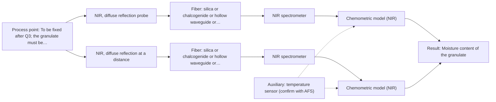
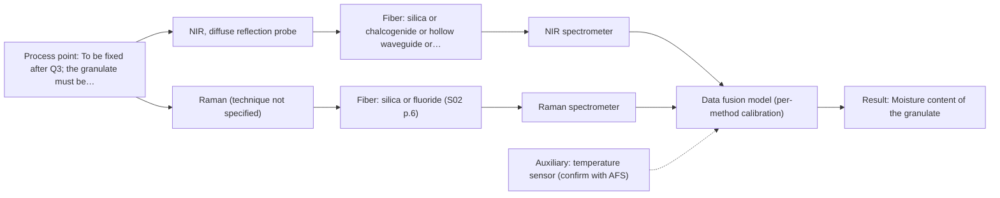

# First technical assessment: Accuracy guarantee, regulatory approval and price

## Answer

**Customer request:** Before we order, please confirm in writing that your NIR system will measure the moisture of our granulate to plus or minus 0.1 % and guarantee that our regulator will approve it for release testing. Please also include the price of the complete system.

### Brief answer

No accuracy figure, regulator approval or price can be given from the available information. NIR diffuse reflection is the method to test first on your granulate, with independent reference moisture; the plus or minus 0.1 % target can only be judged from that trial. Still open: the moisture range and whether plus or minus 0.1 % is absolute, the granulate composition, and where and how the measurement is taken.

### Proposal

- **Best current option:** O2 (recommended)
- **Basis:** supplied AFS sources
- **What would change it:** A very low moisture range, or a matrix whose other absorbers overlap the water bands, would move the choice towards the NIR and Raman option or back to a laboratory method. If the measurement can only be taken at-line or in a laboratory, the installation and the probe choice change as well.
- **Next step:** Answer the first three questions, then run the NIR diffuse-reflection trial on representative granulate samples with independent reference moisture.

**Secondary evidence (external, not AFS material):** G1: E02 ¶12; G2: E03 ¶82, E05 ¶23; G3: no usable external source found; G4: no usable external source found. See Expert detail.

**Decision status:** Provisional feasibility assessment

### Solution options

| ID | Tier | Methods | Confidence | Cost class, S01 Table 1 (p.6) | Ease of use | Maintenance | Performance fit | Sources |
|---|---|---|---|---|---|---|---|---|
| O1 | Simple | M1 NIR, diffuse reflection probe | Low: open question: Q1, Q2 (starts at Medium); uncited auxiliary sensor | average cost (row 8) | single probe, simple bench measurement | probe cleaning, occasional model re-validation | fastest test of NIR moisture sensitivity | [1: S01 p.5] [2: S01 p.6] [3: S01 p.10] [4: S01 p.5] |
| O2 | Recommended | M1 NIR, diffuse reflection probe; M2 NIR, diffuse reflection at a distance | Low: open question: Q1, Q2 (starts at Medium); uncited auxiliary sensor | average cost (rows 8, 10) | one method, standard fiber-probe operation | window or probe cleaning, periodic calibration checks | in-line fit for a scattering granulate stream | [2: S01 p.6] [5: S01 p.15] [4: S01 p.5] [3: S01 p.10] [1: S01 p.5] |
| O3 | Extended (multi-method) | M3 NIR, diffuse reflection probe + Raman (combination) | Low: open question: Q1, Q2 (starts at Medium); uncited auxiliary sensor; multi-method, fusion benefit not yet shown | at least average cost (row 8); Raman row not identified | two instruments, synchronisation and fusion needed | two instruments and probes, two calibrations | adds information only if NIR falls short | [6: S01 p.8] [7: S01 p.8] [8: S01 p.8] [9: S01 p.9] [10: S01 p.15] [11: S01 p.15] [12: S01 p.16] [13: S01 p.7] |

*Confidence rates the basis of the advice (how much is known and cited), not a predicted accuracy or probability of success. It starts at High, or at Medium when a key question on the method or the option is open, and drops one level per weakness listed (floor Low).*

*Cost class is the relative rating in S01 Table 1 (p.6) for the in-line method+technique rows named (the highest one for a multi-method option); it is not a price.*

### Setup sketch

*Recommended option O2; drawn by code from the option, a schematic, not a configuration.*

### Key questions

1. Is the plus or minus 0.1 % an absolute or a relative figure, and over what moisture range must it hold?
2. What are the main components of the granulate, and does it contain other species that absorb near the water bands, such as residual solvents or other -OH and -NH groups?
3. Where will the measurement be taken - in the process line, at-line or in the laboratory - and how is the granulate presented to the probe there, with which temperature, pressure, dust and vibration?

## Expert detail

**Customer enquiry**

> Before we order, please confirm in writing that your NIR system will measure the moisture of our granulate to plus or minus 0.1 % and guarantee that our regulator will approve it for release testing. Please also include the price of the complete system.

**Decision status:** Provisional feasibility assessment. The shortlist rests on the stated sample type and on the method characteristics in the sources, not on measured data for this product, so it stays provisional. No supplied page supports an accuracy figure, regulatory approval for release testing or a price.

### Parameters

| ID | Parameter | Kind | Need | Measured by | Why | Sources |
|---|---|---|---|---|---|---|
| P1 | Moisture content of the granulate | quantitative | required | Spectroscopy: NIR | It is the target of the enquiry and the quantity the calibration must predict. | [3: S01 p.10] [14: S02 p.12] |
| P2 | Temperature at the measurement point | quantitative | required | Auxiliary sensor: temperature sensor (engineering judgement: confirm availability with AFS) | The spectrum and the model depend on the temperature at the probe, so it must be recorded with each measurement. | *(no verified source: engineering judgement)* |
| P3 | Particle-size distribution and bulk density of the granulate | quantitative | optional | Reference lab method: sieve analysis or laser diffraction | Reflection is sensitive to the physical state, so this variation should be available for the trial design and to separate it from moisture; it is not the measured target. | [15: S01 p.17] |
| P4 | Granulate composition and co-absorbing species | qualitative | required | Reference lab method: formulation records and off-line analysis | Groups such as -OH, -NH and -CH absorb in the same NIR regions as water, so the matrix decides whether moisture can be separated. | [16: S01 p.10] |

### Solution option details

- **O1 cost drivers:** probe and spectrometer time, reference moisture analyses, calibration modelling
- **O2 cost drivers:** fiber-coupled probe, process installation and fiber link, temperature sensing, matrix-specific calibration, model upkeep
- **O3 cost drivers:** second instrument and probe, combined or dual-port installation, synchronisation and fusion software, two calibrations, larger reference data set
- **O3 combining methods:** Fusion level: start with one model per method and then join the NIR and Raman blocks with block scaling, since variables from different methods are not equivalent. Both techniques must look at the same small area of the same granulate stream, and the two data streams must be normalised to a common time step, with each instrument keeping its own calibration and diagnostics. The fused model must beat the best single method on independent batches, otherwise the second instrument is dropped.

*Extended (multi-method) option O3; drawn by code from the option, a schematic, not a configuration.*

### Premise check

- **Not covered:** The NIR system will measure the moisture of their granulate to plus or minus 0.1 %. No supplied page gives an accuracy, precision or detection-limit figure for moisture in a granulate or a comparable solid, so this cannot be confirmed from the sources. *(no verified source: engineering judgement)*
- **Not covered:** Their regulator will approve the system for release testing. Regulatory approval, qualification or release testing is not addressed anywhere in the supplied pages. *(no verified source: engineering judgement)*
- **Precedent only:** NIR is suitable for measuring moisture in their granulate. The sources list NIR diffuse reflection for scattering media and powders, NIR bands include the -OH overtone region, and an NIR moisture example exists; that is a reason to test, not proof for this granulate. [2: S01 p.6] [3: S01 p.10] [14: S02 p.12]

### Requirements

**Stated by the customer**

- "moisture of our granulate"
- "your NIR system"
- "plus or minus 0.1 %"
- "our regulator will approve it for release testing"
- "include the price of the complete system"
- "moisture"

**Key unknowns**

- Moisture range in the granulate, and whether plus or minus 0.1 % is absolute or relative.
- Granulate composition, including any species that absorb in the same NIR regions as water.
- Where the measurement is taken (in-line, at-line or laboratory) and how the granulate is presented to the probe.
- Process conditions at the measurement point: temperature, pressure, dust, vibration, cleaning and fouling.
- Physical variation of the granulate: particle-size distribution, bulk density and flow behaviour.
- Reference method used for moisture today, and the regulator and release-testing requirements that apply.

### Clarification questions (most decision-relevant first)

Q1. Is the plus or minus 0.1 % an absolute or a relative figure, and over what moisture range must it hold? *Why it matters:* The precision NIR can deliver depends on the moisture level and on the range the calibration must cover. *(affects: method)*
Q2. What are the main components of the granulate, and does it contain other species that absorb near the water bands, such as residual solvents or other -OH and -NH groups? *Why it matters:* Overlapping absorbers decide whether NIR can separate moisture from the matrix at all. *(affects: method)*
Q3. Where will the measurement be taken - in the process line, at-line or in the laboratory - and how is the granulate presented to the probe there, with which temperature, pressure, dust and vibration? *Why it matters:* The presentation and process conditions decide the probe type, the fiber link and the measurement geometry. *(affects: installation)*
Q4. Which reference method is used for moisture today, and which regulator and release-testing requirements apply? *Why it matters:* The reference method defines the comparison for the feasibility study, and the regulatory requirement decides what a measurement may be used for. *(affects: status)*
Q5. What are the typical particle-size distribution and bulk density of the granulate, and how much do they vary between batches? *Why it matters:* Physical variation changes the scatter signal and can decide between diffuse reflection and a transmission-type technique. *(affects: technique)*

### Recommendation

- **M1 · Primary candidate: NIR, diffuse reflection probe.** NIR diffuse reflection is the listed technique for scattering media and powders, and NIR bands include the -OH overtone region in which moisture is seen. Fiber probes are used for powdered solids and suit measurement at a process point. *Conditions:* Applies if the granulate is a free-flowing solid that can be presented at a probe window, in a by-pass or in a stream, and if the moisture range and required precision are stated. [2: S01 p.6] [3: S01 p.10] [1: S01 p.5] [4: S01 p.5]
- **M2 · Comparison candidate: NIR, diffuse reflection at a distance.** Measuring the same NIR diffuse reflection at a distance from the granulate surface is the configuration to compare with a contacting probe. It keeps the probe out of a moving solid stream, but whether it reaches the same moisture sensitivity must be tested. *Conditions:* Applies where the installation allows measurement at a distance from the granulate surface. [2: S01 p.6] [4: S01 p.5]
- **M3 · Conditional candidate: NIR, diffuse reflection probe + Raman (combination).** A fused NIR and Raman model is a later hypothesis, not the first test: the published powder-process example reports better accuracy and robustness than single-method models. Any gain must be shown against the best single method on independent batches before a second instrument is justified. *Conditions:* Applies only if the single-method trials show that neither NIR nor Raman alone reaches the precision the customer requires. [10: S01 p.15] [11: S01 p.15] [12: S01 p.16] [13: S01 p.7] Later hypothesis, after single-method tests.
- **M4 · Not recommended: MIR, ATR probe.** MIR-ATR requires tight contact with a liquid, paste or soft solid and reads only a surface layer a few micrometres deep, which a dry granulate cannot provide. It is therefore not proposed for this moisture measurement. [17: S01 p.6] [18: S04 p.4] [19: S01 p.13]

### Measurement concept

- **Probe and geometry:** Fiber-coupled NIR diffuse-reflection probe at the process point, with the spectrometer remote from the process.
- **Location:** To be fixed after Q3; the granulate must be presented reproducibly to the probe.
- **Fiber link:** NIR silica fibers; the usable length and the exact fiber and probe are open questions for AFS. [5: S01 p.15] [4: S01 p.5]

### Spectral range

- **NIR:** NIR is a nominal 780-2500 nm method; the usable range depends on the instrument, fiber and probe finally selected, so no narrower figure is claimed here. [20: S01 p.10] [21: REF §3]
- **Raman:** Raman is reported as Raman shift in cm-1 with the laser excitation wavelength stated separately; no excitation wavelength is fixed here. [22: S01 p.11]

### Risks and uncertainty

- The plus or minus 0.1 % target may not be reachable, because no supplied page gives an accuracy figure for moisture in a solid and NIR can lack sensitivity for small concentrations. *(rules: R-NIR-4)* [23: S01 p.16]
- Particle-size, bulk-density and surface variation change the reflected signal and can be mistaken for moisture, so the calibration needs scatter correction. *(rules: R-GEO-6)* [15: S01 p.17]
- The NIR calibration is matrix-specific, so a change of granulate formulation or feedstock requires re-validation on the new material. *(rules: R-CAL-1)* [24: REF §5]
- The measurement location and process conditions are unknown; if the point is hot, dusty or prone to fouling and abrasion, the probe, window and fiber choice change with it. *(rules: R-GEN-5)* *(no verified source: engineering judgement)*

### First feasibility experiment

1. **Collect representative granulate samples covering the expected moisture range, the particle-size and bulk-density variation and the formulation variants, together with the process states they represent.** Cover the chemical and physical variation the calibration must survive. [25: REF §3]
2. **Measure every sample with an NIR diffuse-reflection fiber probe under conditions that mimic the intended measurement point, with repeats at the same spot.** Single method first, at process-like presentation and temperature. [1: S01 p.5]
3. **Determine the moisture of the same samples independently by the reference laboratory method, and, if Raman is included, measure the same samples with the Raman probe as a separate single method.** Independent reference values; combinations only after the single methods. *(no verified source: engineering judgement)*
4. **Build one chemometric model per method, validate on held-out runs or batches, and compare the predicted-versus-reference error with the customer's plus or minus 0.1 % criterion; use scatter correction to separate physical variation from moisture.** Quantify the achievable precision against the customer's number. [26: S01 p.10] [27: S03 p.14]
5. **Go / no-go: the customer's numerical criterion on independent samples or batches decides; if NIR alone does not reach it, repeat the comparison with a fused NIR and Raman model against the best single method.** Define the decision basis and the escalation path. *(no verified source: engineering judgement)*

**Reference measurements:** Loss on drying or Karl Fischer titration, as used by the customer for release, on the same samples as the spectra.

**Decision basis:** The customer's numerical criterion (plus or minus 0.1 % moisture on held-out samples or batches).

### Assumptions

- The granulate is a dry, free-flowing solid that can be presented reproducibly to a probe.
- The moisture of interest is water, seen through its -OH overtone bands in the NIR region.
- A reference moisture method exists and can be run on the trial samples.

### Not covered by the supplied sources

- An accuracy or precision figure for moisture in a granulate or any comparable solid, so the plus or minus 0.1 % requirement cannot be confirmed from the supplied pages.
- Regulatory approval or qualification for release testing.
- Prices, product codes or component ratings for a complete system.

### Further notes

- **Chemometrics:** NIR bands overlap, so the moisture value comes from a chemometric calibration built on reference moisture data, with scatter correction for particle-size and bulk-density effects. The model is matrix-specific and must be validated on held-out batches, not on the calibration samples.
- **Future direction:** Once the method is established for this matrix, a compact sensor using a few selected wavelengths, as shown for an NIR-LED moisture concept, could replace the full spectrometer for routine monitoring.

### Secondary evidence (external, not AFS material)

*Found by a literature search for gaps the supplied AFS sources leave open. Not AFS material and not proof for this case; every quote below was verified verbatim against the fetched text.*

**G1 · auxiliary sensor:** In-line measurement of Temperature at the measurement point with temperature sensor

- **E02 ¶12** The temperature sensitivity of OH bands in NIR and MIR is described as a severe drawback for measuring aqueous solutions, making tempered sample holders necessary. *How it applies:* For moisture measurement, temperature at the measurement point may affect the OH bands, so temperature monitoring or control at the granulate stream could be considered when assessing O2. *Limits and transfer risks:* The statement concerns aqueous solutions and tempered sample holders, not in-line temperature measurement in a granulate stream; transfer to a solid granulate matrix and to an industrial measurement point is not established. *(supports O2)*
  > "Additionally, the temperature sensitivity of the OH bands is a severe drawback for measuring aqueous solution in NIR and MIR, which makes tempered sample holders necessary [29]."
  > A critical review of recent trends, and a future perspective of optical spectroscopy as PAT in biopharmaceutical downstream processing. (2020) · Analytical and bioanalytical chemistry · doi:10.1007/s00216-020-02407-z · https://europepmc.org/article/PMC/PMC7072065 · retrieved 2026-10-17, full text, licence: cc by, via curated library

**G2 · multi-method:** Combining several spectroscopy methods (data fusion) (Fusion level: start with one model per method and then join the NIR and Raman blocks with block scaling, since variables from different methods are not equivalent. Both techniques must look at the same small area of the same granulate stream, and the two data streams must be normalised to a common time step, with each instrument keeping its own calibration and diagnostics. The fused model must beat the best single method on independent batches, otherwise the second instrument is dropped.)

- **E03 ¶82** Before fusing data from multiple sources, the contribution of each dataset and its complementarity should be evaluated. *How it applies:* This supports testing whether Raman adds complementary information to NIR before keeping the second instrument, and dropping it if the fused model does not improve on the best single method. *Limits and transfer risks:* This is a general PAT data-fusion review statement, not a NIR-plus-Raman granulate study; complementarity can differ with sample, matrix, and process conditions. *(supports O3)*
  > "Before fusing data from multiple sources, it is essential to evaluate the contribution of each dataset to the model and its complementarity."
  > Challenges and Opportunities of Implementing Data Fusion in Process Analytical Technology-A Review. (2022) · Molecules (Basel, Switzerland) · doi:10.3390/molecules27154846 · https://europepmc.org/article/PMC/PMC9369811 · retrieved 2026-10-17, full text, licence: cc by, via curated library
- **E05 ¶23** In a cartilage-health study, concatenating Raman, MIR, and NIR spectra in a multi-block fusion gave higher classification accuracy than single-block models, with PCA-SVM fusion at 81% and multiblock PLS-DA at 79.1%. *How it applies:* This is a reason to test a fused NIR and Raman model against the best single method on independent batches, as required for O3, rather than assuming fusion will help. *Limits and transfer risks:* The result is from ex vivo cartilage classification, not moisture in granulate; the modalities, sample type, and prediction target differ, so the reported improvement may not transfer. *(supports O3)*
  > "For multi-block (fusion) approach of concatenating all three spectral modalities, PCA-SVM fusion achieved the highest accuracy of 81%, and multiblock PLS-DA attained 79.1%, both significantly better than the single-block models as confirmed via analysis of variance, highlighting the benefit of multimodal spectral integration for assessing cartilage health."
  > Predictive Performance of Raman Spectroscopy in Osteoarthritis: A Systematic Review. (2025) · Journal of medical systems · doi:10.1007/s10916-025-02304-x · https://europepmc.org/article/PMC/PMC12638382 · retrieved 2026-10-18, full text, licence: cc by, via europepmc

**G3 · not in the supplied sources:** An accuracy or precision figure for moisture in a granulate or any comparable solid, so the plus or minus 0.1 % requirement cannot be confirmed from the supplied pages.

- No usable external source found.

**G4 · not in the supplied sources:** Regulatory approval or qualification for release testing.

- No usable external source found.

### Evidence (verified quotes)

1. ✓ **S01 p.5** (general): "Immersible fiber optic probes operating in various spectral regions from UV to mid-IR are increasingly being used for measuring liquid and soft or powdered solid samples."
2. ✓ **S01 p.6** (general): "Diffuse reflection-probe diffuse reflection Scattering media, powder"
3. ✓ **S01 p.10** (general): "contain predominantly overtones and component bands of fundamental vibrations of molecules and atomic groups, such as -OH"
4. ✓ **S01 p.5** (general): "making it ideal for online applications, including remote measurements via fiber optic probes."
5. ✓ **S01 p.15** (general): "located safely away from the vibration and dust of the manufacturing floor."
6. ✓ **S01 p.8** (general): "It is crucial that the spectral information obtained by different methods-Mid-IR, NIR, Raman, and fluorescence spectra-is collected from the same small, even pinpoint, area of the sample."
7. ✓ **S01 p.8** (general): "Ultimately, the measurement data must be normalized to a common time step."
8. ✓ **S01 p.8** (general): "If the variables have different units of measurement, the data should be normalized in some way, for example, using an autoscaling algorithm."
9. ✓ **S01 p.9** (general): "One of the challenges of multispectral analysis is the need to simultaneously connect at least two independently operating measuring instruments."
10. ✓ (precedent only) **S01 p.15** (method gain): "predict API potency or coating thickness with higher accuracy and robustness than single-method models"
11. ✓ **S01 p.15** (general): "NIR detects hydrogen bonds and asymmetric polar groups, while Raman provides information on the molecular backbone and symmetrical non-polar groups."
12. ✓ **S01 p.16** (general): "Raman is particularly well-suited for aqueous environments, as it exhibits low absorbance for water molecules compared to infrared methods."
13. ✓ (precedent only) **S01 p.7** (method gain): "The analysis of such systems may require a combination of two or even more spectral methods."
14. ✓ **S02 p.12** (application precedent): "Optimal set of wavelengths to see moisture of media in contact"
15. ✓ **S01 p.17** (general): "the method is sensitive to the surface characteristics and fat globule size."
16. ✓ **S01 p.10** (general): "such as -OH, -NH2=NH, -CH3, =CH2, ≥CH, etc., found in many organic and inorganic compounds"
17. ✓ **S01 p.6** (general): "ATR- platform absorption liquid,paste, soft"
18. ✓ **S04 p.4** (general): "suitability of analyzed samples for ATR measurements, which is true for liquid or soft solid samples and their components, allowing a tight contact with the probe head."
19. ✓ **S01 p.13** (general): "typically at a depth of few microns"
20. ✓ **S01 p.10** (general): "NIR spectra (780-2500 nm) contain predominantly overtones and component bands of fundamental vibrations of molecules and atomic groups, such as -OH"
21. ✓ **REF §3** (general): "A nominal method range is not the range of a specific instrument, fiber or probe."
22. ✓ **S01 p.11** (general): "The Raman shift is used as the horizontal (spectral) axis in Raman spectroscopy"
23. ✓ **S01 p.16** (general): "may lack the sensitivity to detect trace compounds below 0.1 percent."
24. ✓ **REF §5** (general): "physical variation; calibration specific to the matrix."
25. ✓ **REF §3** (general): "Representative samples or process states, independent reference measurements, what is compared, and the basis for the go / no-go decision."
26. ✓ **S01 p.10** (general): "The broad absorption bands observed in this region overlap, suggesting the use of chemometrics for quantitative and qualitative analysis of spectral data."
27. ✓ **S03 p.14** (general): "A thorough validation, including full, segmented and random-subset CVs, as well as randomization tests, are recommended in any cases for which important conclusions depend on calibration or discrimination models built on limited experimental material."

### Verification

- Citations verified: 41 of 41 (exact or whitespace/hyphen-tolerant match on the cited page, scope checked).
- Hard check failures before deterministic corrections: 0; still open: 0; soft warnings: 3; repair rounds: 1.
- Corrected deterministically after verification (1):
  - ⚠ recommendations[2].combined_with: combined_with normalised to ['Raman'] (duplicates and the entry's own method removed)
- External evidence (live): 3 quote(s) verified verbatim (exact or whitespace/hyphen-tolerant, at most 400 characters and 2 sentences, against the cited paragraph); 0 item(s) dropped.
- External search: 6 query(ies), 45 hit(s), 5 source(s) (3 from the curated library).
- External step: 2 model call(s), 66.1 s extra (cost in the run JSON).

*Run A08-20261017T235304Z · models deepseek/deepseek-v4.1-flash*
