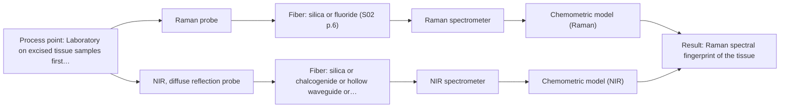
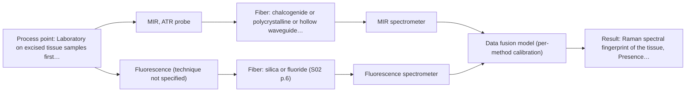

# First technical assessment: Raman probe for tumour margins during surgery

## Answer

**Customer request:** Our surgical team wants to place a fiber Raman probe in the operating field to tell tumour tissue from healthy tissue in real time during operations. Can we start using it on patients next month, and which probe is approved for this?

### Brief answer

No - not next month. The supplied material shows only ex vivo proof-of-concept studies and no approved probe for in-vivo surgical tissue discrimination. The realistic first step is a laboratory feasibility trial on paired tumour/healthy tissue samples, testing your proposed Raman probe against NIR diffuse reflection with histopathology as reference. Regulatory approval and in-vivo evidence remain the open blockers.

### Proposal

- **Best current option:** O2 (recommended)
- **Basis:** supplied AFS sources
- **What would change it:** A confirmed regulatory pathway with an already-approved probe, or ex vivo results showing one method clearly meets the surgeons' accuracy thresholds, would change the plan.
- **Next step:** Run a multi-method ex vivo feasibility trial on paired tumour/healthy samples with histopathology reference, comparing the Raman probe against NIR diffuse reflection.

**Secondary evidence (external, not AFS material):** G1: E01 ¶31; G2: no usable external source found; G3: no usable external source found; G4: no usable external source found. See Expert detail.

**Decision status:** Premise not supported by the sources

### Solution options

| ID | Tier | Methods | Confidence | Cost class, S01 Table 1 (p.6) | Ease of use | Maintenance | Performance fit | Sources |
|---|---|---|---|---|---|---|---|---|
| O1 | Simple | M1 Raman probe | Low: open question: Q1, Q3 (starts at Medium); fit for soft solid to be tested, sample clarity unknown; a customer premise is contradicted, status: premise not supported | high cost (row 12) | Single probe, straightforward ex vivo contact measurement | Low; one spectrometer and probe | Directly tests the team's proposed Raman approach | [1: S01 p.11] [2: S01 p.16] [3: S03 p.1] [4: S01 p.11] |
| O2 | Recommended | M1 Raman probe; M2 NIR, diffuse reflection probe | Low: open question: Q1, Q3 (starts at Medium); fit for soft solid to be tested, sample clarity unknown; a customer premise is contradicted, status: premise not supported | high cost (rows 8, 12) | Two probes tested side by side in the lab | Moderate; two instruments during trials only | Fits the unknown tissue fit by comparing methods before committing | [5: S01 p.3] [1: S01 p.11] [2: S01 p.16] [3: S03 p.1] [4: S01 p.11] [6: S03 p.2] [7: S03 p.2] |
| O3 | Extended (multi-method) | M3 MIR, ATR probe + Fluorescence (combination) | Low: open question: Q1 (starts at Medium); fit for soft solid to be tested, sample clarity unknown, fluorescent target unknown; a customer premise is contradicted, status: premise not supported; multi-method, fusion benefit not yet shown | at least high cost (row 2); Fluorescence row not identified | Combined probe simplifies simultaneous measurement | Higher; two spectrometers and per-block calibration | Fits heterogeneous tissue where single methods separate classes incompletely | [8: S01 p.8] [9: S01 p.9] [10: S04 p.1] [11: S04 p.4] [12: S04 p.4] |

*Confidence rates the basis of the advice (how much is known and cited), not a predicted accuracy or probability of success. It starts at High, or at Medium when a key question on the method or the option is open, and drops one level per weakness listed (floor Low).*

*Cost class is the relative rating in S01 Table 1 (p.6) for the in-line method+technique rows named (the highest one for a multi-method option); it is not a price.*

### Setup sketch

*Recommended option O2; drawn by code from the option, a schematic, not a configuration.*

### Key questions

1. Which organ and tumour type is involved, and do you have access to paired tumour/healthy ex vivo samples from operations?
2. What regulatory approval or certification does your hospital require for a spectroscopic probe used in-vivo, and who holds it?
3. What accuracy (sensitivity/specificity for tumour detection) would your surgeons require before clinical use?

## Expert detail

**Customer enquiry**

> Our surgical team wants to place a fiber Raman probe in the operating field to tell tumour tissue from healthy tissue in real time during operations. Can we start using it on patients next month, and which probe is approved for this?

**Decision status:** Premise not supported by the sources. The sources describe only ex vivo, proof-of-concept spectroscopic tissue studies and contain no approved or clinically validated probe, so starting on patients next month is not supported by anything supplied.

### Parameters

| ID | Parameter | Kind | Need | Measured by | Why | Sources |
|---|---|---|---|---|---|---|
| P1 | Tissue class (tumour vs healthy) | qualitative | required | Reference lab method: histopathology of the measured tissue point | It is the classification target the probe must deliver in real time. | *(no verified source: engineering judgement)* |
| P2 | Raman spectral fingerprint of the tissue | qualitative | required | Spectroscopy: Raman | The Raman spectrum carries the molecular information the classification model is built on. | [13: S01 p.12] |
| P3 | Presence of fluorescent tissue components | qualitative | optional | Spectroscopy: Fluorescence | Needed only if the combined MIR-ATR + fluorescence option is considered, since fluorescence requires a fluorescent component. | [12: S04 p.4] |

### Solution option details

- **O1 cost drivers:** Raman spectrometer, laser, fiber probe, histopathology reference measurements
- **O2 cost drivers:** Trial time on paired ex vivo samples, two spectrometers, histopathology reference data
- **O3 cost drivers:** Combined MIR-ATR/fluorescence probe, two spectrometers, fused-model development
- **O3 combining methods:** Low-level fusion: MIR-ATR and fluorescence spectra from the same probe tip are synchronised and concatenated into one matrix with block scaling, since variables from different methods are not equivalent. Each instrument keeps its own calibration and diagnostics. The fused model must beat the best single method on held-out samples, otherwise the extra method is dropped.

*Extended (multi-method) option O3; drawn by code from the option, a schematic, not a configuration.*

### Premise check

- **Contradicted:** A fiber Raman probe can be used on patients in the operating field next month. The supplied tissue studies are explicitly early-stage ex vivo work; nothing supports in-vivo clinical use on that timescale. [14: S03 p.3] [15: S03 p.14]
- **Not covered:** A specific Raman probe is already approved for clinical tissue discrimination. No supplied source states any regulatory approval or certification of a probe for in-vivo surgical use. *(no verified source: engineering judgement)*
- **Precedent only:** Raman spectroscopy can distinguish tumour from healthy tissue. Published feasibility reports exist for spectroscopic tumour discrimination, but they are a reason to test, not proof for this team's use case. [3: S03 p.1]

### Requirements

**Stated by the customer**

- Real-time discrimination of tumour vs healthy tissue in the operating field.
- Start of patient use next month (not supported; see premise checks).
- An approved probe (none identified in the sources).

**Key unknowns**

- Which organ and tumour type, since spectral biomarkers and probe design are tissue-specific.
- The regulatory pathway and approval status required for in-vivo use.
- Whether any ex vivo paired tumour/healthy samples are available for a feasibility study.
- Sterilisation, biocompatibility and workflow constraints for a probe in the operating field.
- Whether the tissue contains fluorescent components, relevant if a combined method is later considered.

### Clarification questions (most decision-relevant first)

Q1. Which organ and tumour type is involved, and do you have access to paired tumour/healthy ex vivo samples from operations? *Why it matters:* Spectral biomarkers, probe choice and calibration are tissue-specific, and ex vivo samples are the only ethical starting point the sources show. *(affects: method, M1, M2)*
Q2. What regulatory approval or certification does your hospital require for a spectroscopic probe used in-vivo, and who holds it? *Why it matters:* No source identifies an approved probe, so the regulatory path decides whether and when patient use is possible at all. *(affects: status, installation)*
Q3. What accuracy (sensitivity/specificity for tumour detection) would your surgeons require before clinical use? *Why it matters:* The go/no-go criteria for any feasibility study must come from your clinical requirements, and false negatives are the critical error in oncology. *(affects: status, M1)*
Q4. What sterilisation and biocompatibility constraints apply to a probe placed in the operating field? *Why it matters:* These constraints can exclude probe designs and affect which technique is installable in the surgical workflow. *(affects: installation)*

### Recommendation

- **M1 · Primary candidate: Raman probe.** Raman is the method the team proposes and has published precedent for tissue discrimination, including aqueous tissue where water interferes less than in IR methods. Its screening status is unknown for soft solid tissue, so it must first be tested ex vivo, and no source shows an approved probe. *Conditions:* Test first on ex vivo paired tumour/healthy samples with histopathology reference; no patient use before regulatory approval. [1: S01 p.11] [2: S01 p.16] [3: S03 p.1] [4: S01 p.11]
- **M2 · Comparison candidate: NIR, diffuse reflection probe.** NIR diffuse reflection has a published ex vivo precedent for kidney tumour discrimination with a fiber probe and penetrates tissue up to several millimetres, complementing Raman's focal volume. Testing it beside Raman shows whether a simpler, cheaper method suffices. [6: S03 p.2] [7: S03 p.2]
- **M3 · Conditional candidate: MIR, ATR probe + Fluorescence (combination).** A combined MIR-ATR + fluorescence fiber probe has been demonstrated for simultaneous tissue classification at the same point, with the fused data separating tissue classes where single methods did not. This is a later hypothesis to test against the best single method, not a starting point. *Conditions:* Only if single-method ex vivo tests prove insufficient and the tissue contains fluorescent components. [10: S04 p.1] [11: S04 p.4] [12: S04 p.4]

### Measurement concept

- **Probe and geometry:** Fiber Raman probe in contact with the tissue surface (ex vivo first); Raman shift in cm-1 with the laser excitation wavelength stated separately; optional comparison by an NIR diffuse-reflection fiber probe.
- **Location:** Laboratory on excised tissue samples first; operating field only after validation and regulatory approval.
- **Fiber link:** Silica fibers suit Raman and NIR; metal-coated silica avoids polymer-jacket fluorescence background. No MIR link is needed unless the combined option is pursued. [1: S01 p.11] [16: S02 p.7]

### Spectral range

- **Raman:** Raman shift in cm-1; the laser excitation wavelength (e.g. visible/NIR excitation) must be stated separately for the selected probe. The usable range depends on the spectrometer, laser and probe chosen. [1: S01 p.11]
- **NIR:** Nominal NIR range 780-2500 nm; the usable range depends on the instrument, fiber and probe actually selected. [17: S01 p.10]

### Risks and uncertainty

- Raman signals from tissue are weak and can be swamped by fluorescence background, which must be checked on real samples. *(rules: R-RAM-1)* [4: S01 p.11]
- Any classification calibration is specific to the tissue matrix and patient variability, and the published studies used very few patients. *(rules: R-CAL-1)* [18: S03 p.6]
- Ex vivo (frozen/thawed) spectra can differ from in-vivo measurements, so ex vivo results do not establish in-vivo performance. *(rules: R-EVI-3)* [19: S03 p.3]
- The tumor-margin application described in the supplied concept material is aspirational, not a demonstrated clinical capability. *(rules: R-EVI-1)* [20: S01 p.13]

### First feasibility experiment

1. **Collect paired tumour and healthy ex vivo samples across the expected variation (tumour grade, patient, tissue region), with histopathology as the independent reference for every measurement point.** Representative samples and ground truth. *(no verified source: engineering judgement)*
2. **Measure each sample with the Raman fiber probe and, in parallel, the NIR diffuse-reflection probe, recording Raman shift spectra with the excitation wavelength documented.** Single methods first, compared on the same samples. *(no verified source: engineering judgement)*
3. **Build per-method classification models (e.g. PCA/PLS-DA) and validate them on held-out samples or patients, including a permutation check against overfitting.** Honest per-method performance. [21: S03 p.6]
4. **Only if single methods fall short, test the combined MIR-ATR + fluorescence probe on the same samples and check whether the fused model beats the best single method.** Combinations only after single-method tests. [22: S01 p.8]
5. **Apply the surgeon-defined sensitivity/specificity thresholds as the go/no-go basis; only a pass, plus a separate regulatory pathway, opens any path toward in-vivo use.** Go/no-go decision. *(no verified source: engineering judgement)*

**Reference measurements:** Histopathology classification of each measured tissue point.

**Decision basis:** Customer-defined sensitivity and specificity for tumour vs healthy discrimination on held-out samples (Q3).

### Assumptions

- The target is soft solid tissue measured in contact at the surface.
- The optical regime is assumed to be scattering (turbid), typical of biological soft tissue, suiting diffuse reflectance and contact Raman measurements.
- No regulatory approval exists yet for the intended probe.

### Not covered by the supplied sources

- Any regulatory approval status or certified product for in-vivo surgical Raman probes.
- Sterilisation and biocompatibility requirements for surgical probes.
- In-vivo performance data for Raman tumour discrimination.

### Further notes

- **Chemometrics:** A classification model (e.g. PCA/PLS-DA) needs histopathology-labelled spectra from many patients covering tumour grade and patient variability; the published studies were exploratory with very few patients and stress thorough validation and permutation testing before any diagnostic claim.
- **Real-time tracking:** Real-time in-operation use requires validated models, synchronised fast acquisition and regulatory clearance; none of these exists in the supplied material, so real-time capability is a later goal, not the starting point.
- **Future direction:** If ex vivo trials succeed, a dedicated miniaturised or LED-based spectral sensor tuned to the found biomarker wavelengths could be developed for surgical use, as the sources suggest for sensor systems.

### Secondary evidence (external, not AFS material)

*Found by a literature search for gaps the supplied AFS sources leave open. Not AFS material and not proof for this case; every quote below was verified verbatim against the fetched text.*

**G1 · multi-method:** Combining several spectroscopy methods (data fusion) (Low-level fusion: MIR-ATR and fluorescence spectra from the same probe tip are synchronised and concatenated into one matrix with block scaling, since variables from different methods are not equivalent. Each instrument keeps its own calibration and diagnostics. The fused model must beat the best single method on held-out samples, otherwise the extra method is dropped.)

- **E01 ¶31** Low-level data fusion rearranges data from different sources into a new matrix where variables are placed sequentially. *How it applies:* This approach can be evaluated when combining multiple spectroscopic methods for tissue discrimination, provided the fused model is validated on independent samples. *Limits and transfer risks:* The cited research focuses on food and chemical process matrices rather than in-vivo surgical tissue discrimination, so transferability to clinical environments remains uncertain. *(supports O3)*
  > "Low-level data fusion (LLDF) is considered the simplest method to achieve a combination of inputs. In this case, the data is rearranged into a new data matrix, where the variables coming from different sources are placed one after the other."
  > Challenges and Opportunities of Implementing Data Fusion in Process Analytical Technology-A Review. (2022) · Molecules (Basel, Switzerland) · doi:10.3390/molecules27154846 · https://europepmc.org/article/PMC/PMC9369811 · retrieved 2026-10-17, full text, licence: cc by, via curated library

**G2 · not in the supplied sources:** Any regulatory approval status or certified product for in-vivo surgical Raman probes.

- No usable external source found.

**G3 · not in the supplied sources:** Sterilisation and biocompatibility requirements for surgical probes.

- No usable external source found.

**G4 · not in the supplied sources:** In-vivo performance data for Raman tumour discrimination.

- No usable external source found.

### Evidence (verified quotes)

1. ✓ **S01 p.11** (general): "The Raman shift is used as the horizontal (spectral) axis in Raman spectroscopy"
2. ✓ **S01 p.16** (general): "Raman is particularly well-suited for aqueous environments, as it exhibits low absorbance for water molecules compared to infrared methods."
3. ✓ **S03 p.1** (application precedent): "Tumor detection feasibility in human kidney samples using mid- and near-infrared (NIR) spectroscopy, fluorescence spectroscopy, and Raman spectroscopy has been reported"
4. ✓ **S01 p.11** (general): "superposition of luminescence (fluorescence), which has a significantly higher intensity."
5. ✓ **S01 p.3** (general): "samples of incompletely known composition, in order to select the most suitable method or combination of methods."
6. ✓ **S03 p.2** (general): "Diffuse reflectance near-infrared (NIR) spectroscopy is one of the most promising methods for optical tissue analysis."
7. ✓ **S03 p.2** (general): "It is important that the NIR light penetrates into the sample by up to 3 mm [20,21]; this depth cannot be reached by suitable spectroscopic techniques in other wavelength regions."
8. ✓ **S01 p.8** (general): "If the variables have different units of measurement, the data should be normalized in some way, for example, using an autoscaling algorithm."
9. ✓ **S01 p.9** (general): "One of the challenges of multispectral analysis is the need to simultaneously connect at least two independently operating measuring instruments."
10. ✓ **S04 p.1** (application precedent): "A multispectral fiber optic probe has been developed that enables simultaneous analysis of various liquid and solid samples using attenuated total reflection mid-infrared spectroscopy and fluorimetry."
11. ✓ (precedent only) **S04 p.4** (method gain): "the PCA model built on the concatenated IR and fluorescence data revealed three distinct groups of samples corresponding to tissue types"
12. ✓ **S04 p.4** (general): "it is limited to the samples containing at least one fluorescent component"
13. ✓ **S01 p.12** (general): "Raman spectra (as well as IR absorption spectra) can be used to construct chemometric models-calibration or classification ones."
14. ✓ **S03 p.3** (general): "It is common practice to use ex vivo samples at the early research stages, as in the present proof-of-concept study."
15. ✓ **S03 p.14** (general): "This study provides a proof-of-concept demonstration of the LED-based sensor for tumor discrimination."
16. ✓ **S02 p.7** (general): "Free of Polymer jacket fluorescence for Raman and Fluo- Spectroscopy"
17. ✓ **S01 p.10** (general): "NIR spectra (780-2500 nm) contain predominantly overtones and component bands of fundamental vibrations"
18. ✓ **S03 p.6** (general): "conclusions about the general suitability of the NIR sensor analysis for cancer diagnostics and, in particular, of four theoretically chosen LEDs are made on the basis of a very limited number of investigated patients."
19. ✓ **S03 p.3** (general): "Although the spectra of frozen/thawed biopsies can differ from real-life in vivo measurements, the possibility to transfer the diagnostic model was shown in a previous work on Raman spectroscopy of cancer [28]."
20. ✓ **S01 p.13** (general): "Below are descriptions of tasks, cases and potential applications where such multispectral systems and labs are extremely valuable."
21. ✓ **S03 p.6** (general): "In order to reduce the risk of overfitting caused by the limited experimental data volume, a thorough validation of the discrimination models was required."
22. ✓ **S01 p.8** (general): "collected from the same small, even pinpoint, area of the sample."

### Verification

- Citations verified: 27 of 27 (exact or whitespace/hyphen-tolerant match on the cited page, scope checked).
- Hard check failures before deterministic corrections: 0; still open: 0; soft warnings: 2; repair rounds: 1.
- External evidence (live): 1 quote(s) verified verbatim (exact or whitespace/hyphen-tolerant, at most 400 characters and 2 sentences, against the cited paragraph); 0 item(s) dropped.
- External search: 4 query(ies), 35 hit(s), 5 source(s) (3 from the curated library).
- External step: 2 model call(s), 6.7 s extra (cost in the run JSON).

*Run A09-20261018T094914Z-7d45 · models google/gemini-3.5-flash-lite, google/gemini-3.8-flash, z-ai/glm-5.3-flash*
