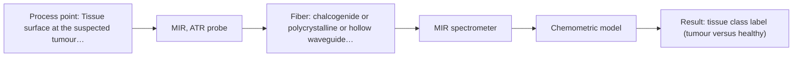
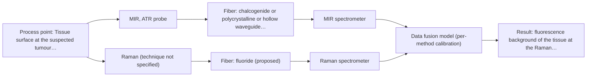

# First technical assessment: Raman probe for tumour margins during surgery

## Answer

**Customer request (our summary):** Surgical team wants to use a fiber Raman probe intraoperatively to distinguish tumour from healthy tissue in real time, and asks whether they can start on patients next month and which probe is approved.

### Brief answer

Nothing supplied covers regulatory approval or clinical readiness, so starting on patients next month is not supported by this material. Technically, the sources give the strongest tissue-classification precedent for MIR-ATR, with Raman (the team's proposal) also worth testing and a combined MIR-ATR + Raman option as a later hypothesis. Next step: a bench feasibility test on representative tumour and healthy tissue against histology, with go/no-go numbers agreed with the team.

### Proposal

- **Best current option:** O2 (recommended)
- **Basis:** engineering judgement
- **What would change it:** If the tissue fluoresces strongly at the Raman excitation, or if the MIR fiber link from the measurement point cannot be realised, the balance shifts toward Raman or toward the combined MIR-ATR + Raman option; the team's go/no-go numbers would also change the choice.
- **Next step:** Run the bench feasibility test on representative tumour and healthy tissue samples against histology before any patient use is considered.

**Secondary evidence (external, not AFS material):** G1: E04 ¶3; G2: E02 ¶33, E02 ¶36; G3: no usable external source found; G4: no usable external source found. See Expert detail.

**Decision status:** Outside the supported scope

### Solution options

| ID | Tier | Methods | Confidence | Cost class, S01 Table 1 (p.6) | Ease of use | Maintenance | Performance fit | Sources |
|---|---|---|---|---|---|---|---|---|
| O1 | Simple | M2 Raman probe | Low: physical state unknown, sample clarity unknown; status: outside supported scope | high cost (row 12) | single probe and spectrometer | probe cleaning, laser and fiber checks | tests the team's Raman proposal first | [1: S03 p.2] [2: S01 p.16] [3: S02 p.7] [4: S01 p.11] |
| O2 | Recommended | M1 MIR, ATR probe | Low: physical state unknown, sample clarity unknown; status: outside supported scope | high cost (row 2) | contact probe, single instrument | ATR crystal cleaning and instrument checks | selective fingerprint bands for tissue | [5: S01 p.5] [6: S01 p.9] [7: S04 p.4] [8: S04 p.1] |
| O3 | Extended (multi-method) | M3 MIR, ATR probe + Raman (combination) | Low: physical state unknown, sample clarity unknown; status: outside supported scope; multi-method, fusion benefit not yet shown | high cost (rows 2, 12) | two instruments, one combined probe | separate calibration and checks per method | adds complementary information on hard margins | [9: S01 p.8] [10: S01 p.8] [11: S01 p.8] [12: S01 p.9] [13: REF §5] [14: S01 p.11] [15: S02 p.16] [16: S01 p.7] |

*Confidence rates the basis of the advice (how much is known and cited), not a predicted accuracy or probability of success. It starts at High, or at Medium when a key question on the method or the option is open, and drops one level per weakness listed (floor Low).*

*Cost class is the relative rating in S01 Table 1 (p.6) for the in-line method+technique rows named (the highest one for a multi-method option); it is not a price.*

### Setup sketch

*Recommended option O2; drawn by code from the option, a schematic, not a configuration.*

### Key questions

1. What is the physical state of the material at the probe tip - a soft solid tissue surface that can be brought into tight contact with a probe head, or a surface that cannot be contacted?
2. Is the tissue opaque and strongly scattering at the probe, or can light pass through a defined layer of it?
3. Are the first measurements planned on excised tissue samples or on tissue in the operating field?

## Expert detail

**Customer enquiry**

> Our surgical team wants to place a fiber Raman probe in the operating field to tell tumour tissue from healthy tissue in real time during operations. Can we start using it on patients next month, and which probe is approved for this?

**Decision status:** Outside the supported scope. The enquiry asks for regulatory approval and for measurements on patients next month; the supplied material describes research-stage feasibility work on excised tissue and does not cover approval, clinical validation, sterility, biocompatibility or deployment timelines. A conditional shortlist for bench feasibility testing can still be given.

### Parameters

| ID | Parameter | Kind | Need | Measured by | Why | Sources |
|---|---|---|---|---|---|---|
| P1 | tissue class label (tumour versus healthy) | qualitative | required | Reference lab method: histopathology of the same sample (for example WHO criteria) | The classification target: without an independent label for each sample no discrimination model or go/no-go decision is possible. | [17: S03 p.3] |
| P2 | fluorescence background of the tissue at the Raman excitation wavelength | qualitative | required | Spectroscopy: Raman | It decides whether Raman bands can be read at all, because fluorescence can be much stronger than the Raman signal. | [4: S01 p.11] |

### Solution option details

- **O1 cost drivers:** Raman spectrometer, laser, fiber probe, chemometrics
- **O2 cost drivers:** FTIR spectrometer, MIR fibers, ATR probe
- **O3 cost drivers:** two spectrometers, MIR fibers, combined probe
- **O3 combining methods:** Both methods must look at the same small tissue area and their data must be aligned to a common time step, because alternating separate probes cannot guarantee the same spot and the acquisition rates differ. Start from one classification model per method with block scaling or per-method scores, keep a separate calibration and diagnostic check for each instrument, and validate the fused model on held-out samples or patients. The fused model must beat the better single method, otherwise the second instrument is not justified.

*Extended (multi-method) option O3; drawn by code from the option, a schematic, not a configuration.*

### Premise check

- **Precedent only:** A fiber Raman probe can be used intraoperatively to distinguish tumour from healthy tissue in real time. The sources report research feasibility of malignant-versus-healthy differentiation by molecular spectroscopic techniques including Raman scattering, but on excised samples and as feasibility work; this is a reason to test, not proof for intraoperative use. [1: S03 p.2] [18: REF §3]
- **Not covered:** The team can start using the probe on patients next month. No supplied source covers regulatory approval, clinical validation, patient safety, sterility or deployment timelines for patient use. *(no verified source: engineering judgement)*
- **Not covered:** There is an approved probe for this clinical application. The supplied material describes fiber probes and their research and industrial applications, but states no regulatory approval and names no probe approved for intraoperative tissue classification. *(no verified source: engineering judgement)*

### Requirements

**Stated by the customer**

- "place a fiber Raman probe in the operating field"
- "tell tumour tissue from healthy tissue"
- "in real time during operations"
- "Can we start using it on patients next month"
- "which probe is approved for this"

**Key unknowns**

- Tumour type, organ and whether the first measurements are on excised tissue or on tissue in the operating field.
- Independent reference standard and the required sensitivity, specificity or accuracy for a go decision.
- Required response time and the number of measurement points per operation.
- Fiber link length, probe sterility, disinfection and biocompatibility constraints in the operating field.
- Tissue fluorescence background at the Raman excitation wavelength.
- Regulatory and ethics pathway for any patient use.

### Clarification questions (most decision-relevant first)

Q1. What is the physical state of the material at the probe tip - a soft solid tissue surface that can be brought into tight contact with a probe head, or a surface that cannot be contacted? *Why it matters:* ATR requires tight contact with liquids, pastes or soft solids, so this decides whether an ATR-based route can be used at all. *(affects: technique)*
Q2. Is the tissue opaque and strongly scattering at the probe, or can light pass through a defined layer of it? *Why it matters:* The optical regime decides between contact and reflection geometries and transmission geometries for any shortlisted method. *(affects: technique)*
Q3. Are the first measurements planned on excised tissue samples or on tissue in the operating field? *Why it matters:* The supplied tissue work is on excised samples, so the answer decides whether this is a bench feasibility study or a clinical use question. *(affects: status)*
Q4. What independent reference standard (for example histopathology) will label each sample, and what sensitivity and specificity must be reached to go ahead? *Why it matters:* Without a reference label and agreed numbers no discrimination model can be validated or judged. *(affects: status)*
Q5. What fiber link length, sterility, disinfection and biocompatibility constraints apply at the operating field? *Why it matters:* These constraints can rule out a probe or a fiber type before any measurement is attempted. *(affects: installation)*
Q6. Has the tissue's fluorescence background at the intended Raman excitation wavelength been measured? *Why it matters:* Strong fluorescence can swamp Raman bands and would remove Raman from the shortlist. *(affects: technique)*

### Recommendation

- **M1 · Primary candidate: MIR, ATR probe.** Mid-IR band spectra contain well-defined peaks, and the mid-IR range (4000-400 cm-1) is described as one of the most informative methods of chemical analysis. ATR suits liquids and soft solids that can be brought into tight contact with the crystal, and it samples only a superficial layer. *Conditions:* Applies if the tissue surface layer (a few micrometres) is representative of the tumour margin and a probe can contact the tissue. [5: S01 p.5] [6: S01 p.9] [7: S04 p.4] [8: S04 p.1]
- **M2 · Comparison candidate: Raman probe.** Raman scattering is among the molecular techniques whose reported feasibility covers differentiation between malignant and healthy tissue, and it is well suited to aqueous media. It can use silica fibers, for which long remote cables are stated, which supports keeping the spectrometer away from the measurement point. *Conditions:* Applies if the tissue's fluorescence background at the chosen excitation does not swamp the Raman bands. [1: S03 p.2] [2: S01 p.16] [3: S02 p.7] [4: S01 p.11]
- **M3 · Comparison candidate: MIR, ATR probe + Raman (combination).** Mid-IR and Raman spectra are complementary, and a combined probe coupling MIR-ATR with a second optical method has been demonstrated, while combining methods is described as a possible need for complex samples. Any gain over the best single method remains a hypothesis to test. *Conditions:* Test only after the single-method tests, if neither MIR-ATR nor Raman alone reaches the agreed discrimination. [14: S01 p.11] [15: S02 p.16] [16: S01 p.7] [13: REF §5] Later hypothesis, after single-method tests.
- **M4 · Not recommended: fluorescence probe.** A fluorescence channel only measures species that fluoresce, and no fluorescent species or marker was stated in the enquiry for this tissue, so it cannot be part of the first tests. The supplied tissue work pairs fluorescence with MIR-ATR, so this can be revisited if a fluorescent species is confirmed. *Conditions:* Reconsider only if a fluorescent species or a justified indicator is confirmed for this tissue. [19: S04 p.4] [20: S01 p.5]

### Measurement concept

- **Probe and geometry:** Contact probe at the tissue surface: MIR-ATR crystal or Raman probe head, with the spectrometer connected by fiber.
- **Location:** Tissue surface at the suspected tumour margin; the first work on excised samples, not in the operating field.
- **Fiber link:** Silica fibers are stated for Raman (long cables); no source states an achievable MIR link length. [21: S01 p.10]

### Spectral range

- **MIR:** Nominal method range [6: S01 p.9] [22: REF §5]
- **Raman:** Raman shift in cm-1; the laser excitation wavelength is stated separately and was not given in the enquiry [23: S01 p.11] [24: S01 p.11]

### Risks and uncertainty

- Tissue autofluorescence can swamp the Raman bands, so the Raman route may fail at the chosen excitation wavelength. [4: S01 p.11] [25: S01 p.11]
- ATR sees only a few micrometres into the tissue, so a probe spot may not represent a heterogeneous tumour margin, and deposits on the crystal can change the signal. [8: S04 p.1] [26: REF §5]
- No supplied source states an achievable MIR fiber length, so remote placement of the MIR spectrometer away from the measurement point is unverified. *(no verified source: engineering judgement)*
- Calibration is specific to the tissue matrix and tumour type, so a model built on one tissue set must be rebuilt and re-validated for another. [27: REF §5]

### First feasibility experiment

1. **Collect representative tissue samples covering the expected variation: both classes, several patients and the tumour types, grades and other factors expected in the surgical population.** Representativeness before any model building. [28: S03 p.10]
2. **Measure each single method separately (MIR-ATR first, then Raman) on the same marked positions, with an independent reference measurement of every sample.** Independent reference and a defined comparison. [29: REF §3]
3. **Build one classification model per single method and validate it on held-out samples or patients, keeping repeated measurements of the same sample together.** Avoid overfitting on few samples. [30: S03 p.13]
4. **Compare each single method with the reference on the agreed numbers; only if neither reaches them, build a fused MIR-ATR + Raman model on the same spots and test whether it beats the best single method.** Decide whether a second method adds anything. [13: REF §5]
5. **Go / no-go: the team's own required sensitivity, specificity or accuracy figures on held-out patients decide; this bench work does not by itself support any patient use.** Numerical criteria come from the customer. *(no verified source: engineering judgement)*

**Reference measurements:** Histology of the same samples as the independent reference.

**Decision basis:** Agreed sensitivity, specificity or accuracy figures supplied by the surgical team.

### Assumptions

- Assumed for this assessment: the tissue surface can be brought into tight contact with a probe head (soft solid), because no sample physical state was given in the enquiry (see Q1).
- Assumed: the tissue is opaque and strongly scattering at the probe, so a contact or reflection geometry is more likely than transmission (see Q2).

### Not covered by the supplied sources

- Regulatory approval or clearance status of any probe for clinical use.
- Clinical validation, sterility, biocompatibility and disinfection requirements for intraoperative use.
- Any timeline or pathway for starting measurements on patients.

### Further notes

- **Chemometrics:** Tissue classification needs calibration or classification models (for example PCA or PLS-DA) built on labelled samples and validated on held-out samples or patients; a model is specific to the tissue matrix and tumour type and must be rebuilt when either changes.
- **Real-time tracking:** Real-time use needs fast acquisition and a fiber link that keeps the spectrometer away from the measurement point; if two methods are combined, their different acquisition rates must be aligned to a common time step.
- **Future direction:** If the bench work identifies the most informative spectral regions, a compact multisensor or LED-based sensor could be a later development step, following the described sequence of lab trials, then a chemometric model or a customised system.

### Secondary evidence (external, not AFS material)

*Found by a literature search for gaps the supplied AFS sources leave open. Not AFS material and not proof for this case; every quote below was verified verbatim against the fetched text.*

**G1 · decision status:** outside supported scope: The enquiry asks for regulatory approval and for measurements on patients next month; the supplied material describes research-stage feasibility work on excised tissue and does not cover approval, clinical validation, sterility, biocompatibility or deployment timelines. A conditional shortlist for bench feasibility testing can still be given.

- **E04 ¶3** The source states that no clinical, ex-vivo, or in-vivo data are used or claimed, and that all quantitative results come from disclosed synthetic simulation for algorithmic demonstration only. *How it applies:* This could inform the assessment by indicating that at least one intraoperative multimodal classification concept remains at a synthetic/conceptual stage, so clinical use next month is not supported by this source; it suggests a phased validation approach before patient studies. *Limits and transfer risks:* The source is a conceptual framework using synthetic data and different modalities (NIR-DRS, HSI, elastography), not a Raman fiber probe or regulatory document; transfer to a surgical Raman probe and approval status is uncertain.
  > "No clinical, ex-vivo, or in-vivo data are used or claimed; all quantitative results are generated by disclosed synthetic simulation for algorithmic demonstration only."
  > A Multimodal, Cloud-Connected Handheld Probe for Real-Time Intraoperative Tissue Classification: A Conceptual Framework Integrating Diffuse Reflectance Spectroscopy, Hyperspectral Imaging, and Shear-Wave Elastography with Bayesian Multimodal Fusion (2026) · Zenodo (CERN European Organization for Nuclear Research) · doi:10.5281/zenodo.21831725 · https://doi.org/10.5281/zenodo.21831725 · retrieved 2026-10-18, full text, licence: cc-by, via openalex

**G2 · multi-method:** Combining several spectroscopy methods (data fusion) (Both methods must look at the same small tissue area and their data must be aligned to a common time step, because alternating separate probes cannot guarantee the same spot and the acquisition rates differ. Start from one classification model per method with block scaling or per-method scores, keep a separate calibration and diagnostic check for each instrument, and validate the fused model on held-out samples or patients. The fused model must beat the better single method, otherwise the second instrument is not justified.)

- **E02 ¶33** The source describes high-level data fusion as working at the decision level, where supervised models are first fitted to each data matrix. *How it applies:* This could support starting with one classification model per method and combining per-method scores, as mentioned in the gap, before attempting tighter fusion. *Limits and transfer risks:* This is a general process analytical technology review, not a tissue or intraoperative study, and it does not address spatial alignment or differing acquisition rates. *(supports O3)*
  > "The high-level data fusion (HLDF) (also called "decision-level" fusion) works on a decision level. This means that the first step is to fit some supervised models to each data matrix."
  > Challenges and Opportunities of Implementing Data Fusion in Process Analytical Technology-A Review. (2022) · Molecules (Basel, Switzerland) · doi:10.3390/molecules27154846 · https://europepmc.org/article/PMC/PMC9369811 · retrieved 2026-10-17, full text, licence: cc by, via curated library
- **E02 ¶36** The source notes that in some situations instrument complementarity was not sufficient to improve performance for several CQAs, citing a Raman and FT-IR food analytical study. *How it applies:* This could inform the assessment by warning that adding a second instrument such as MIR ATR to Raman may not improve the fused model; the fused model should be tested against the better single method. *Limits and transfer risks:* The cited example is a food analytical study with Raman and FT-IR, not intraoperative tissue or the same probe setup, so the result may not transfer. *(supports O3)*
  > "In some situations, instrument complementarity (not data complementarity) was not sufficient to improve the performance of predictive several CQAs, as shown by a Raman and FT-IR data based food analytical study [73]."
  > Challenges and Opportunities of Implementing Data Fusion in Process Analytical Technology-A Review. (2022) · Molecules (Basel, Switzerland) · doi:10.3390/molecules27154846 · https://europepmc.org/article/PMC/PMC9369811 · retrieved 2026-10-17, full text, licence: cc by, via curated library

**G3 · not in the supplied sources:** Regulatory approval or clearance status of any probe for clinical use.

- No usable external source found.

**G4 · not in the supplied sources:** Clinical validation, sterility, biocompatibility and disinfection requirements for intraoperative use.

- No usable external source found.

### Evidence (verified quotes)

1. ✓ **S03 p.2** (application precedent): "Recent research results have confirmed the feasibility of differentiation between malignant and healthy tissues using fluorimetry and molecular spectroscopic techniques, that is, Raman scattering and infrared absorption or diffuse reflection"
2. ✓ **S01 p.16** (general): "Raman is particularly well-suited for aqueous environments, as it exhibits low absorbance for water molecules compared to infrared methods."
3. ✓ **S02 p.7** (performance figure): "Robust 100-300m cables made with Silica fibers of low OH-content (<0.1ppm OH) enable remote industrial process-control"
4. ✓ **S01 p.11** (general): "superposition of luminescence (fluorescence), which has a significantly higher intensity."
5. ✓ **S01 p.5** (general): "Mid-IR band spectra contain well-defined peaks (absorption bands), while NIR, UV, and fluorescence spectra contain broad, highly overlapping signals"
6. ✓ **S01 p.9** (general): "Vibrational spectroscopy in the mid-IR range (4000-400 cm-1) is one of the most informative methods of chemical analysis."
7. ✓ **S04 p.4** (general): "suitability of analyzed samples for ATR measurements, which is true for liquid or soft solid samples and their components, allowing a tight contact with the probe head."
8. ✓ **S04 p.1** (general): "ATR analysis with its penetration depth of a few micrometers acts as the single-cell level"
9. ✓ **S01 p.8** (general): "It is crucial that the spectral information obtained by different methods-Mid-IR, NIR, Raman, and fluorescence spectra-is collected from the same small, even pinpoint, area of the sample."
10. ✓ **S01 p.8** (general): "Ultimately, the measurement data must be normalized to a common time step."
11. ✓ **S01 p.8** (general): "Variables obtained from different spectral methods are not equivalent."
12. ✓ **S01 p.9** (general): "One of the challenges of multispectral analysis is the need to simultaneously connect at least two independently operating measuring instruments."
13. ✓ **REF §5** (general): "compare with the best single method."
14. ✓ **S01 p.11** (general): "This property makes mid-IR and Raman spectra complementary, that is, they complement each other."
15. ✓ **S02 p.16** (application precedent): "Combi probe with 2 IR-fibers coupled to FTIR-spectrometer and 2 Silica fibers coupled to Fluo or Raman spectrometers to work with 680nm & 785nm laser excitation Raman & MIR spectra for refined rapeseed oil"
16. ✓ **S01 p.7** (general): "The analysis of such systems may require a combination of two or even more spectral methods."
17. ✓ **S03 p.3** (application precedent): "Histological classification was performed in accordance with the World Health Organization (WHO) criteria."
18. ✓ **REF §3** (general): "a published application is a reason to test a method, not proof that it will work for a new customer."
19. ✓ **S04 p.4** (general): "it is limited to the samples containing at least one fluorescent component"
20. ✓ **S01 p.5** (general): "However, most chemicals do not exhibit this property."
21. ✓ **S01 p.10** (general): "ATR fiber probes (Fig.1) enable the analysis of liquids and solid elastic samples, such as biological tissue, using specialized probes utilizing high-transmission fiber optics in the Mid-IR region."
22. ✓ **REF §5** (general): "It is not a product specification: actual spectral coverage, fiber length, component ratings, detection limits and accuracy depend on the configuration and the sample."
23. ✓ **S01 p.11** (general): "The difference between the observed frequencies and the laser frequency is called the Raman shift, expressed in units of frequency-wavenumbers (cm-1)."
24. ✓ **S01 p.11** (general): "The Raman shift is used as the horizontal (spectral) axis in Raman spectroscopy"
25. ✓ **S01 p.11** (general): "signals, which are several orders of magnitude weaker than IR absorption peaks"
26. ✓ **REF §5** (general): "Usable range limited by fiber and crystal; contact, fouling, compatibility."
27. ✓ **REF §5** (general): "Weak signal, fluorescence background; calibration specific to the matrix."
28. ✓ **S03 p.10** (general): "The representative set is expected to include all the main potential variability factors, such as the cancer type, grade and staging; and the age, gender, life-style, presence of others kidney diseases, and other patient-related factors."
29. ✓ **REF §3** (general): "Representative samples or process states, independent reference measurements, what is compared, and the basis for the go / no-go decision."
30. ✓ **S03 p.13** (general): "Repeated measurements in the same sample position produced similar spectra or sensor data; therefore, these should always be simultaneously excluded for every CV iteration."

### Verification

- Citations verified: 37 of 37 (exact or whitespace/hyphen-tolerant match on the cited page, scope checked).
- Hard check failures before deterministic corrections: 0; still open: 0; soft warnings: 1; repair rounds: 1.
- External evidence (live): 3 quote(s) verified verbatim (exact or whitespace/hyphen-tolerant, at most 400 characters and 2 sentences, against the cited paragraph); 0 item(s) dropped.
- External search: 6 query(ies), 45 hit(s), 5 source(s) (3 from the curated library).
- External step: 2 model call(s), 58.9 s extra (cost in the run JSON).

*Run A09-20261017T235555Z · models deepseek/deepseek-v4.1-flash*
