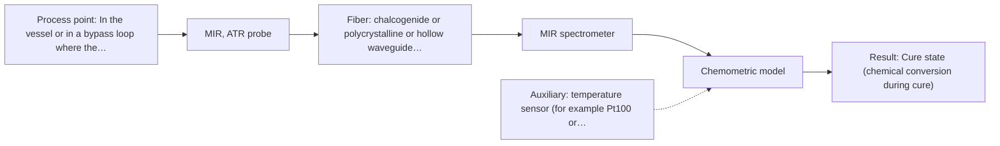
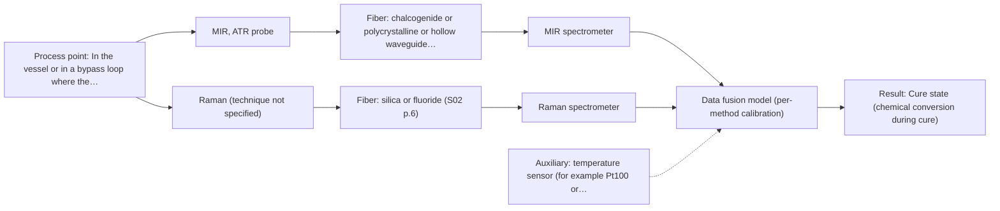

# First technical assessment: Viscosity and temperature of a curing resin

## Answer

**Customer request (our summary):** Customer wants continuous in-process viscosity and temperature monitoring of a dark, thickening resin during cure to determine when to stop the batch.

### Brief answer

Test mid-infrared ATR first: it reads a thick, dark paste in contact with the crystal and can follow chemical change during cure. Viscosity is not a spectroscopic quantity, so an in-line viscometer and a temperature sensor are needed alongside, with the spectrum calibrated against reference viscosity. Tell us what defines the stop point and the required viscosity accuracy and response time; until then no final setup can be fixed.

### Proposal

- **Best current option:** O2 (recommended)
- **Basis:** supplied AFS sources
- **What would change it:** If the stop point turns out to be defined by viscosity alone, or if the MIR-ATR trial shows no usable cure signal, the viscometer becomes the primary sensor and the optical method shifts to Raman or NIR diffuse reflection. The answers on endpoint criterion, ranges and accuracy would also move the choice between the simple and the recommended option.
- **Next step:** Run the single-method MIR-ATR trial on representative resin states from fresh mix to end point, with independent off-line viscosity references, before any in-line installation or multi-method decision.

**Secondary evidence (external, not AFS material):** G1: no usable external source found; G2: E01 ¶31, E01 ¶36; G3: no usable external source found; G4: no usable external source found. See Expert detail.

**Decision status:** Provisional feasibility assessment

### Solution options

| ID | Tier | Methods | Confidence | Cost class, S01 Table 1 (p.6) | Ease of use | Maintenance | Performance fit | Sources |
|---|---|---|---|---|---|---|---|---|
| O1 | Simple | M2 NIR, diffuse reflection probe | Low: open question: Q1, Q3 (starts at Medium); diffuse reflection on a dark sample untested; uncited auxiliary sensor and a parameter is not measurable in-line | average cost (row 8) | one probe, compact spectrometer | clean the probe window between batches | cheapest single-probe test; dark resin risk | [1: S01 p.10] [2: S01 p.5] |
| O2 | Recommended | M1 MIR, ATR probe | Low: open question: Q1, Q3 (starts at Medium); uncited auxiliary sensor and a parameter is not measurable in-line | high cost (row 2) | standard ATR probe in direct contact | clean ATR crystal; check fouling | best fit; contact ATR reads dark paste | [3: S04 p.4] [4: S02 p.14] [5: S01 p.10] [6: S01 p.13] [7: S01 p.5] [8: S01 p.9] |
| O3 | Extended (multi-method) | M3 MIR, ATR probe + Raman (combination) | Low: open question: Q1, Q3 (starts at Medium); fit for paste to be tested; uncited auxiliary sensor and a parameter is not measurable in-line; multi-method, fusion benefit not yet shown | at least high cost (row 2); Raman row not identified | two instruments, one combined probe head | two calibrations and two diagnostics | adds Raman detail where MIR bands overlap | [9: S01 p.8] [10: S01 p.8] [11: S01 p.8] [12: S01 p.9] [13: S01 p.11] [14: S02 p.16] [15: S01 p.7] |

*Confidence rates the basis of the advice (how much is known and cited), not a predicted accuracy or probability of success. It starts at High, or at Medium when a key question on the method or the option is open, and drops one level per weakness listed (floor Low).*

*Cost class is the relative rating in S01 Table 1 (p.6) for the in-line method+technique rows named (the highest one for a multi-method option); it is not a price.*

### Setup sketch

*Recommended option O2; drawn by code from the option, a schematic, not a configuration.*

### Key questions

1. What exactly defines the right point at which the batch is stopped - a viscosity value, a time after mixing, or a chemical conversion?
2. What viscosity range must be covered, and what accuracy, resolution and response time are required?
3. What is the resin chemistry (for example epoxy, polyester or polyurethane), and does it contain fillers or a fluorescent component?

## Expert detail

**Customer enquiry**

> We mix a thick resin batch in a heated vessel and want to follow its viscosity and its temperature continuously during curing, so that we can stop the batch at the right point. The resin is dark and becomes more viscous over time. Which measurement setup would you suggest?

**Decision status:** Provisional feasibility assessment. Mid-infrared ATR is supported as the first method to test on a dark, thick sample that can make contact with a crystal, and the mid-IR bands are well defined enough to follow a chemical change during cure. Viscosity and temperature are not spectroscopic quantities, and the stop criterion, ranges, accuracy and installation point are unknown, so no exact setup can be fixed yet and the assessment stays provisional.

### Parameters

| ID | Parameter | Kind | Need | Measured by | Why | Sources |
|---|---|---|---|---|---|---|
| P1 | Cure state (chemical conversion during cure) | quantitative | required | Spectroscopy: MIR | The batch stop point has to be tied to a chemical change that a spectrum can follow in-line. | [8: S01 p.9] |
| P2 | Temperature | quantitative | required | Auxiliary sensor: temperature sensor (for example Pt100 or thermocouple) (engineering judgement: confirm availability with AFS) | Cure rate and viscosity both depend on temperature, and the spectrum needs the temperature to interpret the cure state. | *(no verified source: engineering judgement)* |
| P3 | Viscosity | quantitative | required | Not measurable in-line by spectroscopy; alternative: in-line viscometer, or torque or pressure-drop based viscosity measurement | It is the customer's stated stop criterion, and optical spectra do not deliver it. | *(no verified source: engineering judgement)* |

### Solution option details

- **O1 cost drivers:** one NIR spectrometer, reflection probe, calibration effort
- **O2 cost drivers:** MIR spectrometer, ATR fiber probe, chemometric calibration
- **O3 cost drivers:** second spectrometer, combined probe, fusion modelling
- **O3 combining methods:** Level: one model per method first, then a fused model on joined spectra with block scaling so that neither method dominates. Both methods must look at the same spot through the combined ATR/Raman probe head and the two streams must be synchronised to a common time step, with its own calibration and diagnostics for each block. The fused model has to beat the best single method on held-out batches, otherwise the second instrument is dropped.

*Extended (multi-method) option O3; drawn by code from the option, a schematic, not a configuration.*

### Premise check

- **Not covered:** Viscosity can be followed continuously by the in-line fiber-optic measurement setup. No supplied page lists viscosity among the quantities optical spectra deliver; the described information is chemical and morphological, not rheological. *(no verified source: engineering judgement)*
- **Not covered:** Continuous viscosity and temperature readings are enough to decide when to stop the batch. No supplied page addresses endpoint criteria for a curing resin, so this cannot be confirmed or denied from the sources. *(no verified source: engineering judgement)*
- **Precedent only:** In-line fiber-optic spectroscopy is applicable to a polymer-type process of this kind. A closely related published example is in-line NIR reflection and MIR-ATR control of polymer extrusion; this is a reason to test the method, not proof that it works for a curing resin in a stirred heated vessel. [4: S02 p.14] [16: S01 p.2]

### Requirements

**Stated by the customer**

- Follow viscosity continuously during cure
- Follow temperature continuously during cure
- Stop the batch at the right point
- Dark, thick resin in a heated vessel that thickens over time

**Key unknowns**

- What exactly defines the batch stop point (endpoint criterion)
- Required viscosity range, accuracy, resolution and response time
- Vessel temperature range and required temperature accuracy
- Resin chemistry, fillers and whether the resin fluoresces
- Probe access, installation point, distance to the spectrometer and cleaning
- Available independent reference method for viscosity and cure, and number of batches

### Clarification questions (most decision-relevant first)

Q1. What exactly defines the right point at which the batch is stopped - a viscosity value, a time after mixing, or a chemical conversion? *Why it matters:* It decides whether a spectroscopic cure signal can itself serve as the stop criterion or whether a viscometer must lead. *(affects: method)*
Q2. What viscosity range must be covered, and what accuracy, resolution and response time are required? *Why it matters:* These numbers set the go/no-go thresholds for any spectroscopic proxy and for the auxiliary viscometer. *(affects: technique)*
Q3. What is the resin chemistry (for example epoxy, polyester or polyurethane), and does it contain fillers or a fluorescent component? *Why it matters:* It determines which spectral bands are usable and whether Raman or fluorescence could add information. *(affects: method)*
Q4. What are the vessel temperature range and accuracy, how is the batch agitated, and where could a probe be inserted (port, distance to the spectrometer, cleaning between batches)? *Why it matters:* Temperature control and probe access decide the installation and the fiber link, which are not free choices. *(affects: installation)*
Q5. What independent reference method is available for viscosity and cure, and how many batches can be measured? *Why it matters:* Without independent reference values no calibration can be validated, which keeps the assessment provisional. *(affects: status)*

### Recommendation

- **M1 · Primary candidate: MIR, ATR probe.** ATR suits liquids, pastes and soft solids that make tight contact with the crystal, and it samples only a few micrometres at the crystal surface, so a dark colour does not by itself block the measurement. Mid-IR band spectra have well-defined peaks and are among the most informative for chemical analysis, which is what a cure signal needs. *Conditions:* Applies if the resin keeps tight contact with the crystal and the crystal can be kept clean during the batch. [3: S04 p.4] [5: S01 p.10] [6: S01 p.13] [7: S01 p.5] [8: S01 p.9] [4: S02 p.14]
- **M2 · Comparison candidate: NIR, diffuse reflection probe.** NIR is the most common in-line method with fiber probes and needs only a reflection probe and a compact spectrometer, so it is the cheapest side-by-side test. Whether a dark, strongly absorbing resin returns enough backscattered light to be useful has to be measured on the real material, not assumed. *Conditions:* Worth keeping only if the resin gives a usable diffuse-reflection signal above noise at the expected temperatures. [1: S01 p.10] [2: S01 p.5]
- **M3 · Conditional candidate: MIR, ATR probe + Raman (combination).** Mid-IR and Raman spectra are complementary, and a combined ATR/Raman probe head has been demonstrated, so a fusion could add structural information where mid-IR bands overlap. Any gain from combining is a hypothesis that must beat the best single method on independent batches. *Conditions:* Only if the single-method MIR-ATR trial cannot separate the cure stages well enough for the stop criterion. [13: S01 p.11] [14: S02 p.16] [15: S01 p.7] Later hypothesis, after single-method tests.

### Measurement concept

- **Probe and geometry:** In-line ATR fiber probe in contact with the resin; a reflection probe as the side-by-side comparison.
- **Location:** In the vessel or in a bypass loop where the resin contacts the probe head; the exact point is still open.
- **Fiber link:** Spectrometer located away from the vessel; the achievable link length for the chosen fiber is not stated in the sources and must be confirmed for the selected configuration. [5: S01 p.10] [17: S02 p.7]

### Spectral range

- **MIR:** Nominal mid-IR range 4000-400 cm-1; the usable range depends on the instrument, fiber and ATR crystal actually selected. [8: S01 p.9]
- **NIR:** Nominal NIR range 780-2500 nm; the usable range depends on the instrument, fiber and probe actually selected. [18: S01 p.10]
- **Raman:** Raman is reported as Raman shift in cm-1; the laser excitation wavelength is stated separately and is not fixed by the sources for this case. [19: S01 p.11]

### Risks and uncertainty

- Viscosity is not a spectroscopic quantity, so the spectrum only tracks a proxy and the correlation can shift when the formulation or the temperature profile changes. *(rules: R-CAL-1)* [20: S01 p.4]
- The dark, strongly absorbing resin may return too little light for NIR diffuse reflection, and in Raman it may add a fluorescence background or absorb laser light. *(rules: R-RAM-1, R-GEO-6)* [21: S01 p.11]
- ATR probes only a few micrometres at the crystal, so a deposit or stagnant film can misrepresent the bulk and foul the measurement. *(rules: R-MIR-3)* [6: S01 p.13]
- The stop criterion, required ranges, accuracy and response time are unknown, so no final configuration and no go/no-go threshold can be fixed yet. *(rules: R-PRO-2)* *(no verified source: engineering judgement)*

### First feasibility experiment

1. **Collect representative samples or process states across the expected variation: fresh mix through partly cured to the intended end point, at the real vessel temperatures, including the darkest and most viscous states.** Cover the chemical and physical variation the method must handle. [22: REF §3]
2. **Measure every state with the single MIR-ATR probe first, and with a NIR reflection probe side by side, recording the sample temperature at each measurement.** Test single methods before any combination. *(no verified source: engineering judgement)*
3. **Obtain independent reference values for every state: off-line viscosity and a laboratory measure of cure conversion.** Independent reference measurements for calibration and validation. *(no verified source: engineering judgement)*
4. **Build and validate a calibration of the spectra against the reference viscosity, using held-out batches or runs rather than repeated spectra of the same batch.** Show that the spectroscopic proxy predicts the reference quantity on unseen material. [23: S01 p.12]
5. **Go/no-go: compare the validated prediction error and response time against the accuracy, resolution and response time you set; if the spectroscopic proxy does not meet them, the viscometer becomes the primary sensor and the optical method is dropped or changed.** A go/no-go basis with numerical criteria supplied by the customer. *(no verified source: engineering judgement)*

**Reference measurements:** Off-line viscosity and a laboratory cure-conversion measurement on the same states, measured independently of the spectra.

**Decision basis:** Go/no-go against the customer's own accuracy, resolution and response-time figures.

### Assumptions

- The resin can be brought into tight contact with an ATR crystal without blocking the vessel or the probe.
- The resin contains at least one chemical group whose band changes measurably during cure.
- The batch temperature stays within the operating limits of the probe and fiber selected.

### Not covered by the supplied sources

- No supplied page covers viscosity as a measurand of fiber-optic spectroscopy.
- No supplied page covers temperature measurement by fiber-optic spectroscopy.
- No supplied page covers cure monitoring of a thermoset resin; the closest examples are in-line polymer extrusion and pharmaceutical or bioprocess monitoring.

### Further notes

- **Chemometrics:** The stop point is a property, not a peak, and the mid-IR and NIR bands of a resin overlap, so a calibration model against reference viscosity is needed and it must be rebuilt or re-validated if the formulation or temperature profile changes.
- **Real-time tracking:** In-line fiber probes give results without sampling and in near real time, and the acquisition speed must match the cure rate; if a combined option is chosen, the spectra of the two methods have to be brought to a common time step.
- **Future direction:** Once the informative bands are known from the laboratory trial, a compact fixed-wavelength or LED-based analyzer could be considered for the plant unit.

### Secondary evidence (external, not AFS material)

*Found by a literature search for gaps the supplied AFS sources leave open. Not AFS material and not proof for this case; every quote below was verified verbatim against the fetched text.*

**G1 · auxiliary sensor:** In-line measurement of Temperature with temperature sensor (for example Pt100 or thermocouple)

- No usable external source found.

**G2 · multi-method:** Combining several spectroscopy methods (data fusion) (Level: one model per method first, then a fused model on joined spectra with block scaling so that neither method dominates. Both methods must look at the same spot through the combined ATR/Raman probe head and the two streams must be synchronised to a common time step, with its own calibration and diagnostics for each block. The fused model has to beat the best single method on held-out batches, otherwise the second instrument is dropped.)

- **E01 ¶31** Low-level data fusion is described as the simplest way to combine inputs by rearranging variables from different sources into a new data matrix. *How it applies:* This could inform O3 by supporting a low-level fusion step where MIR ATR and Raman variables are concatenated, but the assessment should still verify that the streams are synchronised and block-scaled. *Limits and transfer risks:* The source is a review and does not specify the same resin, dark matrix, combined ATR/Raman probe head, or in-line process, so transfer to this batch requires testing. *(supports O3)*
  > "Low-level data fusion (LLDF) is considered the simplest method to achieve a combination of inputs. In this case, the data is rearranged into a new data matrix, where the variables coming from different sources are placed one after the other."
  > Challenges and Opportunities of Implementing Data Fusion in Process Analytical Technology-A Review. (2022) · Molecules (Basel, Switzerland) · doi:10.3390/molecules27154846 · https://europepmc.org/article/PMC/PMC9369811 · retrieved 2026-10-17, full text, licence: cc by, via curated library
- **E01 ¶36** The review reports that in some cases instrument complementarity alone was not sufficient to improve predictive performance for several CQAs, citing a Raman and FT-IR food study. *How it applies:* This supports the gap's condition that a fused MIR ATR/Raman model must demonstrate improvement over the best single method on held-out batches before keeping the second instrument. *Limits and transfer risks:* The cited study is on food analysis, not the customer's dark thickening resin or probe configuration, so it is a caution to test rather than proof of performance. *(supports O3)*
  > "In some situations, instrument complementarity (not data complementarity) was not sufficient to improve the performance of predictive several CQAs, as shown by a Raman and FT-IR data based food analytical study [73]."
  > Challenges and Opportunities of Implementing Data Fusion in Process Analytical Technology-A Review. (2022) · Molecules (Basel, Switzerland) · doi:10.3390/molecules27154846 · https://europepmc.org/article/PMC/PMC9369811 · retrieved 2026-10-17, full text, licence: cc by, via curated library

**G3 · not in the supplied sources:** No supplied page covers viscosity as a measurand of fiber-optic spectroscopy.

- No usable external source found.

**G4 · not in the supplied sources:** No supplied page covers temperature measurement by fiber-optic spectroscopy.

- No usable external source found.

### Evidence (verified quotes)

1. ✓ **S01 p.10** (general): "Near-IR vibrational spectroscopy (NIR) is the most common online analysis method performed using fiber optic probes."
2. ✓ **S01 p.5** (general): "NIR spectroscopy, with its relatively large penetration depth (up to several millimetres) even into dense solid samples due to low absorption and strong scattering, allows the use of ordinary glass for optics"
3. ✓ **S04 p.4** (general): "suitability of analyzed samples for ATR measurements, which is true for liquid or soft solid samples and their components, allowing a tight contact with the probe head."
4. ✓ **S02 p.14** (application precedent): "NIR-Reflex & MIR-ATR-spectroscopy to control polymer extrusion in-line"
5. ✓ **S01 p.10** (general): "ATR fiber probes (Fig.1) enable the analysis of liquids and solid elastic samples"
6. ✓ **S01 p.13** (general): "typically at a depth of few microns"
7. ✓ **S01 p.5** (general): "Mid-IR band spectra contain well-defined peaks (absorption bands), while NIR, UV, and fluorescence spectra contain broad, highly overlapping signals"
8. ✓ **S01 p.9** (general): "Vibrational spectroscopy in the mid-IR range (4000-400 cm-1) is one of the most informative methods of chemical analysis."
9. ✓ **S01 p.8** (general): "It is crucial that the spectral information obtained by different methods-Mid-IR, NIR, Raman, and fluorescence spectra-is collected from the same small, even pinpoint, area of the sample."
10. ✓ **S01 p.8** (general): "Ultimately, the measurement data must be normalized to a common time step."
11. ✓ **S01 p.8** (general): "Variables obtained from different spectral methods are not equivalent."
12. ✓ **S01 p.9** (general): "One of the challenges of multispectral analysis is the need to simultaneously connect at least two independently operating measuring instruments."
13. ✓ **S01 p.11** (general): "This property makes mid-IR and Raman spectra complementary, that is, they complement each other."
14. ✓ **S02 p.16** (application precedent): "Combi probe with 2 IR-fibers coupled to FTIR-spectrometer and 2 Silica fibers coupled to Fluo or Raman spectrometers to work with 680nm & 785nm laser excitation"
15. ✓ (precedent only) **S01 p.7** (method gain): "The analysis of such systems may require a combination of two or even more spectral methods."
16. ✓ **S01 p.2** (general): "Fiber optic probes and cells are being integrated into reactors and production lines of ongoing technological processes, enabling on-site online analysis and obtaining results in near real time."
17. ✓ **S02 p.7** (performance figure): "Robust 100-300m cables made with Silica fibers of low OH-content (<0.1ppm OH) enable remote industrial process-control"
18. ✓ **S01 p.10** (general): "NIR spectra (780-2500 nm) contain predominantly overtones and component bands of fundamental vibrations"
19. ✓ **S01 p.11** (general): "The Raman shift is used as the horizontal (spectral) axis in Raman spectroscopy"
20. ✓ **S01 p.4** (general): "Spectral analysis provides information about the chemistry and morphology of the sample being studied: the concentrations of its components, their distribution, and particle sizes."
21. ✓ **S01 p.11** (general): "superposition of luminescence (fluorescence), which has a significantly higher intensity."
22. ✓ **REF §3** (general): "Representative samples or process states, independent reference measurements, what is compared, and the basis for the go / no-go decision."
23. ✓ **S01 p.12** (general): "Raman spectra (as well as IR absorption spectra) can be used to construct chemometric models-calibration or classification ones."

### Verification

- Citations verified: 31 of 31 (exact or whitespace/hyphen-tolerant match on the cited page, scope checked).
- Hard check failures before deterministic corrections: 0; still open: 0; soft warnings: 1; repair rounds: 0.
- External evidence (live): 2 quote(s) verified verbatim (exact or whitespace/hyphen-tolerant, at most 400 characters and 2 sentences, against the cited paragraph); 0 item(s) dropped.
- External search: 5 query(ies), 25 hit(s), 5 source(s) (3 from the curated library).
- External step: 2 model call(s), 60.2 s extra (cost in the run JSON).

*Run A10-20261017T235602Z · models deepseek/deepseek-v4.1-flash*
