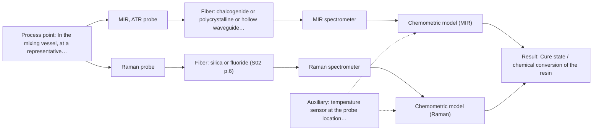
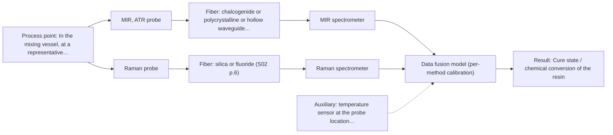

# First technical assessment: Viscosity and temperature of a curing resin

## Answer

**Customer request (our summary):** The customer wants a measurement setup to continuously monitor the viscosity and temperature of a dark, curing resin inside a heated vessel.

### Brief answer

Test an immersion MIR-ATR fiber probe first: it suits dark, thick pastes and tracks the cure chemistry from which viscosity must be inferred, with a separate temperature sensor. Test a Raman probe on the same batches as a comparison. Spectroscopy cannot measure viscosity directly, so a rheometer reference is needed to calibrate the end point. Open: your target viscosity and accuracy, vessel access and temperature range, and whether the resin fluoresces.

### Proposal

- **Best current option:** O2 (recommended)
- **Basis:** engineering judgement
- **What would change it:** If the customer's end-point accuracy (Q1) is tight, an independent in-line viscometer becomes necessary alongside spectroscopy; if the resin fluoresces strongly, Raman may drop out and the choice narrows to MIR-ATR alone.
- **Next step:** Run the feasibility trial: MIR-ATR and Raman spectra plus temperature on representative curing samples with rheometer reference, then agree go/no-go criteria.

**Secondary evidence (external, not AFS material):** G1: no usable external source found; G2: E05 ¶29; G3: no usable external source found; G4: no usable external source found. See Expert detail.

**Decision status:** Provisional feasibility assessment

### Solution options

| ID | Tier | Methods | Confidence | Cost class, S01 Table 1 (p.6) | Ease of use | Maintenance | Performance fit | Sources |
|---|---|---|---|---|---|---|---|---|
| O1 | Simple | M1 MIR, ATR probe | Medium: uncited auxiliary sensor and a parameter is not measurable in-line | high cost (row 2) | Single probe and spectrometer, straightforward | ATR crystal cleaning between batches | Tracks cure chemistry in dark paste directly | [1: S01 p.10] [2: S01 p.9] [3: S01 p.5] |
| O2 | Recommended | M1 MIR, ATR probe; M2 Raman probe | Low: fit for paste to be tested; uncited auxiliary sensor and a parameter is not measurable in-line | high cost (rows 2, 12) | Two probes tested, one kept | Probe cleaning plus spectrometer checks | Tests both fingerprints to secure end-point accuracy | [1: S01 p.10] [2: S01 p.9] [3: S01 p.5] [4: S01 p.11] [5: S01 p.11] |
| O3 | Extended (multi-method) | M3 MIR, ATR probe + Raman (combination) | Low: fit for paste to be tested; uncited auxiliary sensor and a parameter is not measurable in-line; multi-method, fusion benefit not yet shown | high cost (rows 2, 12) | Combined probe, two spectrometers | Two calibrations and diagnostics per block | Fusion only if single methods fall short | [6: S01 p.8] [7: S01 p.8] [4: S01 p.11] |

*Confidence rates the basis of the advice (how much is known and cited), not a predicted accuracy or probability of success. It starts at High, or at Medium when a key question on the method or the option is open, and drops one level per weakness listed (floor Low).*

*Cost class is the relative rating in S01 Table 1 (p.6) for the in-line method+technique rows named (the highest one for a multi-method option); it is not a price.*

### Setup sketch

*Recommended option O2; drawn by code from the option, a schematic, not a configuration.*

### Key questions

1. What viscosity or cure-state value defines the end point, and what accuracy and response time do you need for the stop decision?
2. What are the vessel temperature range and the available probe insertion or viewing port?
3. What is the resin chemistry, and do the formulation or additives fluoresce?

## Expert detail

**Customer enquiry**

> We mix a thick resin batch in a heated vessel and want to follow its viscosity and its temperature continuously during curing, so that we can stop the batch at the right point. The resin is dark and becomes more viscous over time. Which measurement setup would you suggest?

**Decision status:** Provisional feasibility assessment. A shortlist can be justified from the sample properties (dark paste, heated vessel), but the central premise that viscosity itself can be followed optically is not covered by the supplied sources, so viscosity would have to be inferred from cure chemistry and validated against an independent reference.

### Parameters

| ID | Parameter | Kind | Need | Measured by | Why | Sources |
|---|---|---|---|---|---|---|
| P1 | Cure state / chemical conversion of the resin | quantitative | required | Spectroscopy: MIR | It is the spectroscopically accessible quantity from which the viscosity end point must be inferred. | [2: S01 p.9] |
| P2 | Resin temperature | quantitative | required | Auxiliary sensor: temperature sensor at the probe location (engineering judgement: confirm availability with AFS) | The customer needs continuous temperature, and temperature also affects the spectral calibration. | *(no verified source: engineering judgement)* |
| P3 | Viscosity | quantitative | required | Not measurable in-line by spectroscopy; alternative: laboratory rheometry during trials; optionally an independent in-line viscometer if the inferred correlation is not accurate enough | It is the customer's end-point variable, but spectroscopy cannot measure it directly, so it serves as the reference for calibration. | *(no verified source: engineering judgement)* |

### Solution option details

- **O1 cost drivers:** One MIR spectrometer, ATR probe, CIR/PIR fiber link, rheometer reference during trials
- **O2 cost drivers:** MIR and Raman spectrometers with probes during trials, chemometric calibration, rheometer reference
- **O3 cost drivers:** Combined MIR-ATR/Raman probe, two spectrometers, data-fusion software, per-block calibration
- **O3 combining methods:** Low-level fusion: MIR-ATR and Raman spectra from the same probe spot merged into one matrix after synchronisation to a common time step and block scaling. Each method keeps its own calibration and diagnostics. The fused model must beat the best single method on held-out batches, otherwise the extra instrument is dropped.

*Extended (multi-method) option O3; drawn by code from the option, a schematic, not a configuration.*

### Premise check

- **Not covered:** Viscosity can be directly and continuously tracked with an optical spectroscopy setup during resin curing. No supplied source describes direct in-line optical measurement of viscosity; spectroscopy measures chemical and morphological information, so viscosity would be an inferred, calibrated quantity. *(no verified source: engineering judgement)*
- **Precedent only:** A dark, thick resin in a heated vessel can be measured in-line with a fiber-optic probe. ATR fiber probes are described for liquids and soft solid samples in on-line, in-process use; this is a reason to test, not proof for this resin. [1: S01 p.10] [8: S02 p.14]
- **Precedent only:** Spectroscopy can follow the state of a curing resin over time. In-line monitoring of chemical change in polymer-type media is shown in a process example (API in hot polymer by MIR-ATR); it is a precedent, not a demonstrated capability for this customer's resin. [9: S02 p.14]

### Requirements

**Stated by the customer**

- Follow viscosity continuously during curing
- Follow temperature continuously during curing
- Stop the batch at the right point
- Works on a dark, thickening resin in a heated vessel

**Key unknowns**

- Target end-point: which viscosity value or cure state defines the right stopping point, and with what accuracy
- Vessel temperature range, pressure and available probe insertion port
- Resin chemistry and whether additives or the resin itself fluoresce
- Fouling, cleaning and contact requirements at the probe tip during cure

### Clarification questions (most decision-relevant first)

Q1. What viscosity or cure-state value defines the end point, and what accuracy and response time do you need for the stop decision? *Why it matters:* It determines whether an inferred spectroscopic cure signal is sufficient or an independent in-line viscometer is required. *(affects: status)*
Q2. What are the vessel temperature range and the available probe insertion or viewing port? *Why it matters:* It decides which probe and fiber family can be installed and whether the MIR fiber link length is feasible. *(affects: installation)*
Q3. What is the resin chemistry, and do the formulation or additives fluoresce? *Why it matters:* It decides whether Raman suffers fluorescence background and whether fluorescence could add information. *(affects: technique)*
Q4. How often are batches run, and how must the probe be cleaned between batches? *Why it matters:* Curing resin on the ATR crystal is a fouling risk that drives probe design and maintenance. *(affects: installation)*

### Recommendation

- **M1 · Primary candidate: MIR, ATR probe.** ATR fiber probes are made for liquids and soft solid samples in on-line process use, and mid-IR spectra have well-defined bands suited to tracking cure chemistry in a dark paste where transmission fails. Viscosity would be inferred from a calibrated cure-conversion model, not measured directly. *Conditions:* The resin must keep tight contact with the ATR crystal, and fouling of the crystal during cure must be managed. [1: S01 p.10] [2: S01 p.9] [3: S01 p.5]
- **M2 · Comparison candidate: Raman probe.** Raman probes handle liquids, powders and solids and give a molecular fingerprint complementary to mid-IR, so it is worth testing against MIR-ATR on the same batches. The signal is weak and can be swamped by fluorescence, which must be checked on the real dark resin. [4: S01 p.11] [5: S01 p.11]
- **M3 · Conditional candidate: MIR, ATR probe + Raman (combination).** If neither single method tracks the cure end point well enough, a combined MIR-ATR plus Raman measurement from the same spot is the next hypothesis, since the two spectra are complementary. Any fusion gain must be validated against the best single method. *Conditions:* Applies only if the single-method tests (M1, M2) do not meet the end-point accuracy the customer states in Q1. [6: S01 p.8] [4: S01 p.11] Later hypothesis, after single-method tests.
- **M4 · Not recommended: NIR, transmission/transflection probe.** Transmission or transflection fails when the sample is too thick or opaque because light cannot penetrate it, which matches the stated dark, thickening resin. A reader might expect NIR as the standard in-line workhorse, but it is screened out here. [10: S01 p.18]

### Measurement concept

- **Probe and geometry:** Immersion MIR-ATR fiber probe (e.g. diamond or ZrO2 ATR tip) inserted into the heated vessel so the crystal stays in contact with the resin; a separate temperature sensor at the same location.
- **Location:** In the mixing vessel, at a representative position away from walls and stirrer.
- **Fiber link:** MIR light needs CIR or PIR fibers, not silica; the achievable MIR link length is an open question, since long cables are only stated for silica fibers. [11: S02 p.6] [12: S02 p.7]

### Spectral range

- **MIR:** Nominal mid-IR range is 4000-400 cm-1; the usable range depends on the instrument, fiber and probe actually selected. [2: S01 p.9]
- **Raman:** Reported as Raman shift in cm-1 with the laser excitation wavelength (e.g. 785 nm in the pharma example) stated separately; the usable shift range depends on the selected spectrometer and probe. [13: S01 p.15]

### Risks and uncertainty

- Viscosity is not measured directly: the spectroscopic signal tracks cure chemistry, and the link between conversion and viscosity must be established and validated for this resin. *(rules: R-EVI-2)* *(no verified source: engineering judgement)*
- The dark, strongly absorbing matrix may give weak or background-dominated Raman or fluorescence signals, so M2 may fail on the real resin. *(rules: R-RAM-1)* *(no verified source: engineering judgement)*
- ATR samples only a surface layer a few micrometres deep, so curing resin building up on the crystal and surface representativeness are real fouling and bias risks. *(rules: R-MIR-3)* *(no verified source: engineering judgement)*
- Any calibration is specific to this resin matrix and must be re-validated if the formulation changes. *(rules: R-CAL-1)* *(no verified source: engineering judgement)*

### First feasibility experiment

1. **Collect representative resin samples across the expected curing variation (early mix, mid-cure, end point) at the real process temperatures.** Cover the chemical and physical variation the model must handle. *(no verified source: engineering judgement)*
2. **Measure each sample with the MIR-ATR fiber probe and, in parallel, with the Raman probe; record temperature with an independent sensor.** Test the single methods first on identical material. *(no verified source: engineering judgement)*
3. **Measure viscosity of each sample with an independent laboratory rheometer as the reference method.** Provide the reference against which any spectroscopic viscosity inference is judged. *(no verified source: engineering judgement)*
4. **Build a calibration from cure spectra to the rheometer reference, validate on held-out batches, and only then test the MIR+Raman fusion against the best single method.** Confirm that combining methods actually adds accuracy before adding hardware. *(no verified source: engineering judgement)*
5. **Agree go/no-go criteria with the customer: the required end-point accuracy and response time from Q1 decide whether the spectroscopic inference is acceptable or an independent viscometer is needed.** Make the stop/go decision objective and customer-owned. *(no verified source: engineering judgement)*

**Reference measurements:** Laboratory rheometry for viscosity; an independent temperature sensor for temperature.

**Decision basis:** Customer-stated end-point accuracy and response time (Q1) versus validated prediction error on held-out batches.

### Assumptions

- The vessel allows probe insertion at a representative position.
- The resin stays in sufficient contact with an ATR crystal surface during the batch.
- Viscosity is acceptable as an inferred, calibrated quantity rather than a direct measurement.

### Not covered by the supplied sources

- Direct in-line optical measurement of viscosity, or spectroscopy of curing resins specifically, is not covered by the supplied material.
- No source gives an achievable MIR fiber link length for a vessel installation.

### Further notes

- **Chemometrics:** A PLS-type calibration from MIR (and optionally Raman) spectra to the rheometer viscosity reference is needed, built on representative curing batches and validated on held-out runs; the calibration is matrix-specific.
- **Real-time tracking:** Continuous in-line tracking of the cure signal plus temperature is the goal; the stop decision should use the validated model output with the customer's end-point criterion.
- **Future direction:** If the correlation proves robust, a simplified LED- or filter-based spectral sensor at the vessel could replace the full spectrometer later.

### Secondary evidence (external, not AFS material)

*Found by a literature search for gaps the supplied AFS sources leave open. Not AFS material and not proof for this case; every quote below was verified verbatim against the fetched text.*

**G1 · auxiliary sensor:** In-line measurement of Resin temperature with temperature sensor at the probe location

- No usable external source found.

**G2 · multi-method:** Combining several spectroscopy methods (data fusion) (Low-level fusion: MIR-ATR and Raman spectra from the same probe spot merged into one matrix after synchronisation to a common time step and block scaling. Each method keeps its own calibration and diagnostics. The fused model must beat the best single method on held-out batches, otherwise the extra instrument is dropped.)

- **E05 ¶29** The effectiveness of multi-sensor fusion does not increase proportionally with the number of sensors; rather, it hinges on mutual correction and complementarity among different sensors. *How it applies:* Before implementing data fusion of MIR-ATR and Raman, evaluate whether both modalities offer genuine complementarity for monitoring the curing resin. *Limits and transfer risks:* The cited study evaluated optical responses in food matrices rather than reactive resins inside a heated vessel, so performance gains may not transfer directly. *(supports O3)*
  > "It is noteworthy that the effectiveness of multi-sensor fusion does not increase proportionally with the number of sensors; rather, it hinges on mutual correction and complementarity among different sensors."
  > Advancing Egg Freshness Evaluation with Integrated AI and Spectroscopy. (2026) · Foods (Basel, Switzerland) · doi:10.3390/foods15132259 · https://europepmc.org/article/PMC/PMC13361683 · retrieved 2026-10-18, full text, licence: cc by, via europepmc

**G3 · not in the supplied sources:** Direct in-line optical measurement of viscosity, or spectroscopy of curing resins specifically, is not covered by the supplied material.

- No usable external source found.

**G4 · not in the supplied sources:** No source gives an achievable MIR fiber link length for a vessel installation.

- No usable external source found.

### Evidence (verified quotes)

1. ✓ **S01 p.10** (general): "ATR fiber probes (Fig.1) enable the analysis of liquids and solid elastic samples"
2. ✓ **S01 p.9** (general): "Vibrational spectroscopy in the mid-IR range (4000-400 cm-1) is one of the most informative methods of chemical analysis."
3. ✓ **S01 p.5** (general): "Mid-IR band spectra contain well-defined peaks (absorption bands)"
4. ✓ **S01 p.11** (general): "This property makes mid-IR and Raman spectra complementary, that is, they complement each other."
5. ✓ **S01 p.11** (general): "superposition of luminescence (fluorescence), which has a significantly higher intensity."
6. ✓ (precedent only) **S01 p.8** (method gain): "collected from the same small, even pinpoint, area of the sample."
7. ✓ (precedent only) **S01 p.8** (method gain): "Ultimately, the measurement data must be normalized to a common time step."
8. ✓ **S02 p.14** (application precedent): "NIR-Reflex & MIR-ATR-spectroscopy to control polymer extrusion in-line"
9. ✓ **S02 p.14** (application precedent): "Spectra of API in hot polymer obtained with Diamond cone ATR probe coupled to iC10 FTIR (MTAC)"
10. ✓ **S01 p.18** (general): "it fails when the milk becomes too "thick" or fat-rich, as the light cannot penetrate the sample."
11. ✓ **S02 p.6** (general): "3000 nm Polycrystalline Infrared Fibers 17 μm"
12. ✓ **S02 p.7** (general): "Robust 100-300m cables made with Silica fibers of low OH-content (<0.1ppm OH) enable remote industrial process-control"
13. ✓ **S01 p.15** (general): "Raman spectrometer and Raman fiber probe for contact measurements with 785 nm excitation wavelength"

### Verification

- Citations verified: 18 of 18 (exact or whitespace/hyphen-tolerant match on the cited page, scope checked).
- Hard check failures before deterministic corrections: 0; still open: 0; soft warnings: 4; repair rounds: 1.
- External evidence (live): 1 quote(s) verified verbatim (exact or whitespace/hyphen-tolerant, at most 400 characters and 2 sentences, against the cited paragraph); 0 item(s) dropped.
- External search: 4 query(ies), 35 hit(s), 5 source(s) (3 from the curated library).
- External step: 2 model call(s), 6.1 s extra (cost in the run JSON).

*Run A10-20261018T094923Z-acb2 · models google/gemini-3.5-flash-lite, google/gemini-3.8-flash, z-ai/glm-5.3-flash*
