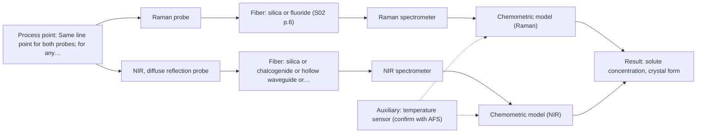
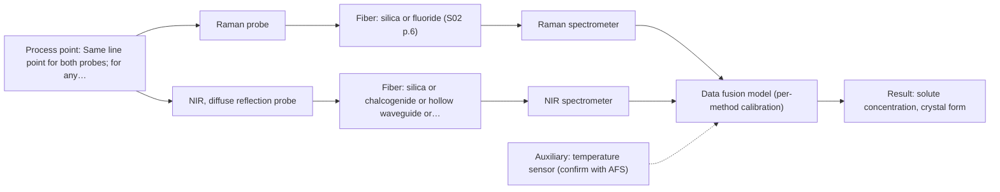

# First technical assessment: Fusing Raman and NIR in a crystallisation line

## Answer

**Customer request (our summary):** Customer runs a continuous crystallisation and asks how to combine Raman and NIR probes at the same line point, fuse both data streams into one model for solute concentration and crystal form, and whether fusion is worth the effort.

### Brief answer

Test Raman alone first, with NIR as the second single method, before fusing the two data streams. Whether fusion is worth the effort stays open: the sources show fusion gains only in other applications, and crystal-form measurement is not covered there. Several facts are still missing — the solute, the stream's opacity, and the required accuracy and response time.

### Proposal

- **Best current option:** O2 (recommended)
- **Basis:** supplied AFS sources
- **What would change it:** If one method alone meets both targets at the required accuracy, the second probe and any fusion become unnecessary. If the stream proves opaque or highly scattering, the NIR geometry changes and a contact technique may be needed instead.
- **Next step:** Run the single-method Raman and NIR tests on representative samples against the customer's reference method before attempting any fusion.

**Secondary evidence (external, not AFS material):** G1: E02 ¶12; G2: E03 ¶31; G3: no usable external source found; G4: E03 ¶36, E04 ¶1. See Expert detail.

**Decision status:** Provisional feasibility assessment

### Solution options

| ID | Tier | Methods | Confidence | Cost class, S01 Table 1 (p.6) | Ease of use | Maintenance | Performance fit | Sources |
|---|---|---|---|---|---|---|---|---|
| O1 | Simple | M1 Raman probe | Medium: open question: Q1, Q3 (starts at Medium) | high cost (row 12) | One probe, one model, simplest | One calibration to maintain | Cheapest way to see if Raman suffices | [1: S01 p.16] [2: S01 p.12] |
| O2 | Recommended | M1 Raman probe; M2 NIR, diffuse reflection probe | Low: open question: Q1, Q3 (starts at Medium); sample clarity unknown | high cost (rows 8, 12) | Two probes at one port | Two probes and calibrations to service | Covers both targets without fusion overhead | [3: S01 p.15] [1: S01 p.16] [2: S01 p.12] [4: S01 p.17] |
| O3 | Extended (multi-method) | M1 Raman probe; M2 NIR, diffuse reflection probe; M3 Raman probe + NIR (combination) | Low: open question: Q1, Q3 (starts at Medium); sample clarity unknown; multi-method, fusion benefit not yet shown | high cost (rows 8, 12) | Two probes plus fused data handling | Two instruments; fused model needs re-calibration | Most information; only if singles fall short | [5: S01 p.8] [6: S01 p.8] [7: S01 p.8] [8: S01 p.15] [1: S01 p.16] [2: S01 p.12] [3: S01 p.15] [4: S01 p.17] [9: S01 p.15] [10: S01 p.15] |

*Confidence rates the basis of the advice (how much is known and cited), not a predicted accuracy or probability of success. It starts at High, or at Medium when a key question on the method or the option is open, and drops one level per weakness listed (floor Low).*

*Cost class is the relative rating in S01 Table 1 (p.6) for the in-line method+technique rows named (the highest one for a multi-method option); it is not a price.*

### Setup sketch

*Recommended option O2; drawn by code from the option, a schematic, not a configuration.*

### Key questions

1. What is the solute, the solvent or matrix, and the expected solute concentration range?
2. At the probe point, is the stream clear or a dense crystal slurry, and what are the solids loading and particle size?
3. Which crystal forms must be distinguished, and what accuracy, precision and response time are required?

## Expert detail

**Customer enquiry**

> We run a continuous crystallisation and want to combine a Raman probe and an NIR probe at the same point in the line, fusing both data streams into one model for solute concentration and crystal form. How should we set this up, and is fusing the two worth the effort?

**Decision status:** Provisional feasibility assessment. A single-method shortlist (Raman first, NIR second) can be justified with the assumptions stated, and the customer's fusion idea is kept as a later hypothesis to test. The sample and process facts needed to confirm any setup are still open.

### Parameters

| ID | Parameter | Kind | Need | Measured by | Why | Sources |
|---|---|---|---|---|---|---|
| P1 | solute concentration | quantitative | required | Spectroscopy: Raman | It is one of the two stated targets and drives the crystallisation. | *(no verified source: engineering judgement)* |
| P2 | crystal form | qualitative | required | Spectroscopy: Raman | It is the second stated target; polymorph identity controls product quality. | *(no verified source: engineering judgement)* |
| P3 | temperature | quantitative | optional | Auxiliary sensor: temperature sensor (engineering judgement: confirm availability with AFS) | Solubility and crystal form depend on temperature, so it should be available to interpret the spectra and the model. | *(no verified source: engineering judgement)* |

### Solution option details

- **O1 cost drivers:** One spectrometer, one probe, one chemometric model
- **O2 cost drivers:** Two spectrometers, two probes, two chemometric models
- **O3 cost drivers:** Two spectrometers, combined probe or two ports, data fusion
- **O3 combining methods:** Fuse at the low level by merging synchronised Raman and NIR spectra into one augmented matrix, with block scaling so neither method dominates. The two probes must sample the same small area at a common time step, and each method keeps its own calibration. Keep the fused model only if it beats the best single-method model on independent runs or batches.

*Extended (multi-method) option O3; drawn by code from the option, a schematic, not a configuration.*

### Premise check

- **Precedent only:** Raman and NIR probes can be combined at the same point in the line. A source shows a combined NIR + Raman fiber probe for a process environment; this is a reason to test, not proof it fits this crystalliser. [11: S01 p.15]
- **Precedent only:** Fusing both data streams into one model is appropriate and beneficial. A source reports better accuracy and robustness from fused NIR + Raman than from single methods in another process; a gain for this stream is a hypothesis. [10: S01 p.15]
- **Not covered:** The combined Raman/NIR setup can measure crystal form. No supplied page addresses crystal-form or polymorph measurement by Raman or NIR. *(no verified source: engineering judgement)*

### Requirements

**Stated by the customer**

- "We run a continuous crystallisation"
- "combine a Raman probe and an NIR probe at the same point in the line"
- "fusing both data streams into one model"
- "solute concentration and crystal form"
- "solute concentration"
- "crystal form"

**Key unknowns**

- solute species and concentration range
- crystal form(s) to be distinguished and the required discrimination
- stream optical regime: clear solution vs dense crystal slurry, solids loading, particle size
- solvent or matrix and any fluorescent species
- installation point, distance from the analyser, temperature, pressure, cleaning and fouling
- reference method and calibration/validation samples

### Clarification questions (most decision-relevant first)

Q1. What is the solute, the solvent or matrix, and the expected solute concentration range? *Why it matters:* It decides whether Raman or NIR sees the solute and which bands are usable. *(affects: method)*
Q2. At the probe point, is the stream clear or a dense crystal slurry, and what are the solids loading and particle size? *Why it matters:* It decides the NIR geometry (transmission/transflection versus diffuse reflection) and whether contact ATR would be needed instead. *(affects: technique)*
Q3. Which crystal forms must be distinguished, and what accuracy, precision and response time are required? *Why it matters:* It sets whether one method can cover crystal form or whether the fusion step is needed at all. *(affects: method)*
Q4. What are the installation conditions: distance from the analyser, temperature, pressure, and cleaning or fouling requirements? *Why it matters:* It decides the probe and fiber link and whether the probe survives the process. *(affects: installation)*
Q5. What independent reference method (off-line analysis) and how many calibration and validation samples are available? *Why it matters:* Without independent reference data no calibration or fused model can be built or validated. *(affects: status)*

### Recommendation

- **M1 · Primary candidate: Raman probe.** Raman is the in-line technique that passes here and suits aqueous streams, where infrared methods suffer from strong water absorption. It can support calibration or classification models, so it is the single method to test first. *Conditions:* Applies if the stream is aqueous and the solute and crystal are Raman-active with a low fluorescence background. [1: S01 p.16] [2: S01 p.12]
- **M2 · Comparison candidate: NIR, diffuse reflection probe.** NIR is the second method the customer proposed and carries information complementary to Raman, on hydrogen bonds and polar groups. Diffuse reflection is the geometry that suits opaque or concentrated streams. *Conditions:* Applies if the stream at the probe is opaque or highly scattering; if it is clear, transmission or transflection would be preferred. [3: S01 p.15] [4: S01 p.17]
- **M3 · Conditional candidate: Raman probe + NIR (combination).** Combining NIR and Raman captures complementary chemical information, and a published tablet-press example reported better accuracy and robustness from a fused NIR + Raman model than from single methods. Any gain for this crystallisation stream is a hypothesis to test against the best single method. *Conditions:* Applies only after the single-method tests, and only if neither Raman nor NIR alone meets both targets. [9: S01 p.15] [10: S01 p.15] Later hypothesis, after single-method tests.

### Measurement concept

- **Probe and geometry:** Raman fiber probe first, single method, at the line point; NIR probe in diffuse reflection as the second single method. If the stream is clear, an NIR transmission or transflection geometry would be the alternative.
- **Location:** Same line point for both probes; for any combined measurement the two probes must look at the same small area and be read at a common time step.
- **Fiber link:** Fiber family and length depend on the method and the installation distance; this is an open point (see Q4). [12: S01 p.18]

### Spectral range

- **Raman:** nominal [13: S01 p.11] [14: S01 p.15] [15: REF §5]

### Risks and uncertainty

- The sample optical regime is unknown: a thick, opaque or high-solids slurry would defeat NIR transmission, so the NIR geometry assumed here may be wrong. *(rules: R-GEO-2, R-GEN-5)* [16: S01 p.18]
- The Raman signal is weak and can be swamped by fluorescence from the solute, solvent or additives, which would weaken or void M1. *(rules: R-RAM-1)* [17: S01 p.11]
- Crystal-form (polymorph) discrimination by Raman or NIR is not covered by the supplied pages, so the second target may not be reachable. *(no verified source: engineering judgement)*
- Fusion pays off only if the fused model beats the best single method and the two probes sample the same small area at a common time step; a slurry flow makes this harder and may add effort without gain. *(rules: R-CMB-2, R-CMB-3)* [18: S01 p.8]

### First feasibility experiment

1. **Collect representative samples or process states across the expected concentration range and across the crystal-form and particle-size variation (clear, nucleating and crystal-rich).** Cover the chemical and physical variation the model must handle. [19: REF §3]
2. **Measure independent reference values for solute concentration and crystal form with the customer's off-line reference method.** Provide the reference data for calibration and validation. [20: REF §3]
3. **Measure every sample with the Raman probe alone first, at the same sampling spot as the reference.** Test the single method before any combination. *(no verified source: engineering judgement)*
4. **Measure the same samples with the NIR probe alone, in the geometry the stream requires.** Test the second single method on its own. *(no verified source: engineering judgement)*
5. **Then build the fused Raman + NIR model on the same samples, compare it with the best single-method model, and validate on held-out runs or batches against the customer's numerical go/no-go thresholds.** Show whether fusion adds anything before committing to it. [21: REF §5]

**Reference measurements:** Independent reference values for solute concentration and crystal form, measured off-line by the customer's method on the same samples.

**Decision basis:** Go/no-go on the customer's required accuracy, precision and response time for both targets, assessed on held-out runs or batches; fusion is kept only if the fused model beats the best single method.

### Assumptions

- The stream at the probe point is aqueous or water-containing and the solute and crystal are Raman-active with a low fluorescence background.
- Raman or NIR can in principle respond to crystal form; this is not stated by any supplied page.
- A single line point is available for the probe(s) and an independent off-line reference method exists.

### Not covered by the supplied sources

- Whether Raman or NIR can measure crystal form (polymorph identity) — the supplied pages do not address crystal-form measurement.
- Whether NIR + Raman fusion helps in a crystallisation stream — the supplied fusion examples are pharmaceutical blending/coating and biological tissue.

### Further notes

- **Chemometrics:** Both NIR and Raman need a chemometric model specific to the matrix; a fused model additionally needs block scaling so one method does not dominate, and reference data covering the full concentration and crystal-form range.
- **Real-time tracking:** The aim is in-line, continuous tracking; Raman and NIR acquire at different rates, so the two streams must be aligned to a common time step before any fusion.
- **Future direction:** If one method proves sufficient, a compact optical multisensor system dedicated to this stream could be considered as a later step.

### Secondary evidence (external, not AFS material)

*Found by a literature search for gaps the supplied AFS sources leave open. Not AFS material and not proof for this case; every quote below was verified verbatim against the fetched text.*

**G1 · auxiliary sensor:** In-line measurement of temperature with temperature sensor

- **E02 ¶12** The source notes that temperature sensitivity of OH bands is a severe drawback for aqueous NIR and MIR measurement, making tempered sample holders necessary. *How it applies:* For a crystallisation stream measured by NIR, this suggests temperature variation could affect spectra, so temperature should be monitored or controlled; it does not itself describe an in-line temperature sensor. *Limits and transfer risks:* The statement comes from biopharmaceutical downstream processing, not continuous crystallisation, and it concerns tempered sample holders rather than an in-line temperature sensor. *(supports O2)*
  > "Additionally, the temperature sensitivity of the OH bands is a severe drawback for measuring aqueous solution in NIR and MIR, which makes tempered sample holders necessary [29]."
  > A critical review of recent trends, and a future perspective of optical spectroscopy as PAT in biopharmaceutical downstream processing. (2020) · Analytical and bioanalytical chemistry · doi:10.1007/s00216-020-02407-z · https://europepmc.org/article/PMC/PMC7072065 · retrieved 2026-10-17, full text, licence: cc by, via curated library

**G2 · multi-method:** Combining several spectroscopy methods (data fusion) (Fuse at the low level by merging synchronised Raman and NIR spectra into one augmented matrix, with block scaling so neither method dominates. The two probes must sample the same small area at a common time step, and each method keeps its own calibration. Keep the fused model only if it beats the best single-method model on independent runs or batches.)

- **E03 ¶31** The review describes low-level data fusion as the simplest way to combine inputs by rearranging variables from different sources into one new data matrix. *How it applies:* This supports the proposed low-level fusion approach of concatenating synchronised Raman and NIR spectra into an augmented matrix, but it does not show that the fused model will outperform single-method models. *Limits and transfer risks:* The review is general PAT data-fusion material, not a crystallisation study, and it does not address same-area sampling, common time steps, or block scaling. *(supports O3)*
  > "Low-level data fusion (LLDF) is considered the simplest method to achieve a combination of inputs. In this case, the data is rearranged into a new data matrix, where the variables coming from different sources are placed one after the other."
  > Challenges and Opportunities of Implementing Data Fusion in Process Analytical Technology-A Review. (2022) · Molecules (Basel, Switzerland) · doi:10.3390/molecules27154846 · https://europepmc.org/article/PMC/PMC9369811 · retrieved 2026-10-17, full text, licence: cc by, via curated library

**G3 · not in the supplied sources:** Whether Raman or NIR can measure crystal form (polymorph identity) — the supplied pages do not address crystal-form measurement.

- No usable external source found.

**G4 · not in the supplied sources:** Whether NIR + Raman fusion helps in a crystallisation stream — the supplied fusion examples are pharmaceutical blending/coating and biological tissue.

- **E03 ¶36** The review reports that in some situations instrument complementarity was not sufficient to improve predictive performance of several CQAs, citing a Raman and FT-IR food analytical study. *How it applies:* This cautions that adding NIR to Raman may not improve a crystallisation model merely because the instruments are complementary; the fused model should be compared against the best single-method model. *Limits and transfer risks:* The cited study used Raman and FT-IR on food, not NIR and Raman on a crystallisation stream, so the result may not transfer to this process or probe combination. *(supports O3)*
  > "In some situations, instrument complementarity (not data complementarity) was not sufficient to improve the performance of predictive several CQAs, as shown by a Raman and FT-IR data based food analytical study [73]."
  > Challenges and Opportunities of Implementing Data Fusion in Process Analytical Technology-A Review. (2022) · Molecules (Basel, Switzerland) · doi:10.3390/molecules27154846 · https://europepmc.org/article/PMC/PMC9369811 · retrieved 2026-10-17, full text, licence: cc by, via curated library
- **E04 ¶1** In a multimodal bone study, corrected five-class modelling achieved only moderate balanced accuracy and did not consistently improve upon NIR-ONE alone. *How it applies:* This supports evaluating whether a fused Raman/NIR model actually adds value over the best single method, rather than assuming fusion is beneficial. *Limits and transfer risks:* The study concerns human skeletal remains and post-mortem interval assessment, not crystallisation, and the quoted result does not establish performance for Raman/NIR fusion in a process stream. *(supports O3)*
  > "Corrected five-class modelling achieved only moderate balanced accuracy and did not consistently improve upon NIR-ONE alone."
  > Task-Specific Multimodal Imaging and Spectroscopy for Post-Mortem Interval Assessment in Human Skeletal Remains: An Exploratory Decision-Support Framework. (2026) · Diagnostics (Basel, Switzerland) · doi:10.3390/diagnostics16182908 · https://europepmc.org/article/PMC/PMC13605527 · retrieved 2026-10-18, full text, licence: cc by, via europepmc

### Evidence (verified quotes)

1. ✓ **S01 p.16** (general): "Raman is particularly well-suited for aqueous environments, as it exhibits low absorbance for water molecules compared to infrared methods."
2. ✓ **S01 p.12** (general): "Raman spectra (as well as IR absorption spectra) can be used to construct chemometric models-calibration or classification ones."
3. ✓ **S01 p.15** (general): "NIR detects hydrogen bonds and asymmetric polar groups, while Raman provides information on the molecular backbone and symmetrical non-polar groups."
4. ✓ **S01 p.17** (general): "NIR Reflection is primarily used for opaque or highly concentrated dairy products, such as yogurt, butter, or whole milk concentrates."
5. ✓ **S01 p.8** (general): "two or more probes, belonging to different methods, can be used for measurements, but the data from each method must be obtained simultaneously."
6. ✓ **S01 p.8** (general): "Ultimately, the measurement data must be normalized to a common time step."
7. ✓ **S01 p.8** (general): "Variables obtained from different spectral methods are not equivalent."
8. ✓ **S01 p.15** (application precedent): "Data processing for pharmaceutical tasks relies on "low-level data fusion," where the synchronized NIR and Raman spectra are merged into a single augmented matrix."
9. ✓ (precedent only) **S01 p.15** (method gain): "The combination of these techniques is particularly effective because it captures complementary chemical information: NIR detects hydrogen bonds and asymmetric polar groups, while Raman provides information on the molecular backbone and symmetrical non-polar groups."
10. ✓ (precedent only) **S01 p.15** (method gain): "By combining Raman and NIR, these models can predict API potency or coating thickness with higher accuracy and robustness than single-method models."
11. ✓ **S01 p.15** (application precedent): "A multispectral NIRaman fiber probe has industrial grade design that combines NIR reflection and Raman optical techniques in a compact shaft that fits in a tablet press feed frame."
12. ✓ **S01 p.18** (general): "Transmission is the preferred method for transparent or semi-transparent liquids, such as skim milk, whey, or permeate."
13. ✓ **S01 p.11** (general): "The Raman shift is used as the horizontal (spectral) axis in Raman spectroscopy"
14. ✓ **S01 p.15** (general): "Raman spectrometer and Raman fiber probe for contact measurements with 785 nm excitation wavelength"
15. ✓ **REF §5** (general): "It is not a product specification: actual spectral coverage, fiber length, component ratings, detection limits and accuracy depend on the configuration and the sample."
16. ✓ **S01 p.18** (general): "it fails when the milk becomes too "thick" or fat-rich, as the light cannot penetrate the sample."
17. ✓ **S01 p.11** (general): "superposition of luminescence (fluorescence), which has a significantly higher intensity."
18. ✓ **S01 p.8** (general): "It is crucial that the spectral information obtained by different methods-Mid-IR, NIR, Raman, and fluorescence spectra-is collected from the same small, even pinpoint, area of the sample."
19. ✓ **REF §3** (general): "Representative samples or process states, independent reference measurements, what is compared, and the basis for the go / no-go decision."
20. ✓ **REF §3** (general): "independent reference measurements"
21. ✓ **REF §5** (general): "compare with the best single method."

### Verification

- Citations verified: 23 of 23 (exact or whitespace/hyphen-tolerant match on the cited page, scope checked).
- Hard check failures before deterministic corrections: 0; still open: 0; soft warnings: 6; repair rounds: 1.
- Removed 2 intake item(s) not quoted verbatim from the enquiry:
  - intake.process[0]: enquiry_quote not found verbatim in the enquiry
  - intake.process[1]: enquiry_quote not found verbatim in the enquiry
- External evidence (live): 4 quote(s) verified verbatim (exact or whitespace/hyphen-tolerant, at most 400 characters and 2 sentences, against the cited paragraph); 1 item(s) dropped.
- External search: 6 query(ies), 45 hit(s), 5 source(s) (3 from the curated library).
- External step: 2 model call(s), 82.6 s extra (cost in the run JSON).
  - ⚠ dropped G2 E03 ¶82: forbidden wording: guarantee: 'guarantee'

*Run A11-20261018T004929Z · models deepseek/deepseek-v4.1-flash*
