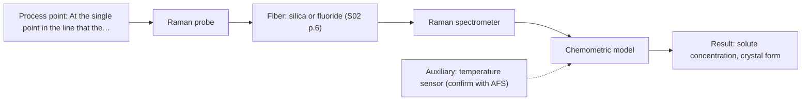
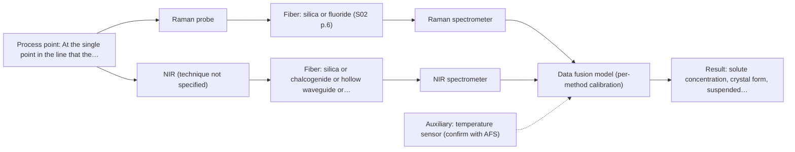

# First technical assessment: Fusing Raman and NIR in a crystallisation line

## Answer

**Customer request (our summary):** Customer runs a continuous crystallisation and wants to co-locate a Raman probe and an NIR probe on the line and fuse both data streams into a single model for solute concentration and crystal form; they ask how to configure it and whether fusion is worth the effort.

### Brief answer

Test one method at a time. On representative crystalliser samples, run a Raman probe first, with an NIR probe at the same point as the comparison, and independent reference values for solute concentration and crystal form. Fusion is a later hypothesis: worth testing only if a fused model beats the best single method on held-out runs. The deciding facts - solute, range, solvent, accuracy - are still open, so no final configuration can be fixed yet.

### Proposal

- **Best current option:** O2 (recommended)
- **Basis:** engineering judgement
- **What would change it:** Answers to the questions on solute and concentration range, on what 'crystal form' must distinguish, and on solvent, solids loading and turbidity decide whether Raman, NIR or the fusion is the better fit; if a single method fails the customer's accuracy criteria in the feasibility test, the fused option (O3) becomes the candidate. A clear, particle-free measurement point would also bring NIR transmission back into consideration.
- **Next step:** Run the single-method feasibility test on representative crystalliser samples with independent reference values for both outputs, and build one model per method before any fused model.

**Secondary evidence (external, not AFS material):** G1: E03 ¶19; G2: E02 ¶82, E05 ¶20; G3: no usable external source found; G4: no usable external source found. See Expert detail.

**Decision status:** Premise not supported by the sources

### Solution options

| ID | Tier | Methods | Confidence | Cost class, S01 Table 1 (p.6) | Ease of use | Maintenance | Performance fit | Sources |
|---|---|---|---|---|---|---|---|---|
| O1 | Simple | M2 NIR, diffuse reflection probe | Low: uncited auxiliary sensor; a customer premise is contradicted, status: premise not supported | average cost (row 8) | one standard in-line NIR setup | probe cleaning and periodic recalibration | least effort; concentration and scattering only | [1: S01 p.10] [2: S01 p.17] [3: S01 p.10] |
| O2 | Recommended | M1 Raman probe | Low: uncited auxiliary sensor; a customer premise is contradicted, status: premise not supported | high cost (row 12) | one contact probe, chemometric model needed | fouling checks and matrix-specific recalibration | sharp bands suit both stated targets | [4: S01 p.16] [5: S01 p.11] [6: S01 p.11] [7: S01 p.15] |
| O3 | Extended (multi-method) | M3 Raman probe + NIR (combination) | Low: uncited auxiliary sensor; a customer premise is contradicted, status: premise not supported; multi-method, fusion benefit not yet shown | high cost (rows 8, 12) | two instruments and one shared port | two calibrations and diagnostics to keep current | complementary information if one method falls short | [8: S01 p.8] [9: S01 p.9] [10: S01 p.8] [11: S01 p.8] [12: S01 p.9] [13: S01 p.15] [14: S01 p.15] [15: S01 p.7] [16: S01 p.8] [17: REF §5] |

*Confidence rates the basis of the advice (how much is known and cited), not a predicted accuracy or probability of success. It starts at High, or at Medium when a key question on the method or the option is open, and drops one level per weakness listed (floor Low).*

*Cost class is the relative rating in S01 Table 1 (p.6) for the in-line method+technique rows named (the highest one for a multi-method option); it is not a price.*

### Setup sketch

*Recommended option O2; drawn by code from the option, a schematic, not a configuration.*

## Expert detail

**Customer enquiry**

> We run a continuous crystallisation and want to combine a Raman probe and an NIR probe at the same point in the line, fusing both data streams into one model for solute concentration and crystal form. How should we set this up, and is fusing the two worth the effort?

**Decision status:** Premise not supported by the sources. The customer asks for a concrete fused setup and for confirmation that fusion is worth the effort, but the deciding facts (solute, matrix, solids loading, crystal form, accuracy targets) are unknown, and the supplied material treats a combination as a hypothesis to be tested against the best single method rather than as the default. A conditional shortlist can be given; a ready configuration cannot.

### Parameters

| ID | Parameter | Kind | Need | Measured by | Why | Sources |
|---|---|---|---|---|---|---|
| P1 | solute concentration | quantitative | required | Spectroscopy: Raman | It is one of the two model outputs the customer asks for and it defines the accuracy criterion for the go/no-go decision. | *(no verified source: engineering judgement)* |
| P2 | crystal form | qualitative | required | Spectroscopy: Raman | It is the second stated output, and the model must separate the forms or attributes the customer cares about, not merely detect crystals. | *(no verified source: engineering judgement)* |
| P3 | temperature at the measurement point | quantitative | required | Auxiliary sensor: temperature sensor (engineering judgement: confirm availability with AFS) | Solubility, and therefore the meaning of a concentration reading, depends on the temperature at the probe. | *(no verified source: engineering judgement)* |
| P4 | suspended solids fraction (turbidity) | quantitative | required | Spectroscopy: NIR | It sets the optical regime at the probe and decides whether NIR should run in diffuse reflection or transmission. | *(no verified source: engineering judgement)* |

### Solution option details

- **O1 cost drivers:** one NIR spectrometer, probe, process port and calibration work
- **O2 cost drivers:** Raman laser, spectrometer, contact probe and model development
- **O3 cost drivers:** two spectrometers, a shared or combined probe, synchronisation and fusion work
- **O3 combining methods:** Fusion level: start with one model per method, then join the two blocks (block-scaled spectra or extracted scores) so that the block with more variables does not dominate. Both probes must look at the same small spot and the two data streams must be brought to a common time step, with a separate calibration and diagnostic kept for each instrument. Keep the fused model only if it beats the best single method on independent runs.

*Extended (multi-method) option O3; drawn by code from the option, a schematic, not a configuration.*

### Premise check

- **Precedent only:** A Raman probe and an NIR probe can be combined at one and the same point in the line. Combined probes that put two methods on one measurement spot have been built and described, including one that combines NIR reflection and Raman in a single shaft used in-line. That is a reason to test the arrangement, not proof for this process. [18: S01 p.15] [19: S01 p.8]
- **Not covered:** A single fused model of the two data streams is the right way to obtain both solute concentration and crystal form. No supplied page addresses crystallisation, crystal-form discrimination or in-line solute concentration, so the sources cannot say whether one fused model is the right route for these two outputs; they treat a combination as a hypothesis to be compared with the best single method. *(no verified source: engineering judgement)*
- **Contradicted:** A concrete setup can be prescribed now, before the deciding facts (matrix, ranges, conditions) are known. The supplied guidance says the opposite for exactly this situation: when the known facts cannot justify a method choice, state that and ask the deciding questions rather than fix a configuration. [20: REF §3]

### Requirements

**Stated by the customer**

- "We run a continuous crystallisation"
- "at the same point in the line"
- "combine a Raman probe and an NIR probe"
- "fusing both data streams into one model"
- "solute concentration"
- "crystal form"

**Key unknowns**

- Solute identity, concentration range, and the required accuracy, precision and response time.
- What 'crystal form' must distinguish: which polymorphs, hydrates or particle attributes, and at what level.
- Solvent and mother-liquor composition, whether the liquid is aqueous, and interfering or fluorescing species.
- Solids loading, crystal size and turbidity at the intended measurement point.
- Temperature, pressure, fouling and cleaning conditions at that point, and whether a probe port exists there.
- The independent reference method for calibration and validation, and whether one shared port can be used.

### Clarification questions (most decision-relevant first)

### Recommendation

- **M1 · Primary candidate: Raman probe.** A contact Raman probe measures liquid and solid samples and is comparatively tolerant of water, so one probe can look at mother liquor and crystals at the same spot; its bands are sharper than NIR bands, which matters for form-related information. Its signal is weak and can be swamped by fluorescence, so that must be checked on the real stream, with the laser excitation wavelength reported separately from the Raman shift. *Conditions:* Applies as long as the stream's fluorescence background does not swamp the weak Raman bands. [4: S01 p.16] [5: S01 p.11] [6: S01 p.11] [7: S01 p.15]
- **M2 · Comparison candidate: NIR, diffuse reflection probe.** NIR diffuse reflection is the usual geometry for opaque, scattering liquids, and NIR is the most common in-line fiber method, so it is the natural single-method competitor for the concentration target. Its bands are broad and overlapping, so a matrix-specific chemometric calibration is required. *Conditions:* Applies if the stream at the probe point is turbid or concentrated; a clear particle-free stream would point to transmission instead. [2: S01 p.17] [1: S01 p.10] [3: S01 p.10]
- **M3 · Conditional candidate: Raman probe + NIR (combination).** NIR and Raman carry complementary chemical information, and a synchronised NIR + Raman model has been demonstrated in-line for a pharmaceutical process, but any gain for this crystallisation is a hypothesis. Test it only after the single-method runs, against the best single method. *Conditions:* Applies only if neither single method reaches the customer's accuracy target for both outputs and both measurements can be taken at the same spot with synchronised acquisition. [13: S01 p.15] [14: S01 p.15] [15: S01 p.7] [16: S01 p.8] [17: REF §5] Later hypothesis, after single-method tests.
- **M4 · Not recommended: NIR, transmission/transflection probe.** In a crystallising stream the medium is thick and scattering, and a transmission signal is lost once light cannot penetrate the sample; diffuse reflection is the NIR geometry that suits such a stream. This technique would become a candidate again only if the measurement point were a clear, particle-free filtrate. [21: S01 p.18]

### Measurement concept

- **Probe and geometry:** One contact Raman probe and one NIR probe on the same measurement spot, preferably through a shared or combined probe rather than two ports used alternately; NIR in diffuse reflection for the turbid slurry.
- **Location:** At the single point in the line that the customer named, with the Raman spot and the NIR sampling volume overlapping as closely as the probe allows.
- **Fiber link:** Silica fibers cover both methods' working range; metal-coated silica avoids polymer-jacket fluorescence, which matters for Raman. A long-link length figure is stated only for low-OH silica cables, and no MIR link is needed here. [22: S02 p.6] [23: S02 p.7]

### Spectral range

- **Raman:** Raman is described by a Raman shift axis in cm-1 plus a separate laser excitation wavelength; the example probe is specified with 785 nm excitation. The usable shift range depends on the instrument, fiber and probe actually selected. [6: S01 p.11] [7: S01 p.15]
- **NIR:** Nominal NIR range 780-2500 nm; the usable range depends on the instrument, fiber and probe actually selected. [24: S01 p.10] [25: REF §5]

### Risks and uncertainty

- Fluorescence from the stream or from the probe can swamp the weak Raman signal, which is several orders of magnitude weaker than IR absorption peaks, so the background must be checked on the real process stream. *(rules: R-RAM-1)* [5: S01 p.11]
- No supplied source covers crystallisation, crystal-form discrimination or in-line solute concentration, so the whole shortlist is a precedent-based hypothesis rather than a demonstrated fit. *(rules: R-EVI-2)* [26: REF §3]
- Raman and NIR sample different volumes and depths, so in a flowing slurry the same point may not be the same material, and solids loading and turbulence add to this. *(rules: R-CMB-2, R-GEN-5)* [16: S01 p.8] [27: S01 p.7]
- Fouling or crystallisation on the probe window or crystal can change the signal, and a change of matrix or composition means the calibration has to be re-validated. *(rules: R-CAL-1)* [28: REF §5]

### First feasibility experiment

1. **Collect representative samples and process states across the expected variation (solute level, solids loading, temperature), including near-boundary and off-spec states.** Representative samples and process states [29: S01 p.3]
2. **Measure each sample at the same point, at process temperature and with repeats, using a contact Raman probe and an NIR probe (diffuse reflection for the slurry; transmission only for clear, particle-free samples), with probe and fiber types that transmit each method's range.** Measure each sample with both methods at the same point, at process temperature, with repeats: contact Raman probe and NIR probe (diffuse reflection for the slurry; transmission only for clear, particle-free samples), with probe and fiber types that transmit each method's range. [16: S01 p.8] [30: S01 p.15] [23: S02 p.7]
3. **Obtain independent reference values for solute concentration and crystal form for every sample, using the customer's reference methods, so that each model can be calibrated and checked.** Independent reference values for solute concentration and crystal form for every sample, using the customer's reference methods, so that each model can be calibrated and checked. [31: REF §3]
4. **Build and validate one model per method on held-out runs or batches first; only then test a fused model (one block per method, scaled) and compare it with the best single method.** Build and validate one model per method on held-out runs or batches first; only then test a fused model (one block per method, scaled) and compare it with the best single method. [17: REF §5]
5. **Apply the customer's numerical criteria (accuracy, precision and response time for both outputs) as the go/no-go basis, and drop a method, or the fusion, if it does not reach them.** Go/no-go on the customer's numerical criteria (accuracy, precision, response time for both outputs); drop a method, or the fusion, if it does not reach them. *(no verified source: engineering judgement)*

**Reference measurements:** Independent reference values for both outputs are required before any model is built; the customer names the reference methods.

**Decision basis:** The customer's own numbers define the go/no-go criteria.

### Assumptions

- The mother liquor does not fluoresce strongly enough to swamp the Raman bands (to be confirmed on real samples).
- The measurement point carries a turbid, particle-bearing stream, so NIR diffuse reflection rather than transmission is the relevant NIR geometry.
- Both probes can be mounted at, or through, one port so that the two methods see essentially the same spot.

### Not covered by the supplied sources

- Whether Raman, NIR or a fused model can distinguish the crystal forms of interest in a continuous crystalliser; no crystallisation, polymorph or solute-concentration case is supplied.
- Any accuracy, precision, detection-limit or response-time figures for solute concentration or crystal form.
- Probe fouling behaviour and cleaning regimes in a crystalliser stream.
- A ready installation layout for this line (port type, path length, probe-to-process distance).

### Further notes

- **Chemometrics:** Plan one calibration per method first, then a fused model: both NIR and Raman calibrations are specific to the sample matrix and have to be re-validated after a change of matrix or composition (REF §5). NIR bands overlap broadly and need chemometric treatment (S01 p.10); the published in-line NIR + Raman example used low-level data fusion into one augmented matrix with PLS regression (S01 p.15). Reference data volume and validation on independent batches matter more than model complexity.
- **Real-time tracking:** Both methods would run continuously in-line, so the two data streams must be aligned to a common time step and the dead time between the measurement ports accounted for before any result is used for control (S01 p.8).
- **Future direction:** If the fused laboratory model shows a real gain, the later step is a compact multisensor system dedicated to this application rather than a full laboratory spectrometer set (S01 p.9).

### Secondary evidence (external, not AFS material)

*Found by a literature search for gaps the supplied AFS sources leave open. Not AFS material and not proof for this case; every quote below was verified verbatim against the fetched text.*

**G1 · auxiliary sensor:** In-line measurement of temperature at the measurement point with temperature sensor

- **E03 ¶19** In a continuous reactive extraction study using FT-IR and Raman, temperature was varied together with acid concentrations and ionic strength to obtain a robust model. *How it applies:* This suggests temperature should be considered as a varying factor when building calibrations, which may inform whether and how to measure temperature at the probe location. *Limits and transfer risks:* The study is on liquid-liquid extraction in lithium recycling, not crystallisation, and it does not describe an in-line temperature sensor or probe-level measurement. *(supports O2)*
  > "The concentrations of nitric acid and hydrochloric acid as well as the ionic strength and temperature were varied to obtain a robust model."
  > Process Analytical Technology-Integrated FT-IR and Raman Spectroscopies for Efficient Reactive Liquid-Liquid Extraction Processing in Lithium Recycling. (2025) · ACS omega · doi:10.1021/acsomega.5c05705 · https://europepmc.org/article/PMC/PMC12573149 · retrieved 2026-10-17, full text, licence: cc by, via curated library

**G2 · multi-method:** Combining several spectroscopy methods (data fusion) (Fusion level: start with one model per method, then join the two blocks (block-scaled spectra or extracted scores) so that the block with more variables does not dominate. Both probes must look at the same small spot and the two data streams must be brought to a common time step, with a separate calibration and diagnostic kept for each instrument. Keep the fused model only if it beats the best single method on independent runs.)

- **E02 ¶82** A review states that before fusing data from multiple sources, it is essential to evaluate the contribution of each dataset to the model and its complementarity. *How it applies:* This supports testing each probe's contribution and complementarity before deciding whether a fused Raman-NIR model is worth keeping. *Limits and transfer risks:* It is a review statement, not a crystallisation or Raman/NIR case, and it does not give a procedure for common time steps or same-spot alignment. *(supports O3)*
  > "Before fusing data from multiple sources, it is essential to evaluate the contribution of each dataset to the model and its complementarity."
  > Challenges and Opportunities of Implementing Data Fusion in Process Analytical Technology-A Review. (2022) · Molecules (Basel, Switzerland) · doi:10.3390/molecules27154846 · https://europepmc.org/article/PMC/PMC9369811 · retrieved 2026-10-17, full text, licence: cc by, via curated library
- **E05 ¶20** In a textile hyperspectral imaging study, low-level data fusion concatenated fluorescence and reflectance blocks along the spectral dimension after separate block autoscaling. *How it applies:* This illustrates separate block scaling before concatenation, which could inform how to prevent one Raman or NIR block from dominating a fused model. *Limits and transfer risks:* The application is dyed textiles with hyperspectral imaging, not in-line Raman/NIR in a crystalliser, and the fusion is not tested for solute concentration or crystal form. *(supports O3)*
  > "As the final step, a low-level data fusion method was chosen to merge F- and R-block by concatenating them along the spectral dimension after separate block autoscaling."
  > Multimodal HSI Combined with Multiblock Data Fusion: A New Tool for the Study of Time-Dependent Alteration Processes in Dyed Textiles. (2024) · Analytical chemistry · doi:10.1021/acs.analchem.4c04236 · https://europepmc.org/article/PMC/PMC11657530 · retrieved 2026-10-18, full text, licence: cc by, via europepmc

**G3 · not in the supplied sources:** Whether Raman, NIR or a fused model can distinguish the crystal forms of interest in a continuous crystalliser; no crystallisation, polymorph or solute-concentration case is supplied.

- No usable external source found.

**G4 · not in the supplied sources:** Any accuracy, precision, detection-limit or response-time figures for solute concentration or crystal form.

- No usable external source found.

### Evidence (verified quotes)

1. ✓ **S01 p.10** (general): "Near-IR vibrational spectroscopy (NIR) is the most common online analysis method performed using fiber optic probes."
2. ✓ **S01 p.17** (application precedent): "NIR Reflection is primarily used for opaque or highly concentrated dairy products, such as yogurt, butter, or whole milk concentrates."
3. ✓ **S01 p.10** (general): "The broad absorption bands observed in this region overlap, suggesting the use of chemometrics for quantitative and qualitative analysis of spectral data."
4. ✓ **S01 p.16** (general): "Raman is particularly well-suited for aqueous environments, as it exhibits low absorbance for water molecules compared to infrared methods."
5. ✓ **S01 p.11** (general): "which are several orders of magnitude weaker than IR absorption peaks"
6. ✓ **S01 p.11** (general): "The Raman shift is used as the horizontal (spectral) axis in Raman spectroscopy"
7. ✓ **S01 p.15** (application precedent): "Raman spectrometer and Raman fiber probe for contact measurements with 785 nm excitation wavelength"
8. ✓ **S01 p.8** (general): "Variables obtained from different spectral methods are not equivalent."
9. ✓ **S01 p.9** (general): "methods containing a larger number of variables have a greater impact on the model."
10. ✓ **S01 p.8** (general): "two or more probes, belonging to different methods, can be used for measurements, but the data from each method must be obtained simultaneously."
11. ✓ **S01 p.8** (general): "Ultimately, the measurement data must be normalized to a common time step."
12. ✓ **S01 p.9** (general): "One of the challenges of multispectral analysis is the need to simultaneously connect at least two independently operating measuring instruments."
13. ✓ **S01 p.15** (general): "NIR detects hydrogen bonds and asymmetric polar groups, while Raman provides information on the molecular backbone and symmetrical non-polar groups."
14. ✓ **S01 p.15** (application precedent): "the synchronized NIR and Raman spectra are merged into a single augmented matrix"
15. ✓ (precedent only) **S01 p.7** (method gain): "The analysis of such systems may require a combination of two or even more spectral methods."
16. ✓ **S01 p.8** (general): "It is crucial that the spectral information obtained by different methods-Mid-IR, NIR, Raman, and fluorescence spectra-is collected from the same small, even pinpoint, area of the sample."
17. ✓ **REF §5** (general): "compare with the best single method."
18. ✓ **S01 p.15** (application precedent): "combines NIR reflection and Raman optical techniques in a compact shaft that fits in a tablet press feed frame"
19. ✓ **S01 p.8** (general): "High accuracy can be achieved by using specially developed multispectral probes."
20. ✓ **REF §3** (general): "An honest provisional plan is more useful than a final configuration built on missing facts."
21. ✓ **S01 p.18** (general): "it fails when the milk becomes too "thick" or fat-rich, as the light cannot penetrate the sample."
22. ✓ **S02 p.6** (general): "350 nm Standard VIS-NIR Silica Fibers Al/Cu-coated VIS-NIR Silica Fibers 2400 nm"
23. ✓ **S02 p.7** (general): "Free of Polymer jacket fluorescence for Raman and Fluo- Spectroscopy"
24. ✓ **S01 p.10** (general): "NIR spectra (780-2500 nm) contain predominantly overtones and component bands of fundamental vibrations"
25. ✓ **REF §5** (general): "It is not a product specification: actual spectral coverage, fiber length, component ratings, detection limits and accuracy depend on the configuration and the sample."
26. ✓ **REF §3** (general): "a published application is a reason to test a method, not proof that it will work for a new customer."
27. ✓ **S01 p.7** (general): "Morphological factors, such as sample inhomogeneity (e.g., biological tissue) or process turbulence, must also be considered when selecting a measurement technique."
28. ✓ **REF §5** (general): "calibration specific to the matrix."
29. ✓ **S01 p.3** (general): "samples of incompletely known composition, in order to select the most suitable method or combination of methods."
30. ✓ **S01 p.15** (application precedent): "the probes are inserted directly into the process environment, such as the feed frame of a rotary tablet press"
31. ✓ **REF §3** (general): "Representative samples or process states, independent reference measurements, what is compared, and the basis for the go / no-go decision."

### Verification

- Citations verified: 40 of 40 (exact or whitespace/hyphen-tolerant match on the cited page, scope checked).
- Hard check failures before deterministic corrections: 0; still open: 0; soft warnings: 3; repair rounds: 1.
- Corrected deterministically after verification (1):
  - ⚠ recommendations[2].combined_with: combined_with normalised to ['NIR'] (duplicates and the entry's own method removed)
- External evidence (live): 3 quote(s) verified verbatim (exact or whitespace/hyphen-tolerant, at most 400 characters and 2 sentences, against the cited paragraph); 0 item(s) dropped.
- External search: 6 query(ies), 45 hit(s), 5 source(s) (3 from the curated library).
- External step: 2 model call(s), 62.7 s extra (cost in the run JSON).

*Run A11-20261018T000104Z · models deepseek/deepseek-v4.1-flash*
