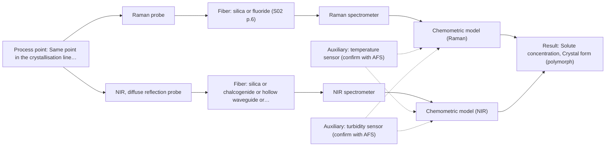
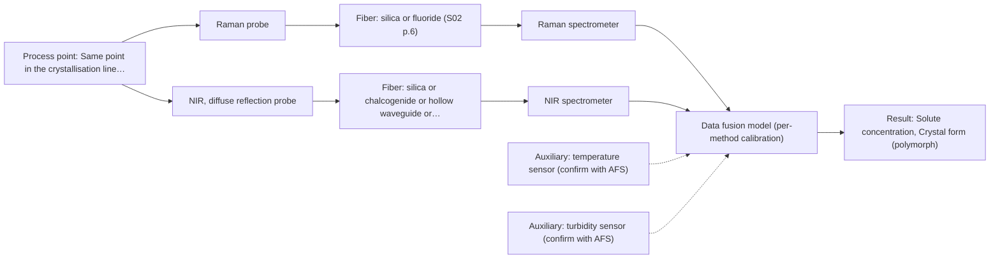

# First technical assessment: Fusing Raman and NIR in a crystallisation line

## Answer

**Customer request (our summary):** The customer wants to know how to set up a combined Raman and NIR probe at the same point in a continuous crystallisation line and whether fusing their data streams is worthwhile.

### Brief answer

Test Raman first as the single method - it suits aqueous crystallisation and is strong for crystal form - alongside an NIR probe at the same point, choosing NIR diffuse reflection or transmission based on your slurry's turbidity. Build single-method models before any fusion. Fusing Raman and NIR has published precedent with reported accuracy gains, but that gain is a hypothesis here: keep it only if the fused model beats the best single method on held-out batches. We still need your slurry's optical properties, concentration ranges and available reference methods.

### Proposal

- **Best current option:** O2 (recommended)
- **Basis:** supplied AFS sources
- **What would change it:** If the slurry proves transparent enough for NIR transmission, or if Raman alone meets the customer's accuracy criteria for both targets, the simpler options O1 or a transmission-based variant take over; if Raman or NIR alone fails on one target, O3 becomes the path.
- **Next step:** Run the multi-method lab trial on representative slurry samples with independent references, building the Raman and NIR single-method models first and only then testing the fused model against them.

**Secondary evidence (external, not AFS material):** G1: no usable external source found; G2: no usable external source found; G3: no usable external source found; G4: no usable external source found. See Expert detail.

**Decision status:** Provisional feasibility assessment

### Solution options

| ID | Tier | Methods | Confidence | Cost class, S01 Table 1 (p.6) | Ease of use | Maintenance | Performance fit | Sources |
|---|---|---|---|---|---|---|---|---|
| O1 | Simple | M1 Raman probe | Low: open question: Q2, Q3 (starts at Medium); uncited auxiliary sensor | high cost (row 12) | Single probe, single spectrometer, straightforward installation | One probe window to keep clean | Raman alone may cover crystal form and concentration in aqueous slurry | [1: S01 p.16] [2: S01 p.11] |
| O2 | Recommended | M1 Raman probe; M2 NIR, diffuse reflection probe | Low: open question: Q1, Q2, Q3 (starts at Medium); sample clarity unknown; uncited auxiliary sensor | high cost (rows 8, 12) | Two probes at one point, moderate integration effort | Two probe windows and two instruments to maintain | Tests both methods on the real slurry before committing to fusion | [3: S01 p.3] [1: S01 p.16] [2: S01 p.11] [4: S01 p.17] [5: S01 p.5] [6: S01 p.18] |
| O3 | Extended (multi-method) | M3 Raman probe + NIR (combination) | Low: open question: Q2, Q3 (starts at Medium); sample clarity unknown; uncited auxiliary sensor; multi-method, fusion benefit not yet shown | high cost (rows 8, 12) | Most complex: two instruments plus fusion software | Each block needs its own calibration and drift diagnostics | Fits only if fusion demonstrably beats the best single method | [7: S01 p.15] [8: S01 p.8] [9: S01 p.9] [10: S01 p.15] [11: S01 p.8] |

*Confidence rates the basis of the advice (how much is known and cited), not a predicted accuracy or probability of success. It starts at High, or at Medium when a key question on the method or the option is open, and drops one level per weakness listed (floor Low).*

*Cost class is the relative rating in S01 Table 1 (p.6) for the in-line method+technique rows named (the highest one for a multi-method option); it is not a price.*

### Setup sketch

*Recommended option O2; drawn by code from the option, a schematic, not a configuration.*

### Key questions

1. What are the slurry's optical properties at the measurement point - solids content, crystal size and turbidity - and does the medium stay transparent enough for a transmission path?
2. Which independent reference methods can you provide for solute concentration (e.g. HPLC, gravimetry) and crystal form (e.g. XRPD, off-line Raman), and how many representative samples or batches?
3. Which solute and concentration range must be tracked, and is any component at trace level?

## Expert detail

**Customer enquiry**

> We run a continuous crystallisation and want to combine a Raman probe and an NIR probe at the same point in the line, fusing both data streams into one model for solute concentration and crystal form. How should we set this up, and is fusing the two worth the effort?

**Decision status:** Provisional feasibility assessment. Raman and NIR are both plausible in-line methods for crystallisation monitoring and their combination has published precedent, but the sample's optical regime, the reference methods and the actual fusion benefit are open, so the assessment is conditional on the answers below.

### Parameters

| ID | Parameter | Kind | Need | Measured by | Why | Sources |
|---|---|---|---|---|---|---|
| P1 | Solute concentration | quantitative | required | Spectroscopy: Raman | It is one of the two stated targets and defines the calibration range the models must cover. | *(no verified source: engineering judgement)* |
| P2 | Crystal form (polymorph) | qualitative | required | Spectroscopy: Raman | It is the second stated target and drives the choice of Raman as the primary method. | *(no verified source: engineering judgement)* |
| P3 | Process temperature | quantitative | required | Auxiliary sensor: temperature sensor (engineering judgement: confirm availability with AFS) | Temperature shifts solubility and spectral band positions, so it must be recorded to separate composition effects from thermal effects. | *(no verified source: engineering judgement)* |
| P4 | Slurry turbidity / solids content | quantitative | optional | Auxiliary sensor: turbidity sensor (engineering judgement: confirm availability with AFS) | It should be available because it decides the NIR geometry and explains scatter-driven spectral variation; it should be logged alongside the spectra. | *(no verified source: engineering judgement)* |

### Solution option details

- **O1 cost drivers:** One Raman spectrometer and probe, calibration samples and reference analyses
- **O2 cost drivers:** Two spectrometers and probes, doubled calibration and reference workload
- **O3 cost drivers:** Second instrument, synchronisation and data-fusion software, larger reference dataset
- **O3 combining methods:** Low-level fusion: synchronised Raman and NIR spectra merged into one augmented matrix, as in the published feed-frame example. Both probes must sample the same slurry volume at one port, or a combined multispectral probe should be considered; data must be normalised to a common time step and block-scaled so neither method dominates. Each instrument keeps its own calibration, and the fused model must beat the best single-method model on held-out batches or the extra instrument is dropped.

*Extended (multi-method) option O3; drawn by code from the option, a schematic, not a configuration.*

### Premise check

- **Precedent only:** A Raman and an NIR probe can be combined at the same point in the line and fused into one model. A published pharmaceutical example runs NIR reflection and Raman probes in the same process point (tablet press feed frame) and fuses the spectra; this is a reason to test, not proof for this crystallisation line. [12: S01 p.15] [13: S01 p.8]
- **Precedent only:** Fusing the two data streams is worth the effort. The published example reports higher accuracy and robustness from fused NIR+Raman models than from single-method models, but any gain here is a hypothesis that must be shown against the best single method on this process. [10: S01 p.15]

### Requirements

**Stated by the customer**

- Continuous crystallisation process, in-line measurement at one point in the line.
- Targets: solute concentration and crystal form.
- Customer proposes a Raman probe plus an NIR probe at the same point, with fused data into one model.

**Key unknowns**

- Slurry optical regime: solids content, turbidity and whether NIR transmission is feasible or diffuse reflection is needed
- Target solute identity and concentration range, including whether any component is at trace level
- Independent reference methods for concentration and crystal form available for calibration and validation
- Installation constraints: probe-to-spectrometer distance, window fouling, process temperature
- Raman laser excitation wavelength and expected fluorescence background of the slurry

### Clarification questions (most decision-relevant first)

Q1. What are the slurry's optical properties at the measurement point - solids content, crystal size and turbidity - and does the medium stay transparent enough for a transmission path? *Why it matters:* It decides between NIR transmission/transflection and NIR diffuse reflection, since transmission fails when light cannot penetrate the sample. *(affects: technique, M2)*
Q2. Which independent reference methods can you provide for solute concentration (e.g. HPLC, gravimetry) and crystal form (e.g. XRPD, off-line Raman), and how many representative samples or batches? *Why it matters:* Calibration and the go/no-go comparison of fused versus single-method models depend entirely on reference data. *(affects: status, M1, M2, M3)*
Q3. Which solute and concentration range must be tracked, and is any component at trace level? *Why it matters:* NIR may lack sensitivity for trace components, which would shift the load onto Raman or change the method choice. *(affects: method, M2)*
Q4. What are the installation constraints: distance from probe to spectrometers, risk of window fouling by crystals, and process temperature? *Why it matters:* Fiber families and achievable link lengths differ per method, and fouling or temperature shifts directly affect probe design and model validity. *(affects: installation)*
Q5. Which Raman excitation wavelength is planned, and does the slurry or solute fluoresce? *Why it matters:* Raman signals are weak and can be swamped by fluorescence, so the excitation choice and background must be checked on real samples. *(affects: technique, M1)*

### Recommendation

- **M1 · Primary candidate: Raman probe.** Raman probes pass screening and suit aqueous crystallisation media, with molecular specificity well suited to distinguishing crystal forms. Its weak signal and possible fluorescence background must be checked on real slurry samples. *Conditions:* Excitation wavelength and fluorescence background confirmed on representative slurry (Q5). [1: S01 p.16] [2: S01 p.11]
- **M2 · Comparison candidate: NIR, diffuse reflection probe.** A crystallisation slurry scatters light, so NIR diffuse reflection is the geometry to test first; it suits opaque or highly concentrated samples and reaches several millimetres. Transmission/transflection stays open only if the medium is clear enough. *Conditions:* Tested against the slurry's actual turbidity and solids content (Q1); transmission/transflection is the alternative if the liquor is transparent. [4: S01 p.17] [5: S01 p.5] [6: S01 p.18]
- **M3 · Conditional candidate: Raman probe + NIR (combination).** Fused Raman+NIR models are the customer's proposal and have published precedent with reported accuracy gains over single-method models, but the gain is a hypothesis. It should be built only after the single-method models and compared against the best of them on held-out batches. *Conditions:* Only pursued if the single Raman and NIR models each leave part of the target (concentration or crystal form) unresolved and the fused model demonstrably beats the best single method. [10: S01 p.15] [11: S01 p.8]

### Measurement concept

- **Probe and geometry:** Raman immersion probe plus an NIR probe at the same line location; NIR geometry (diffuse reflection vs transmission/transflection) decided by slurry turbidity. If the fusion hypothesis proceeds, either two synchronised probes at one port or a combined multispectral probe should be considered.
- **Location:** Same point in the crystallisation line, chosen to be representative of the slurry and accessible for cleaning.
- **Fiber link:** Silica fibers serve both Raman and NIR; metal-coated, low-OH silica cables avoid polymer-jacket fluorescence and are stated for long remote runs, but the actual achievable length depends on the selected configuration. [14: S02 p.7] [15: S01 p.8]

### Spectral range

- **Raman:** Raman shift in cm-1, with the laser excitation wavelength (e.g. 785 nm in the published pharma example) stated separately; the usable range depends on the selected spectrometer, laser and probe. [16: S01 p.11] [17: S01 p.15]
- **NIR:** Nominal NIR range 780-2500 nm; the usable range depends on the instrument, fiber and probe actually selected. [18: S01 p.10]

### Risks and uncertainty

- If the slurry is too turbid or the crystals too large, NIR transmission fails and even reflection may see mostly surface, biasing both concentration and form. *(rules: R-GEO-2, R-GEO-6)* [19: S01 p.17]
- Fluorescence background or weak Raman signal in the real slurry could make the Raman channel unusable at the planned excitation wavelength. *(rules: R-RAM-1)* [20: S01 p.11]
- The published fusion gain is from a pharmaceutical powder feed frame, not a crystallisation slurry, so the benefit here is unproven and may not justify a second instrument. *(rules: R-EVI-2, R-CMB-1)* [10: S01 p.15]
- Calibrations are matrix-specific, so changes in solute formulation, seed policy or crystal size distribution can invalidate the models and require re-validation. *(rules: R-CAL-1)* [21: REF §5]

### First feasibility experiment

1. **Collect representative slurry samples across the expected variation: solute concentration range, both (or all) relevant crystal forms, temperature range and solids-content range.** Cover the chemical and physical variation the models must handle. *(no verified source: engineering judgement)*
2. **Measure independent references for each sample: a lab method for solute concentration and a lab method for crystal form (e.g. XRPD or off-line Raman, per customer's available methods).** Provide the calibration and validation targets. *(no verified source: engineering judgement)*
3. **Build single-method models first: one Raman model and one NIR model on the same samples, with the NIR geometry chosen from the slurry's optical regime.** Establish the baseline each method achieves alone before any fusion. *(no verified source: engineering judgement)*
4. **Only then build the fused Raman+NIR model (synchronised acquisition, block-scaled or concatenated data) and validate it on held-out runs or batches against the best single-method model.** Test the fusion hypothesis fairly and detect overfitting. [22: S01 p.8]
5. **Apply the customer's go/no-go criteria (e.g. required concentration accuracy and crystal-form classification rate, agreed with the customer in advance) to decide whether the fused system is worth installing.** Make the decision objective and owned by the customer. *(no verified source: engineering judgement)*

**Reference measurements:** Independent lab reference methods for concentration and crystal form, supplied or confirmed by the customer (Q2).

**Decision basis:** Customer-defined numerical criteria for prediction accuracy and classification performance on held-out batches.

### Assumptions

- The stream at the measurement point is a crystallisation slurry (solids suspended in mother liquor), so scattering dominates the optical regime.
- Both targets (solute concentration and crystal form) must be measured at the same point; if one target can move to another location, the setup simplifies.

### Not covered by the supplied sources

- Achievable fiber link length for this specific installation (long cables are stated only for low-OH silica fibers; mid-IR fiber examples in the sources are short laboratory lengths).
- Any demonstrated Raman+NIR fused application in crystallisation specifically; the published precedent is a tablet press feed frame.

### Further notes

- **Chemometrics:** Both single-method and fused models need reference data across the full concentration and polymorph range; NIR and Raman calibrations are matrix-specific and must be re-validated after any change in formulation or crystal size distribution. Validation should include held-out batches, and for the fused model a comparison against the best single-method model is the decisive test.
- **Real-time tracking:** Continuous crystallisation requires acquisition fast enough relative to the process dynamics; acquisition rates of different methods can vary greatly and must be normalised to a common time step if fused.
- **Future direction:** If the fused Raman+NIR system proves itself, a later step could be a compact customised multispectral sensor or IoT-style fiber sensor dedicated to this crystallisation control task.

### Secondary evidence (external, not AFS material)

*Found by a literature search for gaps the supplied AFS sources leave open. Not AFS material and not proof for this case; every quote below was verified verbatim against the fetched text.*

**G1 · auxiliary sensor:** In-line measurement of Process temperature with temperature sensor

- No usable external source found.

**G2 · auxiliary sensor:** In-line measurement of Slurry turbidity / solids content with turbidity sensor

- No usable external source found.

**G3 · multi-method:** Combining several spectroscopy methods (data fusion) (Low-level fusion: synchronised Raman and NIR spectra merged into one augmented matrix, as in the published feed-frame example. Both probes must sample the same slurry volume at one port, or a combined multispectral probe should be considered; data must be normalised to a common time step and block-scaled so neither method dominates. Each instrument keeps its own calibration, and the fused model must beat the best single-method model on held-out batches or the extra instrument is dropped.)

- No usable external source found.

**G4 · not in the supplied sources:** Achievable fiber link length for this specific installation (long cables are stated only for low-OH silica fibers; mid-IR fiber examples in the sources are short laboratory lengths).

- No usable external source found.

### Evidence (verified quotes)

1. ✓ **S01 p.16** (general): "Raman is particularly well-suited for aqueous environments, as it exhibits low absorbance for water molecules compared to infrared methods."
2. ✓ **S01 p.11** (general): "superposition of luminescence (fluorescence), which has a significantly higher intensity."
3. ✓ **S01 p.3** (general): "The ability to test various optical spectroscopy approaches is crucial for solving complex analytical problems"
4. ✓ **S01 p.17** (general): "NIR Reflection is primarily used for opaque or highly concentrated dairy products, such as yogurt, butter, or whole milk concentrates."
5. ✓ **S01 p.5** (general): "NIR spectroscopy, with its relatively large penetration depth (up to several millimetres) even into dense solid samples due to low absorption and strong scattering, allows the use of ordinary glass for optics"
6. ✓ **S01 p.18** (general): "it fails when the milk becomes too "thick" or fat-rich, as the light cannot penetrate the sample."
7. ✓ **S01 p.15** (application precedent): "Data processing for pharmaceutical tasks relies on "low-level data fusion," where the synchronized NIR and Raman spectra are merged into a single augmented matrix."
8. ✓ **S01 p.8** (general): "two or more probes, belonging to different methods, can be used for measurements, but the data from each method must be obtained simultaneously."
9. ✓ **S01 p.9** (general): "One of the challenges of multispectral analysis is the need to simultaneously connect at least two independently operating measuring instruments."
10. ✓ (precedent only) **S01 p.15** (method gain): "By combining Raman and NIR, these models can predict API potency or coating thickness with higher accuracy and robustness than single-method models."
11. ✓ **S01 p.8** (general): "Ultimately, the measurement data must be normalized to a common time step."
12. ✓ **S01 p.15** (application precedent): "The combination of these techniques is particularly effective because it captures complementary chemical information"
13. ✓ **S01 p.8** (general): "It is crucial that the spectral information obtained by different methods-Mid-IR, NIR, Raman, and fluorescence spectra-is collected from the same small, even pinpoint, area of the sample."
14. ✓ **S02 p.7** (general): "Free of Polymer jacket fluorescence for Raman and Fluo- Spectroscopy"
15. ✓ **S01 p.8** (general): "The use of a combined probe facilitates measurements and allows for the analysis of a smaller sample volume."
16. ✓ **S01 p.11** (general): "The Raman shift is used as the horizontal (spectral) axis in Raman spectroscopy"
17. ✓ **S01 p.15** (application precedent): "Raman spectrometer and Raman fiber probe for contact measurements with 785 nm excitation wavelength"
18. ✓ **S01 p.10** (general): "NIR spectra (780-2500 nm) contain predominantly overtones and component bands of fundamental vibrations"
19. ✓ **S01 p.17** (general): "the method is sensitive to the surface characteristics and fat globule size."
20. ✓ **S01 p.11** (general): "signals, which are several orders of magnitude weaker than IR absorption peaks"
21. ✓ **REF §5** (general): "calibration specific to the matrix."
22. ✓ **S01 p.8** (general): "If the variables have different units of measurement, the data should be normalized in some way, for example, using an autoscaling algorithm."

### Verification

- Citations verified: 25 of 25 (exact or whitespace/hyphen-tolerant match on the cited page, scope checked).
- Hard check failures before deterministic corrections: 0; still open: 0; soft warnings: 4; repair rounds: 1.
- External evidence (live): 0 quote(s) verified verbatim (exact or whitespace/hyphen-tolerant, at most 400 characters and 2 sentences, against the cited paragraph); 1 item(s) dropped.
- External search: 2 query(ies), 20 hit(s), 5 source(s) (3 from the curated library).
- External step: 2 model call(s), 7.1 s extra (cost in the run JSON).
  - ⚠ dropped G3 E05 ¶29: quote not verified (too_long: quote longer than 400 characters (490))

*Run A11-20261018T094926Z-aa04 · models google/gemini-3.5-flash-lite, google/gemini-3.8-flash, z-ai/glm-5.3-flash*
