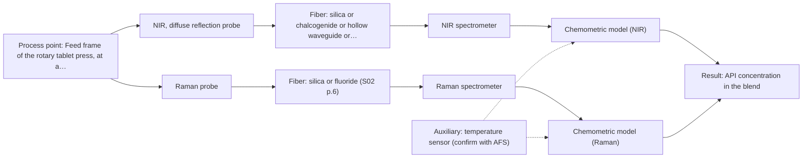
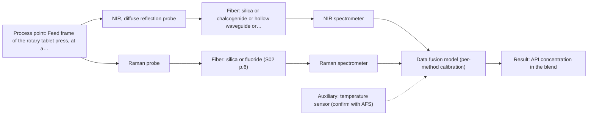

# First technical assessment: Blend potency in a tablet press feed frame

## Answer

**Customer request (our summary):** Customer manufactures tablets from a powder blend containing an API and excipients. They currently rely on laboratory checks after the press and want to assess whether a fiber based measurement in the feed frame could follow API concentration changes. Their first pilot should compare reasonable measurement options before committing to production equipment.

### Brief answer

Sources show NIR and Raman fiber probes used in a rotary tablet press feed frame to predict API potency; these are the methods to test first. Start with laboratory trials on representative blend samples and an independent reference assay, comparing each single method. Still open: the API, its concentration range and required accuracy, response time, and whether a probe fits your feed frame.

### Proposal

- **Best current option:** O2 (recommended)
- **Basis:** supplied AFS sources
- **What would change it:** If the API sits below NIR sensitivity or the excipients fluoresce strongly, Raman would lead or another technique would be needed; if no probe can be mounted or kept clean at the feed frame, the installation concept changes.
- **Next step:** Run the laboratory trial on representative blend samples with an independent reference assay, comparing NIR and Raman as single methods before any combined model.

**Secondary evidence (external, not AFS material):** G1: E01 ¶12, E03 ¶19; G2: E02 ¶31, E02 ¶82. See Expert detail.

**Decision status:** Provisional feasibility assessment

### Solution options

| ID | Tier | Methods | Confidence | Cost class, S01 Table 1 (p.6) | Ease of use | Maintenance | Performance fit | Sources |
|---|---|---|---|---|---|---|---|---|
| O1 | Simple | M1 NIR, diffuse reflection probe | Medium: open question: Q1 (starts at Medium) | average cost (row 8) | one probe, one spectrometer, simplest | one calibration to maintain | answers whether NIR alone follows API | [1: S01 p.15] [2: S01 p.5] [3: S01 p.15] |
| O2 | Recommended | M1 NIR, diffuse reflection probe; M2 Raman probe | Medium: open question: Q1 (starts at Medium) | high cost (rows 8, 12) | two probes, two spectrometers, more setup | two calibrations, two instruments | compares both single methods in one pilot | [1: S01 p.15] [2: S01 p.5] [3: S01 p.15] [4: S01 p.15] [5: S01 p.15] |
| O3 | Extended (multi-method) | M1 NIR, diffuse reflection probe; M2 Raman probe; M3 NIR, diffuse reflection probe + Raman (combination) | Low: open question: Q1 (starts at Medium); multi-method, fusion benefit not yet shown | high cost (rows 8, 12) | two instruments plus fusion, most setup | two calibrations plus a fused model | fuller answer if single methods fall short | [6: S01 p.8] [7: S01 p.9] [1: S01 p.15] [2: S01 p.5] [3: S01 p.15] [4: S01 p.15] [5: S01 p.15] [8: S01 p.15] [9: S01 p.8] |

*Confidence rates the basis of the advice (how much is known and cited), not a predicted accuracy or probability of success. It starts at High, or at Medium when a key question on the method or the option is open, and drops one level per weakness listed (floor Low).*

*Cost class is the relative rating in S01 Table 1 (p.6) for the in-line method+technique rows named (the highest one for a multi-method option); it is not a price.*

### Setup sketch

*Recommended option O2; drawn by code from the option, a schematic, not a configuration.*

### Key questions

1. What is the API, its concentration range in the blend, and the accuracy you need for following changes?
2. What are the conditions at the feed frame (temperature, humidity, dust, powder flow) and where could a probe be mounted?
3. Which reference method will define the API concentration for the pilot, and what is its uncertainty?

## Expert detail

**Customer enquiry**

> We manufacture tablets from a powder blend containing an active pharmaceutical ingredient and excipients. Laboratory checks tell us whether the blend is on target, but results arrive after the material has moved through the press. We want to assess whether a fiber based measurement in the feed frame could follow API concentration changes. Our first pilot should compare reasonable measurement options before we commit to production equipment.

**Decision status:** Provisional feasibility assessment. A shortlist can be justified from a published feed-frame example using NIR and Raman fiber probes to predict API potency, so a pilot is defensible. The API identity, concentration range, accuracy target and feed-frame conditions are still open, so the assessment stays provisional.

### Parameters

| ID | Parameter | Kind | Need | Measured by | Why | Sources |
|---|---|---|---|---|---|---|
| P1 | API concentration in the blend | quantitative | required | Spectroscopy: NIR | This is the target the pilot has to follow. | [10: S01 p.14] |
| P2 | Reference API concentration from the laboratory assay | quantitative | required | Reference lab method: the customer's existing laboratory blend assay | An independent reference is needed to build and validate any calibration. | [11: REF §3] |
| P3 | Blend temperature at the probe | quantitative | optional | Auxiliary sensor: temperature sensor (engineering judgement: confirm availability with AFS) | Temperature shifts band positions and intensities, so a record of it helps interpret the model; it should be available from the press environment. | *(no verified source: engineering judgement)* |

### Solution option details

- **O1 cost drivers:** one spectrometer, probe and calibration effort
- **O2 cost drivers:** two spectrometers, probes and calibrations
- **O3 cost drivers:** two instruments, combined probe and fusion work
- **O3 combining methods:** Low-level fusion of synchronised NIR and Raman spectra taken from the same probe location, with one model per method and a fused model. Each block is calibrated and diagnosed separately, and the fused model must beat the best single method on held-out runs. A combined probe would keep both methods on the same spot, which alternating probes cannot ensure.

*Extended (multi-method) option O3; drawn by code from the option, a schematic, not a configuration.*

### Premise check

- **Precedent only:** A fiber based measurement in the feed frame could follow API concentration changes. A published example does this for a rotary tablet press, which is a reason to test the approach, not proof it will work on this blend. [3: S01 p.15]
- **Supported:** A first pilot comparing reasonable measurement options is the right next step before committing to production equipment. The sources describe selecting a method or combination of methods from laboratory trials on samples of incompletely known composition. [12: S01 p.3]

### Requirements

**Stated by the customer**

- "We manufacture tablets from a powder blend"
- "containing an active pharmaceutical ingredient and excipients"
- "We want to assess whether a fiber based measurement in the feed frame could follow API concentration changes"
- *Further statements: see the customer enquiry above.*

**Key unknowns**

- identity of the active pharmaceutical ingredient and its concentration range in the blend
- required accuracy and response time for following API concentration changes
- excipient composition and any fluorescence or spectral interference
- feed frame conditions (temperature, humidity, dust, powder flow) and probe access
- reference laboratory assay and its uncertainty
- tendency of the blend to stick to or coat a probe window

### Clarification questions (most decision-relevant first)

Q1. What is the API, its concentration range in the blend, and the accuracy you need for following changes? *Why it matters:* This decides whether NIR sensitivity is sufficient or whether another method must lead. *(affects: method)*
Q2. What are the conditions at the feed frame (temperature, humidity, dust, powder flow) and where could a probe be mounted? *Why it matters:* Probe geometry and installation decide whether a reflection probe can be used in-line at all. *(affects: installation)*
Q3. Which reference method will define the API concentration for the pilot, and what is its uncertainty? *Why it matters:* Without an independent reference the calibration and the go/no-go decision cannot be made. *(affects: status)*
Q4. How fast must the measurement follow concentration changes (seconds, minutes)? *Why it matters:* Acquisition speed and averaging decide the technique and the probe arrangement. *(affects: technique)*
Q5. Do the API or the excipients fluoresce, and does the blend tend to stick to surfaces? *Why it matters:* Strong fluorescence or fouling would weaken a Raman option and change probe choice. *(affects: M2)*

### Recommendation

- **M1 · Primary candidate: NIR, diffuse reflection probe.** NIR is one of the two most widely implemented in-line techniques for this kind of task and works with remote fiber probes. A published example inserts NIR probes into a tablet-press feed frame to predict API potency. *Conditions:* Requires a chemometric calibration built on this blend and a workable probe position in the feed frame. [1: S01 p.15] [2: S01 p.5] [3: S01 p.15]
- **M2 · Comparison candidate: Raman probe.** Raman gives complementary molecular-backbone information and is used with a contact probe in the same feed-frame example. It is a single-method alternative worth measuring against NIR. *Conditions:* Applies if the blend gives a usable Raman signal without strong fluorescence background. [4: S01 p.15] [5: S01 p.15]
- **M3 · Conditional candidate: NIR, diffuse reflection probe + Raman (combination).** In the feed-frame example, synchronised NIR and Raman spectra were merged and the fused model predicted API potency better than single-method models. That gain is a hypothesis for this blend and must be tested against the best single method. *Conditions:* Only if the best single method does not meet the accuracy agreed with you. [8: S01 p.15] [9: S01 p.8] Later hypothesis, after single-method tests.
- **M4 · Not recommended: MIR, ATR probe.** ATR probes are used in-line elsewhere, so a reader may expect them here, but ATR needs tight contact with liquid or soft solid samples. A dry powder blend cannot provide that contact. [13: S04 p.4]

### Measurement concept

- **Probe and geometry:** NIR diffuse-reflection fiber probe; a Raman contact probe as the comparison; both look at the powder in the feed frame.
- **Location:** Feed frame of the rotary tablet press, at a point where the blend passes the probe window.
- **Fiber link:** NIR can use standard silica Vis-NIR fibers; the Raman link needs fibers that avoid polymer-jacket fluorescence. Achievable lengths are not stated in the sources. [14: S02 p.7]

### Spectral range

- **NIR:** Nominal NIR range 780-2500 nm; the usable range depends on the instrument, fiber and probe actually selected. [15: S01 p.10]
- **Raman:** Raman is reported as a Raman shift in cm-1, with the laser excitation wavelength stated separately; the feed-frame example uses 785 nm excitation. [16: S01 p.11] [5: S01 p.15]

### Risks and uncertainty

- NIR may be too insensitive if the API sits at a low level in the blend. *(rules: R-NIR-4)* [17: S01 p.16]
- Fluorescence from the API or excipients can swamp the weak Raman signal. *(rules: R-RAM-1)* [18: S01 p.11]
- Powder flow and turbulence in the feed frame can make the sampled spot unrepresentative of the blend. *(rules: R-GEN-5)* [19: S01 p.7]
- The calibration is matrix-specific and would need rebuilding if the formulation or excipient mix changes. *(rules: R-CAL-1)* [20: REF §5]

### First feasibility experiment

1. **Collect representative blend samples across the expected API concentration range and across the process states the feed frame actually shows.** Cover the chemical and physical variation the model must handle. [11: REF §3]
2. **Measure the samples with NIR diffuse reflection and, separately, with Raman as single methods.** Compare the single methods first, before any combination. [12: S01 p.3]
3. **Measure the API concentration independently with the reference laboratory assay for every sample.** Independent reference data are needed to build and validate the calibration. [11: REF §3]
4. **Build and validate one model per method, then test whether a fused NIR + Raman model beats the best single method on held-out runs or batches.** A fusion gain is a hypothesis and must be shown, not assumed. [21: REF §5]
5. **Set the go/no-go basis with you, using your own numerical criteria for accuracy, detection limit and response time.** The acceptance figures must come from your process, not from the sources. *(no verified source: engineering judgement)*

**Reference measurements:** The customer's existing laboratory blend assay, run on the same samples used for the fiber measurements.

**Decision basis:** Agreed numerical targets for API concentration accuracy and response time, applied to held-out samples.

### Assumptions

- The blend behaves optically as an opaque, scattering powder.
- A probe can be mounted where the powder passes it in the feed frame.
- The existing laboratory assay can serve as the independent reference.

### Further notes

- **Chemometrics:** NIR and Raman bands overlap, so calibration models are needed. In the feed-frame example, low-level data fusion merges synchronised NIR and Raman spectra into one matrix and Partial Least Squares regression predicts API potency; the model needs your own reference data and should be validated on held-out runs or batches.
- **Real-time tracking:** The aim is in-line, time-resolved tracking of API concentration in the feed frame, replacing laboratory checks that arrive after the press. The required time step and averaging must be agreed, because the methods can acquire at very different rates.
- **Future direction:** If the pilot succeeds, a compact optical multisensor or IoT-style spectral sensor dedicated to this blend could be developed for production, as the sources describe for later stages of method development.

### Secondary evidence (external, not AFS material)

*Found by a literature search for gaps the supplied AFS sources leave open. Not AFS material and not proof for this case; every quote below was verified verbatim against the fetched text.*

*Live search unavailable (library only: cache miss (europepmc); cache miss (openalex)); curated library only.*

**G1 · auxiliary sensor:** In-line measurement of Blend temperature at the probe with temperature sensor

- **E01 ¶12** The source states that temperature sensitivity of OH bands is a severe drawback for measuring aqueous solution in NIR and MIR, making tempered sample holders necessary. *How it applies:* For the feed frame, this suggests that if NIR or MIR is used, temperature at the probe may affect spectra, so measuring or controlling blend temperature could be considered; test whether temperature variation changes API predictions. *Limits and transfer risks:* The quote concerns aqueous solutions and NIR/MIR, not a powder blend in a tablet feed frame; transfer to in-line NIR or Raman on powder is uncertain. *(supports O2)*
  > "Additionally, the temperature sensitivity of the OH bands is a severe drawback for measuring aqueous solution in NIR and MIR, which makes tempered sample holders necessary [29]."
  > A critical review of recent trends, and a future perspective of optical spectroscopy as PAT in biopharmaceutical downstream processing. (2020) · Analytical and bioanalytical chemistry · doi:10.1007/s00216-020-02407-z · https://europepmc.org/article/PMC/PMC7072065 · retrieved 2026-10-17, full text, licence: cc by, via curated library
- **E03 ¶19** The source reports that concentrations, ionic strength and temperature were varied to obtain a robust model. *How it applies:* This could inform including temperature as a recorded variable during calibration and monitoring it at the probe, to see whether it helps model robustness. *Limits and transfer risks:* The study is on reactive liquid-liquid extraction in lithium recycling, not tablet powder blending; laboratory variation of temperature may not reflect in-line feed-frame conditions. *(supports O2)*
  > "The concentrations of nitric acid and hydrochloric acid as well as the ionic strength and temperature were varied to obtain a robust model."
  > Process Analytical Technology-Integrated FT-IR and Raman Spectroscopies for Efficient Reactive Liquid-Liquid Extraction Processing in Lithium Recycling. (2025) · ACS omega · doi:10.1021/acsomega.5c05705 · https://europepmc.org/article/PMC/PMC12573149 · retrieved 2026-10-17, full text, licence: cc by, via curated library

**G2 · multi-method:** Combining several spectroscopy methods (data fusion) (Low-level fusion of synchronised NIR and Raman spectra taken from the same probe location, with one model per method and a fused model. Each block is calibrated and diagnosed separately, and the fused model must beat the best single method on held-out runs. A combined probe would keep both methods on the same spot, which alternating probes cannot ensure.)

- **E02 ¶31** The source describes low-level data fusion as the simplest way to combine inputs by rearranging variables from different sources into a new data matrix one after the other. *How it applies:* For O3, this describes how low-level fusion would arrange synchronised NIR and Raman variables into one matrix; test whether the fused model beats the best single method on held-out runs. *Limits and transfer risks:* This is a general review of data fusion, not a tablet blend or same-probe NIR/Raman setup; synchronisation and scale effects are not addressed. *(supports O3)*
  > "Low-level data fusion (LLDF) is considered the simplest method to achieve a combination of inputs. In this case, the data is rearranged into a new data matrix, where the variables coming from different sources are placed one after the other."
  > Challenges and Opportunities of Implementing Data Fusion in Process Analytical Technology-A Review. (2022) · Molecules (Basel, Switzerland) · doi:10.3390/molecules27154846 · https://europepmc.org/article/PMC/PMC9369811 · retrieved 2026-10-17, full text, licence: cc by, via curated library
- **E02 ¶82** The source states that before fusing data from multiple sources, it is essential to evaluate each dataset's contribution to the model and its complementarity. *How it applies:* For O3, this supports calibrating and diagnosing each block separately and checking complementarity before accepting a fused model. *Limits and transfer risks:* The recommendation is general; it does not show that NIR and Raman from the same probe will be complementary or that a fused model will beat the best single method on held-out runs. *(supports O3)*
  > "Before fusing data from multiple sources, it is essential to evaluate the contribution of each dataset to the model and its complementarity."
  > Challenges and Opportunities of Implementing Data Fusion in Process Analytical Technology-A Review. (2022) · Molecules (Basel, Switzerland) · doi:10.3390/molecules27154846 · https://europepmc.org/article/PMC/PMC9369811 · retrieved 2026-10-17, full text, licence: cc by, via curated library

### Evidence (verified quotes)

1. ✓ **S01 p.15** (application precedent): "and widely implemented spectral techniques are Near-Infrared (NIR) and Raman spectroscopy."
2. ✓ **S01 p.5** (general): "making it ideal for online applications, including remote measurements via fiber optic probes."
3. ✓ **S01 p.15** (application precedent): "During the experimental action, the probes are inserted directly into the process environment, such as the feed frame of a rotary tablet press."
4. ✓ **S01 p.15** (general): "Raman provides information on the molecular backbone and symmetrical non-polar groups."
5. ✓ **S01 p.15** (application precedent): "Raman spectrometer and Raman fiber probe for contact measurements with 785 nm excitation wavelength"
6. ✓ **S01 p.8** (general): "Ultimately, the measurement data must be normalized to a common time step."
7. ✓ **S01 p.9** (general): "One of the challenges of multispectral analysis is the need to simultaneously connect at least two independently operating measuring instruments."
8. ✓ (precedent only) **S01 p.15** (method gain): "By combining Raman and NIR, these models can predict API potency or coating thickness with higher accuracy and robustness than single-method models."
9. ✓ **S01 p.8** (general): "collected from the same small, even pinpoint, area of the sample."
10. ✓ **S01 p.14** (application precedent): "the precise concentration and uniformity of the Active Pharmaceutical Ingredient (API)"
11. ✓ **REF §3** (general): "Representative samples or process states, independent reference measurements, what is compared, and the basis for the go / no-go decision."
12. ✓ **S01 p.3** (general): "samples of incompletely known composition, in order to select the most suitable method or combination of methods."
13. ✓ **S04 p.4** (general): "suitability of analyzed samples for ATR measurements, which is true for liquid or soft solid samples and their components, allowing a tight contact with the probe head."
14. ✓ **S02 p.7** (general): "Free of Polymer jacket fluorescence for Raman and Fluo- Spectroscopy"
15. ✓ **S01 p.10** (general): "NIR spectra (780-2500 nm) contain predominantly overtones and component bands of fundamental vibrations"
16. ✓ **S01 p.11** (general): "The Raman shift is used as the horizontal (spectral) axis in Raman spectroscopy"
17. ✓ **S01 p.16** (general): "may lack the sensitivity to detect trace compounds below 0.1 percent."
18. ✓ **S01 p.11** (general): "superposition of luminescence (fluorescence), which has a significantly higher intensity."
19. ✓ **S01 p.7** (general): "process turbulence, must also be considered when selecting a measurement technique."
20. ✓ **REF §5** (general): "calibration specific to the matrix."
21. ✓ **REF §5** (general): "compare with the best single method."

### Verification

- Citations verified: 27 of 27 (exact or whitespace/hyphen-tolerant match on the cited page, scope checked).
- Hard check failures before deterministic corrections: 0; still open: 0; soft warnings: 1; repair rounds: 1.
- Corrected deterministically after verification (1):
  - ⚠ recommendations[2].combined_with: combined_with normalised to ['Raman'] (duplicates and the entry's own method removed)
- External evidence (cache): 4 quote(s) verified verbatim (exact or whitespace/hyphen-tolerant, at most 400 characters and 2 sentences, against the cited paragraph); 0 item(s) dropped.
- External search: 5 query(ies), 0 hit(s), 3 source(s) (3 from the curated library); ⚠ library only: cache miss (europepmc); cache miss (openalex).
- External step: 2 model call(s), 53.9 s extra (cost in the run JSON).

*Run D01-20261018T080635Z-eba4 · models deepseek/deepseek-v4.1-flash*
