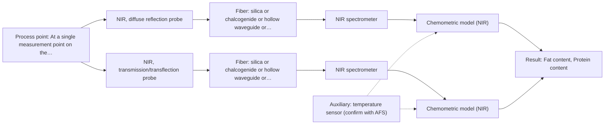
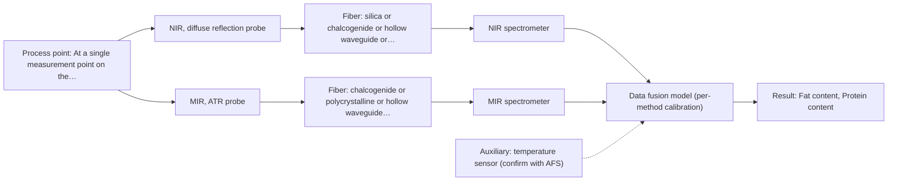

# First technical assessment: Fat and protein monitoring in opaque dairy product

## Answer

**Customer request (our summary):** Customer runs an opaque, concentrated milk product through a processing line, currently samples it off-line for fat and protein, and wants earlier (in-line) information about composition changes. They ask for an initial spectroscopy concept plus a practical comparison experiment, with laboratory checks retained.

### Brief answer

Start with NIR diffuse reflection, which is used for opaque or highly concentrated dairy products and has been used with PLS to quantify fat and protein; test MIR-ATR as a head-to-head comparator and, only if the product is thin enough at the point, a NIR transmission/transflection variant. Keep the laboratory fat and protein results as the reference. What is still open: the required accuracy and response time, and the product's state and temperature at the measurement point.

### Proposal

- **Best current option:** O2 (recommended)
- **Basis:** supplied AFS sources
- **What would change it:** The required accuracy and response time, and the product's state and temperature at the measurement point, decide whether NIR reflection alone (O1) is enough or whether the combined option (O3) has to be tested.
- **Next step:** Run the comparison experiment with NIR reflection first, against the retained laboratory fat and protein results, recording product state and temperature at each measurement.

**Secondary evidence (external, not AFS material):** G1: E01 ¶12; G2: E03 ¶16, E03 ¶19; G3: no usable external source found; G4: no usable external source found. See Expert detail.

**Decision status:** Provisional feasibility assessment

### Solution options

| ID | Tier | Methods | Confidence | Cost class, S01 Table 1 (p.6) | Ease of use | Maintenance | Performance fit | Sources |
|---|---|---|---|---|---|---|---|---|
| O1 | Simple | M1 NIR, diffuse reflection probe | Low: open question: Q1 (starts at Medium); uncited auxiliary sensor | average cost (row 8) | one probe, one spectrometer, simple interface | routine probe cleaning and recalibration | covers opaque states and the two stated targets | [1: S01 p.17] [2: S01 p.10] [3: S01 p.17] [4: S01 p.10] |
| O2 | Recommended | M1 NIR, diffuse reflection probe; M3 NIR, transmission/transflection probe | Low: open question: Q1 (starts at Medium); suitability for this sample not confirmed; uncited auxiliary sensor | average cost (rows 7, 8) | one spectrometer, two probe options | two probes to clean and verify | covers opaque and thinner process states with one NIR instrument | [5: S01 p.18] [6: S01 p.18] [1: S01 p.17] [3: S01 p.17] [4: S01 p.10] [7: S01 p.18] [8: S01 p.18] [9: S01 p.18] |
| O3 | Extended (multi-method) | M1 NIR, diffuse reflection probe; M2 MIR, ATR probe | Low: open question: Q1 (starts at Medium); uncited auxiliary sensor; multi-method, fusion benefit not yet shown | high cost (rows 2, 8) | two instruments and synchronised data | two calibrations and two probe checks | adds fundamental-band specificity if NIR alone falls short | [10: S01 p.7] [11: S01 p.7] [12: REF §5] [1: S01 p.17] [3: S01 p.17] [4: S01 p.10] [13: S01 p.9] [14: S01 p.5] [15: S04 p.4] |

*Confidence rates the basis of the advice (how much is known and cited), not a predicted accuracy or probability of success. It starts at High, or at Medium when a key question on the method or the option is open, and drops one level per weakness listed (floor Low).*

*Cost class is the relative rating in S01 Table 1 (p.6) for the in-line method+technique rows named (the highest one for a multi-method option); it is not a price.*

### Setup sketch

*Recommended option O2; drawn by code from the option, a schematic, not a configuration.*

### Key questions

1. What accuracy, measuring range and response time are required for fat and protein, and what size of composition change must be detected?
2. What is the product's state at the intended measurement point - how opaque and how consistent, and is entrained air or foam present - and how does it change during production?
3. Where can the measurement point be, can a probe or flow cell (or a bypass loop) be fitted there, and how far is the instrument from that point?

## Expert detail

**Customer enquiry**

> We produce an opaque, concentrated milk product that flows through a processing line. We currently sample it for fat and protein analysis and would like earlier information about composition changes. Product temperature and texture vary during production. We want an initial spectroscopy concept and a practical comparison experiment, while retaining our laboratory checks.

**Decision status:** Provisional feasibility assessment. NIR diffuse reflection has a published dairy precedent for opaque or highly concentrated products and for quantifying fat and protein, so a shortlist can be justified. The required accuracy, the response time and the product state at the measurement point are still open, so this remains a provisional assessment with stated assumptions.

### Parameters

| ID | Parameter | Kind | Need | Measured by | Why | Sources |
|---|---|---|---|---|---|---|
| P1 | Fat content | quantitative | required | Spectroscopy: NIR | Fat is one of the two composition variables the customer measures today and wants earlier information about. | [3: S01 p.17] |
| P2 | Protein content | quantitative | required | Spectroscopy: NIR | Protein is the second composition variable the customer measures today and wants earlier information about. | [3: S01 p.17] |
| P3 | Product temperature at the measurement point | quantitative | required | Auxiliary sensor: temperature sensor (engineering judgement: confirm availability with AFS) | Temperature varies during production and affects both the spectra and the interface, so it has to be recorded alongside the spectra. | *(no verified source: engineering judgement)* |
| P4 | Product consistency / optical state at the measurement point | qualitative | optional | Not measurable in-line by spectroscopy; alternative: off-line consistency or total-solids check at the process stage | The stated variation in texture changes how much light is scattered or transmitted, so it decides whether a reflection or a transmission/transflection geometry is representative; it should be available from the process records. | [16: S01 p.17] |

### Solution option details

- **O1 cost drivers:** one NIR spectrometer, one reflection probe, calibration runs
- **O2 cost drivers:** one NIR instrument, two probes, broader calibration set
- **O3 cost drivers:** two spectrometers, two probe lines, fusion modelling
- **O3 combining methods:** Fusion level: one calibration per method first, then the NIR and MIR blocks joined with block scaling or autoscaling so that neither block dominates the model. Both probes must look at the same small area of the product and the data must be aligned to a common time step. Each instrument keeps its own calibration and diagnostics, and the joined model must beat the best single method on independent runs or batches, otherwise the second instrument is dropped.

*Extended (multi-method) option O3; drawn by code from the option, a schematic, not a configuration.*

### Premise check

- **Precedent only:** In-line fiber-optic spectroscopy can give earlier fat and protein information for an opaque, concentrated dairy product. A source describes in-line NIR reflection for opaque or highly concentrated dairy products and PLS regression to quantify fat and protein. That is a published example and a reason to test the method, not proof for this line. [1: S01 p.17] [3: S01 p.17]
- **Not covered:** The product is opaque at the wavelengths of interest, so a transmission geometry can be set aside without testing. No supplied source addresses this product or its optical state at the relevant wavelengths. The dairy sources describe opaque and concentrated products generally and state that transmission fails once a stream is too thick or fat-rich, which argues for observing or testing the state at the measurement point rather than assuming it. *(no verified source: engineering judgement)*

### Requirements

**Stated by the customer**

- "opaque, concentrated milk product"
- "flows through a processing line"
- "We currently sample it for fat and protein analysis"
- "would like earlier information about composition changes"
- *Further statements: see the customer enquiry above.*

**Key unknowns**

- Required accuracy, measuring range and response time for fat and protein in-line.
- The product's optical state and consistency at the measurement point, and whether entrained air or foam is present.
- Installation point, probe or flow-cell feasibility, and the distance from the measurement point to the instrument.
- Product temperature range and rate of change.
- Cleaning and fouling regime at the interface.
- The laboratory reference method for fat and protein and its uncertainty.

### Clarification questions (most decision-relevant first)

Q1. What accuracy, measuring range and response time are required for fat and protein, and what size of composition change must be detected? *Why it matters:* These values set the go/no-go criteria for the comparison experiment and decide whether one method can be enough. *(affects: method)*
Q2. What is the product's state at the intended measurement point - how opaque and how consistent, and is entrained air or foam present - and how does it change during production? *Why it matters:* This decides whether a reflection or a transmission/transflection geometry is representative of the flowing product. *(affects: technique)*
Q3. Where can the measurement point be, can a probe or flow cell (or a bypass loop) be fitted there, and how far is the instrument from that point? *Why it matters:* This fixes the installation and the fiber link, and the usable length of a mid-infrared link is not stated in the supplied material. *(affects: installation)*
Q4. What temperature range and rate of change does the product show at the measurement point, and what cleaning and fouling regime applies there? *Why it matters:* Temperature changes and cleaning cycles affect the probe, the calibration and how reliably the measurement runs. *(affects: installation)*
Q5. Which laboratory method will be used as the reference for fat and protein, and what is its uncertainty? *Why it matters:* The reference defines what the comparison is measured against and how small a change can be confirmed. *(affects: status)*

### Recommendation

- **M1 · Primary candidate: NIR, diffuse reflection probe.** NIR reflection is used in-line for opaque or highly concentrated dairy products, and PLS regression on reflection spectra has been used to quantify fat and protein. It is the single method to test first, with the retained laboratory analysis as the reference. *Conditions:* Applies to the opaque and concentrated states of the product; the nominal NIR range is 780-2500 nm and the usable range depends on the instrument, fiber and probe actually selected. [1: S01 p.17] [3: S01 p.17] [4: S01 p.10]
- **M2 · Comparison candidate: MIR, ATR probe.** MIR ATR is the in-line vibrational alternative for liquids and pastes and gives well-defined bands, which complement the broad, overlapping NIR overtones. It is a head-to-head comparator for NIR reflection, not a simultaneous second method at this stage. *Conditions:* Applies where the product can make a tight contact with the ATR crystal at the measurement point. [13: S01 p.9] [14: S01 p.5] [15: S04 p.4]
- **M3 · Conditional candidate: NIR, transmission/transflection probe.** Transmission is preferred for transparent or semi-transparent liquids, and a transflection probe is described as working for both low-fat and high-fat milk products in some cases. It applies only where the product state at the measurement point allows a controlled optical path. *Conditions:* Applies only where the product is thin enough for a controlled path, because transmission fails once the stream is too thick or fat-rich. [7: S01 p.18] [8: S01 p.18] [9: S01 p.18]

### Measurement concept

- **Probe and geometry:** In-line fiber probes at a process connection: a NIR reflection probe as the base geometry, with an ATR probe as the comparison geometry; a transmission/transflection probe only if the product state at that point permits a defined short path.
- **Location:** At a single measurement point on the processing line, or in a bypass loop if a probe or flow cell cannot be fitted in the main stream.
- **Fiber link:** Fiber family and usable link length depend on the selected method and probe; silica fibers cover the visible to short-wave NIR region, while mid-infrared light needs chalcogenide or polycrystalline fibers or hollow waveguides. [17: S02 p.6] [18: S01 p.15]

### Spectral range

- **NIR:** Nominal NIR range 780-2500 nm; the usable range depends on the instrument, fiber and probe actually selected. [4: S01 p.10] [19: REF §5]
- **MIR:** Nominal mid-IR range 4000-400 cm-1; the usable range is limited by the fiber and the ATR crystal actually selected. [13: S01 p.9] [20: REF §5]

### Risks and uncertainty

- The required accuracy, measuring range and response time are not stated, so it is not yet known whether any single method can meet them. *(rules: R-GEN-1)* *(no verified source: engineering judgement)*
- Texture and temperature vary during production and change the scattering and the spectra, so a model built on a narrow set of process states may not transfer. *(rules: R-GEO-6, R-CAL-1, R-GEN-5)* [16: S01 p.17]
- A concentrated, opaque stream can foul the probe, and an ATR crystal samples only a surface layer, so the measured layer may not represent the bulk product. *(rules: R-MIR-3, R-MIR-2)* [20: REF §5]
- The usable spectral range and the achievable fiber link depend on the fiber and probe chosen, and the usable length of a mid-infrared link is not stated in the supplied material. *(rules: R-FIB-2, R-GEN-1)* *(no verified source: engineering judgement)*

### First feasibility experiment

1. **Collect representative samples or process states across the expected variation - fat and protein level, temperature and consistency - and keep the corresponding laboratory fat and protein result for each.** Cover the expected chemical and physical variation rather than one convenient state. [21: REF §3]
2. **Measure the retained laboratory fat and protein values (the independent reference) on the same material, and record product state and temperature at each measurement.** Give every spectrum an independent reference value and the conditions it was taken under. *(no verified source: engineering judgement)*
3. **Test the single methods first on the same samples or at the same measurement point: NIR diffuse reflection (M1) and MIR ATR (M2); check separately whether a NIR transmission/transflection measurement (M3) is possible on the thinner states.** Compare single methods before any combination, at the same sampling location. [22: S01 p.8]
4. **Build one calibration per method with the laboratory values as reference, apply scatter correction to the reflection data, and validate the models on held-out runs or batches.** Show whether a model transfers to material the model has not seen. [23: S01 p.17] [24: S03 p.14]
5. **Only if no single method meets the required accuracy, compare the combined NIR reflection + MIR-ATR option (O3) with the best single method on the same held-out batches.** A combined model has to beat the best single method to justify the second instrument; the go/no-go criteria are the accuracy and response time from Q1. [12: REF §5] [25: REF §5]

**Reference measurements:** The retained laboratory fat and protein analysis is the independent reference; its method and uncertainty are open (Q5).

**Decision basis:** The customer's required accuracy, measuring range and response time (Q1) are the numerical go/no-go criteria.

### Assumptions

- The product is a pumpable, aqueous dairy stream that can wet a probe or flow cell at the measurement point.
- The retained laboratory fat and protein analysis can be run on the same material as the in-line measurements.
- Temperature and consistency at the measurement point can be recorded alongside the spectra.

### Not covered by the supplied sources

- Performance figures for this application: the supplied material gives no accuracy, detection limit or response time for fat or protein in a dairy process stream.
- The usable length of a mid-infrared fiber link for an in-line installation is not stated in the supplied material.
- The customer's specific concentrated milk product and its line conditions are not described in the supplied material.

### Further notes

- **Chemometrics:** Fat and protein from NIR reflection need a chemometric calibration (for example PLS) built on laboratory reference data, with scatter correction for the physical variation; the model has to be re-validated when the product or process state changes.
- **Real-time tracking:** The request is for earlier, in-line information on composition change, so the measurement has to run continuously at the process point; the achievable time resolution is not stated in the sources and must follow the required response time (Q1).
- **Future direction:** If the comparison supports a simpler device, a dedicated optical multisensor or an LED-based sensor at selected wavelengths could be a later extension; no specification for this product is given in the sources.

### Secondary evidence (external, not AFS material)

*Found by a literature search for gaps the supplied AFS sources leave open. Not AFS material and not proof for this case; every quote below was verified verbatim against the fetched text.*

*Live search unavailable (library only: cache miss (europepmc); cache miss (openalex)); curated library only.*

**G1 · auxiliary sensor:** In-line measurement of Product temperature at the measurement point with temperature sensor

- **E01 ¶12** The source says temperature sensitivity of the OH bands is a severe drawback for measuring aqueous solution in NIR and MIR, making tempered sample holders necessary. *How it applies:* For in-line product temperature at the measurement point, this suggests monitoring or controlling temperature to limit OH-band effects; test whether temperature variation changes NIR/MIR spectra. *Limits and transfer risks:* This is a review statement about aqueous solutions and tempered sample holders, not a dairy process stream or an in-line temperature sensor; transfer to opaque concentrated milk needs testing. *(supports O2)*
  > "Additionally, the temperature sensitivity of the OH bands is a severe drawback for measuring aqueous solution in NIR and MIR, which makes tempered sample holders necessary [29]."
  > A critical review of recent trends, and a future perspective of optical spectroscopy as PAT in biopharmaceutical downstream processing. (2020) · Analytical and bioanalytical chemistry · doi:10.1007/s00216-020-02407-z · https://europepmc.org/article/PMC/PMC7072065 · retrieved 2026-10-17, full text, licence: cc by, via curated library

**G2 · multi-method:** Combining several spectroscopy methods (data fusion) (Fusion level: one calibration per method first, then the NIR and MIR blocks joined with block scaling or autoscaling so that neither block dominates the model. Both probes must look at the same small area of the product and the data must be aligned to a common time step. Each instrument keeps its own calibration and diagnostics, and the joined model must beat the best single method on independent runs or batches, otherwise the second instrument is dropped.)

- **E03 ¶16** The source says block scaling is often recommended for data fusion but can sometimes have a worse effect on results than other pre-processing methods. *How it applies:* When joining NIR and MIR blocks, test block scaling or autoscaling against alternatives rather than assuming it improves the joined model. *Limits and transfer risks:* This is a dairy data-fusion review, not a trial on opaque concentrated milk; the result may depend on the specific blocks and preprocessing. *(supports O3)*
  > "While block scaling is often recommended for data fusion, sometimes it can have a worse effect on results than other pre-processing methods (17)."
  > Spectroscopic technologies and data fusion: Applications for the dairy industry. (2022) · Frontiers in nutrition · doi:10.3389/fnut.2022.1074688 · https://europepmc.org/article/PMC/PMC9875022 · retrieved 2026-10-17, full text, licence: cc by, via curated library
- **E03 ¶19** The source says SO-PLS is not affected by scaling of each block because it is independent of scaling, so it is not affected by variance differences between data blocks. *How it applies:* Consider SO-PLS as a fusion approach that may avoid scaling sensitivity when combining NIR and MIR blocks; compare it with the best single method on independent runs. *Limits and transfer risks:* This is a method statement from a dairy data-fusion review, not a validation on this product or process; transfer to in-line concentrated milk needs testing. *(supports O3)*
  > "SO-PLS is not affected by scaling of each block as it is independent of the scaling, therefore is not affected by variance differences between data blocks (22)."
  > Spectroscopic technologies and data fusion: Applications for the dairy industry. (2022) · Frontiers in nutrition · doi:10.3389/fnut.2022.1074688 · https://europepmc.org/article/PMC/PMC9875022 · retrieved 2026-10-17, full text, licence: cc by, via curated library

**G3 · not in the supplied sources:** Performance figures for this application: the supplied material gives no accuracy, detection limit or response time for fat or protein in a dairy process stream.

- No usable external source found.

**G4 · not in the supplied sources:** The usable length of a mid-infrared fiber link for an in-line installation is not stated in the supplied material.

- No usable external source found.

### Evidence (verified quotes)

1. ✓ **S01 p.17** (application precedent): "Inline NIR Reflection is primarily used for opaque or highly concentrated dairy products, such as yogurt, butter, or whole milk concentrates."
2. ✓ **S01 p.10** (general): "The broad absorption bands observed in this region overlap, suggesting the use of chemometrics for quantitative and qualitative analysis of spectral data."
3. ✓ **S01 p.17** (application precedent): "before using Partial Least Squares (PLS) regression to quantify fat and protein."
4. ✓ **S01 p.10** (general): "NIR spectra (780-2500 nm) contain predominantly overtones and component bands of fundamental vibrations of molecules and atomic groups"
5. ✓ **S01 p.18** (general): "By maintaining both, a lab can calibrate models for every stage of production"
6. ✓ **S01 p.18** (general): "NIR Spectrometer and NIR light source remain the same for both reflection and transmission techniques."
7. ✓ **S01 p.18** (general): "Transmission is the preferred method for transparent or semi-transparent liquids, such as skim milk, whey, or permeate."
8. ✓ **S01 p.18** (general): "In some cases, a Transflection probe can already be a combined solution working well for low-fat and high-fat containing milk products."
9. ✓ **S01 p.18** (general): "it fails when the milk becomes too "thick" or fat-rich, as the light cannot penetrate the sample."
10. ✓ (precedent only) **S01 p.7** (method gain): "The analysis of such systems may require a combination of two or even more spectral methods."
11. ✓ **S01 p.7** (application precedent): "The combination of NIR and IR spectroscopy showed benefits in determining tumor boundaries in medical diagnostics."
12. ✓ (precedent only) **REF §5** (method gain): "compare with the best single method."
13. ✓ **S01 p.9** (general): "Vibrational spectroscopy in the mid-IR range (4000-400 cm-1) is one of the most informative methods of chemical analysis."
14. ✓ **S01 p.5** (general): "Mid-IR band spectra contain well-defined peaks (absorption bands), while NIR, UV, and fluorescence spectra contain broad, highly overlapping signals"
15. ✓ **S04 p.4** (general): "suitability of analyzed samples for ATR measurements, which is true for liquid or soft solid samples and their components, allowing a tight contact with the probe head."
16. ✓ **S01 p.17** (general): "the method is sensitive to the surface characteristics and fat globule size."
17. ✓ **S02 p.6** (general): "350 nm Standard VIS-NIR Silica Fibers Al/Cu-coated VIS-NIR Silica Fibers 2400 nm"
18. ✓ **S01 p.15** (general): "located safely away from the vibration and dust of the manufacturing floor."
19. ✓ **REF §5** (general): "It is not a product specification: actual spectral coverage, fiber length, component ratings, detection limits and accuracy depend on the configuration and the sample."
20. ✓ **REF §5** (general): "Usable range limited by fiber and crystal; contact, fouling, compatibility."
21. ✓ **REF §3** (general): "Representative samples or process states, independent reference measurements, what is compared, and the basis for the go / no-go decision."
22. ✓ **S01 p.8** (general): "It is crucial that the spectral information obtained by different methods-Mid-IR, NIR, Raman, and fluorescence spectra-is collected from the same small, even pinpoint, area of the sample."
23. ✓ **S01 p.17** (general): "applying Multiplicative Scatter Correction (MSC) or Standard Normal Variate (SNV) transformations to remove physical interference caused by the scattering nature of the milk particles"
24. ✓ **S03 p.14** (general): "A thorough validation, including full, segmented and random-subset CVs, as well as randomization tests, are recommended in any cases for which important conclusions depend on calibration or discrimination models built on limited experimental material."
25. ✓ (precedent only) **REF §5** (method gain): "Sampling location and timing must be aligned; a gain is a hypothesis to test."

### Verification

- Citations verified: 35 of 35 (exact or whitespace/hyphen-tolerant match on the cited page, scope checked).
- Hard check failures before deterministic corrections: 0; still open: 0; soft warnings: 5; repair rounds: 0.
- External evidence (cache): 3 quote(s) verified verbatim (exact or whitespace/hyphen-tolerant, at most 400 characters and 2 sentences, against the cited paragraph); 0 item(s) dropped.
- External search: 6 query(ies), 0 hit(s), 3 source(s) (3 from the curated library); ⚠ library only: cache miss (europepmc); cache miss (openalex).
- External step: 2 model call(s), 53.1 s extra (cost in the run JSON).

*Run D02-20261018T080635Z-3387 · models deepseek/deepseek-v4.1-flash*
