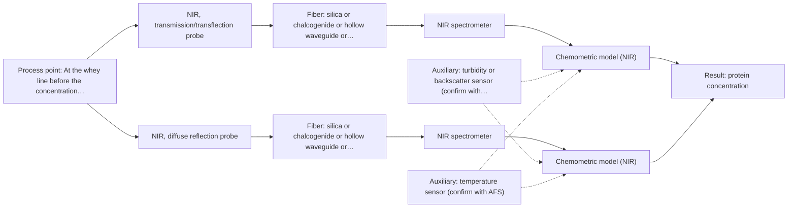
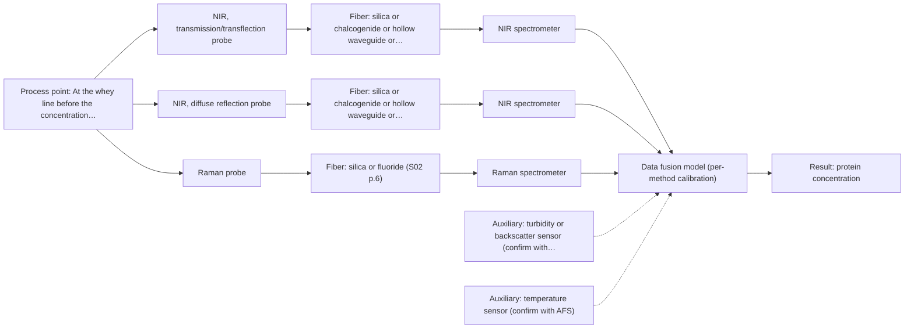

# First technical assessment: A clear whey stream before concentration

## Answer

**Customer request:** Our dairy process includes a relatively clear whey stream before a concentration stage. We want to investigate whether spectroscopy can track protein concentration as the stream changes, with laboratory results used as the reference. The stream can become more turbid under some operating conditions. We need a first measurement concept that handles this change rather than assuming the liquid always remains clear.

### Brief answer

Test NIR transmission/transflection first on representative whey samples against laboratory protein values; the sources name transmission for whey and permeate. Add NIR diffuse reflection for the turbid state, because transmission loses signal when the stream thickens. Open: the protein range and required accuracy, the turbidity range and particle size, and the installation point and cleaning conditions.

### Proposal

- **Best current option:** O2 (recommended)
- **Basis:** supplied AFS sources
- **What would change it:** A stated protein range or accuracy that NIR overtones cannot reach, or a turbidity state that neither NIR transmission/transflection nor NIR diffuse reflection handles, would change the choice. A strong fluorescence background in the stream would also count against the Raman combination.
- **Next step:** Run the feasibility plan on representative whey samples across the clear and turbid states, with laboratory protein values as the reference.

**Secondary evidence (external, not AFS material):** G1: no usable external source found; G2: no usable external source found; G3: E03 ¶16, E03 ¶19; G4: no usable external source found. See Expert detail.

**Decision status:** Provisional feasibility assessment

### Solution options

| ID | Tier | Methods | Confidence | Cost class, S01 Table 1 (p.6) | Ease of use | Maintenance | Performance fit | Sources |
|---|---|---|---|---|---|---|---|---|
| O1 | Simple | M1 NIR, transmission/transflection probe | Medium: open question: Q1 (starts at Medium) | average cost (row 7) | One probe, one spectrometer, simple flow-through | Single probe window to clean and check | Best on clear whey; blind when turbid | [1: S01 p.18] [2: S01 p.18] |
| O2 | Recommended | M1 NIR, transmission/transflection probe; M2 NIR, diffuse reflection probe | Medium: open question: Q1 (starts at Medium) | average cost (rows 7, 8) | Two probes on one NIR spectrometer | Two probe interfaces to clean and verify | Covers the clear and the turbid stream states | [3: S01 p.18] [1: S01 p.18] [2: S01 p.18] [4: S01 p.17] [5: S01 p.18] |
| O3 | Extended (multi-method) | M1 NIR, transmission/transflection probe; M2 NIR, diffuse reflection probe; M3 Raman probe + NIR (combination) | Low: open question: Q1 (starts at Medium); multi-method, fusion benefit not yet shown | high cost (rows 7, 8, 12) | Two instruments, more alignment and data work | Two instrument chains to calibrate and service | Adds molecular specificity if NIR alone falls short | [6: S01 p.8] [7: S01 p.8] [8: S01 p.8] [9: S01 p.9] [10: S01 p.9] [1: S01 p.18] [2: S01 p.18] [4: S01 p.17] [5: S01 p.18] [11: S01 p.15] [12: S01 p.16] |

*Confidence rates the basis of the advice (how much is known and cited), not a predicted accuracy or probability of success. It starts at High, or at Medium when a key question on the method or the option is open, and drops one level per weakness listed (floor Low).*

*Cost class is the relative rating in S01 Table 1 (p.6) for the in-line method+technique rows named (the highest one for a multi-method option); it is not a price.*

### Setup sketch

*Recommended option O2; drawn by code from the option, a schematic, not a configuration.*

### Key questions

1. Which protein fraction must be tracked, over what concentration range, and what accuracy, precision and response time does the process need?
2. What turbidity range and particle size occur in the stream, and how often and for how long does it leave the clear state?
3. Where would the measurement sit (in-line probe, flow cell or bypass), at what distance from the spectrometer, and what cleaning or CIP regime applies?

## Expert detail

**Customer enquiry**

> Our dairy process includes a relatively clear whey stream before a concentration stage. We want to investigate whether spectroscopy can track protein concentration as the stream changes, with laboratory results used as the reference. The stream can become more turbid under some operating conditions. We need a first measurement concept that handles this change rather than assuming the liquid always remains clear.

**Decision status:** Provisional feasibility assessment. The supplied sources support a first method shortlist for a dairy stream: NIR transmission for whey and permeate, and NIR reflection for opaque dairy, with an in-line precedent for quantifying fat and protein. The choice stays provisional because the protein range, the turbidity range and the required accuracy are not stated.

### Parameters

| ID | Parameter | Kind | Need | Measured by | Why | Sources |
|---|---|---|---|---|---|---|
| P1 | protein concentration | quantitative | required | Spectroscopy: NIR | It is the target the customer wants to track in the stream. | [13: S01 p.17] |
| P2 | turbidity / light scattering | quantitative | required | Auxiliary sensor: turbidity or backscatter sensor (cited; confirm availability with AFS) | It defines which optical regime the stream is in and whether a transmission measurement is still valid. | [14: S01 p.7] |
| P3 | stream temperature | quantitative | optional | Auxiliary sensor: temperature sensor (engineering judgement: confirm availability with AFS) | It should be available to check whether spectral variation follows process temperature rather than protein; no supplied source covers this for the case. | *(no verified source: engineering judgement)* |

### Solution option details

- **O1 cost drivers:** One NIR spectrometer and probe, chemometric calibration, reference analyses
- **O2 cost drivers:** One spectrometer, two probes, two calibrations, more reference samples
- **O3 cost drivers:** Second spectrometer and laser, combined probe, data fusion, two calibrations
- **O3 combining methods:** Fusion level: one calibrated model per method first, then joined spectra with block scaling so that neither method dominates the model. The NIR and Raman probes must look at the same small area of the stream, and the two acquisition rates must be aligned to a common time step, with each block kept under its own calibration and diagnostics. The fused model must beat the best single NIR method on held-out runs, otherwise the second instrument is dropped.

*Extended (multi-method) option O3; drawn by code from the option, a schematic, not a configuration.*

### Premise check

- **Precedent only:** Spectroscopy can track protein concentration as the stream changes. An in-line dairy example describes NIR with PLS regression to quantify fat and protein, which is a reason to test NIR here, not proof for this whey stream. [13: S01 p.17]
- **Not covered:** Laboratory results are a suitable reference for protein concentration. No supplied source names a reference laboratory method for protein in dairy or states its accuracy, so this stays open and is asked as a question. *(no verified source: engineering judgement)*
- **Precedent only:** A first measurement concept can handle the stream changing from relatively clear to more turbid. The dairy example says a transflection probe can in some cases serve low-fat and high-fat products, which is a reason to test a geometry that tolerates both states rather than proof for this stream. [2: S01 p.18]

### Requirements

**Stated by the customer**

- "Our dairy process includes a relatively clear whey stream before a concentration stage."
- "We want to investigate whether spectroscopy can track protein concentration as the stream changes"
- *Further statements: see the customer enquiry above.*

**Key unknowns**

- Target protein fraction and concentration range, and the accuracy, precision and response time the process needs
- Turbidity range, particle size and how often the stream leaves the clear state
- Reference laboratory protein method and its sampling frequency relative to the spectral measurement
- Installation point, interface (in-line probe, flow cell or bypass) and cleaning/CIP regime
- Whether the stream contains fluorescent species (relevant to the Raman part of any combination)
- Matrix composition and interferences (fat, lactose, salts, particulates)

### Clarification questions (most decision-relevant first)

Q1. Which protein fraction must be tracked, over what concentration range, and what accuracy, precision and response time does the process need? *Why it matters:* These numbers decide whether NIR overtones can reach the target at all, or whether a second method has to be tested. *(affects: method)*
Q2. What turbidity range and particle size occur in the stream, and how often and for how long does it leave the clear state? *Why it matters:* It decides whether one geometry (transmission/transflection) can cover both states or whether a reflection geometry is needed for the turbid state. *(affects: technique)*
Q3. Where would the measurement sit (in-line probe, flow cell or bypass), at what distance from the spectrometer, and what cleaning or CIP regime applies? *Why it matters:* Installation point, contact with the stream and cleaning determine the probe type, the fiber link and whether fouling is manageable. *(affects: installation)*
Q4. Which laboratory method will measure protein as the reference, and how often will a reference sample be taken relative to the spectral measurement? *Why it matters:* The calibration can only be as good as the reference values and their timing relative to each spectrum. *(affects: M1)*
Q5. Does the stream contain fluorescent species (for example proteins or cofactors), and which matrix components vary besides protein? *Why it matters:* A strong fluorescence background would work against the Raman part of any combination, and matrix variation sets how often a calibration must be re-validated. *(affects: M3)*

### Recommendation

- **M1 · Primary candidate: NIR, transmission/transflection probe.** The sources name transmission as the preferred geometry for transparent or semi-transparent dairy liquids such as whey and permeate, and NIR is the dairy method with an in-line fat and protein calibration. The same source notes that a transflection probe can in some cases already cover low-fat and high-fat products, which is worth testing as a single-probe option. *Conditions:* Applies while the stream stays relatively clear; a transflection probe should also be tested for the turbid state. [1: S01 p.18] [2: S01 p.18]
- **M2 · Conditional candidate: NIR, diffuse reflection probe.** NIR reflection is the dairy geometry for opaque or highly concentrated products, and the source states that transmission fails once the liquid becomes too thick for light to penetrate. It is the fallback geometry when the whey stream turns turbid. *Conditions:* Applies only when the stream becomes turbid or highly scattering. [4: S01 p.17] [5: S01 p.18]
- **M3 · Comparison candidate: Raman probe + NIR (combination).** Adding Raman to NIR is a later hypothesis: in an in-line pharmaceutical example the fused NIR and Raman models predicted potency better than single-method models, and Raman tolerates water better than infrared methods, which suits an aqueous whey stream. Any gain from the combination is a hypothesis to test against the best single NIR method. *Conditions:* Only after the single NIR techniques have been tested and only if they do not reach the required accuracy. [11: S01 p.15] [12: S01 p.16]
- **M4 · Not recommended: UV-Vis, transmission/transflection probe.** A reader may expect UV-Vis for a relatively clear liquid, but in mixtures the absorption signals overlap strongly and turbidity adds a scattering term that is not protein. It is therefore a weak route to a protein concentration. [15: S01 p.5]

### Measurement concept

- **Probe and geometry:** In-line NIR probe in transmission or transflection for the clear state, with a diffuse-reflection probe or a transflection probe for the turbid state; ATR is not the first route here.
- **Location:** At the whey line before the concentration stage, at a point where the probe sees the flowing stream; interface and cleaning regime are open (Q3).
- **Fiber link:** Vis-NIR silica fiber is the family for NIR; the achievable link length for the actual installation is not stated in the sources and must be confirmed with the supplier. [16: S02 p.6]

### Spectral range

- **NIR:** Nominal NIR range 780-2500 nm; the usable range depends on the instrument, fiber and probe actually selected, and is not the nominal range. [17: S01 p.10] [18: REF §5]
- **Raman:** For the optional Raman part, the Raman shift in cm-1 and the laser excitation wavelength in nm are stated separately; both depend on the laser and spectrometer selected. [19: S01 p.11]

### Risks and uncertainty

- If the stream thickens enough, the transmission signal can be lost before the composition is read. *(rules: R-GEO-2, R-GEN-4)* [5: S01 p.18]
- Reflection signals depend on surface characteristics and particle size, so turbidity can mimic a composition change and the calibration may not transfer between the clear and turbid states. *(rules: R-GEO-6, R-CAL-1)* [20: S01 p.17]
- NIR calibrations are matrix-specific, so a change in whey composition or upstream process can invalidate the protein model. *(rules: R-CAL-1)* [21: REF §5]
- If the stream contains fluorescent species, the Raman part of a combination could be swamped by fluorescence background. *(rules: R-RAM-1)* [22: S01 p.11]

### First feasibility experiment

1. **Collect representative whey samples and process states across the expected protein range and across the clear and turbid conditions, including the most turbid state seen in operation, each with an independent laboratory protein value.** Representative samples, independent reference measurements and the comparison basis are what a feasibility plan must contain. [23: REF §3]
2. **Measure all samples with NIR transmission or transflection first (single method), testing more than one optical pathlength within the range the source gives for dairy transmission.** Single method first; pathlength must be controlled or the signal is lost or the sampled volume is negligible. [24: S01 p.18]
3. **Measure the turbid subset with NIR diffuse reflection (and, if available, a transflection probe) against the same laboratory reference values.** Test whether one geometry can cover both states, or whether the turbid state needs the second geometry (M2). *(no verified source: engineering judgement)*
4. **Build a chemometric protein calibration per technique and validate it on held-out runs or batches, not on the samples used for calibration; the go / no-go numbers (accuracy, precision, range, response time) must come from the customer.** Models built on limited experimental material need thorough validation, and the decision criteria are the customer's. [25: S03 p.14]
5. **Only if the single-method models fall short of the customer's accuracy over both states, test the NIR plus Raman combination on the same samples and require the fused model to beat the best single method; otherwise drop the extra instrument.** A combination is a later hypothesis to test against the best single method. [26: S01 p.7] [27: REF §5]

**Reference measurements:** Laboratory protein values on the same samples, with sampling frequency and method to be agreed (Q4).

**Decision basis:** Numerical criteria for accuracy, precision, range and response time come from the customer; the plan above only sets how they are measured.

### Assumptions

- The whey stream behaves like the dairy liquids described in the sources (skim milk, whey, permeate) for geometry selection.
- The protein level is a bulk component, not a trace below the NIR sensitivity limit; this is unverified and asked as Q1.
- The stream is suitable for contact with a probe or flow cell; installation and cleaning conditions are unverified (Q3).

### Not covered by the supplied sources

- Protein performance figures for whey: the sources describe milk fat and protein and dairy geometry, but give no protein accuracy, detection limit or response time for whey or for a stream that changes from clear to turbid.
- The customer's required accuracy and response time: no supplied source states achievable values for this case, so they must come from the customer.

### Further notes

- **Chemometrics:** NIR bands in this region overlap, so a quantitative protein result needs a chemometric calibration built on reference laboratory values; the same applies to any later fused NIR and Raman model.
- **Real-time tracking:** The question is whether the protein signal can be followed as the stream changes, so the trials should keep the time stamp of each spectrum and of each reference sample, and check whether the two geometries can be switched or run together as the turbidity changes.
- **Future direction:** If a small number of informative wavelengths turns out to carry the protein signal, a compact dedicated sensor could be considered later; the sources describe this path but give no configuration for this stream.

### Secondary evidence (external, not AFS material)

*Found by a literature search for gaps the supplied AFS sources leave open. Not AFS material and not proof for this case; every quote below was verified verbatim against the fetched text.*

*Live search unavailable (library only: cache miss (europepmc); cache miss (openalex)); curated library only.*

**G1 · auxiliary sensor:** In-line measurement of turbidity / light scattering with turbidity or backscatter sensor

- No usable external source found.

**G2 · auxiliary sensor:** In-line measurement of stream temperature with temperature sensor

- No usable external source found.

**G3 · multi-method:** Combining several spectroscopy methods (data fusion) (Fusion level: one calibrated model per method first, then joined spectra with block scaling so that neither method dominates the model. The NIR and Raman probes must look at the same small area of the stream, and the two acquisition rates must be aligned to a common time step, with each block kept under its own calibration and diagnostics. The fused model must beat the best single NIR method on held-out runs, otherwise the second instrument is dropped.)

- **E03 ¶16** The source says block scaling is often recommended for data fusion but can sometimes worsen results compared with other pre-processing methods. *How it applies:* For O3, this suggests testing block scaling against alternative pre-processing and checking whether the fused model beats the best single NIR method on held-out runs. *Limits and transfer risks:* The evidence comes from dairy-industry spectroscopy data fusion, not from a NIR/Raman stream with aligned acquisition rates or a shared small measurement area, so the scaling effect may differ. *(supports O3)*
  > "While block scaling is often recommended for data fusion, sometimes it can have a worse effect on results than other pre-processing methods (17)."
  > Spectroscopic technologies and data fusion: Applications for the dairy industry. (2022) · Frontiers in nutrition · doi:10.3389/fnut.2022.1074688 · https://europepmc.org/article/PMC/PMC9875022 · retrieved 2026-10-17, full text, licence: cc by, via curated library
- **E03 ¶19** The source says SO-PLS is independent of block scaling and therefore not affected by variance differences between data blocks. *How it applies:* For O3, SO-PLS could be considered as a fusion approach that may avoid block-scaling sensitivity, but it still needs comparison against the best single NIR method on held-out runs. *Limits and transfer risks:* The source is dairy data fusion and does not establish performance for NIR and Raman probes on the same stream area or with aligned time steps. *(supports O3)*
  > "SO-PLS is not affected by scaling of each block as it is independent of the scaling, therefore is not affected by variance differences between data blocks (22)."
  > Spectroscopic technologies and data fusion: Applications for the dairy industry. (2022) · Frontiers in nutrition · doi:10.3389/fnut.2022.1074688 · https://europepmc.org/article/PMC/PMC9875022 · retrieved 2026-10-17, full text, licence: cc by, via curated library

**G4 · not in the supplied sources:** Protein performance figures for whey: the sources describe milk fat and protein and dairy geometry, but give no protein accuracy, detection limit or response time for whey or for a stream that changes from clear to turbid.

- No usable external source found.

### Evidence (verified quotes)

1. ✓ **S01 p.18** (general): "Transmission is the preferred method for transparent or semi-transparent liquids, such as skim milk, whey, or permeate."
2. ✓ **S01 p.18** (general): "In some cases, a Transflection probe can already be a combined solution working well for low-fat and high-fat containing milk products."
3. ✓ **S01 p.18** (general): "NIR Spectrometer and NIR light source remain the same for both reflection and transmission techniques."
4. ✓ **S01 p.17** (general): "NIR Reflection is primarily used for opaque or highly concentrated dairy products, such as yogurt, butter, or whole milk concentrates."
5. ✓ **S01 p.18** (general): "it fails when the milk becomes too "thick" or fat-rich, as the light cannot penetrate the sample."
6. ✓ **S01 p.8** (general): "collected from the same small, even pinpoint, area of the sample."
7. ✓ **S01 p.8** (general): "Ultimately, the measurement data must be normalized to a common time step."
8. ✓ **S01 p.8** (general): "If the variables have different units of measurement, the data should be normalized in some way, for example, using an autoscaling algorithm."
9. ✓ **S01 p.9** (general): "Furthermore, methods containing a larger number of variables have a greater impact on the model."
10. ✓ **S01 p.9** (general): "One of the challenges of multispectral analysis is the need to simultaneously connect at least two independently operating measuring instruments."
11. ✓ (precedent only) **S01 p.15** (method gain): "By combining Raman and NIR, these models can predict API potency or coating thickness with higher accuracy and robustness than single-method models."
12. ✓ **S01 p.16** (general): "Raman is particularly well-suited for aqueous environments, as it exhibits low absorbance for water molecules compared to infrared methods."
13. ✓ **S01 p.17** (application precedent): "using Partial Least Squares (PLS) regression to quantify fat and protein."
14. ✓ **S01 p.7** (general): "Morphological factors, such as sample inhomogeneity (e.g., biological tissue) or process turbulence, must also be considered when selecting a measurement technique."
15. ✓ **S01 p.5** (general): "the strong overlap of spectral signals in UV spectra complicates the analysis of real samples"
16. ✓ **S02 p.6** (general): "350 nm Standard VIS-NIR Silica Fibers Al/Cu-coated VIS-NIR Silica Fibers 2400 nm"
17. ✓ **S01 p.10** (general): "NIR spectra (780-2500 nm) contain predominantly overtones and component bands of fundamental vibrations"
18. ✓ **REF §5** (general): "It is not a product specification: actual spectral coverage, fiber length, component ratings, detection limits and accuracy depend on the configuration and the sample."
19. ✓ **S01 p.11** (general): "The Raman shift is used as the horizontal (spectral) axis in Raman spectroscopy"
20. ✓ **S01 p.17** (general): "the method is sensitive to the surface characteristics and fat globule size."
21. ✓ **REF §5** (general): "physical variation; calibration specific to the matrix."
22. ✓ **S01 p.11** (general): "superposition of luminescence (fluorescence), which has a significantly higher intensity."
23. ✓ **REF §3** (general): "Representative samples or process states, independent reference measurements, what is compared, and the basis for the go / no-go decision."
24. ✓ **S01 p.18** (general): "the precise control of the optical pathlength (usually 1 - 10 mm)"
25. ✓ **S03 p.14** (general): "A thorough validation, including full, segmented and random-subset CVs, as well as randomization tests, are recommended in any cases for which important conclusions depend on calibration or discrimination models built on limited experimental material."
26. ✓ (precedent only) **S01 p.7** (method gain): "The analysis of such systems may require a combination of two or even more spectral methods."
27. ✓ **REF §5** (general): "compare with the best single method."

### Verification

- Citations verified: 30 of 30 (exact or whitespace/hyphen-tolerant match on the cited page, scope checked).
- Hard check failures before deterministic corrections: 0; still open: 0; soft warnings: 3; repair rounds: 1.
- Removed 1 intake item(s) not quoted verbatim from the enquiry:
  - intake.process[0]: enquiry_quote not found verbatim in the enquiry
- External evidence (cache): 2 quote(s) verified verbatim (exact or whitespace/hyphen-tolerant, at most 400 characters and 2 sentences, against the cited paragraph); 0 item(s) dropped.
- External search: 6 query(ies), 0 hit(s), 3 source(s) (3 from the curated library); ⚠ library only: cache miss (europepmc); cache miss (openalex).
- External step: 2 model call(s), 48.8 s extra (cost in the run JSON).

*Run D03-20261018T080635Z-0ab0 · models deepseek/deepseek-v4.1-flash*
