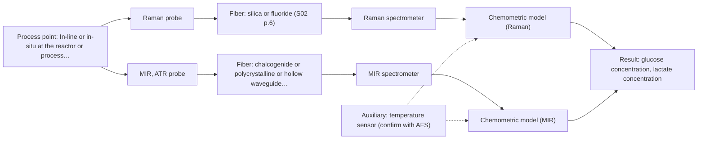
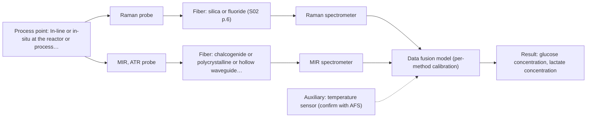

# First technical assessment: Glucose and lactate trends in an aqueous bioprocess

## Answer

**Customer request (our summary):** Customer runs a cell culture process in aqueous medium, currently measuring glucose and lactate from samples with delay. They are exploring an in situ spectroscopy pilot checked against existing lab measurements, but have not selected a probe or calibration strategy.

### Brief answer

Test Raman first: in an aqueous medium it absorbs little and can fingerprint glucose and lactate directly in the reactor. Compare it with mid-IR ATR on the same samples, using the existing laboratory measurements as the reference. What is still open: the concentration ranges, the medium's optical regime and fluorescence, and whether the current reference method is adequate.

### Proposal

- **Best current option:** O2 (recommended)
- **Basis:** supplied AFS sources
- **What would change it:** If the medium's fluorescence background swamps Raman, or if glucose and lactate are at trace level, the shortlist shifts toward mid-IR ATR or NIR. If one single method meets the customer's numerical targets on held-out runs, the fused option is dropped.
- **Next step:** Run a laboratory trial on representative samples that compares Raman and mid-IR ATR against the existing reference measurements.

**Secondary evidence (external, not AFS material):** G1: E03 ¶12; G2: E02 ¶31, E02 ¶36; G3: E01 ¶8. See Expert detail.

**Decision status:** Provisional feasibility assessment

### Solution options

| ID | Tier | Methods | Confidence | Cost class, S01 Table 1 (p.6) | Ease of use | Maintenance | Performance fit | Sources |
|---|---|---|---|---|---|---|---|---|
| O1 | Simple | M1 Raman probe | Medium: open question: Q1, Q3 (starts at Medium) | high cost (row 12) | one probe, one method | single probe, routine cleaning | aqueous medium suits Raman; direct glucose and lactate | [1: S01 p.16] [2: S01 p.16] |
| O2 | Recommended | M1 Raman probe; M2 MIR, ATR probe | Medium: open question: Q1, Q3 (starts at Medium) | high cost (rows 2, 12) | two methods in one trial campaign | two instruments and probes | covers targets; MIR backs up Raman | [1: S01 p.16] [2: S01 p.16] [3: S01 p.9] [4: S01 p.5] [5: S01 p.10] [6: S01 p.11] [7: S02 p.6] |
| O3 | Extended (multi-method) | M3 Raman probe + MIR (combination) | Low: open question: Q1 (starts at Medium); multi-method, fusion benefit not yet shown | high cost (rows 2, 12) | two synchronised instruments, fused model | two calibrations and diagnostics | fused vibrational data if singles fall short | [8: S01 p.8] [9: S01 p.8] [10: S01 p.9] [11: S01 p.7] [12: S01 p.8] |

*Confidence rates the basis of the advice (how much is known and cited), not a predicted accuracy or probability of success. It starts at High, or at Medium when a key question on the method or the option is open, and drops one level per weakness listed (floor Low).*

*Cost class is the relative rating in S01 Table 1 (p.6) for the in-line method+technique rows named (the highest one for a multi-method option); it is not a price.*

### Setup sketch

*Recommended option O2; drawn by code from the option, a schematic, not a configuration.*

### Key questions

1. What are the expected concentration ranges for glucose and lactate during the run, and what accuracy, precision and response time must the in situ measurement reach?
2. What is the optical regime of the medium during the run - clear, turbid or opaque - and how does the cell population density change from start to end?
3. Does the medium or its feed contain fluorescent species, and has a fluorescence background been observed on similar samples?

## Expert detail

**Customer enquiry**

> We run a cell culture process in an aqueous medium. Glucose and lactate are measured from samples, and the delay makes it difficult to see changes promptly. We are exploring an in situ spectroscopy pilot that can be checked against those existing laboratory measurements. The medium and cell population change during the run; we have not yet selected a probe or a calibration strategy.

**Decision status:** Provisional feasibility assessment. Aqueous glucose and lactate have a documented Raman precedent and mid-IR ATR is a passing single method, so a shortlist is justified. The concentration ranges, the medium's optical regime and the reference method are still open, so the choice stays provisional.

### Parameters

| ID | Parameter | Kind | Need | Measured by | Why | Sources |
|---|---|---|---|---|---|---|
| P1 | glucose concentration | quantitative | required | Spectroscopy: Raman | It is one of the two targets the customer wants to follow in situ instead of by sampling. | [1: S01 p.16] |
| P2 | lactate concentration | quantitative | required | Spectroscopy: Raman | It is the second target the customer wants to follow in situ instead of by sampling. | [1: S01 p.16] |
| P3 | temperature at the measurement point | quantitative | optional | Auxiliary sensor: temperature sensor (engineering judgement: confirm availability with AFS) | It should be available because temperature shifts vibrational spectra and is needed to keep a calibration valid. | *(no verified source: engineering judgement)* |

### Solution option details

- **O1 cost drivers:** one spectrometer, fiber probe and calibration
- **O2 cost drivers:** two spectrometers, probes and comparative analysis
- **O3 cost drivers:** two instruments, combined probe and fusion modelling
- **O3 combining methods:** A combined ATR/Raman probe collects both spectra from the same small measurement spot, so the two methods see the same material. The two spectrometers must be synchronised to a common time step, and each spectral block keeps its own calibration and diagnostics. The fused model must beat the best single method on independent runs, otherwise the second instrument is not justified.

*Extended (multi-method) option O3; drawn by code from the option, a schematic, not a configuration.*

### Premise check

- **Precedent only:** In situ spectroscopy is a suitable measurement approach for this cell culture process. Bioprocess monitoring with fiber techniques is shown as a published precedent, not as proof for this medium or process. [1: S01 p.16]
- **Supported:** An in situ measurement would remove the sampling delay and make changes visible promptly. In-process analysis without sampling is described as eliminating delays. [13: S01 p.3]
- **Not covered:** The existing laboratory measurements are an adequate reference for checking the in situ pilot. The supplied material states that a feasibility plan needs independent reference measurements but says nothing about whether these particular laboratory measurements qualify. *(no verified source: engineering judgement)*

### Requirements

**Stated by the customer**

- "We run a cell culture process"
- "aqueous medium"
- "Glucose and lactate are measured from samples"
- "the delay makes it difficult to see changes promptly"
- "The medium and cell population change during the run"
- *Further statements: see the customer enquiry above.*

**Key unknowns**

- Glucose and lactate concentration ranges, and the required accuracy, precision and response time.
- Optical regime of the medium during the run (clear, turbid or opaque) and how cell density changes.
- Whether the medium contains fluorescent species that could swamp a Raman signal.
- Details and adequacy of the existing laboratory glucose and lactate method.
- Installation conditions: temperature, pressure, cleaning or sterilisation, and distance to the spectrometer.

### Clarification questions (most decision-relevant first)

Q1. What are the expected concentration ranges for glucose and lactate during the run, and what accuracy, precision and response time must the in situ measurement reach? *Why it matters:* These numbers decide whether Raman, mid-IR ATR or NIR can reach the targets and set the go/no-go criteria for the trial. *(affects: method)*
Q2. What is the optical regime of the medium during the run - clear, turbid or opaque - and how does the cell population density change from start to end? *Why it matters:* It decides whether transmission or transflection can be used or whether reflection and ATR geometries are needed instead. *(affects: technique)*
Q3. Does the medium or its feed contain fluorescent species, and has a fluorescence background been observed on similar samples? *Why it matters:* A strong fluorescence background can swamp the weak Raman signal and would make the Raman-first choice wrong. *(affects: M1)*
Q4. What is the existing laboratory glucose and lactate method, and at what sampling frequency, accuracy and precision is it run? *Why it matters:* It is the reference the pilot would be checked against, and its uncertainty limits what can be concluded from the comparison. *(affects: status)*
Q5. What are the installation conditions at the intended measurement point: temperature, pressure, cleaning or sterilisation cycle, and the distance from the probe to the spectrometer? *Why it matters:* Contact, fouling and cleaning requirements and the fiber link length constrain the probe and fiber selection. *(affects: installation)*

### Recommendation

- **M1 · Primary candidate: Raman probe.** Aqueous media suit Raman because water absorbs little, and Raman gives a molecular fingerprint for glucose and lactate in the reactor. It is the single method to test first. [1: S01 p.16] [2: S01 p.16]
- **M2 · Comparison candidate: MIR, ATR probe.** Mid-IR has strong, well-defined absorption bands, and ATR probes give a short, controlled path that suits aqueous media. Mid-IR and Raman spectra are complementary, so ATR is the natural second single method to compare. *Conditions:* Applies if the medium tolerates ATR contact and the mid-IR link uses a fiber that transmits the mid-IR range rather than silica. [3: S01 p.9] [4: S01 p.5] [5: S01 p.10] [6: S01 p.11] [7: S02 p.6]
- **M3 · Conditional candidate: Raman probe + MIR (combination).** Combining Raman and mid-IR ATR fuses complementary vibrational information for glucose and lactate. Any gain is a hypothesis and is only worth testing if the single methods do not meet the targets. *Conditions:* Applies only if the best single method does not reach the customer's stated targets on held-out runs. [11: S01 p.7] [12: S01 p.8] Later hypothesis, after single-method tests.

### Measurement concept

- **Probe and geometry:** Start with an immersible Raman fiber probe for the aqueous medium; compare with a mid-IR ATR fiber probe at the same sampling point.
- **Location:** In-line or in-situ at the reactor or process line, checked against the existing laboratory measurements.
- **Fiber link:** Fiber family follows the method: visible-to-NIR silica fibers for Raman; chalcogenide (CIR) or polycrystalline (PIR) fibers for mid-IR. [14: S01 p.5]

### Spectral range

- **Raman:** Report Raman as a Raman shift in cm-1; state the laser excitation wavelength separately. [15: S01 p.11]
- **MIR:** Nominal mid-IR range is 4000-400 cm-1 (2.5-25 um); the usable range depends on the fiber and crystal actually selected. [3: S01 p.9] [16: REF §3]

### Risks and uncertainty

- Fluorescence in the medium could swamp the weak Raman signal, making Raman unusable without a change of method. *(rules: R-RAM-1)* [17: S01 p.11]
- The changing cell population and medium alter scattering and matrix, so a calibration built early may not hold across the run. *(rules: R-CAL-1, R-GEN-5)* [18: REF §5]
- Mid-IR ATR samples only a few micrometres at the crystal, so deposits, fouling or a non-representative surface layer could bias results. *(rules: R-MIR-3)* [19: S01 p.13]
- If glucose or lactate sit at trace level, NIR or mid-IR sensitivity may be insufficient; the concentration ranges are unknown. *(rules: R-NIR-4)* [20: S01 p.16]

### First feasibility experiment

1. **Collect representative samples or process states across the run, covering the expected range of glucose, lactate, cell density and medium composition, including early, mid and late phases.** Cover the chemical and physical variation the method must handle. [21: REF §3]
2. **Measure each sample with the single methods first (Raman, then mid-IR ATR) at the same sampling point, and check the Raman fluorescence background on the real medium.** Test single methods first and screen the fluorescence interference before any combination. [17: S01 p.11]
3. **Obtain independent reference values for glucose and lactate with the existing laboratory method on the same samples.** Provide the independent reference the pilot is checked against. [21: REF §3]
4. **Build and validate per-method chemometric models on held-out runs or batches, and compare each single method against the reference.** Test whether one single method already meets the targets. [18: REF §5]
5. **Only if the best single method misses the customer's numerical targets, test the fused Raman and mid-IR model against it; the go/no-go uses the customer's own accuracy and response criteria.** Keep the combination as a later hypothesis and give a defined go/no-go basis. [22: REF §5]

**Reference measurements:** Existing laboratory glucose and lactate measurements on the same samples.

**Decision basis:** The customer's own accuracy, precision and response-time criteria on held-out runs.

### Assumptions

- Glucose and lactate remain the in situ targets and are within the ranges the shortlisted methods can reach.
- The existing laboratory measurements can serve as an independent reference.
- The medium allows probe contact at the chosen measurement point.

### Further notes

- **Chemometrics:** Quantitative glucose and lactate models need reference data and are matrix-specific; build and re-validate them across the run and check them on held-out batches.
- **Real-time tracking:** The purpose of the in situ pilot is continuous, time-resolved tracking of glucose and lactate without the sampling delay.
- **Future direction:** Once the key spectral features are known, a compact optical multisensor or LED-based sensor at selected wavelengths could be considered for routine process control.

### Secondary evidence (external, not AFS material)

*Found by a literature search for gaps the supplied AFS sources leave open. Not AFS material and not proof for this case; every quote below was verified verbatim against the fetched text.*

*Live search unavailable (library only: cache miss (europepmc); cache miss (openalex)); curated library only.*

**G1 · auxiliary sensor:** In-line measurement of temperature at the measurement point with temperature sensor

- **E03 ¶12** The source says temperature sensitivity of OH bands is a severe drawback for measuring aqueous solutions in NIR and MIR, making tempered sample holders necessary. *How it applies:* For O2 with MIR ATR in aqueous medium, temperature at the measurement point may need to be controlled or monitored; test whether temperature variation affects the spectra. *Limits and transfer risks:* This is a review statement, not a cell culture or in-line probe study; tempered sample holders are laboratory hardware and may not transfer directly to an in-line measurement point. *(supports O2)*
  > "Additionally, the temperature sensitivity of the OH bands is a severe drawback for measuring aqueous solution in NIR and MIR, which makes tempered sample holders necessary [29]."
  > A critical review of recent trends, and a future perspective of optical spectroscopy as PAT in biopharmaceutical downstream processing. (2020) · Analytical and bioanalytical chemistry · doi:10.1007/s00216-020-02407-z · https://europepmc.org/article/PMC/PMC7072065 · retrieved 2026-10-17, full text, licence: cc by, via curated library

**G2 · multi-method:** Combining several spectroscopy methods (data fusion) (A combined ATR/Raman probe collects both spectra from the same small measurement spot, so the two methods see the same material. The two spectrometers must be synchronised to a common time step, and each spectral block keeps its own calibration and diagnostics. The fused model must beat the best single method on independent runs, otherwise the second instrument is not justified.)

- **E02 ¶31** The source says low-level data fusion is the simplest way to combine inputs by rearranging variables from different sources into one data matrix. *How it applies:* For O3, if ATR and Raman spectra are combined, low-level fusion is a candidate approach to test; ensure the variables from each method are aligned. *Limits and transfer risks:* This is a review of PAT data fusion, not a cell culture ATR/Raman study; it does not address synchronisation or separate calibration blocks. *(supports O3)*
  > "Low-level data fusion (LLDF) is considered the simplest method to achieve a combination of inputs. In this case, the data is rearranged into a new data matrix, where the variables coming from different sources are placed one after the other."
  > Challenges and Opportunities of Implementing Data Fusion in Process Analytical Technology-A Review. (2022) · Molecules (Basel, Switzerland) · doi:10.3390/molecules27154846 · https://europepmc.org/article/PMC/PMC9369811 · retrieved 2026-10-17, full text, licence: cc by, via curated library
- **E02 ¶36** The source says instrument complementarity was not always sufficient to improve prediction of several CQAs in a Raman and FT-IR food study. *How it applies:* For O3, combining ATR and Raman may not improve performance; require the fused model to beat the best single method on independent runs before accepting the second instrument. *Limits and transfer risks:* This is a food analytical study using Raman and FT-IR, not ATR/Raman in cell culture; the CQAs, matrix and process differ. *(supports O3)*
  > "In some situations, instrument complementarity (not data complementarity) was not sufficient to improve the performance of predictive several CQAs, as shown by a Raman and FT-IR data based food analytical study [73]."
  > Challenges and Opportunities of Implementing Data Fusion in Process Analytical Technology-A Review. (2022) · Molecules (Basel, Switzerland) · doi:10.3390/molecules27154846 · https://europepmc.org/article/PMC/PMC9369811 · retrieved 2026-10-17, full text, licence: cc by, via curated library

**G3 · premise not covered:** The existing laboratory measurements are an adequate reference for checking the in situ pilot.

- **E01 ¶8** The source says a continuous process at a fixed probe location can simplify model design, with validation relying on independent steady-state runs. *How it applies:* For the in situ pilot, consider whether independent steady-state runs are needed as a reference in addition to existing laboratory measurements. *Limits and transfer risks:* This is a lithium recycling liquid-liquid extraction process, not cell culture; it does not compare laboratory measurements with in situ data.
  > "In contrast, a continuous process at a fixed probe location is intended to operate in a steady-state window, which simplifies the model design: calibrations can be narrower and centered on the operational envelope, validation can rely on independent steady-state runs, and online monitoring focuses on drift and out-of-specification detection rather than resolving the rapidly changing composition."
  > Process Analytical Technology-Integrated FT-IR and Raman Spectroscopies for Efficient Reactive Liquid-Liquid Extraction Processing in Lithium Recycling. (2025) · ACS omega · doi:10.1021/acsomega.5c05705 · https://europepmc.org/article/PMC/PMC12573149 · retrieved 2026-10-17, full text, licence: cc by, via curated library

### Evidence (verified quotes)

1. ✓ **S01 p.16** (application precedent): "Raman spectroscopy can be used in the same reactor to provide a "molecular fingerprint" for direct detection of specific metabolites like glucose, acetate, or lactate."
2. ✓ **S01 p.16** (general): "Raman is particularly well-suited for aqueous environments, as it exhibits low absorbance for water molecules compared to infrared methods."
3. ✓ **S01 p.9** (general): "Vibrational spectroscopy in the mid-IR range (4000-400 cm-1) is one of the most informative methods of chemical analysis."
4. ✓ **S01 p.5** (general): "strong absorption in the mid-IR region limits the corresponding spectral method to the analysis of very thin samples"
5. ✓ **S01 p.10** (general): "ATR fiber probes (Fig.1) enable the analysis of liquids and solid elastic samples"
6. ✓ **S01 p.11** (general): "This property makes mid-IR and Raman spectra complementary, that is, they complement each other."
7. ✓ **S02 p.6** (general): "1100 nm Chalcogenide As-S IR Fibers 6500 nm"
8. ✓ (precedent only) **S01 p.8** (method gain): "two or more probes, belonging to different methods, can be used for measurements, but the data from each method must be obtained simultaneously."
9. ✓ (precedent only) **S01 p.8** (method gain): "Ultimately, the measurement data must be normalized to a common time step."
10. ✓ **S01 p.9** (general): "One of the challenges of multispectral analysis is the need to simultaneously connect at least two independently operating measuring instruments."
11. ✓ (precedent only) **S01 p.7** (method gain): "The analysis of such systems may require a combination of two or even more spectral methods."
12. ✓ (precedent only) **S01 p.8** (method gain): "It is crucial that the spectral information obtained by different methods-Mid-IR, NIR, Raman, and fluorescence spectra-is collected from the same small, even pinpoint, area of the sample."
13. ✓ **S01 p.3** (general): "It allows for in-process analysis, i.e., directly in the process flow or reactor without sampling, eliminating delays and the risk of sample contamination."
14. ✓ **S01 p.5** (general): "Immersible fiber optic probes operating in various spectral regions from UV to mid-IR are increasingly being used for measuring liquid and soft or powdered solid samples."
15. ✓ **S01 p.11** (general): "The Raman shift is used as the horizontal (spectral) axis in Raman spectroscopy"
16. ✓ **REF §3** (general): "A nominal method range is not the range of a specific instrument, fiber or probe."
17. ✓ **S01 p.11** (general): "superposition of luminescence (fluorescence), which has a significantly higher intensity"
18. ✓ **REF §5** (general): "physical variation; calibration specific to the matrix."
19. ✓ **S01 p.13** (general): "typically at a depth of few microns"
20. ✓ **S01 p.16** (general): "NIR spectroscopy is effective for tracking major components like glucose or glycerol in the millimolar range but may lack the sensitivity to detect trace compounds below 0.1 percent."
21. ✓ **REF §3** (general): "Representative samples or process states, independent reference measurements, what is compared, and the basis for the go / no-go decision."
22. ✓ (precedent only) **REF §5** (method gain): "compare with the best single method."

### Verification

- Citations verified: 29 of 29 (exact or whitespace/hyphen-tolerant match on the cited page, scope checked).
- Hard check failures before deterministic corrections: 0; still open: 0; soft warnings: 6; repair rounds: 1.
- Corrected deterministically after verification (1):
  - ⚠ recommendations[2].combined_with: combined_with normalised to ['MIR'] (duplicates and the entry's own method removed)
- External evidence (cache): 4 quote(s) verified verbatim (exact or whitespace/hyphen-tolerant, at most 400 characters and 2 sentences, against the cited paragraph); 0 item(s) dropped.
- External search: 6 query(ies), 0 hit(s), 3 source(s) (3 from the curated library); ⚠ library only: cache miss (europepmc); cache miss (openalex).
- External step: 2 model call(s), 80.3 s extra (cost in the run JSON).

*Run D04-20261018T080635Z-e78a · models deepseek/deepseek-v4.1-flash*
