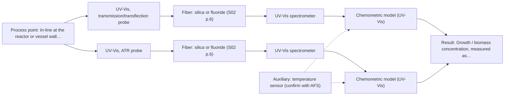
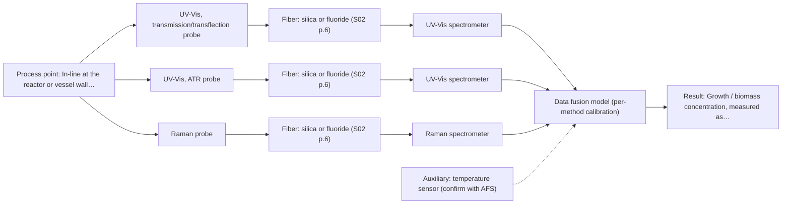

# First technical assessment: Biomass related monitoring during yeast fermentation

## Answer

**Customer request (our summary):** Customer wants an optical measurement during yeast fermentation to follow growth and to detect changes earlier, with an undefined 'biomass signal' and 'metabolic signal', and asks for help turning this into an initial feasibility study with reference measurements.

### Brief answer

Test UV-Vis first, in-line: transmission while the broth is still clear enough, and an ATR probe once it becomes too optically dense for transmission, because turbidity tracks cell density but is not a cell count. Raman is the candidate for the metabolic signal, but only once that signal is defined. Still open: the metabolic analyte, the optical-density range, the installation point and the reference methods.

### Proposal

- **Best current option:** O2 (recommended)
- **Basis:** supplied AFS sources
- **What would change it:** Defining the metabolic analyte would move the choice towards the extended UV-Vis plus Raman option, and a broth that stays transparent throughout, or one that becomes opaque immediately, would shift the transmission/ATR balance. A stated response time or detection limit could also change the technique.
- **Next step:** Agree the metabolic analyte, the optical-density range and the reference methods, then run the single-method comparison on representative fermentation samples.

**Secondary evidence (external, not AFS material):** G1: E03 ¶12; G2: E01 ¶31, E01 ¶36; G3: E03 ¶20; G4: no usable external source found. See Expert detail.

**Decision status:** Provisional feasibility assessment

### Solution options

| ID | Tier | Methods | Confidence | Cost class, S01 Table 1 (p.6) | Ease of use | Maintenance | Performance fit | Sources |
|---|---|---|---|---|---|---|---|---|
| O1 | Simple | M1 UV-Vis, transmission/transflection probe | High | low cost (row 16) | one probe, simplest to operate | one probe, routine cleaning | answers the growth trend in dilute broth | [1: S01 p.16] [2: S01 p.16] |
| O2 | Recommended | M1 UV-Vis, transmission/transflection probe; M2 UV-Vis, ATR probe | Medium: open question: Q2 (starts at Medium) | average cost (rows 14, 16) | two UV-Vis probes, moderate handling | two probes, cleaning and deposit checks | covers the run across the optical-density range | [2: S01 p.16] [1: S01 p.16] [3: S01 p.16] [4: S01 p.16] |
| O3 | Extended (multi-method) | M1 UV-Vis, transmission/transflection probe; M2 UV-Vis, ATR probe; M3 Raman probe | Low: open question: Q1, Q2 (starts at Medium); multi-method, fusion benefit not yet shown | high cost (rows 12, 14, 16) | two instruments, more setup effort | two instruments, two calibrations to keep | adds a metabolite signal to the growth trend | [5: S01 p.16] [6: S01 p.8] [7: S01 p.8] [1: S01 p.16] [2: S01 p.16] [3: S01 p.16] [4: S01 p.16] [8: S01 p.16] |

*Confidence rates the basis of the advice (how much is known and cited), not a predicted accuracy or probability of success. It starts at High, or at Medium when a key question on the method or the option is open, and drops one level per weakness listed (floor Low).*

*Cost class is the relative rating in S01 Table 1 (p.6) for the in-line method+technique rows named (the highest one for a multi-method option); it is not a price.*

### Setup sketch

*Recommended option O2; drawn by code from the option, a schematic, not a configuration.*

### Key questions

1. Which analytes define the 'metabolic signal', and over what concentration range should they be measured?
2. What is the optical-density range over the run, from start to end, and does the broth ever become too opaque for light to pass through?
3. Where and how would the probe be installed: in-line in the vessel or in a bypass, at what scale, immersion depth and distance from the spectrometer?

## Expert detail

**Customer enquiry**

> We would like an optical measurement during yeast fermentation to help us follow growth and notice changes earlier. Our team has mentioned both a biomass signal and a metabolic signal, but these have not been defined as separate targets. The broth becomes more optically dense as the run develops. We need help turning this request into an initial feasibility study with useful reference measurements.

**Decision status:** Provisional feasibility assessment. A single method can carry the growth target: the sources describe UV/Vis turbidity tracking of biomass, transmission for clear liquids and a UV-ATR probe for high optical density, so a conditional shortlist is justified. The metabolic target is still undefined, so the method for it stays conditional and the overall choice is provisional.

### Parameters

| ID | Parameter | Kind | Need | Measured by | Why | Sources |
|---|---|---|---|---|---|---|
| P1 | Growth / biomass concentration, measured as turbidity or optical density | quantitative | required | Spectroscopy: UV-Vis | The customer's first target is to follow growth, and turbidity in a cell suspension correlates with cell density, so this is the primary in-line signal. | [1: S01 p.16] |
| P2 | Metabolic analyte concentration (analyte to be defined, for example glucose, acetate or lactate) | quantitative | optional | Spectroscopy: Raman | The customer mentioned a metabolic signal but has not defined it; once an analyte is named it becomes required, and Raman can give its molecular fingerprint. | [5: S01 p.16] |
| P3 | Temperature at the measurement point | quantitative | optional | Auxiliary sensor: temperature sensor (engineering judgement: confirm availability with AFS) | Fermentation runs are temperature-controlled and temperature affects both the broth and the spectra, so this process variable should be available alongside the spectral data. | *(no verified source: engineering judgement)* |
| P4 | Independent biomass reference (dry cell weight or viable cell count) | quantitative | required | Reference lab method: dry cell weight or viable cell count (method to be agreed) | Turbidity tracks cell density but is not a cell count, so an independent reference is needed to anchor the growth signal; the exact reference method is still to be agreed. | [9: REF §5] |

### Solution option details

- **O1 cost drivers:** one spectrometer, one fiber probe and one interface
- **O2 cost drivers:** one spectrometer, two UV-Vis probes and interfaces
- **O3 cost drivers:** two spectrometers, UV-Vis and Raman probes, synchronisation
- **O3 combining methods:** Fusion level: one model per method first, then a low-level fusion of block-scaled UV-Vis and Raman spectra. Both probes must sample the same small area and the two data streams must be normalised to a common time step. Each block keeps its own calibration, and the fused model must beat the best single method on held-out runs or the Raman block is dropped.

*Extended (multi-method) option O3; drawn by code from the option, a schematic, not a configuration.*

### Premise check

- **Precedent only:** A biomass signal and a metabolic signal can both be obtained optically and can be separated, although the customer has not defined them as separate targets. The sources describe this pair of signals for bioprocessing in general; that is a reason to test the separation, not proof that it works in this broth. [1: S01 p.16] [5: S01 p.16]
- **Precedent only:** An optical measurement will let them follow growth and notice changes earlier. A published yeast-fermentation example and the general in-line capability are reasons to test, not proof for this process. [10: S01 p.7] [11: S01 p.2]
- **Supported:** Turning the request into an initial feasibility study with reference measurements is a sufficient and appropriate way forward. The guidance lists exactly this kind of plan, and the sources recommend method trials when the sample composition is not fully known. [12: REF §3] [13: S01 p.3]

### Requirements

**Stated by the customer**

- "during yeast fermentation"
- "an optical measurement"
- "help us follow growth"
- "notice changes earlier"
- "both a biomass signal and a metabolic signal"
- "these have not been defined as separate targets"
- *Further statements: see the customer enquiry above.*

**Key unknowns**

- Identity and concentration range of the 'metabolic signal'.
- Whether the biomass and metabolic signals can be separated optically in this broth.
- Optical-density range over the run, and whether transmission saturates.
- Installation point, scale, immersion depth and distance to the spectrometer.
- Required response time, accuracy and detection limit.
- Available independent reference methods for biomass and for metabolites.

### Clarification questions (most decision-relevant first)

Q1. Which analytes define the 'metabolic signal', and over what concentration range should they be measured? *Why it matters:* It decides whether Raman (or another method) is needed at all and whether the metabolic target can be measured. *(affects: M3)*
Q2. What is the optical-density range over the run, from start to end, and does the broth ever become too opaque for light to pass through? *Why it matters:* It decides whether transmission alone suffices or whether an ATR probe is needed for the dense end of the run. *(affects: M2)*
Q3. Where and how would the probe be installed: in-line in the vessel or in a bypass, at what scale, immersion depth and distance from the spectrometer? *Why it matters:* It fixes the measurement concept and whether an in-line or a bypass configuration is realistic. *(affects: installation)*
Q4. What response time and accuracy are required, and what is the smallest change the measurement must detect? *Why it matters:* These targets decide the acquisition rate and the method and probe selection. *(affects: technique)*
Q5. Which independent reference measurements are available for biomass (for example dry cell weight or a viable count) and for the metabolites (an off-line assay)? *Why it matters:* Without an independent reference the growth and metabolite signals cannot be validated. *(affects: status)*

### Recommendation

- **M1 · Primary candidate: UV-Vis, transmission/transflection probe.** Turbidity in a cell suspension correlates with cell density, so UV-Vis transmission is the most direct in-line route to the 'follow growth' target. It is the simplest single method to test first. *Conditions:* Applies while the broth stays transparent or semi-transparent enough for light to cross the sample. [1: S01 p.16] [2: S01 p.16]
- **M2 · Conditional candidate: UV-Vis, ATR probe.** When the broth becomes too optically dense, a UV-ATR probe gives an extremely short path length that enables measurement of highly scattering fluids without dilution. It covers the dense end of the run, where a standard transmission signal saturates. *Conditions:* Use only if the broth becomes too optically dense for transmission as the run develops. [3: S01 p.16] [4: S01 p.16]
- **M3 · Conditional candidate: Raman probe.** Raman gives a molecular fingerprint of specific metabolites and tolerates water better than infrared methods, so it is the candidate for the metabolic signal. It can only be tested once that signal is defined as an analyte. *Conditions:* Use only if the metabolic signal is defined as a specific analyte and its fluorescence background in the broth is acceptable. [5: S01 p.16] [8: S01 p.16]

### Measurement concept

- **Probe and geometry:** A UV-Vis transmission (or transflection) probe through the broth for the clearer part of the run, with a UV-Vis ATR probe in contact with the broth for the dense part; a Raman probe only if the metabolic target is defined.
- **Location:** In-line at the reactor or vessel wall; in-line or bypass configuration to be agreed (Q3).
- **Fiber link:** Silica fibers cover the UV-Vis and Raman ranges in the sources; no link length is stated for this case, so it stays an open question. [14: S01 p.10]

### Spectral range

- **UV-Vis:** Range depends on the target and the probe selected; the usable range is set by the instrument, fiber and probe actually chosen, not by a nominal figure. *(no verified source: engineering judgement)*
- **Raman:** Reported as Raman shift in cm-1 with the laser excitation wavelength stated separately; both depend on the selected laser and probe. [15: S01 p.11]

### Risks and uncertainty

- The metabolic signal is undefined, so the Raman recommendation cannot be finalised until an analyte is named. *(no verified source: engineering judgement)*
- If the broth becomes fully opaque, even ATR may be unrepresentative, because it samples only a thin layer at the crystal where bubbles, foam or deposits can dominate. *(rules: R-GEN-5)* [3: S01 p.16]
- Turbidity is only a proxy for growth, not a cell count, so the growth signal must be anchored to an independent reference. [9: REF §5]
- The Raman signal in a fluorescing fermentation broth may be swamped by fluorescence background, so the Raman route may not survive real-sample testing. *(rules: R-RAM-1)* [16: S01 p.11]

### First feasibility experiment

1. **Collect representative fermentation samples or process states across the run, from low to high optical density, and from at least two independent runs, so that the expected chemical and physical variation is covered.** Cover the range of broth states the measurement must follow. [12: REF §3]
2. **Measure every sample with the single methods first: UV-Vis transmission, and UV-Vis ATR for the denser samples.** Establish what each single technique can and cannot see before any combination. *(no verified source: engineering judgement)*
3. **Take independent reference measurements on the same samples: an independent biomass reference (dry cell weight or a viable count) and, if the metabolic target is defined, reference concentrations by an off-line assay.** Provide the reference data the calibration and the comparison are built on. [9: REF §5]
4. **Only after the single-method tests, compare the UV-Vis plus Raman combination on the same samples, measured at the same small sample area and aligned in time, and check whether it beats the best single method.** Test the combination as a hypothesis, not as a default. [17: S01 p.7] [18: S01 p.8] [19: REF §5]
5. **Validate the models on held-out runs or batches and agree the go/no-go criteria (accuracy, detection limit, response time) with the customer, since no numerical targets have been stated.** Decide, on independent runs, whether the method is worth taking further. [20: REF §3]

**Reference measurements:** An independent biomass reference (dry cell weight or viable count) and, if defined, reference concentrations for the metabolic analyte; these are not stated by the customer yet (Q5).

**Decision basis:** Go/no-go criteria are not yet stated and must come from the customer: required response time, accuracy and the smallest change to detect.

### Assumptions

- The broth is an aqueous liquid that becomes more optically dense over the run.
- The measurement is intended in-line at the reactor, at a scale and location still to be agreed.

### Not covered by the supplied sources

- No supplied source states detection limits, accuracy or response times for in-line biomass or metabolite measurement in yeast fermentation.
- No supplied source names a reference method for biomass or metabolites in fermentation broth.

### Further notes

- **Chemometrics:** The growth and metabolite signals will need multivariate calibration or classification models built on the reference data. Models should be validated on held-out runs or batches rather than on the calibration samples alone.
- **Real-time tracking:** The measurement is intended for continuous in-line tracking of the run so that changes are seen earlier; the acquisition rate should be matched to the fastest change that must be detected (Q4).
- **Future direction:** If the trials identify a few informative wavelengths, a compact optical multisensor with selected light sources could be considered later for routine in-line use, instead of full-spectrum instruments.

### Secondary evidence (external, not AFS material)

*Found by a literature search for gaps the supplied AFS sources leave open. Not AFS material and not proof for this case; every quote below was verified verbatim against the fetched text.*

*Live search unavailable (library only: cache miss (europepmc); cache miss (openalex)); curated library only.*

**G1 · auxiliary sensor:** In-line measurement of Temperature at the measurement point with temperature sensor

- **E03 ¶12** The source says that temperature sensitivity of OH bands in aqueous solution in NIR and MIR is a severe drawback, making tempered sample holders necessary. *How it applies:* For in-line measurement in yeast fermentation, this suggests temperature at the measurement point may need to be controlled or monitored to reduce spectral variability; test with a temperature sensor or tempered holder. *Limits and transfer risks:* The statement concerns NIR and MIR, not UV-Vis transmission/ATR, and aqueous solutions rather than fermentation broth; it is a review, not an in-line yeast study. *(supports O2)*
  > "Additionally, the temperature sensitivity of the OH bands is a severe drawback for measuring aqueous solution in NIR and MIR, which makes tempered sample holders necessary [29]."
  > A critical review of recent trends, and a future perspective of optical spectroscopy as PAT in biopharmaceutical downstream processing. (2020) · Analytical and bioanalytical chemistry · doi:10.1007/s00216-020-02407-z · https://europepmc.org/article/PMC/PMC7072065 · retrieved 2026-10-17, full text, licence: cc by, via curated library

**G2 · multi-method:** Combining several spectroscopy methods (data fusion) (Fusion level: one model per method first, then a low-level fusion of block-scaled UV-Vis and Raman spectra. Both probes must sample the same small area and the two data streams must be normalised to a common time step. Each block keeps its own calibration, and the fused model must beat the best single method on held-out runs or the Raman block is dropped.)

- **E01 ¶31** Low-level data fusion is described as the simplest way to combine inputs by rearranging variables from different sources into a new data matrix. *How it applies:* This matches the proposed low-level fusion of block-scaled UV-Vis and Raman spectra; test whether concatenating variables improves over single methods. *Limits and transfer risks:* General PAT review, not yeast fermentation or UV-Vis/Raman specifically; no guidance on block scaling or time normalization. *(supports O3)*
  > "Low-level data fusion (LLDF) is considered the simplest method to achieve a combination of inputs. In this case, the data is rearranged into a new data matrix, where the variables coming from different sources are placed one after the other."
  > Challenges and Opportunities of Implementing Data Fusion in Process Analytical Technology-A Review. (2022) · Molecules (Basel, Switzerland) · doi:10.3390/molecules27154846 · https://europepmc.org/article/PMC/PMC9369811 · retrieved 2026-10-17, full text, licence: cc by, via curated library
- **E01 ¶36** The source notes that instrument complementarity was not sufficient to improve performance for several CQAs in a Raman and FT-IR food analytical study. *How it applies:* This cautions that combining UV-Vis and Raman may not automatically beat the best single method; the fused model should be tested on held-out runs and the Raman block dropped if it does not add value. *Limits and transfer risks:* The cited study used Raman and FT-IR on food, not UV-Vis and Raman on yeast fermentation; the result may not transfer to this matrix or process. *(supports O3)*
  > "In some situations, instrument complementarity (not data complementarity) was not sufficient to improve the performance of predictive several CQAs, as shown by a Raman and FT-IR data based food analytical study [73]."
  > Challenges and Opportunities of Implementing Data Fusion in Process Analytical Technology-A Review. (2022) · Molecules (Basel, Switzerland) · doi:10.3390/molecules27154846 · https://europepmc.org/article/PMC/PMC9369811 · retrieved 2026-10-17, full text, licence: cc by, via curated library

**G3 · not in the supplied sources:** No supplied source states detection limits, accuracy or response times for in-line biomass or metabolite measurement in yeast fermentation.

- **E03 ¶20** Raman spectroscopy is frequently applied in upstream processing due to high selectivity and low water interference, despite relatively long measurement times. *How it applies:* For in-line yeast fermentation, this suggests Raman may be selective for metabolites but measurement time could affect how early changes are detected; test time resolution. *Limits and transfer risks:* The statement is about upstream processing generally, not yeast fermentation, and gives no detection limits or accuracy; it is a review. *(supports O3)*
  > "Raman spectroscopy is frequently applied in upstream processing in research and industry due to its high selectivity and low water interference [55] despite the relatively long measurement times."
  > A critical review of recent trends, and a future perspective of optical spectroscopy as PAT in biopharmaceutical downstream processing. (2020) · Analytical and bioanalytical chemistry · doi:10.1007/s00216-020-02407-z · https://europepmc.org/article/PMC/PMC7072065 · retrieved 2026-10-17, full text, licence: cc by, via curated library

**G4 · not in the supplied sources:** No supplied source names a reference method for biomass or metabolites in fermentation broth.

- No usable external source found.

### Evidence (verified quotes)

1. ✓ **S01 p.16** (application precedent): "UV/Vis spectroscopy can be deployed as a low-cost, robust tool for real-time biomass monitoring, as cell suspension turbidity correlates well with cell density."
2. ✓ **S01 p.16** (general): "transmission setup becomes saturated because the light cannot penetrate the bulk of the sample."
3. ✓ **S01 p.16** (general): "ATR relies on the evanescent wave that penetrates only a few micrometers into the medium at the crystal interface"
4. ✓ **S01 p.16** (general): "extremely short path length that enables the measurement of "black" or highly scattering fluids without dilution."
5. ✓ **S01 p.16** (application precedent): "Raman spectroscopy can be used in the same reactor to provide a "molecular fingerprint" for direct detection of specific metabolites like glucose, acetate, or lactate."
6. ✓ **S01 p.8** (general): "Ultimately, the measurement data must be normalized to a common time step."
7. ✓ **S01 p.8** (general): "If the variables have different units of measurement, the data should be normalized in some way, for example, using an autoscaling algorithm."
8. ✓ **S01 p.16** (general): "Raman is particularly well-suited for aqueous environments, as it exhibits low absorbance for water molecules compared to infrared methods."
9. ✓ **REF §5** (general): "optical density is not a viable cell count."
10. ✓ **S01 p.7** (application precedent): "Thus, the combination of NIR spectroscopy with fluorescence spectroscopy demonstrated the possibility of more accurately determining the biomass content during yeast fermentation"
11. ✓ **S01 p.2** (general): "enabling on-site online analysis and obtaining results in near real time."
12. ✓ **REF §3** (general): "Representative samples or process states, independent reference measurements, what is compared, and the basis for the go / no-go decision."
13. ✓ **S01 p.3** (general): "samples of incompletely known composition, in order to select the most suitable method or combination of methods."
14. ✓ **S01 p.10** (general): "Probe-based analysis is gaining widespread use in online analysis, such as in-line, in-process (chemical, biotechnological, natural) environments"
15. ✓ **S01 p.11** (general): "The Raman shift is used as the horizontal (spectral) axis in Raman spectroscopy"
16. ✓ **S01 p.11** (general): "superposition of luminescence (fluorescence), which has a significantly higher intensity."
17. ✓ (precedent only) **S01 p.7** (method gain): "The analysis of such systems may require a combination of two or even more spectral methods."
18. ✓ **S01 p.8** (general): "It is crucial that the spectral information obtained by different methods-Mid-IR, NIR, Raman, and fluorescence spectra-is collected from the same small, even pinpoint, area of the sample."
19. ✓ **REF §5** (general): "compare with the best single method."
20. ✓ **REF §3** (general): "the basis for the go / no-go decision."

### Verification

- Citations verified: 30 of 30 (exact or whitespace/hyphen-tolerant match on the cited page, scope checked).
- Hard check failures before deterministic corrections: 0; still open: 0; soft warnings: 2; repair rounds: 0.
- Removed 1 intake item(s) not quoted verbatim from the enquiry:
  - intake.sample.fluorophore: slot value without a verbatim enquiry quote; reset to unknown
- External evidence (cache): 4 quote(s) verified verbatim (exact or whitespace/hyphen-tolerant, at most 400 characters and 2 sentences, against the cited paragraph); 0 item(s) dropped.
- External search: 6 query(ies), 0 hit(s), 3 source(s) (3 from the curated library); ⚠ library only: cache miss (europepmc); cache miss (openalex).
- External step: 2 model call(s), 72.4 s extra (cost in the run JSON).

*Run D05-20261018T080635Z-77a6 · models deepseek/deepseek-v4.1-flash*
