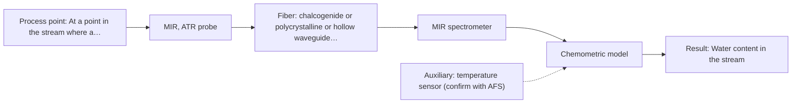
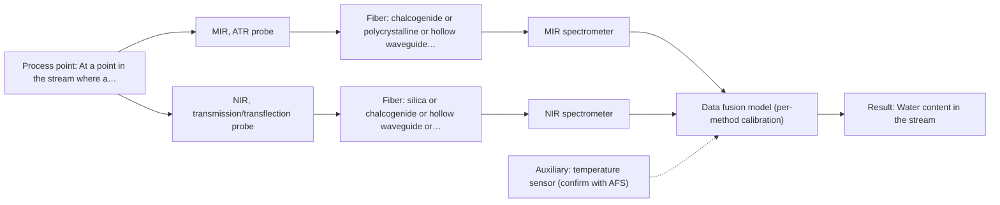

# First technical assessment: Water content in a petroleum stream

## Answer

**Customer request (our summary):** Enquiry about a fiber-based (in-line) measurement of water in a petroleum stream, to be located closer to the process with the analyzer outside the process area; the customer asks what to clarify and what a first comparison experiment should establish before equipment selection.

### Brief answer

Test a mid-infrared ATR fiber probe first: the supplied material shows water content in petroleum measured with ATR probes, and MIR gives well-defined water bands. A NIR transmission or transflection measurement is the natural comparison. Both need representative samples and the laboratory water determination as reference. Still open: the stream state at the probe, the water range and required response time, the probe-to-analyzer distance, and the process conditions.

### Proposal

- **Best current option:** O2 (recommended)
- **Basis:** supplied AFS sources
- **What would change it:** If the stream at the probe proves to be a gas, multiphase or heavily fouling, or if the required water range and detection limit are beyond what an ATR measurement can show, the choice would move to another technique or to the combined option. A required fiber link longer than a mid-infrared fiber can carry would also change the recommendation.
- **Next step:** Run the first comparison experiment on representative samples across the expected water range with MIR-ATR and NIR transmission or transflection, against the laboratory water determination.

**Secondary evidence (external, not AFS material):** G1: E01 ¶12; G2: E02 ¶33, E02 ¶36; G3: no usable external source found; G4: no usable external source found. See Expert detail.

**Decision status:** Provisional feasibility assessment

### Solution options

| ID | Tier | Methods | Confidence | Cost class, S01 Table 1 (p.6) | Ease of use | Maintenance | Performance fit | Sources |
|---|---|---|---|---|---|---|---|---|
| O1 | Simple | M2 NIR, transmission/transflection probe | Low: physical state unknown, sample clarity unknown; uncited auxiliary sensor | average cost (row 7) | standard silica optics, familiar handling | low; probe cleaning and recalibration | least effort; long fiber runs to remote analyzer | [1: S01 p.10] [2: S01 p.18] [3: S02 p.7] |
| O2 | Recommended | M1 MIR, ATR probe | Low: physical state unknown, sample clarity unknown; uncited auxiliary sensor | high cost (row 2) | immersion ATR probe in contact with stream | crystal cleaning and fouling control | shown water-in-petroleum precedent; strong water bands | [4: S02 p.13] [5: S01 p.9] [6: S01 p.10] |
| O3 | Extended (multi-method) | M3 MIR, ATR probe + NIR (combination) | Low: physical state unknown, sample clarity unknown; uncited auxiliary sensor; multi-method, fusion benefit not yet shown | high cost (rows 2, 7) | two instruments and one fused model | two calibrations and two instrument checks | later hypothesis only if one method falls short | [7: S01 p.13] [8: S01 p.8] [9: S01 p.7] [10: S02 p.14] [11: S01 p.8] |

*Confidence rates the basis of the advice (how much is known and cited), not a predicted accuracy or probability of success. It starts at High, or at Medium when a key question on the method or the option is open, and drops one level per weakness listed (floor Low).*

*Cost class is the relative rating in S01 Table 1 (p.6) for the in-line method+technique rows named (the highest one for a multi-method option); it is not a price.*

### Setup sketch

*Recommended option O2; drawn by code from the option, a schematic, not a configuration.*

### Key questions

1. At the proposed measurement point, is the stream a single-phase liquid, and is it clear/transparent or turbid, emulsified or otherwise light-scattering, and does that change with process conditions?
2. What is the water content range in the stream, the smallest change that must be detected, and the required response time?
3. How far is the intended analyzer location from the probe point, and along which route would the fiber run?

## Expert detail

**Customer enquiry**

> We handle a petroleum stream and currently send samples to a laboratory for water determination. We want to investigate a fiber based measurement closer to the process so that changes can be noticed sooner. The analyzer would be outside the process area. Before selecting equipment, we need to know what to clarify and what a first comparison experiment should establish.

**Decision status:** Provisional feasibility assessment. The supplied material contains a directly relevant precedent (water content in petroleum measured with ATR probes) and supports a shortlist of methods to test, but the stream state, water range, process conditions and link distance are not known. The choice is therefore provisional and rests on the assumptions stated with each option.

### Parameters

| ID | Parameter | Kind | Need | Measured by | Why | Sources |
|---|---|---|---|---|---|---|
| P1 | Water content in the stream | quantitative | required | Spectroscopy: MIR | This is the target of the enquiry, and its range and required detection limit decide whether a single method is sufficient. | [4: S02 p.13] |
| P2 | Independent water reference values for calibration and validation | quantitative | required | Reference lab method: the customer's existing laboratory water determination | Calibration and held-out validation need independent values from the laboratory water determination the customer already uses. | [12: REF §3] |
| P3 | Temperature at the measurement point | quantitative | required | Auxiliary sensor: temperature sensor (engineering judgement: confirm availability with AFS) | Water bands and the ATR response depend on temperature, and the stream temperature is not stated. | *(no verified source: engineering judgement)* |
| P4 | Matrix composition and interfering species of the stream | qualitative | optional | Not measurable in-line by spectroscopy; alternative: laboratory analysis of the stream composition from existing customer data | Should be available from the customer's existing laboratory data; it decides whether one calibration can cover the stream or must be extended for different feeds. | *(no verified source: engineering judgement)* |

### Solution option details

- **O1 cost drivers:** one NIR spectrometer, probe, fiber routing, calibration effort
- **O2 cost drivers:** MIR spectrometer, ATR probe, MIR fiber link, calibration effort
- **O3 cost drivers:** two spectrometers, two probes, synchronisation and fusion effort
- **O3 combining methods:** Fusion level: start with one model per method and then fuse joined spectra or per-method scores with block scaling, so that neither method dominates the model. MIR-ATR and NIR transmission or transflection do not sample the same volume (a few micrometres against a defined pathlength), so the same-spot requirement is hard to meet in a flowing stream and must be checked. Data must be synchronised to a common time step, each instrument needs its own calibration and diagnostics, and the fused model must beat the best single method on held-out runs.

*Extended (multi-method) option O3; drawn by code from the option, a schematic, not a configuration.*

### Premise check

- **Precedent only:** A fiber-based measurement can sit closer to the process while the analyzer stays outside the process area (fiber link plus remote analyzer feasible here). A source states that mid-IR ATR immersion probes allow analysis at a significant distance from the spectrometer, which is a reason to test this arrangement. No supplied source states an achievable length for a mid-infrared fiber link, so the required distance stays an open question. [13: S01 p.10]
- **Supported:** Moving the measurement closer to the process will make changes noticed sooner. The sources describe in-process measurement without sampling as eliminating delays, which is the mechanism behind earlier notice of change. [14: S01 p.3]
- **Not covered:** The laboratory water determination is a suitable reference for the comparison. No supplied source addresses the customer's laboratory water determination, its uncertainty, its sampling lag or its representativeness for this stream; the feasibility plan needs these values from the customer. *(no verified source: engineering judgement)*

### Requirements

**Stated by the customer**

- "We handle a petroleum stream"
- "currently send samples to a laboratory for water determination"
- "a fiber based measurement closer to the process"
- "so that changes can be noticed sooner"
- *Further statements: see the customer enquiry above.*

**Key unknowns**

- Water content range in the stream and the size of change that must be detected, with the required response time.
- Physical state at the proposed measurement point: single-phase liquid, gas, multiphase; whether free water or droplets can appear.
- Temperature, pressure and area classification at the probe point.
- Distance and routing between the proposed probe point and the analyzer location (no source states an achievable mid-infrared link length).
- Matrix composition and possible interferences: hydrocarbon type, additives, contaminants.
- Reference method uncertainty, sampling lag and representativeness of the current laboratory water determination.

### Clarification questions (most decision-relevant first)

Q1. At the proposed measurement point, is the stream a single-phase liquid, and is it clear/transparent or turbid, emulsified or otherwise light-scattering, and does that change with process conditions? *Why it matters:* The optical regime and physical state decide whether a mid-IR ATR contact measurement or a NIR transmission/transflection geometry is the right first test. *(affects: technique)*
Q2. What is the water content range in the stream, the smallest change that must be detected, and the required response time? *Why it matters:* These numbers set the go/no-go basis and decide whether one method can cover the target. *(affects: status)*
Q3. How far is the intended analyzer location from the probe point, and along which route would the fiber run? *Why it matters:* No supplied source states an achievable mid-infrared link length, so this distance decides whether the remote-analyzer arrangement is feasible. *(affects: installation)*
Q4. What are the temperature, pressure and area classification at the probe point, and what fouling or cleaning is expected there? *Why it matters:* These conditions decide the probe and fiber materials, the installation and the maintenance effort. *(affects: installation)*
Q5. What is the procedure, uncertainty and sampling lag of the current laboratory water determination? *Why it matters:* The comparison and the calibration validation rest on this reference being independent and precise enough for the change to be detected. *(affects: status)*

### Recommendation

- **M1 · Primary candidate: MIR, ATR probe.** A supplied page shows water content in petroleum being measured with ATR probes, and mid-IR gives well-defined absorption bands for a small molecule such as water. ATR probes are made for liquids and soft solid samples and can sit remotely from the spectrometer. *Conditions:* Applies if the stream at the measurement point is a liquid or soft, pumpable phase that can make tight contact with the ATR crystal. [4: S02 p.13] [5: S01 p.9] [6: S01 p.10]
- **M2 · Comparison candidate: NIR, transmission/transflection probe.** NIR is the most common online method run through fiber probes, and silica fibers are stated to carry long cable runs, which suits an analyzer placed away from the process. Transmission or transflection is the preferred geometry for transparent to semi-transparent liquids. *Conditions:* Applies if the stream is transparent or semi-transparent and a controlled optical pathlength can be set at the measurement point. [1: S01 p.10] [2: S01 p.18] [3: S02 p.7]
- **M3 · Conditional candidate: MIR, ATR probe + NIR (combination).** A combination is a later hypothesis: it is worth testing only if one single method cannot reach the required water range or cannot cope with a changing stream. Any gain from combining is a hypothesis, not a demonstrated result for this stream. *Conditions:* Applies only if the single-method tests show that M1 or M2 does not cover the required water range or the observed stream variability. [9: S01 p.7] [10: S02 p.14] [11: S01 p.8]
- **M4 · Not recommended: Raman probe.** Raman signals are several orders of magnitude weaker than infrared absorption peaks, and a hydrocarbon matrix can add a fluorescence background of much higher intensity; no supplied source shows water in petroleum measured by Raman. [15: S01 p.11] [16: S01 p.11]

### Measurement concept

- **Probe and geometry:** Mid-infrared ATR probe in contact with the stream as the first choice; NIR transmission or transflection probe with a controlled pathlength as the comparison. The probe sits at the process point, the spectrometer stays away from it, connected by fiber.
- **Location:** At a point in the stream where a representative, single-phase liquid wets the probe; location to be confirmed from the process data.
- **Fiber link:** Silica fibers for NIR are stated for 100-300 m cable runs; no source states an achievable length for a mid-infrared link, so that distance is an open question. [3: S02 p.7] [13: S01 p.10]

### Spectral range

- **MIR:** Nominal mid-IR range 4000-400 cm-1 (2.5-25 um); the usable range depends on the instrument, fiber and probe actually selected. [5: S01 p.9]
- **NIR:** Nominal NIR range 780-2500 nm; the usable range depends on the instrument, fiber and probe actually selected. [17: S01 p.10]

### Risks and uncertainty

- The physical state at the measurement point is unknown; if the stream is a gas, multiphase or cannot wet the ATR crystal, the mid-infrared ATR route does not apply. *(rules: R-MIR-2, R-GEN-5)* *(no verified source: engineering judgement)*
- The water content range and the required detection limit are unknown, so it cannot yet be said whether one method covers the target. *(rules: R-NIR-4)* *(no verified source: engineering judgement)*
- No supplied source states an achievable length for a mid-infrared fiber link, so routing the analyzer outside the process area may not be feasible at the required distance. *(rules: R-FIB-2)* *(no verified source: engineering judgement)*
- The laboratory reference may be less representative or less precise than the change that must be seen, because of sampling lag and possible water pickup or loss between the process and the laboratory. *(rules: R-GEN-2)* *(no verified source: engineering judgement)*

### First feasibility experiment

1. **Fix the target and the go/no-go criteria with the customer: water range, the change to be detected, required response time, and the uncertainty of the laboratory reference.** Without these numbers the comparison has no pass or fail basis. [12: REF §3]
2. **Collect representative samples across the expected water range and process variation (temperature, flow, single phase versus free water), and record the process conditions for each sample.** The model must see the variation it will meet in the stream. [18: S01 p.7]
3. **Measure every sample with the single methods first (MIR-ATR and NIR transmission/transflection) and with the laboratory water determination as reference.** This decides which single method is worth carrying forward. [19: S01 p.3]
4. **Build one calibration per method and validate it on held-out runs or batches, not on the samples used for calibration; report the comparison against the reference.** Held-out validation is the only honest test of the calibration. [20: S03 p.14]
5. **Only if no single method meets the go/no-go criteria, test the combined MIR-ATR plus NIR option on the same samples and check that the fused model beats the best single method on held-out runs.** A combination has to earn its extra instrument. [21: REF §5]

**Reference measurements:** The customer's existing laboratory water determination, with its stated uncertainty and sampling lag, used as the independent reference for every sample.

**Decision basis:** The customer's own numbers for water range, required change and response time; a method passes only if the held-out validation meets them.

### Assumptions

- The stream at the proposed measurement point can be brought into contact with a probe (liquid or soft, pumpable phase).
- The laboratory water determination is independent enough to serve as reference; its uncertainty is not yet known.
- The analyzer can be placed at a distance from the probe that a fiber link of the chosen family can carry; no source states a mid-infrared link length.

### Not covered by the supplied sources

- Accuracy, detection limit or response time for water in a petroleum stream: the supplied example page shows ATR spectra of water in petroleum but no performance figures.
- An achievable fiber link length for a mid-infrared probe run to an analyzer outside the process area.
- Safety and area classification, fouling behaviour in this specific stream, and the customer's laboratory water determination procedure.

### Further notes

- **Chemometrics:** Water determination from MIR-ATR or NIR spectra needs a chemometric calibration built on the reference values, because the bands are broad and overlapping in NIR and the calibration is specific to the matrix; after a change of stream composition it must be re-validated on the new material.
- **Real-time tracking:** The purpose is earlier notice of change, and fiber probes at the process point give results in near real time; the comparison should therefore include the required update rate and time resolution, not only the accuracy.
- **Future direction:** If the laboratory comparison selects one method and one water range, a compact analyzer built for that specific task could be a later step.

### Secondary evidence (external, not AFS material)

*Found by a literature search for gaps the supplied AFS sources leave open. Not AFS material and not proof for this case; every quote below was verified verbatim against the fetched text.*

*Live search unavailable (library only: cache miss (europepmc); cache miss (openalex)); curated library only.*

**G1 · auxiliary sensor:** In-line measurement of Temperature at the measurement point with temperature sensor

- **E01 ¶12** The temperature sensitivity of the OH bands in NIR and MIR is a severe drawback for measuring aqueous solution, making tempered sample holders necessary. *How it applies:* This could inform whether the MIR ATR measurement point needs temperature control or monitoring, and what temperature stability to test before comparing spectra. *Limits and transfer risks:* The quote concerns aqueous solutions and tempered sample holders, not a flowing petroleum stream or an in-line fiber probe; transfer to petroleum and process conditions is unproven. *(supports O2)*
  > "Additionally, the temperature sensitivity of the OH bands is a severe drawback for measuring aqueous solution in NIR and MIR, which makes tempered sample holders necessary [29]."
  > A critical review of recent trends, and a future perspective of optical spectroscopy as PAT in biopharmaceutical downstream processing. (2020) · Analytical and bioanalytical chemistry · doi:10.1007/s00216-020-02407-z · https://europepmc.org/article/PMC/PMC7072065 · retrieved 2026-10-17, full text, licence: cc by, via curated library

**G2 · multi-method:** Combining several spectroscopy methods (data fusion) (Fusion level: start with one model per method and then fuse joined spectra or per-method scores with block scaling, so that neither method dominates the model. MIR-ATR and NIR transmission or transflection do not sample the same volume (a few micrometres against a defined pathlength), so the same-spot requirement is hard to meet in a flowing stream and must be checked. Data must be synchronised to a common time step, each instrument needs its own calibration and diagnostics, and the fused model must beat the best single method on held-out runs.)

- **E02 ¶33** High-level data fusion works at the decision level, where supervised models are first fitted to each data matrix. *How it applies:* This supports starting with one model per method and then fusing per-method outputs, as a possible route for MIR-ATR and NIR data. *Limits and transfer risks:* The source is a review of data fusion in PAT and does not test MIR-ATR/NIR on petroleum or flowing streams; the exact fusion architecture and synchronisation still need local validation. *(supports O3)*
  > "The high-level data fusion (HLDF) (also called "decision-level" fusion) works on a decision level. This means that the first step is to fit some supervised models to each data matrix."
  > Challenges and Opportunities of Implementing Data Fusion in Process Analytical Technology-A Review. (2022) · Molecules (Basel, Switzerland) · doi:10.3390/molecules27154846 · https://europepmc.org/article/PMC/PMC9369811 · retrieved 2026-10-17, full text, licence: cc by, via curated library
- **E02 ¶36** Instrument complementarity alone was not sufficient to improve performance for several CQAs in a Raman and FT-IR food analytical study. *How it applies:* This is a reason to require that any fused MIR-ATR/NIR model beats the best single method on held-out runs before selecting O3. *Limits and transfer risks:* The cited study is food analytical and uses Raman and FT-IR, not MIR-ATR and NIR in petroleum; the result may not transfer to this matrix or process. *(supports O3)*
  > "In some situations, instrument complementarity (not data complementarity) was not sufficient to improve the performance of predictive several CQAs, as shown by a Raman and FT-IR data based food analytical study [73]."
  > Challenges and Opportunities of Implementing Data Fusion in Process Analytical Technology-A Review. (2022) · Molecules (Basel, Switzerland) · doi:10.3390/molecules27154846 · https://europepmc.org/article/PMC/PMC9369811 · retrieved 2026-10-17, full text, licence: cc by, via curated library

**G3 · not in the supplied sources:** Accuracy, detection limit or response time for water in a petroleum stream: the supplied example page shows ATR spectra of water in petroleum but no performance figures.

- No usable external source found.

**G4 · not in the supplied sources:** An achievable fiber link length for a mid-infrared probe run to an analyzer outside the process area.

- No usable external source found.

### Evidence (verified quotes)

1. ✓ **S01 p.10** (general): "Near-IR vibrational spectroscopy (NIR) is the most common online analysis method performed using fiber optic probes."
2. ✓ **S01 p.18** (general): "Transmission is the preferred method for transparent or semi-transparent liquids, such as skim milk, whey, or permeate."
3. ✓ **S02 p.7** (performance figure): "Robust 100-300m cables made with Silica fibers of low OH-content (<0.1ppm OH) enable remote industrial process-control"
4. ✓ **S02 p.13** (application precedent): "measurement of water content in petroleum"
5. ✓ **S01 p.9** (general): "Vibrational spectroscopy in the mid-IR range (4000-400 cm-1) is one of the most informative methods of chemical analysis."
6. ✓ **S01 p.10** (general): "ATR fiber probes (Fig.1) enable the analysis of liquids and solid elastic samples, such as biological tissue, using specialized probes utilizing high-transmission fiber optics in the Mid-IR region."
7. ✓ **S01 p.13** (general): "typically at a depth of few microns"
8. ✓ **S01 p.8** (general): "Ultimately, the measurement data must be normalized to a common time step."
9. ✓ (precedent only) **S01 p.7** (method gain): "The analysis of such systems may require a combination of two or even more spectral methods."
10. ✓ **S02 p.14** (application precedent): "NIR-Reflex & MIR-ATR-spectroscopy to control polymer extrusion in-line"
11. ✓ **S01 p.8** (general): "It is crucial that the spectral information obtained by different methods-Mid-IR, NIR, Raman, and fluorescence spectra-is collected from the same small, even pinpoint, area of the sample."
12. ✓ **REF §3** (general): "Representative samples or process states, independent reference measurements, what is compared, and the basis for the go / no-go decision."
13. ✓ **S01 p.10** (general): "These immersion probes operate on the ATR principle but allow analysis at a significant distance from the spectrometer, without the need for sampling."
14. ✓ **S01 p.3** (general): "It allows for in-process analysis, i.e., directly in the process flow or reactor without sampling, eliminating delays and the risk of sample contamination."
15. ✓ **S01 p.11** (general): "signals, which are several orders of magnitude weaker than IR absorption peaks"
16. ✓ **S01 p.11** (general): "superposition of luminescence (fluorescence), which has a significantly higher intensity."
17. ✓ **S01 p.10** (general): "NIR spectra (780-2500 nm) contain predominantly overtones and component bands of fundamental vibrations of molecules"
18. ✓ **S01 p.7** (general): "Morphological factors, such as sample inhomogeneity (e.g., biological tissue) or process turbulence, must also be considered when selecting a measurement technique."
19. ✓ **S01 p.3** (general): "samples of incompletely known composition, in order to select the most suitable method or combination of methods."
20. ✓ **S03 p.14** (general): "A thorough validation, including full, segmented and random-subset CVs, as well as randomization tests, are recommended in any cases for which important conclusions depend on calibration or discrimination models built on limited experimental material."
21. ✓ (precedent only) **REF §5** (method gain): "compare with the best single method."

### Verification

- Citations verified: 28 of 28 (exact or whitespace/hyphen-tolerant match on the cited page, scope checked).
- Hard check failures before deterministic corrections: 0; still open: 0; soft warnings: 4; repair rounds: 1.
- Corrected deterministically after verification (1):
  - ⚠ recommendations[2].combined_with: combined_with normalised to ['NIR'] (duplicates and the entry's own method removed)
- External evidence (cache): 3 quote(s) verified verbatim (exact or whitespace/hyphen-tolerant, at most 400 characters and 2 sentences, against the cited paragraph); 0 item(s) dropped.
- External search: 6 query(ies), 0 hit(s), 3 source(s) (3 from the curated library); ⚠ library only: cache miss (europepmc); cache miss (openalex).
- External step: 2 model call(s), 38.9 s extra (cost in the run JSON).

*Run D06-20261018T080635Z-fbfc · models deepseek/deepseek-v4.1-flash*
