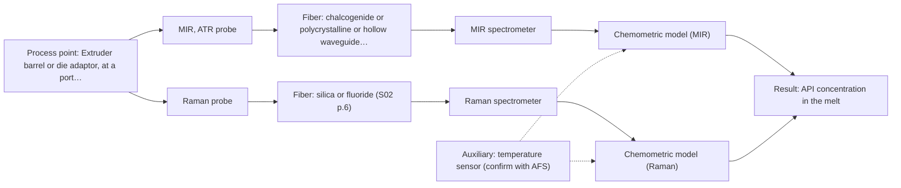
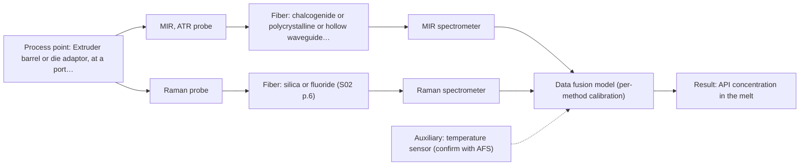

# First technical assessment: API concentration during hot polymer extrusion

## Answer

**Customer request (our summary):** Customer is developing a hot polymer extrusion process with an active pharmaceutical ingredient and wants to investigate whether an optical measurement can detect composition changes in the melt. They have offline assays and note the process interface is hot and may be exposed to material build up. They request an initial comparison plan and questions before choosing a probe.

### Brief answer

Start with a laboratory comparison of mid-IR ATR and Raman on representative melt samples, using the offline assays as reference; mid-IR ATR has a precedent for an active ingredient in hot polymer. Which probe fits the extruder still depends on the API concentration, the melt's optical clarity and the interface temperature. Answer those questions before a probe is chosen.

### Proposal

- **Best current option:** O2 (recommended)
- **Basis:** supplied AFS sources
- **What would change it:** A stated API concentration and melt optical regime would change the comparison: a high-concentration, turbid melt could be covered by MIR-ATR alone (O1), while a clear melt or a very low target level would bring a transmission or transflection geometry into the test. A temperature limit or a build-up rate that rules out a contact crystal would change the probe and the installation.
- **Next step:** Provide the target species and concentration range, the melt temperature at the planned port, and representative melt samples for a first MIR-ATR and Raman comparison against the offline assays.

**Secondary evidence (external, not AFS material):** G1: no usable external source found; G2: E01 ¶31, E01 ¶36; G3: no usable external source found; G4: no usable external source found. See Expert detail.

**Decision status:** Provisional feasibility assessment

### Solution options

| ID | Tier | Methods | Confidence | Cost class, S01 Table 1 (p.6) | Ease of use | Maintenance | Performance fit | Sources |
|---|---|---|---|---|---|---|---|---|
| O1 | Simple | M1 MIR, ATR probe | Low: open question: Q1 (starts at Medium); uncited auxiliary sensor | high cost (row 2) | one contact probe, one spectrometer | crystal cleaning whenever build-up occurs | gives the molecular fingerprint directly at the melt | [1: S02 p.14] [2: S01 p.5] [3: S01 p.10] [4: S04 p.4] [5: S02 p.6] |
| O2 | Recommended | M1 MIR, ATR probe; M2 Raman probe | Low: open question: Q1 (starts at Medium); uncited auxiliary sensor | high cost (rows 2, 12) | two probes and two spectrometers to run | two calibrations, two probes to keep clean | compares two complementary methods before committing to one | [6: S01 p.3] [7: S01 p.11] [2: S01 p.5] [3: S01 p.10] [4: S04 p.4] [1: S02 p.14] [5: S02 p.6] [8: S01 p.11] [9: S01 p.11] [10: S01 p.16] [11: S02 p.7] |
| O3 | Extended (multi-method) | M1 MIR, ATR probe; M2 Raman probe; M3 MIR, ATR probe + Raman (combination) | Low: open question: Q1 (starts at Medium); uncited auxiliary sensor; multi-method, fusion benefit not yet shown | high cost (rows 2, 12) | combined probe head plus fusion software | per-method calibration and diagnostics, two instruments | only if one method cannot cover the composition target | [12: S01 p.8] [13: S01 p.8] [14: S01 p.9] [15: S04 p.4] [2: S01 p.5] [3: S01 p.10] [4: S04 p.4] [1: S02 p.14] [5: S02 p.6] [7: S01 p.11] [8: S01 p.11] [9: S01 p.11] [10: S01 p.16] [11: S02 p.7] [16: S01 p.7] [17: S02 p.16] [18: S01 p.8] [19: REF §5] |

*Confidence rates the basis of the advice (how much is known and cited), not a predicted accuracy or probability of success. It starts at High, or at Medium when a key question on the method or the option is open, and drops one level per weakness listed (floor Low).*

*Cost class is the relative rating in S01 Table 1 (p.6) for the in-line method+technique rows named (the highest one for a multi-method option); it is not a price.*

### Setup sketch

*Recommended option O2; drawn by code from the option, a schematic, not a configuration.*

### Key questions

1. What is the target species (the API and any other component) and its expected concentration range in the melt?
2. Is the melt optically clear, turbid or opaque at the measurement point, and which polymer and additives are present?
3. What are the melt temperature and pressure at the planned measurement point, and how far is the spectrometer from that port?

## Expert detail

**Customer enquiry**

> We are developing a hot polymer extrusion process that incorporates an active pharmaceutical ingredient. We want to investigate whether an optical measurement can detect composition changes while the melt is being processed. We have offline assays, but the process interface is hot and may be exposed to material build up. We need an initial comparison plan and the questions required before choosing a probe.

**Decision status:** Provisional feasibility assessment. A shortlist can be justified: an ATR fibre probe has a precedent for recording spectra of an active ingredient in a hot polymer during extrusion control, and MIR and Raman are stated to be complementary. The probe and technique still rest on the API concentration, the melt's optical behaviour and the interface temperature, which the enquiry does not give.

### Parameters

| ID | Parameter | Kind | Need | Measured by | Why | Sources |
|---|---|---|---|---|---|---|
| P1 | API concentration in the melt | quantitative | required | Spectroscopy: MIR | This is the composition change the customer wants to detect in the melt. | [1: S02 p.14] |
| P2 | Melt temperature at the measurement point | quantitative | required | Auxiliary sensor: temperature sensor (engineering judgement: confirm availability with AFS) | Temperature shifts vibrational bands and affects instrument stability, so it must be recorded with every spectrum. | *(no verified source: engineering judgement)* |
| P3 | Water or moisture content of the melt | quantitative | optional | Reference lab method: the customer's existing offline assay | Water absorbs strongly in the infrared, so its level changes the MIR-ATR spectrum and should be available as a reference value. | [10: S01 p.16] |

### Solution option details

- **O1 cost drivers:** one mid-IR spectrometer, mid-IR fibre probe and ATR crystal, trial time
- **O2 cost drivers:** two spectrometers, mid-IR and Raman probes, longer laboratory trial
- **O3 cost drivers:** two spectrometers, combined ATR/Raman probe, data-fusion model development
- **O3 combining methods:** Low-level fusion: the synchronised MIR-ATR and Raman spectra are concatenated into one matrix and block-scaled so that neither method dominates the model. A combined ATR/Raman probe head is needed so that both methods look at the same spot on the melt, and the data must be normalised to a common time step. Each method keeps its own calibration and diagnostics, and the fused model must beat the best single-method model on independent runs, otherwise the extra instrument is dropped.

*Extended (multi-method) option O3; drawn by code from the option, a schematic, not a configuration.*

### Premise check

- **Precedent only:** An optical measurement can detect composition changes in the melt while the process is running. A shown in-line extrusion application is a reason to test the method here, not proof that it will work for this melt. [1: S02 p.14] [20: S02 p.14] [21: REF §3]
- **Not covered:** Material build-up on the interface will not prevent an in-line optical measurement. No supplied page states how fast a polymer melt fouls a probe window or crystal, or how such an interface is cleaned; this stays open (Q4). *(no verified source: engineering judgement)*

### Requirements

**Stated by the customer**

- "We are developing a hot polymer extrusion process that incorporates an active pharmaceutical ingredient"
- "We want to investigate whether an optical measurement can detect composition changes while the melt is being processed"
- *Further statements: see the customer enquiry above.*

**Key unknowns**

- Target species and its expected concentration range in the melt
- Optical regime of the melt (clear, turbid, opaque) and the polymer/additive composition
- Melt temperature and pressure at the planned measurement point
- Build-up and cleaning behaviour at the probe interface
- Required accuracy, detection limit and response time (go/no-go criteria)
- Details of the existing offline assays and the sampling protocol

### Clarification questions (most decision-relevant first)

Q1. What is the target species (the API and any other component) and its expected concentration range in the melt? *Why it matters:* The concentration level decides whether one sensitive method is enough or whether weaker signals have to be supplemented. *(affects: method)*
Q2. Is the melt optically clear, turbid or opaque at the measurement point, and which polymer and additives are present? *Why it matters:* The optical regime decides between a contact ATR geometry and reflection or transmission geometries. *(affects: technique)*
Q3. What are the melt temperature and pressure at the planned measurement point, and how far is the spectrometer from that port? *Why it matters:* Probe, crystal and fibre type must match the temperature and the available distance, and the supplied material gives no temperature limit or mid-IR link length. *(affects: installation)*
Q4. How quickly does material build up on an interface in this melt, and how is the extruder cleaned between runs? *Why it matters:* A deposit on the measurement surface can change or block the signal and dictates how the probe is mounted and cleaned. *(affects: installation)*
Q5. What accuracy, detection limit and response time must the in-line measurement meet, and how are the offline assays taken and referenced? *Why it matters:* These figures are the go/no-go criteria for the comparison and cannot be set by AFS. *(affects: status)*

### Recommendation

- **M1 · Primary candidate: MIR, ATR probe.** ATR is the usual in-line route for MIR, because the strong mid-IR absorption limits transmission to very thin layers and ATR fibre probes are used for in-line, in-process measurement. The nearest precedent is an ATR probe coupled to an FTIR recording the spectra of an active ingredient in a hot polymer during extrusion control. *Conditions:* The melt must make tight contact with the ATR crystal, and the crystal must tolerate the build-up and cleaning regime. [2: S01 p.5] [3: S01 p.10] [4: S04 p.4] [1: S02 p.14] [5: S02 p.6]
- **M2 · Comparison candidate: Raman probe.** Raman bands sit at the same fundamental frequencies as mid-IR bands but with different intensities, so the two methods are stated to complement each other. Raman is also less affected by water, which helps if the melt carries residual moisture. *Conditions:* Check the fluorescence background of the real melt first, because luminescence can be much more intense than the Raman signal. [7: S01 p.11] [8: S01 p.11] [9: S01 p.11] [10: S01 p.16] [11: S02 p.7]
- **M3 · Conditional candidate: MIR, ATR probe + Raman (combination).** If neither single method covers the composition change, the two can be combined: their vibrational information is complementary and a combined ATR/Raman fibre probe has been shown. Any gain from combining is a hypothesis to be tested against the best single method. *Conditions:* Test the combination only after the single-method trials, and only if no single method meets the target on the same spot and time base. [16: S01 p.7] [7: S01 p.11] [17: S02 p.16] [18: S01 p.8] [19: REF §5]

### Measurement concept

- **Probe and geometry:** A mid-IR ATR fibre probe in contact with the melt is the first geometry to test; Raman on the same samples follows. A combined ATR/Raman probe head would be needed if both methods have to see the same spot.
- **Location:** Extruder barrel or die adaptor, at a port the customer can access for probe insertion and cleaning.
- **Fiber link:** A mid-IR link needs chalcogenide (CIR) or polycrystalline (PIR) fibres; the achievable link length is not stated in the supplied material and must be asked. [17: S02 p.16] [22: S02 p.6]

### Spectral range

- **MIR:** Nominal mid-IR range 4000-400 cm-1; the usable range depends on the instrument, the fibre and the ATR crystal actually selected. [23: S01 p.9] [24: REF §5]
- **Raman:** Reported as a Raman shift in cm-1, with the laser excitation wavelength stated separately; a combined ATR/Raman probe in the sources works with 680 nm and 785 nm excitation. [25: S01 p.11] [17: S02 p.16]

### Risks and uncertainty

- If the target sits at a very low concentration, the weak Raman signal may not be sufficient and the comparison would fall back on MIR-ATR alone. *(rules: R-RAM-1)* [8: S01 p.11]
- Material building up on the ATR crystal can change or block the signal, because ATR samples only the outermost few micrometres. *(rules: R-MIR-3)* [26: S01 p.13] [27: REF §5]
- The interface temperature and the achievable distance to the spectrometer are unknown, so the probe, crystal and fibre choice may have to change. *(rules: R-FIB-2)* *(no verified source: engineering judgement)*
- Any gain from combining MIR-ATR and Raman is a hypothesis and must be shown on the customer's own melt, with both methods looking at the same spot and time base. *(rules: R-CMB-1, R-CMB-2)* [28: REF §5]

### First feasibility experiment

1. **Collect representative melt samples across the expected variation: API level (low, nominal, high), polymer grade and moisture, and the process states (temperature, throughput) the probe would see.** Make the comparison representative of the real melt, not of one convenient condition. [29: REF §3]
2. **Measure every sample with MIR-ATR first as a single method, then with Raman on the same samples, and check the fluorescence background of the real melt.** Single methods first, so that a later combination is only tested against a known single-method result. [6: S01 p.3]
3. **Take independent reference values from the customer's offline assays on the same samples, with a documented sampling protocol.** Calibration and comparison need an independent reference, not the spectra themselves. *(no verified source: engineering judgement)*
4. **Build and validate one model per method on held-out runs or batches, and compare the two methods on those held-out data.** Shows which single method predicts composition change on material it has not seen. [30: S03 p.14]
5. **Only if no single method meets the target, test the combined MIR-ATR plus Raman measurement on the same spot and time base, and require it to beat the best single method; the go/no-go figures come from the customer (Q5).** Keeps the second instrument as a tested hypothesis rather than an assumption. [19: REF §5]

**Reference measurements:** The customer's existing offline assays serve as the independent reference; the sampling protocol and their uncertainty are not yet known (Q5).

**Decision basis:** A conditional shortlist is proposed on stated assumptions: ATR contact with the melt, a mid-IR link that can reach the port, and a target level that MIR-ATR or Raman can see. If any of these fails, the shortlist changes.

### Assumptions

- The melt can be brought into tight contact with an ATR crystal at the measurement port.
- The API level is high enough for at least one of the shortlisted methods to see it.
- A mid-IR fibre link of a workable length can be installed at the port; no source states such a length.

### Not covered by the supplied sources

- Operating temperature limit for a probe, crystal and fibre link at an extruder interface: no supplied page states a temperature rating.
- Achievable link length for a mid-IR (chalcogenide or polycrystalline) fibre run to an extruder: the supplied material shows only short laboratory lengths and no process-scale figure.
- Fouling rate of a polymer melt on an ATR crystal and a cleaning procedure for such an interface.

### Further notes

- **Chemometrics:** Both MIR-ATR and Raman need a calibration or classification model built on the customer's own melt and reference values, because the calibrations are matrix-specific and the bands overlap; a formulation change means the model has to be re-validated on the new material. The band regions found informative on one material are not transferable without this check.
- **Real-time tracking:** The purpose is continuous in-line tracking of composition change in the melt; fibre probes let the spectrometers sit away from the hot, dusty extruder, and the acquisition must be fast enough to follow the process.
- **Future direction:** If one method proves sufficient on this melt, a compact optical multisensor system dedicated to this task could later replace the laboratory spectrometers at the line.

### Secondary evidence (external, not AFS material)

*Found by a literature search for gaps the supplied AFS sources leave open. Not AFS material and not proof for this case; every quote below was verified verbatim against the fetched text.*

*Live search unavailable (library only: cache miss (europepmc); cache miss (openalex)); curated library only.*

**G1 · auxiliary sensor:** In-line measurement of Melt temperature at the measurement point with temperature sensor

- No usable external source found.

**G2 · multi-method:** Combining several spectroscopy methods (data fusion) (Low-level fusion: the synchronised MIR-ATR and Raman spectra are concatenated into one matrix and block-scaled so that neither method dominates the model. A combined ATR/Raman probe head is needed so that both methods look at the same spot on the melt, and the data must be normalised to a common time step. Each method keeps its own calibration and diagnostics, and the fused model must beat the best single-method model on independent runs, otherwise the extra instrument is dropped.)

- **E01 ¶31** Low-level data fusion is described as the simplest way to combine inputs by rearranging data from different sources into one new matrix, with variables placed one after the other. *How it applies:* This supports the O3 low-level fusion concept: synchronised MIR-ATR and Raman spectra could be concatenated into a single matrix, but the source does not specify block-scaling or time-step normalisation. *Limits and transfer risks:* The source is a general review, not a hot polymer melt with an API; transfer depends on whether the same concatenation and scaling choices suit the process spectra and whether the methods are truly complementary. *(supports O3)*
  > "Low-level data fusion (LLDF) is considered the simplest method to achieve a combination of inputs. In this case, the data is rearranged into a new data matrix, where the variables coming from different sources are placed one after the other."
  > Challenges and Opportunities of Implementing Data Fusion in Process Analytical Technology-A Review. (2022) · Molecules (Basel, Switzerland) · doi:10.3390/molecules27154846 · https://europepmc.org/article/PMC/PMC9369811 · retrieved 2026-10-17, full text, licence: cc by, via curated library
- **E01 ¶36** The review notes that instrument complementarity alone was not sufficient to improve predictive performance for several CQAs in a Raman and FT-IR food study. *How it applies:* This cautions that adding Raman to MIR-ATR in O3 should be tested against the best single-method model on independent runs, and dropped if it does not improve performance. *Limits and transfer risks:* The cited study is food analysis, not a hot polymer/API melt, and the review does not give a threshold or guarantee; the same lack of improvement may or may not occur here. *(supports O3)*
  > "In some situations, instrument complementarity (not data complementarity) was not sufficient to improve the performance of predictive several CQAs, as shown by a Raman and FT-IR data based food analytical study [73]."
  > Challenges and Opportunities of Implementing Data Fusion in Process Analytical Technology-A Review. (2022) · Molecules (Basel, Switzerland) · doi:10.3390/molecules27154846 · https://europepmc.org/article/PMC/PMC9369811 · retrieved 2026-10-17, full text, licence: cc by, via curated library

**G3 · not in the supplied sources:** Operating temperature limit for a probe, crystal and fibre link at an extruder interface: no supplied page states a temperature rating.

- No usable external source found.

**G4 · not in the supplied sources:** Achievable link length for a mid-IR (chalcogenide or polycrystalline) fibre run to an extruder: the supplied material shows only short laboratory lengths and no process-scale figure.

- No usable external source found.

### Evidence (verified quotes)

1. ✓ **S02 p.14** (application precedent): "Spectra of API in hot polymer obtained with Diamond cone ATR probe coupled to iC10 FTIR (MTAC)"
2. ✓ **S01 p.5** (general): "strong absorption in the mid-IR region limits the corresponding spectral method to the analysis of very thin samples (usually less than 50 μm), but it opens up the possibility of using attenuated total reflectance (ATR)"
3. ✓ **S01 p.10** (general): "ATR fiber probes (Fig.1) enable the analysis of liquids and solid elastic samples"
4. ✓ **S04 p.4** (general): "suitability of analyzed samples for ATR measurements, which is true for liquid or soft solid samples and their components, allowing a tight contact with the probe head."
5. ✓ **S02 p.6** (general): "1100 nm Chalcogenide As-S IR Fibers 6500 nm"
6. ✓ **S01 p.3** (general): "The ability to test various optical spectroscopy approaches is crucial for solving complex analytical problems, such as analyzing natural and industrial samples of incompletely known composition, in order to select the most suitable method or combination of methods."
7. ✓ **S01 p.11** (general): "This property makes mid-IR and Raman spectra complementary, that is, they complement each other."
8. ✓ **S01 p.11** (general): "measuring Raman spectra is hampered by the low intensity of Raman signals, which are several orders of magnitude weaker than IR absorption peaks in the IR range"
9. ✓ **S01 p.11** (general): "superposition of luminescence (fluorescence), which has a significantly higher intensity."
10. ✓ **S01 p.16** (general): "Raman is particularly well-suited for aqueous environments, as it exhibits low absorbance for water molecules compared to infrared methods."
11. ✓ **S02 p.7** (general): "Free of Polymer jacket fluorescence for Raman and Fluo- Spectroscopy"
12. ✓ **S01 p.8** (general): "Ultimately, the measurement data must be normalized to a common time step."
13. ✓ **S01 p.8** (general): "If the variables have different units of measurement, the data should be normalized in some way, for example, using an autoscaling algorithm."
14. ✓ **S01 p.9** (general): "One of the challenges of multispectral analysis is the need to simultaneously connect at least two independently operating measuring instruments."
15. ✓ **S04 p.4** (general): "none of the individual techniques was sufficient to completely separate the three sample classes"
16. ✓ (precedent only) **S01 p.7** (method gain): "The analysis of such systems may require a combination of two or even more spectral methods."
17. ✓ **S02 p.16** (application precedent): "Combi probe with 2 IR-fibers coupled to FTIR-spectrometer and 2 Silica fibers coupled to Fluo or Raman spectrometers to work with 680nm & 785nm laser excitation"
18. ✓ **S01 p.8** (general): "It is crucial that the spectral information obtained by different methods-Mid-IR, NIR, Raman, and fluorescence spectra-is collected from the same small, even pinpoint, area of the sample."
19. ✓ (precedent only) **REF §5** (method gain): "compare with the best single method."
20. ✓ **S02 p.14** (application precedent): "NIR-Reflex & MIR-ATR-spectroscopy to control polymer extrusion in-line"
21. ✓ **REF §3** (general): "a published application is a reason to test a method, not proof that it will work for a new customer."
22. ✓ **S02 p.6** (general): "3000 nm Polycrystalline Infrared Fibers 17 μm"
23. ✓ **S01 p.9** (general): "Vibrational spectroscopy in the mid-IR range (4000-400 cm-1) is one of the most informative methods of chemical analysis."
24. ✓ **REF §5** (general): "It is not a product specification: actual spectral coverage, fiber length, component ratings, detection limits and accuracy depend on the configuration and the sample."
25. ✓ **S01 p.11** (general): "The Raman shift is used as the horizontal (spectral) axis in Raman spectroscopy"
26. ✓ **S01 p.13** (general): "typically at a depth of few microns"
27. ✓ **REF §5** (general): "Usable range limited by fiber and crystal; contact, fouling, compatibility."
28. ✓ (precedent only) **REF §5** (method gain): "Sampling location and timing must be aligned; a gain is a hypothesis to test."
29. ✓ **REF §3** (general): "Representative samples or process states, independent reference measurements, what is compared, and the basis for the go / no-go decision."
30. ✓ **S03 p.14** (general): "A thorough validation, including full, segmented and random-subset CVs, as well as randomization tests, are recommended in any cases for which important conclusions depend on calibration or discrimination models built on limited experimental material."

### Verification

- Citations verified: 41 of 41 (exact or whitespace/hyphen-tolerant match on the cited page, scope checked).
- Hard check failures before deterministic corrections: 0; still open: 0; soft warnings: 4; repair rounds: 1.
- External evidence (cache): 2 quote(s) verified verbatim (exact or whitespace/hyphen-tolerant, at most 400 characters and 2 sentences, against the cited paragraph); 0 item(s) dropped.
- External search: 6 query(ies), 0 hit(s), 3 source(s) (3 from the curated library); ⚠ library only: cache miss (europepmc); cache miss (openalex).
- External step: 2 model call(s), 50.8 s extra (cost in the run JSON).

*Run D07-20261018T080635Z-e282 · models deepseek/deepseek-v4.1-flash*
