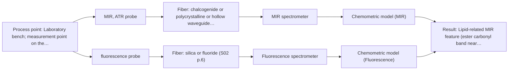
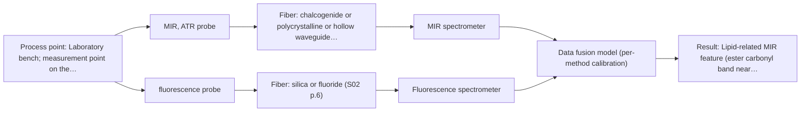

# First technical assessment: Local measurements of heterogeneous model tissues

## Answer

**Customer request (our summary):** Customer is evaluating a spectral measurement interface using model biological tissues (chicken muscle, fat, liver) for a laboratory classification study, comparing MIR ATR and fluorescence information. Key method-selection details are missing, and several premises need checking.

### Brief answer

Start with MIR ATR and fluorescence measured separately on the same marked positions of chicken muscle, fat and liver, several points per sample, each point given an independent tissue-type label. Published work on the same tissues reports that MIR ATR separates fat and fluorescence separates liver, so the comparison can show whether one method, or the combined data, separates all three classes. Still open: the fluorescence excitation choice, ATR contact quality, and the group's success criterion.

### Proposal

- **Best current option:** O2 (recommended)
- **Basis:** supplied AFS sources
- **What would change it:** If the tissue cannot make reproducible ATR contact, or the fluorescence signal from these samples is too weak or absent, the comparison falls back to MIR ATR alone (O1). If measurements at marked positions prove unreliable on these heterogeneous samples, the combined-probe option (O3) becomes the better fit.
- **Next step:** Agree the class labels, the independent reference and the numerical success criterion with the group, then run the two single-method blocks on the marked sample set.

**Secondary evidence (external, not AFS material):** G1: E01 ¶31, E01 ¶82; G2: no usable external source found. See Expert detail.

**Decision status:** Provisional feasibility assessment

### Solution options

| ID | Tier | Methods | Confidence | Cost class, S01 Table 1 (p.6) | Ease of use | Maintenance | Performance fit | Sources |
|---|---|---|---|---|---|---|---|---|
| O1 | Simple | M1 MIR, ATR probe | Medium: open question: Q2 (starts at Medium) | high cost (row 2) | single probe, one instrument | ATR crystal cleaning between samples | tests whether MIR ATR alone separates the classes | [1: S01 p.10] [2: S04 p.3] |
| O2 | Recommended | M1 MIR, ATR probe; M2 fluorescence probe | Low: open question: Q2 (starts at Medium); fit for soft solid to be tested, sample clarity unknown, fluorescent target unknown | high cost (rows 2, 19) | two probes, alignment at marked points | two instruments, crystal cleaning and probe care | gives the requested method comparison at shared points | [3: S04 p.4] [1: S01 p.10] [2: S04 p.3] [4: S04 p.3] [5: S04 p.4] |
| O3 | Extended (multi-method) | M3 MIR, ATR probe + Fluorescence (combination) | Low: fit for soft solid to be tested, sample clarity unknown, fluorescent target unknown; multi-method, fusion benefit not yet shown | high cost (rows 2, 19) | one combined probe, simultaneous acquisition | two instruments and a custom combined probe | same-spot fusion for heterogeneous tissue | [6: S04 p.2] [7: S01 p.8] [8: S01 p.8] [9: S04 p.4] |

*Confidence rates the basis of the advice (how much is known and cited), not a predicted accuracy or probability of success. It starts at High, or at Medium when a key question on the method or the option is open, and drops one level per weakness listed (floor Low).*

*Cost class is the relative rating in S01 Table 1 (p.6) for the in-line method+technique rows named (the highest one for a multi-method option); it is not a price.*

### Setup sketch

*Recommended option O2; drawn by code from the option, a schematic, not a configuration.*

### Key questions

1. What is the optical regime of the samples (opaque/turbid or clear) and which fluorescent species are present, or is a fluorescent indicator planned?
2. Can fresh tissue samples be presented so that the ATR crystal makes tight, reproducible contact (flat surface, controlled thickness and hydration)?
3. What are the classification labels and the number of classes, how many independent samples per class are planned, and which independent reference assigns the labels?

## Expert detail

**Customer enquiry**

> Our research group is evaluating a spectral measurement interface using model biological tissues such as chicken muscle, fat and liver. We want to compare MIR ATR and fluorescence information, because the material is heterogeneous and sequential measurements may not sample the same location. This is a laboratory classification study. We need a first comparison experiment and a clear statement of what its results would demonstrate.

**Decision status:** Provisional feasibility assessment. ATR fits soft solids that make tight contact with the crystal, and fluorescence is a reasonable second block where a fluorescent component is present. The supporting evidence is laboratory work on the same tissue types, so it justifies a comparison study rather than any statement of readiness.

### Parameters

| ID | Parameter | Kind | Need | Measured by | Why | Sources |
|---|---|---|---|---|---|---|
| P1 | Tissue class label | qualitative | required | Reference lab method: independent tissue-type assignment (e.g. histological or visual classification) | The study is a classification comparison, so every measurement point needs an independent tissue-type label to judge each method against. | *(no verified source: engineering judgement)* |
| P2 | Lipid-related MIR feature (ester carbonyl band near 1740 cm-1) | qualitative | required | Spectroscopy: MIR | This is the infrared feature that carries the fat-versus-other discrimination in the model tissue. | [2: S04 p.3] |
| P3 | Protein amide I and II bands | qualitative | optional | Spectroscopy: MIR | They come free with the same IR measurement and help interpret the fat spectra, but the source notes they are less discriminative because fat samples also contain protein. | [10: S04 p.3] |
| P4 | Porphyrin-related fluorescence peak near 613 nm | qualitative | required | Spectroscopy: Fluorescence | It is the fluorescence feature that distinguished liver from the other tissue types in the model system. | [4: S04 p.3] |

### Solution option details

- **O1 cost drivers:** one spectrometer, one ATR probe, sample handling
- **O2 cost drivers:** two spectrometers, two probes, longer measurement campaign
- **O3 cost drivers:** custom combined probe, two spectrometers, fusion software and model work
- **O3 combining methods:** The combined probe head measures both methods through one ATR crystal tip, so the analysed spot is the same; the two spectral blocks are concatenated at the spectral level, with scaling so neither method dominates. Acquisition rates differ, so the blocks must be normalised to a common time step, and each method keeps its own calibration and diagnostics. The fused model is kept only if it beats the better single method on held-out samples.

*Extended (multi-method) option O3; drawn by code from the option, a schematic, not a configuration.*

### Premise check

- **Precedent only:** Chicken muscle, fat and liver are suitable model biological tissues for evaluating this measurement interface. A published laboratory study used exactly chicken breast, fat and liver as its model system for evaluating a combined MIR-ATR and fluorescence probe; that is a reason to test, not proof for this group's samples. [11: S04 p.3]
- **Supported:** Heterogeneity and sequential measurements possibly not sampling the same location are real problems to address. The supplied material states directly that multi-method information must come from the same small area, and that alternating probes make this hard. [12: S01 p.8] [13: S04 p.2]
- **Precedent only:** Comparing MIR ATR and fluorescence information on these tissues is worthwhile. In the published chicken-tissue example neither method alone separated all three tissue types, while the concatenated IR and fluorescence data did; this is a hypothesis to test on the group's own samples. [3: S04 p.4] [9: S04 p.4]

### Requirements

**Stated by the customer**

- "model biological tissues such as chicken muscle, fat and liver"
- "compare MIR ATR and fluorescence information"
- "the material is heterogeneous and sequential measurements may not sample the same location"
- *Further statements: see the customer enquiry above.*

**Key unknowns**

- Which fluorescent species are present in the samples, and which excitation wavelength is intended.
- Whether fresh tissue can make tight, reproducible contact with an ATR crystal.
- The classification labels, number of classes, number of independent samples per class and the independent reference that assigns the labels.
- The success criterion: what result would make the comparison conclusive.
- Probe-to-spectrometer distance and the planned fiber link for the mid-IR channel.
- Usable spectral range of the instrument, fiber and probe actually selected.

### Clarification questions (most decision-relevant first)

Q1. What is the optical regime of the samples (opaque/turbid or clear) and which fluorescent species are present, or is a fluorescent indicator planned? *Why it matters:* Fluorescence only measures species that emit, and the sample's optical regime decides whether a fluorescence probe can collect a usable signal at all. *(affects: technique)*
Q2. Can fresh tissue samples be presented so that the ATR crystal makes tight, reproducible contact (flat surface, controlled thickness and hydration)? *Why it matters:* ATR requires tight contact with liquid or soft solid samples, and poor contact would dominate the mid-IR block. *(affects: M1)*
Q3. What are the classification labels and the number of classes, how many independent samples per class are planned, and which independent reference assigns the labels? *Why it matters:* The study compares classification performance, so the labels and their independent reference define what the models are validated against. *(affects: status)*
Q4. What numerical success criterion (for example correct classification per class on held-out samples) would make the comparison conclusive? *Why it matters:* The go/no-go basis must come from the customer, not from the sources. *(affects: status)*
Q5. What probe-to-spectrometer distance is planned for the mid-IR channel, and which mid-IR fiber is intended? *Why it matters:* No source states an achievable length for a mid-IR fiber link, so the installation depends on this answer. *(affects: installation)*
Q6. What usable spectral range do the selected instrument, fiber and probe cover? *Why it matters:* A nominal method range is not the range of a specific instrument, fiber or probe, so the usable range must be confirmed for the selected configuration. *(affects: technique)*

### Recommendation

- **M1 · Primary candidate: MIR, ATR probe.** ATR suits liquids and solid elastic samples that make tight contact with the crystal, which matches the stated sample state. In the chicken-tissue example, IR separated fat-rich tissue through the ester carbonyl band near 1740 cm-1. *Conditions:* Requires fresh tissue that makes reproducible tight contact with the ATR crystal. [1: S01 p.10] [2: S04 p.3]
- **M2 · Comparison candidate: fluorescence probe.** Fluorescence gives a chemically different view of the same tissues: in the chicken-tissue example the porphyrin-related peak at 613 nm separated liver from muscle and fat. It is worth testing as a single method beside MIR ATR, before any fusion. *Conditions:* Applies where the tissue contains a fluorescent component, or a justified fluorescent indicator is added. [4: S04 p.3] [5: S04 p.4]
- **M3 · Comparison candidate: MIR, ATR probe + Fluorescence (combination).** The published chicken-tissue result shows the individual techniques not separating all three classes, while the concatenated IR and fluorescence data did. One combined probe measures the same spot at the same time, which alternating probes cannot guarantee. *Conditions:* Test only after the single-method blocks, and only if the fused model beats the better single method on held-out samples. [9: S04 p.4] [6: S04 p.2]

### Measurement concept

- **Probe and geometry:** MIR: ATR probe with the tissue in tight contact with the crystal; Fluorescence: fluorescence fiber probe, or one combined ATR/fluorescence probe head for the later hypothesis. Nominal MIR range 4000-400 cm-1; the usable range depends on the instrument, fiber and probe actually selected, and no range is quoted for the fluorescence channel because it depends on the fluorophore and excitation.
- **Location:** Laboratory bench; measurement point on the tissue surface, identical marked positions for the two methods in the first comparison.
- **Fiber link:** Mid-IR light needs chalcogenide (CIR) or polycrystalline (PIR) fibers, not silica; the achievable mid-IR link length is not stated in the sources and is an open question. [14: S01 p.9] [15: S02 p.6]

### Spectral range

- **MIR:** Nominal mid-IR range 4000-400 cm-1, measured with the ATR technique on samples in tight contact with the crystal. [14: S01 p.9] [16: REF §5]
- **Fluorescence:** No fixed method range: the measured range is set by the fluorescent species present and by the chosen excitation wavelength, and must be confirmed for these samples. [17: S01 p.5]

### Risks and uncertainty

- Fluorescence only reports species that emit, so if emission from these particular tissues is weak or unstable the second information block is lost. *(rules: R-FLU-1)* [5: S04 p.4]
- ATR probes only a thin surface layer, so a dry or fatty surface film can dominate the spectrum and misrepresent the bulk tissue. *(rules: R-MIR-3)* [18: REF §5]
- With two separate probes and a marking grid the IR and fluorescence spots may not coincide exactly, so on heterogeneous tissue the two blocks describe slightly different material. *(rules: R-CMB-2)* [13: S04 p.2]
- All supporting evidence is laboratory work on similar tissue types, so it supports testing and not any statement of readiness for these samples or for later process or clinical use. *(rules: R-EVI-1, R-EVI-2)* [19: REF §3]

### First feasibility experiment

1. **Prepare at least three independent samples of each tissue type (muscle, fat, liver), fresh and of comparable thickness, with several distributed measurement points per sample to cover tissue heterogeneity.** Representative samples across the expected biological variation. [20: S04 p.3] [21: S04 p.3]
2. **Assign an independent tissue-type reference to every measurement point and keep that reference out of the spectral modelling.** Independent reference measurements. [22: REF §3]
3. **Measure MIR ATR alone on all points first, then fluorescence alone on the same marked points; keep the two data blocks separate for the first comparison.** Single methods first; the same-location question is handled by marked positions. [23: S04 p.2]
4. **Build one classification model per method block and validate it on held-out samples or positions; only then fuse the two blocks and check whether the fused model beats the better single method.** Combinations only after single methods; fusion must earn its place. [9: S04 p.4] [24: REF §5]
5. **Go/no-go: the group sets the numerical criterion (for example correct classification per class on held-out samples); the study reports whether one method or the combined data separates all three tissue types, and whether the two blocks agree at the same points.** A defined comparison and an agreed go/no-go basis. [25: REF §3]

**Reference measurements:** Independent tissue-type assignment per measurement point, made without reference to the spectra.

**Decision basis:** Numerical criterion set by the customer (for example correct classification rate per class on held-out samples and agreement between the two method blocks).

### Assumptions

- The tissue samples can be presented fresh and flat enough for tight ATR contact (see Q2).
- The tissues are assumed to be optically turbid and to contain at least one fluorescent component at a measurable level; both are open and are covered by Q1.
- The measurement points can be relocated accurately enough on the sample for the two methods to be compared point by point.

### Further notes

- **Chemometrics:** The comparison needs one classification model per method block (for example PCA or PLS-DA) with held-out validation, and a fused model only after the single blocks have been compared. Reference labels must be independent of the spectra, and validation matters because the sample set is small.
- **Future direction:** A later extension worth considering is a smaller combined-probe format: the source describes a probe design that could be reduced in size for endoscopic applications, limited by the minimal thickness of the CIR fibers. A laboratory classification study would come first.

### Secondary evidence (external, not AFS material)

*Found by a literature search for gaps the supplied AFS sources leave open. Not AFS material and not proof for this case; every quote below was verified verbatim against the fetched text.*

*Live search unavailable (library only: cache miss (europepmc); cache miss (openalex)); curated library only.*

**G1 · multi-method:** Combining several spectroscopy methods (data fusion) (The combined probe head measures both methods through one ATR crystal tip, so the analysed spot is the same; the two spectral blocks are concatenated at the spectral level, with scaling so neither method dominates. Acquisition rates differ, so the blocks must be normalised to a common time step, and each method keeps its own calibration and diagnostics. The fused model is kept only if it beats the better single method on held-out samples.)

- **E01 ¶31** The source describes low-level data fusion as the simplest way to combine inputs by rearranging variables from different sources into a new data matrix. *How it applies:* This could inform O3 by suggesting that concatenating MIR and fluorescence blocks at the spectral level is a recognised low-level fusion approach, but it should be tested against the better single method. *Limits and transfer risks:* The source is a general PAT review, not a tissue study, and it does not address scaling, time-step normalisation, calibration, or diagnostics for MIR and fluorescence. *(supports O3)*
  > "Low-level data fusion (LLDF) is considered the simplest method to achieve a combination of inputs. In this case, the data is rearranged into a new data matrix, where the variables coming from different sources are placed one after the other."
  > Challenges and Opportunities of Implementing Data Fusion in Process Analytical Technology-A Review. (2022) · Molecules (Basel, Switzerland) · doi:10.3390/molecules27154846 · https://europepmc.org/article/PMC/PMC9369811 · retrieved 2026-10-17, full text, licence: cc by, via curated library
- **E01 ¶82** The source states that before fusing data from multiple sources, it is essential to evaluate each dataset's contribution and complementarity. *How it applies:* This supports checking whether the MIR and fluorescence blocks add complementary information and whether the fused model improves on the better single method before keeping it. *Limits and transfer risks:* The statement is general to multi-source fusion and does not provide criteria, metrics, or tissue-specific evidence for MIR ATR and fluorescence. *(supports O3)*
  > "Before fusing data from multiple sources, it is essential to evaluate the contribution of each dataset to the model and its complementarity."
  > Challenges and Opportunities of Implementing Data Fusion in Process Analytical Technology-A Review. (2022) · Molecules (Basel, Switzerland) · doi:10.3390/molecules27154846 · https://europepmc.org/article/PMC/PMC9369811 · retrieved 2026-10-17, full text, licence: cc by, via curated library

**G2 · parameter without a source:** Measuring Tissue class label: The study is a classification comparison, so every measurement point needs an independent tissue-type label to judge each method against.

- No usable external source found.

### Evidence (verified quotes)

1. ✓ **S01 p.10** (general): "ATR fiber probes (Fig.1) enable the analysis of liquids and solid elastic samples, such as biological tissue"
2. ✓ **S04 p.3** (application precedent): "the stretching vibration band of the ester carbonyl C=O at about 1740 cm-1, which is characteristic of saturated triglycerides."
3. ✓ **S04 p.4** (application precedent): "However, none of the individual techniques was sufficient to completely separate the three sample classes on the PCA score plots (PCs one to five were investigated)."
4. ✓ **S04 p.3** (application precedent): "The most selective peak at 613 nm, which can be assigned to porphyrins, has sufficient specificity to distinguish the liver from other measured samples."
5. ✓ **S04 p.4** (general): "it is limited to the samples containing at least one fluorescent component that often has a biological or natural origin."
6. ✓ **S04 p.2** (general): "The main challenge of such local multispectral analysis is related to the necessity to perform different spectroscopic measurements at the same point simultaneously."
7. ✓ **S01 p.8** (general): "Ultimately, the measurement data must be normalized to a common time step."
8. ✓ **S01 p.8** (general): "Variables obtained from different spectral methods are not equivalent."
9. ✓ (precedent only) **S04 p.4** (method gain): "At the same time, the PCA model built on the concatenated IR and fluorescence data revealed three distinct groups of samples corresponding to tissue types (Figure 3c)."
10. ✓ **S04 p.3** (general): "These are, respectively, the amide I and II bands, two major absorption peaks of the protein peptide group in the infrared region."
11. ✓ **S04 p.3** (application precedent): "Commercially produced poultry combines the availability of fresh samples and the variability of tissue types, making it an attractive model system for evaluating spectroscopic methods and equipment."
12. ✓ **S01 p.8** (general): "It is crucial that the spectral information obtained by different methods-Mid-IR, NIR, Raman, and fluorescence spectra-is collected from the same small, even pinpoint, area of the sample."
13. ✓ **S04 p.2** (general): "Such alternating multispectral measurements cannot guarantee complete coincidence of the spots analyzed by both methods"
14. ✓ **S01 p.9** (general): "Vibrational spectroscopy in the mid-IR range (4000-400 cm-1) is one of the most informative methods of chemical analysis."
15. ✓ **S02 p.6** (general): "1100 nm Chalcogenide As-S IR Fibers 6500 nm"
16. ✓ **REF §5** (general): "It is not a product specification: actual spectral coverage, fiber length, component ratings, detection limits and accuracy depend on the configuration and the sample."
17. ✓ **S01 p.5** (general): "Another highly sensitive method, UV/Vis fluorimetry, is based on the secondary emission of excited molecules of certain substances, most often of biological origin."
18. ✓ **REF §5** (general): "Usable range limited by fiber and crystal; contact, fouling, compatibility."
19. ✓ **REF §3** (general): "a published application is a reason to test a method, not proof that it will work for a new customer."
20. ✓ **S04 p.3** (application precedent): "To provide the necessary statistical representativeness of the data, three samples of each tissue type were prepared."
21. ✓ **S04 p.3** (application precedent): "Each sample was represented by five distributed points."
22. ✓ **REF §3** (general): "Representative samples or process states, independent reference measurements, what is compared, and the basis for the go / no-go decision."
23. ✓ **S04 p.2** (application precedent): "a marking grid was applied in a lab experiment"
24. ✓ **REF §5** (general): "compare with the best single method."
25. ✓ **REF §3** (general): "the basis for the go / no-go decision."

### Verification

- Citations verified: 35 of 35 (exact or whitespace/hyphen-tolerant match on the cited page, scope checked).
- Hard check failures before deterministic corrections: 0; still open: 0; soft warnings: 4; repair rounds: 1.
- External evidence (cache): 2 quote(s) verified verbatim (exact or whitespace/hyphen-tolerant, at most 400 characters and 2 sentences, against the cited paragraph); 0 item(s) dropped.
- External search: 5 query(ies), 0 hit(s), 3 source(s) (3 from the curated library); ⚠ library only: cache miss (europepmc); cache miss (openalex).
- External step: 2 model call(s), 44.3 s extra (cost in the run JSON).

*Run D08-20261018T080635Z-58c9 · models deepseek/deepseek-v4.1-flash*
