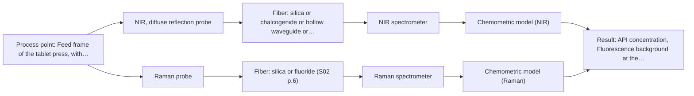
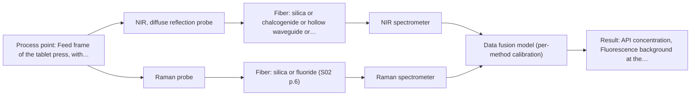

# First technical assessment: Blend potency in a tablet press feed frame

## Answer

**Customer request (our summary):** Customer manufactures tablets from a powder blend containing an active pharmaceutical ingredient and excipients. They currently use laboratory checks after the material has moved through the press, so results are delayed. They want to assess whether a fiber based measurement in the feed frame could follow API concentration changes, and want a first pilot comparing reasonable measurement options before committing to production equipment.

### Brief answer

Start with NIR diffuse reflection in the feed frame; it is the most common online fiber method and is listed for scattering powders. Run a small pilot with Raman as a comparison only if the API has a usable Raman signature and fluorescence is low. The main open points are API identity and range, excipient interference, feed-frame access and the go/no-go accuracy criteria.

### Proposal

- **Best current option:** O2 (recommended)
- **Basis:** supplied AFS sources
- **What would change it:** If the API has no usable NIR or Raman signal, if excipient fluorescence swamps Raman, or if the required accuracy cannot be reached, the choice would change to another method or to O3 only after single-method tests.
- **Next step:** Run a laboratory feasibility on representative blend samples with an independent API assay, then trial the best single method in the feed frame.

**Secondary evidence (external, not AFS material):** G1: E02 ¶31, E02 ¶82; G2: no usable external source found; G3: no usable external source found. See Expert detail.

**Decision status:** Provisional feasibility assessment

### Solution options

| ID | Tier | Methods | Confidence | Cost class, S01 Table 1 (p.6) | Ease of use | Maintenance | Performance fit | Sources |
|---|---|---|---|---|---|---|---|---|
| O1 | Simple | M1 NIR, diffuse reflection probe | Medium: open question: Q1 (starts at Medium) | average cost (row 8) | Simple single-probe operation | Probe cleaning and calibration checks | Direct API tracking with least effort | [1: S01 p.10] [2: S01 p.6] [3: S01 p.15] [4: S01 p.10] [5: REF §5] |
| O2 | Recommended | M1 NIR, diffuse reflection probe; M2 Raman probe | Medium: open question: Q1, Q2 (starts at Medium) | high cost (rows 8, 12) | Two probes need more operating care | Two instruments and two calibrations | Compares NIR and Raman API specificity | [6: S01 p.15] [1: S01 p.10] [2: S01 p.6] [3: S01 p.15] [4: S01 p.10] [5: REF §5] [7: S01 p.11] [8: S01 p.11] |
| O3 | Extended (multi-method) | M3 NIR, diffuse reflection probe + Raman (combination) | Low: open question: Q1 (starts at Medium); multi-method, fusion benefit not yet shown | high cost (rows 8, 12) | Complex synchronised two-method operation | Two instruments plus fused-model maintenance | Fusion may improve API prediction | [9: S01 p.8] [10: S01 p.8] [11: S01 p.15] |

*Confidence rates the basis of the advice (how much is known and cited), not a predicted accuracy or probability of success. It starts at High, or at Medium when a key question on the method or the option is open, and drops one level per weakness listed (floor Low).*

*Cost class is the relative rating in S01 Table 1 (p.6) for the in-line method+technique rows named (the highest one for a multi-method option); it is not a price.*

### Setup sketch

*Recommended option O2; drawn by code from the option, a schematic, not a configuration.*

### Key questions

1. What is the API identity, concentration range and expected variation, and what reference laboratory method defines 'on target'?
2. Which excipients are present, and do any fluoresce or have strong NIR or Raman bands that overlap the API?
3. What access, mounting space, powder flow, temperature and cleaning constraints exist at the feed frame?

## Expert detail

**Customer enquiry**

> We manufacture tablets from a powder blend containing an active pharmaceutical ingredient and excipients. Laboratory checks tell us whether the blend is on target, but results arrive after the material has moved through the press. We want to assess whether a fiber based measurement in the feed frame could follow API concentration changes. Our first pilot should compare reasonable measurement options before we commit to production equipment.

**Decision status:** Provisional feasibility assessment. A shortlist is justified by a published feed-frame NIR/Raman example and by NIR diffuse reflection being listed for scattering powders, but the API identity, concentration range and acceptance criteria are unknown. The assessment is provisional and does not establish production readiness.

### Parameters

| ID | Parameter | Kind | Need | Measured by | Why | Sources |
|---|---|---|---|---|---|---|
| P1 | API concentration | quantitative | required | Spectroscopy: NIR | The main target is to follow API concentration changes in the feed frame. | [12: S01 p.14] |
| P2 | Particle-size and scattering variation | quantitative | optional | Reference lab method: particle-size analysis (laser diffraction or sieve) | Should be available because NIR diffuse reflection is sensitive to surface and particle-size effects, so this variation helps interpret calibration residuals. | *(no verified source: engineering judgement)* |
| P3 | Fluorescence background at the Raman excitation wavelength | qualitative | optional | Spectroscopy: Raman | Should be available if Raman is tested because fluorescence can swamp the weak Raman signal. | [7: S01 p.11] |

### Solution option details

- **O1 cost drivers:** One spectrometer, one fiber probe, feed-frame access and calibration samples
- **O2 cost drivers:** Two spectrometers, two probes, fiber links and separate calibrations
- **O3 cost drivers:** Two instruments, synchronised acquisition, combined probe and fusion modelling
- **O3 combining methods:** Low-level fusion of synchronised NIR and Raman spectra from the same feed-frame location, with block scaling before modelling. Each method needs its own calibration and diagnostics; the fused model must beat the best single method on held-out runs before it is kept.

*Extended (multi-method) option O3; drawn by code from the option, a schematic, not a configuration.*

### Premise check

- **Precedent only:** A fiber based measurement in the feed frame could follow API concentration changes. A published pharmaceutical example places NIR and Raman probes in a tablet-press feed frame to predict API potency, which is a reason to test the approach, not proof for this blend. [3: S01 p.15]
- **Supported:** A first pilot comparing reasonable measurement options is an appropriate next step before committing to production equipment. The supplied guidance says testing several optical approaches is appropriate when sample composition is incompletely known and a method or combination must be selected. [13: S01 p.3]

### Requirements

**Stated by the customer**

- "We manufacture tablets from a powder blend containing an active pharmaceutical ingredient and excipients."
- "We want to assess whether a fiber based measurement in the feed frame could follow API concentration changes."
- *Further statements: see the customer enquiry above.*

**Key unknowns**

- API identity, concentration range and expected variation
- Excipient composition and any spectral overlap or fluorescence
- Powder particle size, flow behaviour and homogeneity in the feed frame
- Feed-frame access, temperature, dust, fouling and cleaning constraints
- Required accuracy, precision, detection limit and response time
- Whether pilot lots and held-out runs represent production variation

### Clarification questions (most decision-relevant first)

Q1. What is the API identity, concentration range and expected variation, and what reference laboratory method defines 'on target'? *Why it matters:* This decides whether NIR or Raman has a usable API signal and what accuracy the pilot must reach. *(affects: method)*
Q2. Which excipients are present, and do any fluoresce or have strong NIR or Raman bands that overlap the API? *Why it matters:* Overlap or fluorescence could make one method unsuitable and change the comparison. *(affects: M2)*
Q3. What access, mounting space, powder flow, temperature and cleaning constraints exist at the feed frame? *Why it matters:* These determine whether a contact diffuse-reflection probe or a remote window is practical. *(affects: installation)*
Q4. What accuracy, precision, detection limit and response time must the pilot demonstrate for a go decision? *Why it matters:* These are the numerical go/no-go criteria the feasibility plan needs. *(affects: status)*
Q5. Can the pilot include production-representative lots and physical variation such as particle size, moisture and flow, with held-out runs for validation? *Why it matters:* Calibration transfer and validation depend on covering the real variation. *(affects: M1)*

### Recommendation

- **M1 · Primary candidate: NIR, diffuse reflection probe.** NIR (nominal 780-2500 nm; usable range depends on the instrument, fiber and probe) is the most common online fiber method and is listed for scattering media and powder; a published pharma example uses NIR probes in a tablet-press feed frame to predict API potency. *Conditions:* Test on representative blend samples across the expected API range with an independent reference assay before any feed-frame trial. [1: S01 p.10] [2: S01 p.6] [3: S01 p.15] [4: S01 p.10] [5: REF §5]
- **M2 · Comparison candidate: Raman probe.** Raman is reported as Raman shift (cm-1) with the excitation wavelength stated separately and provides complementary molecular-backbone information, so it is a useful comparison for API specificity; its weak signal and fluorescence background must be checked on real blend samples. *Conditions:* Include Raman only if the API has a usable Raman signature and fluorescence background is acceptable on the real blend. [6: S01 p.15] [7: S01 p.11] [8: S01 p.11]
- **M3 · Conditional candidate: NIR, diffuse reflection probe + Raman (combination).** Only test a fused NIR plus Raman model if single-method tests show one method is insufficient; the published pharma example reports better API potency prediction with combined NIR and Raman, but this is a hypothesis for this blend. *Conditions:* After single-method NIR and Raman tests, and only if both have usable API signal and the fused model beats the best single method on held-out runs. [11: S01 p.15] [9: S01 p.8]

### Measurement concept

- **Probe and geometry:** NIR diffuse reflection is the first geometry to test; Raman is a side-by-side comparison on the same blend samples. A feed-frame installation would need a contact or window-mounted probe with a defined sampling spot and cleaning access.
- **Location:** Feed frame of the tablet press, with representative powder blend present during measurement.
- **Fiber link:** Fiber type and achievable link length depend on the selected instrument, probe and wavelength range; these are not specified in the supplied sources for this installation. [14: S01 p.15]

### Spectral range

- **NIR:** Nominal NIR range is 780-2500 nm; usable range depends on the instrument, fiber and probe actually selected. [4: S01 p.10]
- **Raman:** Raman is reported as Raman shift in cm-1, with the laser excitation wavelength stated separately; the pharma example uses 785 nm excitation. [15: S01 p.15]

### Risks and uncertainty

- The API may lack a distinct NIR or Raman signature at the required concentration range, or excipient bands may overlap it. *(rules: R-CAL-1)* *(no verified source: engineering judgement)*
- Powder heterogeneity, particle-size variation and flow in the feed frame may make the sampled volume unrepresentative. *(rules: R-GEO-6, R-GEN-5)* *(no verified source: engineering judgement)*
- Raman may be limited by weak signal or fluorescence background from the blend. *(rules: R-RAM-1)* *(no verified source: engineering judgement)*
- Probe fouling, cleaning access and calibration transfer from pilot to production are unresolved. *(rules: R-MIR-3)* *(no verified source: engineering judgement)*

### First feasibility experiment

1. **Collect representative blend samples across the expected API concentration range and the main physical variation such as lot, particle size and moisture, plus feed-frame process states.** Cover the chemical and physical variation the method must tolerate. [16: REF §3]
2. **Measure each sample with an independent reference API assay and keep reference data separate from model building.** Provide an independent basis for calibration and validation. *(no verified source: engineering judgement)*
3. **Test NIR diffuse reflection first as a single method, build a calibration and validate on held-out runs or batches.** Establish the best single-method baseline before any combination. [17: S01 p.10]
4. **Test Raman as a single comparison on the same samples, record fluorescence background and decide whether it adds API information.** Check whether a second single method improves specificity. *(no verified source: engineering judgement)*
5. **Only if single methods are insufficient, test synchronised NIR plus Raman fusion; the go/no-go criteria such as accuracy, precision, detection limit and response time must be set by the customer before the trial.** Keep fusion as a later hypothesis and compare it with the best single method. [10: S01 p.8]

**Reference measurements:** Independent laboratory API assay on the same samples or runs.

**Decision basis:** Customer-defined numerical criteria for accuracy, precision, detection limit and response time; the fused model must beat the best single method on held-out runs.

### Assumptions

- The powder blend can be presented to a diffuse-reflection probe in a way that represents the feed-frame material.
- The API has a measurable NIR signature and, if tested, a usable Raman signature.
- Reference API assays can be obtained for the pilot samples and held-out runs.

### Not covered by the supplied sources

- No supplied source gives a qualified production feed-frame probe configuration, cleaning validation or regulatory acceptance for this tablet blend.
- No supplied source states the achievable accuracy, detection limit or response time for API concentration in this powder blend.

### Further notes

- **Chemometrics:** NIR and Raman both need blend-specific chemometric calibration; reference API assay data and validation on held-out runs or batches are required.
- **Real-time tracking:** The feed-frame question is time-resolved: acquisition rate, synchronisation and probe fouling must be matched to powder flow.
- **Future direction:** A combined NIR plus Raman probe with low-level data fusion is a later option, only if single-method results are insufficient and the fused model beats the best single method.

### Secondary evidence (external, not AFS material)

*Found by a literature search for gaps the supplied AFS sources leave open. Not AFS material and not proof for this case; every quote below was verified verbatim against the fetched text.*

**G1 · multi-method:** Combining several spectroscopy methods (data fusion) (Low-level fusion of synchronised NIR and Raman spectra from the same feed-frame location, with block scaling before modelling. Each method needs its own calibration and diagnostics; the fused model must beat the best single method on held-out runs before it is kept.)

- **E02 ¶31** The review describes low-level data fusion as the simplest way to combine inputs by rearranging variables from different sources into a new data matrix. *How it applies:* This could inform the pilot by treating low-level fusion as a simple starting architecture for synchronised NIR and Raman data, but it does not establish that a fused model will outperform the best single method. *Limits and transfer risks:* This is a general PAT data-fusion review, not a tablet feed-frame study; it gives no evidence on synchronised NIR/Raman spectra, block scaling, or held-out run comparison for this blend. *(supports O3)*
  > "Low-level data fusion (LLDF) is considered the simplest method to achieve a combination of inputs. In this case, the data is rearranged into a new data matrix, where the variables coming from different sources are placed one after the other."
  > Challenges and Opportunities of Implementing Data Fusion in Process Analytical Technology-A Review. (2022) · Molecules (Basel, Switzerland) · doi:10.3390/molecules27154846 · https://europepmc.org/article/PMC/PMC9369811 · retrieved 2026-10-17, full text, licence: cc by, via curated library
- **E02 ¶82** The review states that before fusing data from multiple sources, it is essential to evaluate each dataset's contribution to the model and its complementarity. *How it applies:* This supports including per-method diagnostics and checking whether Raman adds useful information beyond NIR before keeping a fused model in the pilot assessment. *Limits and transfer risks:* This is a general review statement, not a tablet feed-frame experiment; it does not show that NIR and Raman are complementary for this powder blend or that fusion will improve performance. *(supports O3)*
  > "Before fusing data from multiple sources, it is essential to evaluate the contribution of each dataset to the model and its complementarity."
  > Challenges and Opportunities of Implementing Data Fusion in Process Analytical Technology-A Review. (2022) · Molecules (Basel, Switzerland) · doi:10.3390/molecules27154846 · https://europepmc.org/article/PMC/PMC9369811 · retrieved 2026-10-17, full text, licence: cc by, via curated library

**G2 · not in the supplied sources:** No supplied source gives a qualified production feed-frame probe configuration, cleaning validation or regulatory acceptance for this tablet blend.

- No usable external source found.

**G3 · not in the supplied sources:** No supplied source states the achievable accuracy, detection limit or response time for API concentration in this powder blend.

- No usable external source found.

### Evidence (verified quotes)

1. ✓ **S01 p.10** (general): "Near-IR vibrational spectroscopy (NIR) is the most common online analysis method performed using fiber optic probes."
2. ✓ **S01 p.6** (general): "Scattering media, powder"
3. ✓ **S01 p.15** (application precedent): "During the experimental action, the probes are inserted directly into the process environment, such as the feed frame of a rotary tablet press."
4. ✓ **S01 p.10** (general): "NIR spectra (780-2500 nm) contain predominantly overtones and component bands of fundamental vibrations"
5. ✓ **REF §5** (general): "actual spectral coverage, fiber length, component ratings, detection limits and accuracy depend on the configuration and the sample."
6. ✓ **S01 p.15** (general): "NIR detects hydrogen bonds and asymmetric polar groups, while Raman provides information on the molecular backbone and symmetrical non-polar groups."
7. ✓ **S01 p.11** (general): "superposition of luminescence (fluorescence), which has a significantly higher intensity."
8. ✓ **S01 p.11** (general): "The Raman shift is used as the horizontal (spectral) axis in Raman spectroscopy"
9. ✓ **S01 p.8** (general): "It is crucial that the spectral information obtained by different methods-Mid-IR, NIR, Raman, and fluorescence spectra-is collected from the same small, even pinpoint, area of the sample."
10. ✓ **S01 p.8** (general): "Ultimately, the measurement data must be normalized to a common time step."
11. ✓ (precedent only) **S01 p.15** (method gain): "By combining Raman and NIR, these models can predict API potency or coating thickness with higher accuracy and robustness than single-method models."
12. ✓ **S01 p.14** (application precedent): "the precise concentration and uniformity of the Active Pharmaceutical Ingredient (API)"
13. ✓ **S01 p.3** (general): "The ability to test various optical spectroscopy approaches is crucial for solving complex analytical problems, such as analyzing natural and industrial samples of incompletely known composition, in order to select the most suitable method or combination of methods."
14. ✓ **S01 p.15** (general): "The use of fiber optics is critical here, as it allows the sensitive spectrometers to be located safely away from the vibration and dust of the manufacturing floor."
15. ✓ **S01 p.15** (application precedent): "Raman spectrometer and Raman fiber probe for contact measurements with 785 nm excitation wavelength"
16. ✓ **REF §3** (general): "Representative samples or process states, independent reference measurements, what is compared, and the basis for the go / no-go decision."
17. ✓ **S01 p.10** (general): "The broad absorption bands observed in this region overlap, suggesting the use of chemometrics for quantitative and qualitative analysis of spectral data."

### Verification

- Citations verified: 23 of 23 (exact or whitespace/hyphen-tolerant match on the cited page, scope checked).
- Hard check failures before deterministic corrections: 0; still open: 0; soft warnings: 2; repair rounds: 1.
- External evidence (cache): 2 quote(s) verified verbatim (exact or whitespace/hyphen-tolerant, at most 400 characters and 2 sentences, against the cited paragraph); 0 item(s) dropped.
- External search: 5 query(ies), 10 hit(s), 5 source(s) (3 from the curated library).
- External step: 2 model call(s), 31.5 s extra (cost in the run JSON).

*Run D01-20261018T080635Z-dbe9 · models deepseek/deepseek-v4.1-flash-1017*
