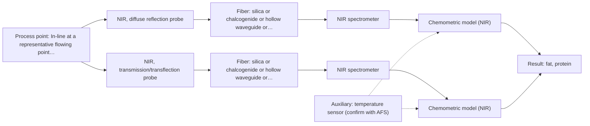

# First technical assessment: Fat and protein monitoring in opaque dairy product

## Answer

**Customer request (our summary):** The customer has an opaque, concentrated milk product flowing through a processing line and wants earlier information about composition changes via an initial spectroscopy concept and a practical comparison experiment, while retaining laboratory checks.

### Brief answer

Test NIR diffuse reflection first on representative product states, with laboratory fat and protein references and recorded temperature and texture. A NIR transflection comparison is worth including only where a controlled optical path can be maintained; it may fail in a very thick, opaque product. Required accuracy, response time, installation point, cleaning and reference sampling remain open.

### Proposal

- **Best current option:** O2 (recommended)
- **Basis:** engineering judgement, with secondary external support E02 ¶27, E03 ¶23, E02 ¶11 (not AFS material)
- **What would change it:** If transflection proves impractical or NIR reflection alone meets the customer's criteria, O1 would be preferred; if NIR cannot meet the criteria, the method shortlist would need review.
- **Next step:** Run the comparison on representative product states with independent laboratory references and decide against customer-defined go/no-go criteria.

**Secondary evidence (external, not AFS material):** G1: E01 ¶19; G2: E02 ¶13; G3: E02 ¶27, E03 ¶23; G4: E02 ¶11. See Expert detail.

**Decision status:** Provisional feasibility assessment

### Solution options

| ID | Tier | Methods | Confidence | Cost class, S01 Table 1 (p.6) | Ease of use | Maintenance | Performance fit | Sources |
|---|---|---|---|---|---|---|---|---|
| O1 | Simple | M1 NIR, diffuse reflection probe | Low: open question: Q2, Q3 (starts at Medium); uncited auxiliary sensor | average cost (row 8) | single probe, simple optics | clean probe, recalibrate on matrix change | least hardware for fat/protein trend | [1: S01 p.17] [2: S01 p.17] [3: S01 p.10] [4: REF §5] |
| O2 | Recommended | M1 NIR, diffuse reflection probe; M2 NIR, transmission/transflection probe | Low: open question: Q2, Q3 (starts at Medium); physical state unknown, suitability for this sample not confirmed; uncited auxiliary sensor | average cost (rows 7, 8) | two NIR paths, moderate setup | two probes or paths to clean | compares geometries across texture variation | [5: S01 p.18] [1: S01 p.17] [2: S01 p.17] [3: S01 p.10] [4: REF §5] [6: S01 p.18] |

*Confidence rates the basis of the advice (how much is known and cited), not a predicted accuracy or probability of success. It starts at High, or at Medium when a key question on the method or the option is open, and drops one level per weakness listed (floor Low).*

*Cost class is the relative rating in S01 Table 1 (p.6) for the in-line method+technique rows named (the highest one for a multi-method option); it is not a price.*

### Setup sketch

*Recommended option O2; drawn by code from the option, a schematic, not a configuration.*

### Key questions

1. What is the physical state and texture/viscosity range of the product on the line, and can it be kept in reliable contact with a probe or passed through a controlled optical path?
2. What fat and protein ranges and accuracy must the inline measurement achieve?
3. How quickly must a composition change be detected for the result to be useful?

## Expert detail

**Customer enquiry**

> We produce an opaque, concentrated milk product that flows through a processing line. We currently sample it for fat and protein analysis and would like earlier information about composition changes. Product temperature and texture vary during production. We want an initial spectroscopy concept and a practical comparison experiment, while retaining our laboratory checks.

**Decision status:** Provisional feasibility assessment. NIR diffuse reflection is a defensible first method for an opaque, concentrated dairy stream, but the product-specific calibration, accuracy and installation are not established. The transflection comparison is a hypothesis to test, not a proven configuration.

### Parameters

| ID | Parameter | Kind | Need | Measured by | Why | Sources |
|---|---|---|---|---|---|---|
| P1 | fat | quantitative | required | Spectroscopy: NIR | The customer needs fat as a composition target, and NIR reflection with PLS is reported for fat in milk. | [2: S01 p.17] |
| P2 | protein | quantitative | required | Spectroscopy: NIR | The customer needs protein as a composition target, and NIR reflection with PLS is reported for protein in milk. | [2: S01 p.17] |
| P3 | temperature | quantitative | required | Auxiliary sensor: temperature sensor (engineering judgement: confirm availability with AFS) | Temperature varies during production and can change scattering and spectra, so it must be recorded for calibration and compensation. | *(no verified source: engineering judgement)* |
| P4 | texture/viscosity | quantitative | required | Reference lab method: laboratory rheology/viscosity | Texture varies during production and changes probe contact and scattering, so it must be separated from composition effects. | [7: S01 p.17] |

### Solution option details

- **O1 cost drivers:** single NIR spectrometer, reflection probe, installation, reference samples
- **O2 cost drivers:** two NIR probe configurations and wider reference sampling

### Premise check

- **Precedent only:** Spectroscopy is suitable for an opaque, concentrated milk product. NIR reflection is reported for opaque or highly concentrated dairy products, which is a reason to test it, not proof for this product. [1: S01 p.17]
- **Not covered:** Earlier information about composition changes can be obtained while retaining laboratory checks. The sources describe online analysis and near-real-time results, but do not address retaining laboratory checks alongside an inline measurement. *(no verified source: engineering judgement)*
- **Supported:** A practical comparison experiment can be designed before required accuracy, response time, and installation constraints are fully defined. A provisional plan with missing facts is acceptable, provided the go/no-go basis is defined. [8: REF §3]

### Requirements

**Stated by the customer**

- "opaque, concentrated milk product"
- "flows through a processing line"
- "currently sample it for fat and protein analysis"
- "earlier information about composition changes"
- *Further statements: see the customer enquiry above.*

**Key unknowns**

- Required fat and protein ranges and accuracy
- Required response time for earlier composition information
- Temperature and texture/viscosity ranges on the line
- Installation point, pressure, cleaning and fouling conditions
- Laboratory reference methods and sampling frequency
- Whether opacity/texture varies enough to make transflection feasible at any stage

### Clarification questions (most decision-relevant first)

Q1. What is the physical state and texture/viscosity range of the product on the line, and can it be kept in reliable contact with a probe or passed through a controlled optical path? *Why it matters:* This decides whether a contact probe or a transflection path is practical and whether NIR diffuse reflection or another geometry should be tested first. *(affects: technique)*
Q2. What fat and protein ranges and accuracy must the inline measurement achieve? *Why it matters:* The required accuracy and range set the go/no-go basis and determine whether NIR sensitivity is sufficient for this product. *(affects: method)*
Q3. How quickly must a composition change be detected for the result to be useful? *Why it matters:* The required response time affects whether a practical in-line NIR configuration can meet the customer's need. *(affects: method)*
Q4. Where on the line would the probe be installed, and what are the pressure, temperature range and cleaning regime there? *Why it matters:* These conditions determine probe geometry, materials, fouling risk and whether the installation is realistic. *(affects: installation)*
Q5. Which laboratory methods and sampling frequency are used for fat and protein, and can those results be time-matched to the inline spectra? *Why it matters:* Independent, time-matched laboratory references are needed to build and validate any chemometric calibration. *(affects: M1)*

### Recommendation

- **M1 · Primary candidate: NIR, diffuse reflection probe.** Test NIR diffuse reflection first: it is used for opaque or highly concentrated dairy products and can quantify fat and protein with PLS. The nominal NIR range is 780-2500 nm, while the usable range depends on the instrument, fiber and probe selected. *Conditions:* Test on representative product states with laboratory fat and protein references, and record temperature and texture. [1: S01 p.17] [2: S01 p.17] [3: S01 p.10] [4: REF §5]
- **M2 · Comparison candidate: NIR, transmission/transflection probe.** Transflection is reported as a possible combined solution for low- and high-fat milk products, but transmission fails when the product is too thick or opaque, so it is a comparison only. It uses the same nominal NIR range with a different optical path. *Conditions:* Include only if a controlled optical path and probe contact can be maintained without blocking flow. [5: S01 p.18] [6: S01 p.18]

### Measurement concept

- **Probe and geometry:** Start with an NIR diffuse reflection probe for the opaque product, then compare a NIR transflection probe only where a controlled path is practical.
- **Location:** In-line at a representative flowing point, with a bypass or sampling point for comparison against laboratory checks.
- **Fiber link:** Fiber type and length depend on the selected NIR instrument and probe; the sources do not establish a product-specific link length. [1: S01 p.17]

### Spectral range

- **NIR:** Nominal NIR range is 780-2500 nm; the usable range depends on the instrument, fiber and probe selected. [3: S01 p.10] [4: REF §5]

### Risks and uncertainty

- Texture and opacity changes may alter NIR scattering and sampling depth, so a single calibration may not hold across the line. *(rules: R-GEO-6)* [7: S01 p.17]
- Fat and protein bands overlap in NIR, and a product-specific calibration may be unstable if laboratory references are sparse or not time-matched. *(rules: R-NIR-2, R-CAL-1)* [9: S01 p.10]
- Temperature variation may shift spectra or change scattering, causing prediction drift without compensation. *(no verified source: engineering judgement)*
- The transflection comparison may be impractical if the product is too thick or opaque for a controlled optical path. *(rules: R-GEO-2)* [6: S01 p.18]

### First feasibility experiment

1. **Collect representative samples or process states across the expected fat/protein, temperature and texture ranges; record independent laboratory fat/protein, temperature and texture references.** Representativeness and independent reference data. [10: REF §3]
2. **Measure the same samples with NIR diffuse reflection (M1) under fixed probe contact or distance, and record the auxiliary temperature.** Single-method baseline. [1: S01 p.17]
3. **Compare NIR transflection (M2) on the same samples only where a controlled optical path and probe contact can be maintained.** Technique comparison, not fusion. [5: S01 p.18]
4. **Build one chemometric calibration per technique against the laboratory references and test it on held-out runs or batches, including temperature and texture variation.** Validation on independent runs or batches. [9: S01 p.10]
5. **Decide go/no-go against the customer's numerical accuracy and response-time criteria, and keep laboratory checks as the independent reference.** Go/no-go basis from customer criteria. *(no verified source: engineering judgement)*

**Reference measurements:** Laboratory fat and protein, temperature and texture/viscosity measurements taken at the same time as spectra.

**Decision basis:** Customer-defined numerical accuracy and response-time criteria; no numbers are supplied in the sources.

### Assumptions

- The product is in contact with the probe or a suitable flow interface.
- Laboratory fat and protein results can be time-matched to the spectral samples.
- Temperature and texture can be recorded as independent reference variables.

### Not covered by the supplied sources

- The sources do not give a product-specific NIR calibration or expected accuracy for fat and protein in this concentrated milk product.
- The sources do not cover long-term fouling or cleaning behaviour for this line.
- The sources do not give an achievable response time for this product.

### Further notes

- **Chemometrics:** A product-specific chemometric calibration against laboratory fat and protein references is needed; revalidate after matrix, temperature or texture changes.
- **Real-time tracking:** NIR reflection is described for inline milk monitoring; the achievable update rate for this line is not stated in the sources and must be defined.
- **Future direction:** If NIR cannot meet the criteria, a later comparison with MIR ATR or Raman could test whether additional molecular specificity improves fat and protein prediction.

### Secondary evidence (external, not AFS material)

*Found by a literature search for gaps the supplied AFS sources leave open. Not AFS material and not proof for this case; every quote below was verified verbatim against the fetched text.*

**G1 · auxiliary sensor:** In-line measurement of temperature with temperature sensor

- **E01 ¶19** The source reports that temperature was varied together with acid concentrations and ionic strength to obtain a robust model. *How it applies:* This suggests treating temperature as a model variable and checking whether the line temperature range needs to be covered in calibration; it does not establish an in-line temperature sensor. *Limits and transfer risks:* The work concerns lithium recycling liquid-liquid extraction, not a concentrated milk matrix, and the temperature variation was for model building rather than an in-line sensor. *(supports O2)*
  > "The concentrations of nitric acid and hydrochloric acid as well as the ionic strength and temperature were varied to obtain a robust model."
  > Process Analytical Technology-Integrated FT-IR and Raman Spectroscopies for Efficient Reactive Liquid-Liquid Extraction Processing in Lithium Recycling. (2025) · ACS omega · doi:10.1021/acsomega.5c05705 · https://europepmc.org/article/PMC/PMC12573149 · retrieved 2026-10-17, full text, licence: cc by, via curated library

**G2 · not in the supplied sources:** The sources do not give a product-specific NIR calibration or expected accuracy for fat and protein in this concentrated milk product.

- **E02 ¶13** The source notes that NIR spectra are harder to interpret than conventional methods because absorption bands overlap. *How it applies:* For fat and protein in concentrated milk, this points to overlapping bands and the need for product-specific chemometric calibration and retained laboratory checks; it gives no accuracy figure. *Limits and transfer risks:* The statement is about NIRS in pharmaceutical unit operations, not a concentrated milk product, and it does not report calibration performance.
  > "However, a disadvantage of NIRS is that it is more difficult to interpret a signal than by using conventional analysis methods, such as chromatography, ultraviolet/visible (UV-VIS) light, and others, because the absorption bands overlap due to spectral complexity."
  > Process Analytical Technology Tools for Monitoring Pharmaceutical Unit Operations: A Control Strategy for Continuous Process Verification. (2021) · Pharmaceutics · doi:10.3390/pharmaceutics13060919 · https://europepmc.org/article/PMC/PMC8234957 · retrieved 2026-10-17, full text, licence: cc by, via curated library

**G3 · not in the supplied sources:** The sources do not cover long-term fouling or cleaning behaviour for this line.

- **E02 ¶27** The source says probe-window contamination from a binder added during the process can make accurate measurement impossible. *How it applies:* This flags window fouling as a risk to watch in the milk line and supports planning cleaning and signal-verification steps; it does not describe long-term fouling or cleaning behaviour for this product. *Limits and transfer risks:* The contamination example is a pharmaceutical binder, not concentrated milk, and the source does not quantify fouling or cleaning intervals. *(supports O2)*
  > "However, an accurate measurement may not be possible because of contamination of the probe window due to the addition of a binder during the process, which is a disadvantage."
  > Process Analytical Technology Tools for Monitoring Pharmaceutical Unit Operations: A Control Strategy for Continuous Process Verification. (2021) · Pharmaceutics · doi:10.3390/pharmaceutics13060919 · https://europepmc.org/article/PMC/PMC8234957 · retrieved 2026-10-17, full text, licence: cc by, via curated library
- **E03 ¶23** The source states that the probe housing must be compatible with the installation environment, process chemistry, and sterilization and cleaning protocols across scales. *How it applies:* This could inform a check of housing materials and cleaning compatibility for the line; it is a requirement statement, not evidence of long-term performance. *Limits and transfer risks:* It comes from biopharmaceutical Raman probe practice, not NIR in concentrated milk, and does not report fouling or cleaning outcomes. *(supports O2)*
  > "The first requirement is that the probe housing needs to be compatible with the installation environment, process chemistry, and sterilization and cleaning protocols across multiple scales."
  > The role of Raman spectroscopy in biopharmaceuticals from development to manufacturing. (2022) · Analytical and bioanalytical chemistry · doi:10.1007/s00216-021-03727-4 · https://europepmc.org/article/PMC/PMC8724084 · retrieved 2026-10-17, full text, licence: cc by, via curated library

**G4 · not in the supplied sources:** The sources do not give an achievable response time for this product.

- **E02 ¶11** The source describes in-line monitoring as real-time and requiring no sample collection from the process flow. *How it applies:* This supports exploring in-line information for earlier composition changes, but it does not give an achievable response time for this product; a practical comparison should measure it. *Limits and transfer risks:* The definition is from pharmaceutical unit operations and gives no numeric response time, so transfer to a concentrated milk line is unproven. *(supports O2)*
  > "In-line is a real time monitoring method using software without collecting a sample from the process flow [121]."
  > Process Analytical Technology Tools for Monitoring Pharmaceutical Unit Operations: A Control Strategy for Continuous Process Verification. (2021) · Pharmaceutics · doi:10.3390/pharmaceutics13060919 · https://europepmc.org/article/PMC/PMC8234957 · retrieved 2026-10-17, full text, licence: cc by, via curated library

### Evidence (verified quotes)

1. ✓ **S01 p.17** (application precedent): "NIR Reflection is primarily used for opaque or highly concentrated dairy products, such as yogurt, butter, or whole milk concentrates."
2. ✓ **S01 p.17** (application precedent): "using Partial Least Squares (PLS) regression to quantify fat and protein."
3. ✓ **S01 p.10** (general): "NIR spectra (780-2500 nm) contain predominantly overtones and component bands of fundamental vibrations"
4. ✓ **REF §5** (general): "It is not a product specification: actual spectral coverage, fiber length, component ratings, detection limits and accuracy depend on the configuration and the sample."
5. ✓ **S01 p.18** (application precedent): "In some cases, a Transflection probe can already be a combined solution working well for low-fat and high-fat containing milk products."
6. ✓ **S01 p.18** (general): "it fails when the milk becomes too "thick" or fat-rich, as the light cannot penetrate the sample."
7. ✓ **S01 p.17** (general): "the method is sensitive to the surface characteristics and fat globule size."
8. ✓ **REF §3** (general): "An honest provisional plan is more useful than a final configuration built on missing facts."
9. ✓ **S01 p.10** (general): "The broad absorption bands observed in this region overlap, suggesting the use of chemometrics for quantitative and qualitative analysis of spectral data."
10. ✓ **REF §3** (general): "Representative samples or process states, independent reference measurements, what is compared, and the basis for the go / no-go decision."

### Verification

- Citations verified: 23 of 23 (exact or whitespace/hyphen-tolerant match on the cited page, scope checked).
- Hard check failures before deterministic corrections: 0; still open: 0; soft warnings: 0; repair rounds: 1.
- External evidence (cache): 5 quote(s) verified verbatim (exact or whitespace/hyphen-tolerant, at most 400 characters and 2 sentences, against the cited paragraph); 0 item(s) dropped.
- External search: 5 query(ies), 10 hit(s), 3 source(s) (3 from the curated library).
- External step: 2 model call(s), 25.9 s extra (cost in the run JSON).

*Run D02-20261018T080635Z-c17d · models deepseek/deepseek-v4.1-flash-1017*
