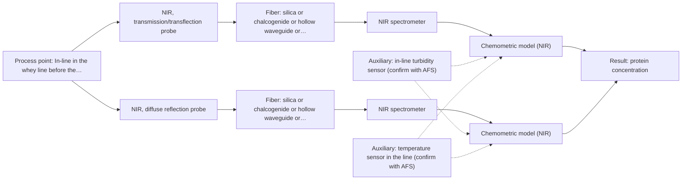
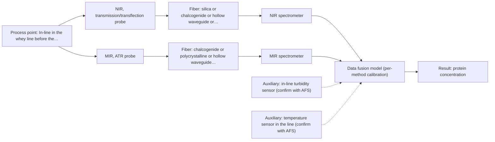

# First technical assessment: A clear whey stream before concentration

## Answer

**Customer request (our summary):** Customer wants to investigate spectroscopy for tracking protein concentration in a dairy whey stream before a concentration stage, using laboratory results as reference, with a first measurement concept that handles the stream becoming more turbid.

### Brief answer

Test NIR first. A transmission/transflection probe suits the clear whey stream, and a diffuse-reflection probe covers the turbid state on the same NIR spectrometer, so the concept does not assume the liquid stays clear. Compare both against your laboratory protein results on representative clear and turbid samples. Still open: the required protein range and accuracy, the real turbidity range, the installation point and the reference method.

### Proposal

- **Best current option:** O2 (recommended)
- **Basis:** engineering judgement
- **What would change it:** If the required accuracy is beyond what NIR can reach, or if the stream becomes opaque, MIR-ATR (O3) becomes the primary route; if the turbidity change is small in practice, O1 alone may be enough.
- **Next step:** Measure representative clear and turbid whey samples with NIR transmission/transflection and NIR diffuse reflection and compare the calibrations against the customer's laboratory protein values.

**Secondary evidence (external, not AFS material):** G1: E03 ¶27; G2: E01 ¶12; G3: E02 ¶31, E02 ¶82; G4: no usable external source found. See Expert detail.

**Decision status:** Provisional feasibility assessment

### Solution options

| ID | Tier | Methods | Confidence | Cost class, S01 Table 1 (p.6) | Ease of use | Maintenance | Performance fit | Sources |
|---|---|---|---|---|---|---|---|---|
| O1 | Simple | M1 NIR, transmission/transflection probe | Low: open question: Q1 (starts at Medium); uncited auxiliary sensor | average cost (row 7) | single probe, simple optical path | window cleaning and pathlength checks | least effort; answers the clear-stream question first | [1: S01 p.10] [2: S01 p.10] [3: S01 p.18] [4: S01 p.18] [5: REF §5] |
| O2 | Recommended | M1 NIR, transmission/transflection probe; M2 NIR, diffuse reflection probe | Low: open question: Q1 (starts at Medium); uncited auxiliary sensor | average cost (rows 7, 8) | two probes on one spectrometer | two probe windows to clean | covers clear and turbid states in one concept | [6: S01 p.18] [1: S01 p.10] [2: S01 p.10] [3: S01 p.18] [4: S01 p.18] [5: REF §5] [7: S01 p.17] [8: S01 p.18] |
| O3 | Extended (multi-method) | M1 NIR, transmission/transflection probe; M3 MIR, ATR probe | Low: open question: Q1 (starts at Medium); uncited auxiliary sensor; multi-method, fusion benefit not yet shown | high cost (rows 2, 7) | two instruments, alignment critical | ATR crystal cleaning, MIR fiber care | adds molecular specificity when turbidity confuses NIR | [9: S01 p.7] [10: S01 p.8] [11: S01 p.8] [12: S01 p.8] [13: S01 p.7] [1: S01 p.10] [2: S01 p.10] [3: S01 p.18] [4: S01 p.18] [5: REF §5] [14: S01 p.9] [15: S01 p.5] [16: S04 p.4] |

*Confidence rates the basis of the advice (how much is known and cited), not a predicted accuracy or probability of success. It starts at High, or at Medium when a key question on the method or the option is open, and drops one level per weakness listed (floor Low).*

*Cost class is the relative rating in S01 Table 1 (p.6) for the in-line method+technique rows named (the highest one for a multi-method option); it is not a price.*

### Setup sketch

*Recommended option O2; drawn by code from the option, a schematic, not a configuration.*

### Key questions

1. What protein concentration range must be covered, and what accuracy or limit of detection is required?
2. How turbid can the stream become, and is there a measured turbidity or solids range for the clear and the turbid state?
3. Where exactly is the measurement point, and what are the line size, flow rate, temperature and pressure there?

## Expert detail

**Customer enquiry**

> Our dairy process includes a relatively clear whey stream before a concentration stage. We want to investigate whether spectroscopy can track protein concentration as the stream changes, with laboratory results used as the reference. The stream can become more turbid under some operating conditions. We need a first measurement concept that handles this change rather than assuming the liquid always remains clear.

**Decision status:** Provisional feasibility assessment. A shortlist can be justified: whey is named in the sources as a liquid for which NIR transmission is the preferred geometry, and dairy NIR is shown to quantify protein. No source gives a protein accuracy or a turbidity limit for whey, so the concept stays conditional on the customer's target and on how turbid the stream really becomes.

### Parameters

| ID | Parameter | Kind | Need | Measured by | Why | Sources |
|---|---|---|---|---|---|---|
| P1 | protein concentration | quantitative | required | Spectroscopy: NIR | It is the target variable the customer wants to follow as the stream changes. | [17: S01 p.17] |
| P2 | turbidity / light scattering of the stream | quantitative | required | Auxiliary sensor: in-line turbidity sensor (engineering judgement: confirm availability with AFS) | It decides which NIR technique is valid and keeps a scattering change from being read as a protein change. | *(no verified source: engineering judgement)* |
| P3 | stream temperature | quantitative | optional | Auxiliary sensor: temperature sensor in the line (engineering judgement: confirm availability with AFS) | It should be available because water bands and baselines shift with temperature, and recording it makes a calibration transferable and drift diagnosable. | *(no verified source: engineering judgement)* |

### Solution option details

- **O1 cost drivers:** one NIR spectrometer, one probe, flow-cell installation
- **O2 cost drivers:** second NIR probe, dual calibration work, probe switching
- **O3 cost drivers:** second spectrometer, MIR fiber and probe, fusion modelling effort
- **O3 combining methods:** Low-level fusion of the NIR transmission/transflection and MIR-ATR spectra with block scaling, because variables from different methods are not equivalent and one block can dominate the model. The two probes must look at the same small area and be synchronised to a common time step, and each method keeps its own calibration and diagnostics. The fused model must beat the best single-method model on held-out batches, otherwise the extra instrument is dropped.

*Extended (multi-method) option O3; drawn by code from the option, a schematic, not a configuration.*

### Premise check

- **Precedent only:** Spectroscopy may be suitable to track protein concentration in the whey stream. A dairy NIR example shows PLS regression used to quantify fat and protein in milk. That is a reason to test NIR on whey, not proof that it will reach the required accuracy here. [17: S01 p.17]
- **Precedent only:** One measurement concept can handle both the clear and the turbid state of the stream. The dairy example states that keeping both NIR techniques gives the flexibility to follow a stream whose physical state changes, and that a transflection probe can in some cases serve both low-fat and high-fat products. This is a documented possibility to test, not a demonstrated result for this whey stream. [6: S01 p.18] [4: S01 p.18]

### Requirements

**Stated by the customer**

- "Our dairy process"
- "whey stream before a concentration stage"
- "relatively clear whey stream"
- "The stream can become more turbid under some operating conditions"
- "protein concentration"
- "as the stream changes"
- *Further statements: see the customer enquiry above.*

**Key unknowns**

- Required protein concentration range and the accuracy or limit of detection that counts as success.
- Actual turbidity range of the stream and whether it ever becomes opaque or carries fat/particulates.
- Installation point before the concentration stage: line size, flow, temperature, pressure and available optical access.
- Laboratory reference method for protein and how many reference samples per run can be supplied.
- Cleaning, fouling and sanitation requirements at the measurement point.
- Whether the measurement must be in-line in the pipe or may be at-line with sampling.

### Clarification questions (most decision-relevant first)

Q1. What protein concentration range must be covered, and what accuracy or limit of detection is required? *Why it matters:* The required accuracy decides whether NIR alone can meet the target or whether the MIR-ATR route (M3) has to become the primary method. *(affects: method)*
Q2. How turbid can the stream become, and is there a measured turbidity or solids range for the clear and the turbid state? *Why it matters:* The turbidity range decides whether transmission still works or whether diffuse reflection (M2) or ATR (M3) is needed. *(affects: technique)*
Q3. Where exactly is the measurement point, and what are the line size, flow rate, temperature and pressure there? *Why it matters:* These determine probe geometry, how the probe is mounted and whether the analyzer can stand off from the line. *(affects: installation)*
Q4. Which laboratory protein method will provide the reference, and how many reference samples per batch can be supplied? *Why it matters:* The reference method and sample count decide whether a calibration can be validated on held-out runs or batches. *(affects: status)*
Q5. What cleaning, fouling and sanitation requirements apply at the probe point? *Why it matters:* Protein deposits on a window or ATR crystal change the signal and drive the maintenance effort of every option. *(affects: installation)*

### Recommendation

- **M1 · Primary candidate: NIR, transmission/transflection probe.** NIR is the most common in-line fiber-probe method, and transmission is preferred for transparent or semi-transparent liquids such as whey (nominal range 780-2500 nm; the usable range depends on the instrument, fiber and probe selected). A transflection probe can in some cases serve both low-fat and high-fat dairy, which is the cheapest way to cover part of the turbidity change. *Conditions:* The optical pathlength must be controlled and the calibration is specific to the matrix, so it must be re-validated when whey composition or turbidity regime changes. [1: S01 p.10] [2: S01 p.10] [3: S01 p.18] [4: S01 p.18] [5: REF §5]
- **M2 · Comparison candidate: NIR, diffuse reflection probe.** Diffuse reflection is the dairy technique for opaque or highly concentrated streams, so it targets the turbid state in which transmission loses signal. It can be less representative for clear liquids, so it is tested alongside transmission rather than instead of it. *Conditions:* Applies mainly when the stream is turbid or concentrated; both techniques share one NIR spectrometer and light source in the dairy example. [7: S01 p.17] [8: S01 p.18]
- **M3 · Comparison candidate: MIR, ATR probe.** Mid-IR carries the most informative molecular bands and ATR suits liquids and soft solids in tight contact, with a very short effective sampling depth that is tolerant of scattering. It is a comparison because an ATR crystal in a dairy line raises fouling, cleaning and contact questions that no source answers. *Conditions:* Applies if NIR cannot reach the required accuracy or if the stream becomes too turbid for transmission; it needs tight contact with the sample and a cleaning regime. [14: S01 p.9] [15: S01 p.5] [16: S04 p.4]

### Measurement concept

- **Probe and geometry:** NIR transmission or transflection flow cell for the clear regime, NIR diffuse-reflection probe for the turbid regime, both on the same NIR spectrometer and light source in the dairy example; MIR-ATR as the higher-specificity alternative.
- **Location:** In-line in the whey line before the concentration stage; exact point, line size and optical access are open (Q3).
- **Fiber link:** The fiber family must transmit the NIR range; achievable link lengths and probe ratings for this installation are not stated in the sources and remain an open point. [18: S01 p.18] [19: REF §3]

### Spectral range

- **NIR:** Nominal NIR range 780-2500 nm for the method; the usable range for this line depends on the spectrometer, fiber and probe actually selected. [2: S01 p.10] [19: REF §3]
- **MIR:** Nominal MIR range 4000-400 cm-1 for the method; the usable range depends on the ATR crystal and the infrared fiber selected. [14: S01 p.9]

### Risks and uncertainty

- If the required accuracy is tighter than NIR can deliver at the whey protein level, the recommended NIR concept fails and the MIR-ATR route (M3) becomes the primary method. *(rules: R-NIR-4)* [20: S01 p.16]
- If the stream becomes opaque or carries fat and particulates, neither transmission nor reflection may give a usable signal, and ATR (M3) or sampling would be needed. *(rules: R-GEO-2, R-GEO-4)* [8: S01 p.18]
- Protein and solids deposits on the probe window or ATR crystal change the signal, and the cleaning and sanitation regime at the point is not covered by the sources. *(rules: R-MIR-3)* [21: S01 p.13]
- The calibration is matrix-specific, so a change in whey composition, temperature or upstream step would require re-validation before the readings can be trusted. *(rules: R-CAL-1)* [22: REF §5]

### First feasibility experiment

1. **Collect representative whey samples across the operating window, covering the clear state and the most turbid state and spanning the expected protein range; record turbidity and temperature for each sample.** Cover the chemical and physical variation the concept must handle. [23: REF §3]
2. **Measure each sample by NIR transmission/transflection at a controlled pathlength and by NIR diffuse reflection, on the same sample and as close in time as possible.** Test both NIR techniques on identical material so that clear and turbid states can be compared. [24: S01 p.18]
3. **Obtain independent reference protein values with the customer's laboratory method on the same samples, with replicates, keeping runs or batches separate.** Provide the reference data against which the spectral models are judged. *(no verified source: engineering judgement)*
4. **Build one PLS calibration per NIR technique, validate on held-out runs or batches, then test whether a two-technique model beats the best single technique.** Establish the single-method baseline first and treat any gain from combining as a hypothesis. [25: REF §5]
5. **Set the go/no-go on the customer's own accuracy target, judged separately for the clear and the turbid state; if it fails, repeat the comparison with MIR-ATR (M3).** Give a numerical decision basis that comes from the customer, not from the sources. [23: REF §3]

**Reference measurements:** Laboratory protein determination on the same samples, with replicates, used as the independent reference; the method itself is the customer's choice (Q4).

**Decision basis:** A conditional shortlist, because the protein accuracy target and the real turbidity range are not yet known (Q1, Q2).

### Assumptions

- The whey stream is aqueous and its protein is present at a concentration NIR can address with a chemometric calibration.
- The clear state dominates normal operation and the turbid state is an exception that the concept must still cover.
- The customer can supply laboratory protein values for a representative sample set.

### Not covered by the supplied sources

- Achievable protein accuracy or limit of detection for NIR or MIR-ATR in whey: no supplied page gives a figure.
- Fouling, cleaning and dairy sanitation requirements for fiber probes or ATR crystals in a whey line: not covered by the supplied material.

### Further notes

- **Chemometrics:** One PLS calibration per NIR technique, built and validated on the customer's own reference data, with the turbid and clear states represented in the calibration set. If a combined model is tried, spectra from two techniques are not equivalent in scale, so block scaling or normalisation is needed and the fused model has to beat the best single-technique model on held-out runs or batches.
- **Real-time tracking:** The enquiry is about following a changing stream: NIR spectra can be acquired continuously in-line, and if two probes are used their data must be brought to a common time step before they are compared or fused.
- **Future direction:** Once the informative spectral regions for whey protein are known, a compact multi-wavelength or LED-based sensor could be considered for routine control; that is a later step after the method is fixed on representative samples.

### Secondary evidence (external, not AFS material)

*Found by a literature search for gaps the supplied AFS sources leave open. Not AFS material and not proof for this case; every quote below was verified verbatim against the fetched text.*

*Live search unavailable (library only: cache miss (europepmc); cache miss (openalex)); curated library only.*

**G1 · auxiliary sensor:** In-line measurement of turbidity / light scattering of the stream with in-line turbidity sensor

- **E03 ¶27** The source warns that contamination of the probe window by a binder added during the process can prevent accurate measurement. *How it applies:* For an in-line turbidity or light-scattering sensor, this suggests checking window fouling and cleaning needs in the whey stream. *Limits and transfer risks:* The example is a pharmaceutical process with a binder, not a dairy whey stream, and it does not test a turbidity sensor. *(supports O2)*
  > "However, an accurate measurement may not be possible because of contamination of the probe window due to the addition of a binder during the process, which is a disadvantage."
  > Process Analytical Technology Tools for Monitoring Pharmaceutical Unit Operations: A Control Strategy for Continuous Process Verification. (2021) · Pharmaceutics · doi:10.3390/pharmaceutics13060919 · https://europepmc.org/article/PMC/PMC8234957 · retrieved 2026-10-17, full text, licence: cc by, via curated library

**G2 · auxiliary sensor:** In-line measurement of stream temperature with temperature sensor in the line

- **E01 ¶12** The source states that temperature sensitivity of OH bands is a severe drawback for aqueous NIR and MIR measurement, making tempered sample holders necessary. *How it applies:* This supports including line temperature measurement or control and testing temperature effects on the whey spectra. *Limits and transfer risks:* It is a review statement about aqueous solutions and tempered holders, not an in-line temperature sensor in dairy whey. *(supports O2)*
  > "Additionally, the temperature sensitivity of the OH bands is a severe drawback for measuring aqueous solution in NIR and MIR, which makes tempered sample holders necessary [29]."
  > A critical review of recent trends, and a future perspective of optical spectroscopy as PAT in biopharmaceutical downstream processing. (2020) · Analytical and bioanalytical chemistry · doi:10.1007/s00216-020-02407-z · https://europepmc.org/article/PMC/PMC7072065 · retrieved 2026-10-17, full text, licence: cc by, via curated library

**G3 · multi-method:** Combining several spectroscopy methods (data fusion) (Low-level fusion of the NIR transmission/transflection and MIR-ATR spectra with block scaling, because variables from different methods are not equivalent and one block can dominate the model. The two probes must look at the same small area and be synchronised to a common time step, and each method keeps its own calibration and diagnostics. The fused model must beat the best single-method model on held-out batches, otherwise the extra instrument is dropped.)

- **E02 ¶31** The source describes low-level data fusion as the simplest way to combine inputs by rearranging variables from different sources into one new data matrix. *How it applies:* This is consistent with the proposed low-level fusion of NIR and MIR-ATR blocks, but the fused model still needs held-out batch testing. *Limits and transfer risks:* The source is a general PAT data-fusion review; it does not test NIR/MIR-ATR on whey or the specific block scaling and synchronisation. *(supports O3)*
  > "Low-level data fusion (LLDF) is considered the simplest method to achieve a combination of inputs. In this case, the data is rearranged into a new data matrix, where the variables coming from different sources are placed one after the other."
  > Challenges and Opportunities of Implementing Data Fusion in Process Analytical Technology-A Review. (2022) · Molecules (Basel, Switzerland) · doi:10.3390/molecules27154846 · https://europepmc.org/article/PMC/PMC9369811 · retrieved 2026-10-17, full text, licence: cc by, via curated library
- **E02 ¶82** The source says that before fusing multiple data sources, it is essential to evaluate each dataset's contribution and complementarity. *How it applies:* This supports the plan to drop the extra instrument unless fusion beats the best single-method model on held-out batches. *Limits and transfer risks:* The statement is a general recommendation, not evidence that NIR and MIR-ATR are complementary for whey protein. *(supports O3)*
  > "Before fusing data from multiple sources, it is essential to evaluate the contribution of each dataset to the model and its complementarity."
  > Challenges and Opportunities of Implementing Data Fusion in Process Analytical Technology-A Review. (2022) · Molecules (Basel, Switzerland) · doi:10.3390/molecules27154846 · https://europepmc.org/article/PMC/PMC9369811 · retrieved 2026-10-17, full text, licence: cc by, via curated library

**G4 · not in the supplied sources:** Achievable protein accuracy or limit of detection for NIR or MIR-ATR in whey: no supplied page gives a figure.

- No usable external source found.

### Evidence (verified quotes)

1. ✓ **S01 p.10** (general): "Near-IR vibrational spectroscopy (NIR) is the most common online analysis method performed using fiber optic probes."
2. ✓ **S01 p.10** (general): "NIR spectra (780-2500 nm) contain predominantly overtones and component bands of fundamental vibrations"
3. ✓ **S01 p.18** (application precedent): "Transmission is the preferred method for transparent or semi-transparent liquids, such as skim milk, whey, or permeate."
4. ✓ **S01 p.18** (application precedent): "In some cases, a Transflection probe can already be a combined solution working well for low-fat and high-fat containing milk products."
5. ✓ **REF §5** (general): "It is not a product specification: actual spectral coverage, fiber length, component ratings, detection limits and accuracy depend on the configuration and the sample."
6. ✓ **S01 p.18** (application precedent): "having both fiber optic techniques available in a lab rather than relying on one provides the flexibility needed to monitor the entire production chain"
7. ✓ **S01 p.17** (application precedent): "NIR Reflection is primarily used for opaque or highly concentrated dairy products, such as yogurt, butter, or whole milk concentrates."
8. ✓ **S01 p.18** (general): "reflection can work well in highly scattering environments but can be less representative for clear liquids."
9. ✓ (precedent only) **S01 p.7** (method gain): "The analysis of such systems may require a combination of two or even more spectral methods."
10. ✓ (precedent only) **S01 p.8** (method gain): "It is crucial that the spectral information obtained by different methods-Mid-IR, NIR, Raman, and fluorescence spectra-is collected from the same small, even pinpoint, area of the sample."
11. ✓ (precedent only) **S01 p.8** (method gain): "Ultimately, the measurement data must be normalized to a common time step."
12. ✓ (precedent only) **S01 p.8** (method gain): "Variables obtained from different spectral methods are not equivalent."
13. ✓ **S01 p.7** (application precedent): "The combination of NIR and IR spectroscopy showed benefits in determining tumor boundaries in medical diagnostics."
14. ✓ **S01 p.9** (general): "Vibrational spectroscopy in the mid-IR range (4000-400 cm-1) is one of the most informative methods of chemical analysis."
15. ✓ **S01 p.5** (general): "it opens up the possibility of using attenuated total reflectance (ATR)"
16. ✓ **S04 p.4** (general): "suitability of analyzed samples for ATR measurements, which is true for liquid or soft solid samples and their components, allowing a tight contact with the probe head."
17. ✓ **S01 p.17** (application precedent): "Partial Least Squares (PLS) regression to quantify fat and protein"
18. ✓ **S01 p.18** (general): "NIR Spectrometer and NIR light source remain the same for both reflection and transmission techniques."
19. ✓ **REF §3** (general): "A nominal method range is not the range of a specific instrument, fiber or probe."
20. ✓ **S01 p.16** (general): "may lack the sensitivity to detect trace compounds below 0.1 percent."
21. ✓ **S01 p.13** (general): "typically at a depth of few microns"
22. ✓ **REF §5** (general): "physical variation; calibration specific to the matrix."
23. ✓ **REF §3** (general): "Representative samples or process states, independent reference measurements, what is compared, and the basis for the go / no-go decision."
24. ✓ **S01 p.18** (general): "the precise control of the optical pathlength (usually 1 - 10 mm)"
25. ✓ (precedent only) **REF §5** (method gain): "compare with the best single method."

### Verification

- Citations verified: 33 of 33 (exact or whitespace/hyphen-tolerant match on the cited page, scope checked).
- Hard check failures before deterministic corrections: 0; still open: 0; soft warnings: 5; repair rounds: 0.
- External evidence (cache): 4 quote(s) verified verbatim (exact or whitespace/hyphen-tolerant, at most 400 characters and 2 sentences, against the cited paragraph); 0 item(s) dropped.
- External search: 6 query(ies), 0 hit(s), 3 source(s) (3 from the curated library); ⚠ library only: cache miss (europepmc); cache miss (openalex).
- External step: 2 model call(s), 30.6 s extra (cost in the run JSON).

*Run D03-20261018T080635Z-f58e · models deepseek/deepseek-v4.1-flash-1017*
