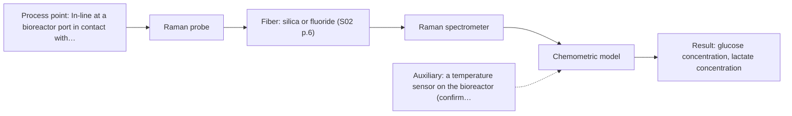
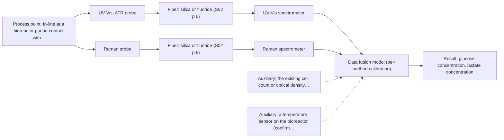

# First technical assessment: Glucose and lactate trends in an aqueous bioprocess

## Answer

**Customer request (our summary):** Customer runs a cell-culture process in aqueous medium and currently measures glucose and lactate from samples. They are exploring an in situ spectroscopy pilot, to be checked against existing laboratory measurements, but have not selected a probe or calibration strategy.

### Brief answer

Test Raman first: it tolerates water and has been used in a bioreactor to detect glucose, acetate and lactate directly, matching your two targets. MIR-ATR is the closest single-method alternative, and NIR only fits if the broth stays clear enough for a defined pathlength. Before a probe or calibration is chosen, the concentration ranges, accuracy targets, turbidity and reference method need fixing.

### Proposal

- **Best current option:** O2 (recommended)
- **Basis:** supplied AFS sources
- **What would change it:** A fluorescence background strong enough to hide the Raman bands, or a broth clear and stable enough for a defined NIR pathlength, would move the first test to M2 or M3. Reference values too slow or too coarse to pair with in-line spectra would change the trial design rather than the method.
- **Next step:** Run a first Raman trial on representative samples across one run and pair the spectra with the existing laboratory glucose and lactate values.

**Secondary evidence (external, not AFS material):** G1: no usable external source found; G2: E02 ¶19; G3: E02 ¶8, E02 ¶72; G4: no usable external source found. See Expert detail.

**Decision status:** Provisional feasibility assessment

### Solution options

| ID | Tier | Methods | Confidence | Cost class, S01 Table 1 (p.6) | Ease of use | Maintenance | Performance fit | Sources |
|---|---|---|---|---|---|---|---|---|
| O1 | Simple | M2 MIR, ATR probe | Low: open question: Q1 (starts at Medium); a parameter is not measurable in-line | high cost (row 2) | one contact probe, no pathlength setting | crystal cleaning and fouling checks | selective bands through a thin ATR layer | [1: S01 p.10] [2: S01 p.9] [3: S01 p.5] |
| O2 | Recommended | M1 Raman probe | Low: open question: Q1 (starts at Medium); a parameter is not measurable in-line | high cost (row 12) | silica probe, no ATR crystal contact | laser, probe window and filter care | water-tolerant direct glucose and lactate signal | [4: S01 p.16] [5: S01 p.16] |
| O3 | Extended (multi-method) | M4 UV-Vis, ATR probe + Raman (combination) | Low: open question: Q1 (starts at Medium); uncited auxiliary sensor and a parameter is not measurable in-line; multi-method, fusion benefit not yet shown | high cost (rows 12, 14) | two instruments at one measurement point | two calibrations and two drift checks | adds cell-population context to the metabolite signal | [6: S01 p.8] [7: S01 p.8] [8: S01 p.8] [9: S01 p.9] [10: S01 p.16] [11: S01 p.16] [12: REF §5] |

*Confidence rates the basis of the advice (how much is known and cited), not a predicted accuracy or probability of success. It starts at High, or at Medium when a key question on the method or the option is open, and drops one level per weakness listed (floor Low).*

*Cost class is the relative rating in S01 Table 1 (p.6) for the in-line method+technique rows named (the highest one for a multi-method option); it is not a price.*

### Setup sketch

*Recommended option O2; drawn by code from the option, a schematic, not a configuration.*

### Key questions

1. What glucose and lactate concentration ranges do you expect, and what accuracy and precision does the process decision need?
2. How turbid does the broth become during a run, and does it stay clear enough for a controlled transmission path?
3. Do the medium or the cells show strong fluorescence at the wavelengths a Raman probe would use?

## Expert detail

**Customer enquiry**

> We run a cell culture process in an aqueous medium. Glucose and lactate are measured from samples, and the delay makes it difficult to see changes promptly. We are exploring an in situ spectroscopy pilot that can be checked against those existing laboratory measurements. The medium and cell population change during the run; we have not yet selected a probe or a calibration strategy.

**Decision status:** Provisional feasibility assessment. No method, probe or calibration strategy has been chosen, and the concentration ranges, turbidity, fluorescence background and reference method are still open, so the shortlist rests on stated assumptions. A Raman-first trial is justified by the aqueous medium and the two metabolite targets, but no supplied source makes any method a ready solution for this process.

### Parameters

| ID | Parameter | Kind | Need | Measured by | Why | Sources |
|---|---|---|---|---|---|---|
| P1 | glucose concentration | quantitative | required | Spectroscopy: Raman | Glucose is one of the two targets the customer wants to follow in situ instead of from delayed samples. | [5: S01 p.16] |
| P2 | lactate concentration | quantitative | required | Spectroscopy: Raman | Lactate is the second target and is expected to change quickly enough that the sampling delay matters. | [5: S01 p.16] |
| P3 | cell density (or optical density) | quantitative | required | Auxiliary sensor: the existing cell count or optical density measurement (engineering judgement: confirm availability with AFS) | The changing cell population alters scattering and can shift the spectrum independently of the analytes. | *(no verified source: engineering judgement)* |
| P4 | temperature | quantitative | optional | Auxiliary sensor: a temperature sensor on the bioreactor (engineering judgement: confirm availability with AFS) | Water bands and Raman intensities shift with temperature, so a logged temperature is needed to judge whether one calibration holds across the run; it should already be available from the bioreactor. | *(no verified source: engineering judgement)* |
| P5 | medium formulation and feed state | qualitative | required | Not measurable in-line by spectroscopy; alternative: feed and batch records for medium formulation and additions | The calibration is specific to the matrix, so the medium composition at each sample must be known to interpret model error. | [13: REF §5] |

### Solution option details

- **O1 cost drivers:** MIR spectrometer, infrared fiber probe, crystal handling
- **O2 cost drivers:** Raman spectrometer, laser, filtered probe, calibration runs
- **O3 cost drivers:** second spectrometer, combined probe, fusion and validation work
- **O3 combining methods:** Low-level fusion of Raman and UV-Vis ATR spectra taken at the same probe spot into one matrix, with per-block scaling so neither block dominates. Both blocks keep their own calibration and their own drift checks, and their different acquisition rates must be aligned to a common time step. The fused model must beat the best single Raman model on held-out runs, otherwise the extra channel is dropped.

*Extended (multi-method) option O3; drawn by code from the option, a schematic, not a configuration.*

### Premise check

- **Supported:** An in situ spectroscopy pilot can be checked against the existing laboratory glucose and lactate measurements. The guidance for a feasibility plan explicitly includes independent reference measurements and a defined go/no-go basis, which is what the existing laboratory values would provide. [14: REF §3]
- **Precedent only:** Fiber-optic spectroscopy can measure glucose and lactate directly in an aqueous cell-culture medium, in situ. The source describes Raman in a bioreactor for direct detection of glucose, acetate and lactate; that is a reason to test the method on this process, not proof of performance in this medium. [5: S01 p.16]

### Requirements

**Stated by the customer**

- "cell culture process in an aqueous medium"
- "Glucose and lactate are measured from samples"
- "the delay makes it difficult to see changes promptly"
- "in situ spectroscopy pilot"
- *Further statements: see the customer enquiry above.*

**Key unknowns**

- Expected glucose and lactate concentration ranges and the accuracy the customer needs
- Turbidity and optical density of the broth across the run
- Fluorescent species in the medium and the resulting Raman background
- Reference method details and sampling frequency for the existing laboratory values
- Installation point, sterilisation/cleaning procedure and distance from port to spectrometer
- Temperature level and variation during the run

### Clarification questions (most decision-relevant first)

Q1. What glucose and lactate concentration ranges do you expect, and what accuracy and precision does the process decision need? *Why it matters:* The ranges and tolerances decide which method can be sensitive enough and set the numerical go/no-go criteria for the trial. *(affects: method)*
Q2. How turbid does the broth become during a run, and does it stay clear enough for a controlled transmission path? *Why it matters:* A clear, stable liquid would allow NIR transmission with a defined pathlength, while a turbid or strongly scattering broth rules that geometry out and favours Raman or ATR. *(affects: technique)*
Q3. Do the medium or the cells show strong fluorescence at the wavelengths a Raman probe would use? *Why it matters:* A strong fluorescence background can swamp the weak Raman bands and would make MIR-ATR the better first test. *(affects: technique)*
Q4. Where would the probe sit, how is the port cleaned or sterilised, and how far is the spectrometer from that point? *Why it matters:* Port geometry, cleaning and the link length constrain the probe design and the fiber family that can carry the light. *(affects: installation)*
Q5. Which laboratory method produces the glucose and lactate values, and how often are samples taken? *Why it matters:* The reference values must be time-stamped and precise enough to pair fairly with in-line spectra, otherwise the comparison cannot separate the methods. *(affects: status)*
Q6. What temperature does the run hold, and how much does it vary? *Why it matters:* Temperature variation changes water bands and Raman intensities, so it decides whether one calibration can cover the whole run. *(affects: status)*

### Recommendation

- **M1 · Primary candidate: Raman probe.** Raman tolerates water far better than infrared methods and has been used in a bioreactor for direct detection of glucose, acetate and lactate, which matches the two targets. It is the single method to test first against the existing laboratory values. *Conditions:* Applies if the medium does not show a fluorescence background that swamps the Raman bands at the chosen excitation wavelength. [4: S01 p.16] [5: S01 p.16]
- **M2 · Comparison candidate: MIR, ATR probe.** Mid-IR gives well-defined absorption bands and high selectivity, and strong water absorption confines it to a very thin layer that ATR provides. It is the natural head-to-head alternative to Raman for the same two analytes. *Conditions:* Applies where the probe can keep tight contact with the liquid and the crystal surface can be cleaned between runs. [2: S01 p.9] [3: S01 p.5]
- **M3 · Conditional candidate: NIR, transmission/transflection probe.** NIR is the most common in-line fiber method and has been used to follow glucose in the millimolar range in bioprocesses. Its use here depends on the broth staying clear enough for a defined pathlength. *Conditions:* Only if the optical density of the broth allows a controlled pathlength without losing the signal to absorption. [15: S01 p.10] [16: S01 p.16] [17: S01 p.18]
- **M4 · Conditional candidate: UV-Vis, ATR probe + Raman (combination).** Raman gives the metabolite fingerprint but not the cell population, while UV/Vis turbidity follows cell density in the same reactor. Combining them is a hypothesis to test only after the single methods, because no single sensor is optimal for every analyte or condition. *Conditions:* Only if the single-method tests show that the changing cell population confounds the Raman calibration. [10: S01 p.16] [11: S01 p.16] [12: REF §5]

### Measurement concept

- **Probe and geometry:** Raman fiber probe in contact with the liquid, or a MIR-ATR immersion probe as the alternative; NIR transmission/transflection only if a defined pathlength is feasible.
- **Location:** In-line at a bioreactor port in contact with the broth; exact port, sterilisation route and distance to the spectrometer are open.
- **Fiber link:** Silica fibers for Raman and NIR; infrared fibers (chalcogenide or polycrystalline) for MIR. Achievable link length for the MIR route is not stated in the sources and is an open question for the supplier. *(no verified source: engineering judgement)*

### Spectral range

- **Raman:** Raman shift in cm-1, with the laser excitation wavelength stated separately; the usable shift range depends on the laser, spectrograph, filter and probe actually selected. [18: S01 p.11]
- **MIR:** Nominal mid-IR range 4000-400 cm-1; the usable range depends on the fiber, crystal and spectrometer selected. [2: S01 p.9]

### Risks and uncertainty

- Fluorescence from the medium or cells could overlap the weak Raman bands and make the metabolite signals hard to extract. *(rules: R-RAM-1)* *(no verified source: engineering judgement)*
- A calibration built on one run may not hold as the medium and cell population change, so recalibration or model extension would be needed. *(rules: R-CAL-1)* *(no verified source: engineering judgement)*
- The existing laboratory values may be too slow or too coarse to pair fairly with in-line spectra, which would weaken the go/no-go comparison. *(no verified source: engineering judgement)*
- An ATR crystal in a cell-culture stream can foul or need frequent cleaning, which would degrade the MIR option. *(rules: R-MIR-3)* *(no verified source: engineering judgement)*

### First feasibility experiment

1. **Collect samples across at least one full run (early and late phase, low and high glucose, low and high cell density) and split each sample between the spectroscopic measurement and the existing laboratory glucose/lactate method.** Representative process states plus an independent reference. [14: REF §3]
2. **Measure the single methods first on the same samples - Raman (M1) and MIR-ATR (M2), and NIR (M3) only if the broth is clear enough - keeping each spectrum paired with its reference value.** Single-method comparison before any combination. *(no verified source: engineering judgement)*
3. **Build one calibration per method and validate it on held-out runs or batches, not on random spectra from the same run.** Avoid an optimistic calibration that only fits one batch. [19: S03 p.14]
4. **Only then test the UV-Vis ATR + Raman combination on the same samples and check whether the fused model beats the best single method.** The gain from combining is a hypothesis to be demonstrated. [12: REF §5]
5. **Go/no-go: the customer sets the numerical accuracy and response-time criteria before the trial, and a method passes only if it meets them on held-out runs.** A defined decision basis from the customer's requirements. *(no verified source: engineering judgement)*

**Reference measurements:** Existing laboratory glucose and lactate values, sampled at known times and paired with the spectra.

**Decision basis:** Customer-defined accuracy and response-time criteria met on held-out runs.

### Assumptions

- The broth can be brought into contact with a probe at a bioreactor port.
- The existing laboratory glucose and lactate values are traceable and time-stamped well enough to pair with spectra.
- Glucose and lactate concentrations are in a range where the methods above are informative; this is not yet confirmed.
- The broth is assumed to become turbid as the cell population grows, so a scattering-tolerant method is preferred; the actual optical density has not been stated (see Q2).

### Not covered by the supplied sources

- No supplied source gives accuracy, detection limits or response times for glucose and lactate in cell-culture medium.
- No supplied source gives a calibration that stays valid while the medium formulation and cell population change during a run.

### Further notes

- **Chemometrics:** Both Raman and NIR work here only with a calibration built on this matrix and validated on held-out runs; the medium change during a run means the model must be checked against reference values from more than one batch before it is trusted.
- **Real-time tracking:** The point of the in-line pilot is to replace the sampling delay: spectra are acquired continuously at the probe and converted to glucose and lactate values by the calibration, so trends become visible between laboratory samples.
- **Future direction:** If the single-method results are promising, a combined MIR-ATR plus Raman probe or a reduced multisensor system at selected wavelengths could be considered later.

### Secondary evidence (external, not AFS material)

*Found by a literature search for gaps the supplied AFS sources leave open. Not AFS material and not proof for this case; every quote below was verified verbatim against the fetched text.*

*Live search unavailable (library only: cache miss (europepmc); cache miss (openalex)); curated library only.*

**G1 · auxiliary sensor:** In-line measurement of cell density (or optical density) with the existing cell count or optical density measurement

- No usable external source found.

**G2 · auxiliary sensor:** In-line measurement of temperature with a temperature sensor on the bioreactor

- **E02 ¶19** The source varied temperature, along with acid concentrations and ionic strength, to obtain a robust model. *How it applies:* This could prompt testing whether the calibration remains robust across bioreactor temperature excursions and whether temperature is logged as a model input. *Limits and transfer risks:* It does not describe an in-line temperature sensor or a bioreactor; it is a lithium-recycling extraction study. *(supports O2)*
  > "The concentrations of nitric acid and hydrochloric acid as well as the ionic strength and temperature were varied to obtain a robust model."
  > Process Analytical Technology-Integrated FT-IR and Raman Spectroscopies for Efficient Reactive Liquid-Liquid Extraction Processing in Lithium Recycling. (2025) · ACS omega · doi:10.1021/acsomega.5c05705 · https://europepmc.org/article/PMC/PMC12573149 · retrieved 2026-10-17, full text, licence: cc by, via curated library

**G3 · multi-method:** Combining several spectroscopy methods (data fusion) (Low-level fusion of Raman and UV-Vis ATR spectra taken at the same probe spot into one matrix, with per-block scaling so neither block dominates. Both blocks keep their own calibration and their own drift checks, and their different acquisition rates must be aligned to a common time step. The fused model must beat the best single Raman model on held-out runs, otherwise the extra channel is dropped.)

- **E02 ¶8** For a continuous process at a fixed probe location, the source says calibrations can be narrower and validation can use independent steady-state runs, with online monitoring focused on drift and out-of-specification detection. *How it applies:* This could inform how a fused Raman/UV-Vis model is validated on held-out runs and how drift checks are framed, but it does not describe data fusion itself. *Limits and transfer risks:* The source concerns FT-IR/Raman monitoring in lithium recycling, not Raman/UV-Vis ATR in cell-culture medium; per-block scaling and acquisition-rate alignment are not addressed. *(supports O3)*
  > "In contrast, a continuous process at a fixed probe location is intended to operate in a steady-state window, which simplifies the model design: calibrations can be narrower and centered on the operational envelope, validation can rely on independent steady-state runs, and online monitoring focuses on drift and out-of-specification detection rather than resolving the rapidly changing composition."
  > Process Analytical Technology-Integrated FT-IR and Raman Spectroscopies for Efficient Reactive Liquid-Liquid Extraction Processing in Lithium Recycling. (2025) · ACS omega · doi:10.1021/acsomega.5c05705 · https://europepmc.org/article/PMC/PMC12573149 · retrieved 2026-10-17, full text, licence: cc by, via curated library
- **E02 ¶72** The source notes that in-line method drawbacks such as calibration maintenance and sensor drift/aging can be addressed by checking the baseline in pure-component phases and monitoring drift. *How it applies:* This could inform separate drift checks for each spectral block, for example baseline checks during known process phases, before deciding whether the fused model beats the best single Raman model. *Limits and transfer risks:* The source is a lithium-recycling liquid-liquid extraction study, not cell culture, and it does not discuss Raman/UV-Vis fusion or per-block scaling. *(supports O3)*
  > "Potential typical drawbacks of any in-line method are maintenance efforts like calibration, and actions to sensor drift and aging could be easily overcome by checking the baseline in each cycle of pure component phases of process operation and monitoring any drift in order to be able to react."
  > Process Analytical Technology-Integrated FT-IR and Raman Spectroscopies for Efficient Reactive Liquid-Liquid Extraction Processing in Lithium Recycling. (2025) · ACS omega · doi:10.1021/acsomega.5c05705 · https://europepmc.org/article/PMC/PMC12573149 · retrieved 2026-10-17, full text, licence: cc by, via curated library

**G4 · not in the supplied sources:** No supplied source gives accuracy, detection limits or response times for glucose and lactate in cell-culture medium.

- No usable external source found.

### Evidence (verified quotes)

1. ✓ **S01 p.10** (general): "These immersion probes operate on the ATR principle but allow analysis at a significant distance from the spectrometer, without the need for sampling."
2. ✓ **S01 p.9** (general): "Vibrational spectroscopy in the mid-IR range (4000-400 cm-1) is one of the most informative methods of chemical analysis."
3. ✓ **S01 p.5** (general): "strong absorption in the mid-IR region limits the corresponding spectral method to the analysis of very thin samples (usually less than 50 μm), but it opens up the possibility of using attenuated total reflectance (ATR)"
4. ✓ **S01 p.16** (general): "Raman is particularly well-suited for aqueous environments, as it exhibits low absorbance for water molecules compared to infrared methods."
5. ✓ **S01 p.16** (application precedent): "for direct detection of specific metabolites like glucose, acetate, or lactate."
6. ✓ **S01 p.8** (general): "collected from the same small, even pinpoint, area of the sample."
7. ✓ **S01 p.8** (general): "Ultimately, the measurement data must be normalized to a common time step."
8. ✓ **S01 p.8** (general): "If the variables have different units of measurement, the data should be normalized in some way, for example, using an autoscaling algorithm."
9. ✓ **S01 p.9** (general): "One of the challenges of multispectral analysis is the need to simultaneously connect at least two independently operating measuring instruments."
10. ✓ **S01 p.16** (general): "cell suspension turbidity correlates well with cell density."
11. ✓ **S01 p.16** (general): "where no single sensor is universally optimal for every analyte or condition."
12. ✓ (precedent only) **REF §5** (method gain): "compare with the best single method."
13. ✓ **REF §5** (general): "calibration specific to the matrix."
14. ✓ **REF §3** (general): "Representative samples or process states, independent reference measurements, what is compared, and the basis for the go / no-go decision."
15. ✓ **S01 p.10** (general): "Near-IR vibrational spectroscopy (NIR) is the most common online analysis method performed using fiber optic probes."
16. ✓ **S01 p.16** (general): "NIR spectroscopy is effective for tracking major components like glucose or glycerol in the millimolar range but may lack the sensitivity to detect trace compounds below 0.1 percent."
17. ✓ **S01 p.18** (general): "if the pathlength is too wide, the signal is lost to absorption"
18. ✓ **S01 p.11** (general): "The Raman shift is used as the horizontal (spectral) axis in Raman spectroscopy"
19. ✓ **S03 p.14** (general): "important conclusions depend on calibration or discrimination models built on limited experimental material."

### Verification

- Citations verified: 28 of 28 (exact or whitespace/hyphen-tolerant match on the cited page, scope checked).
- Hard check failures before deterministic corrections: 0; still open: 0; soft warnings: 4; repair rounds: 1.
- External evidence (cache): 3 quote(s) verified verbatim (exact or whitespace/hyphen-tolerant, at most 400 characters and 2 sentences, against the cited paragraph); 0 item(s) dropped.
- External search: 6 query(ies), 0 hit(s), 3 source(s) (3 from the curated library); ⚠ library only: cache miss (europepmc); cache miss (openalex).
- External step: 2 model call(s), 35.4 s extra (cost in the run JSON).

*Run D04-20261018T080635Z-6bb7 · models deepseek/deepseek-v4.1-flash-1017*
