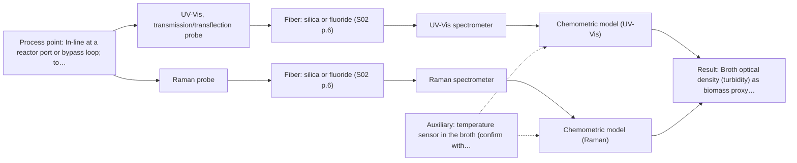
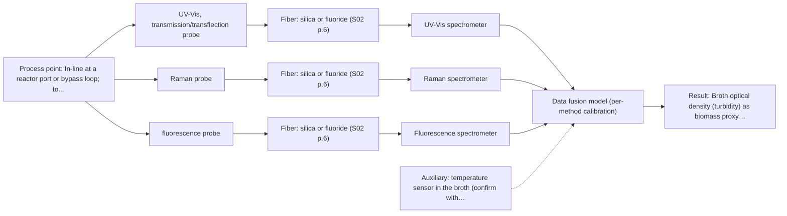

# First technical assessment: Biomass related monitoring during yeast fermentation

## Answer

**Customer request (our summary):** Customer requests an optical measurement during yeast fermentation to follow growth and notice changes earlier, with undefined biomass and metabolic signals, and asks for help turning this into an initial feasibility study with useful reference measurements.

### Brief answer

Test a UV-Vis transmission or transflection measurement first: it gives the growth signal through broth turbidity, at low effort. Add a Raman probe as the second single-method test for a metabolite fingerprint, since the broth is aqueous. Fluorescence is worth testing only if the broth is shown to contain a fluorophore. What the biomass and metabolic signals must actually represent, and the reference methods, are still open.

### Proposal

- **Best current option:** O2 (recommended)
- **Basis:** supplied AFS sources
- **What would change it:** If the metabolic signal turns out to be a redox or viability state, or the broth shows no usable fluorescence, the method set changes; if the broth saturates a transmission path, the growth measurement moves to a short-path ATR probe.
- **Next step:** Run one trial on representative broth across the run with independent biomass and metabolite references, then fix the probe configuration from the results.

**Secondary evidence (external, not AFS material):** G1: E03 ¶12; G2: E01 ¶31, E01 ¶82; G3: no usable external source found; G4: no usable external source found. See Expert detail.

**Decision status:** Provisional feasibility assessment

### Solution options

| ID | Tier | Methods | Confidence | Cost class, S01 Table 1 (p.6) | Ease of use | Maintenance | Performance fit | Sources |
|---|---|---|---|---|---|---|---|---|
| O1 | Simple | M1 UV-Vis, transmission/transflection probe | Low: open question: Q1, Q2 (starts at Medium); uncited auxiliary sensor | low cost (row 16) | one probe, standard optics | probe cleaning, one calibration | answers the growth question only | [1: S01 p.16] [2: S01 p.18] [3: S01 p.16] |
| O2 | Recommended | M1 UV-Vis, transmission/transflection probe; M2 Raman probe | Low: open question: Q1, Q2 (starts at Medium); uncited auxiliary sensor | high cost (rows 12, 16) | two probes, standard software | two calibrations, two instruments | covers growth and metabolite fingerprint | [1: S01 p.16] [2: S01 p.18] [3: S01 p.16] [4: S01 p.16] [5: S01 p.16] [6: S01 p.11] |
| O3 | Extended (multi-method) | M1 UV-Vis, transmission/transflection probe; M2 Raman probe; M3 fluorescence probe | Low: open question: Q1, Q2 (starts at Medium); fluorescent target unknown; uncited auxiliary sensor; multi-method, fusion benefit not yet shown | high cost (rows 12, 16, 19) | most complex, fusion workflow | three blocks to keep calibrated | adds metabolic state, widest coverage | [1: S01 p.16] [2: S01 p.18] [3: S01 p.16] [4: S01 p.16] [5: S01 p.16] [6: S01 p.11] [7: S01 p.7] [8: S01 p.5] [9: S01 p.16] |

*Confidence rates the basis of the advice (how much is known and cited), not a predicted accuracy or probability of success. It starts at High, or at Medium when a key question on the method or the option is open, and drops one level per weakness listed (floor Low).*

*Cost class is the relative rating in S01 Table 1 (p.6) for the in-line method+technique rows named (the highest one for a multi-method option); it is not a price.*

### Setup sketch

*Recommended option O2; drawn by code from the option, a schematic, not a configuration.*

### Key questions

1. What should the biomass signal represent - total cell density, viable biomass, or dry cell weight - and by which reference method will it be checked?
2. What does 'metabolic signal' mean for your team: named extracellular metabolites (for example glucose, ethanol, acetate, lactate) or a viability/redox indicator?
3. How optically dense does the broth become during the run, and does it stay single-phase (foam, aeration bubbles, solids)?

## Expert detail

**Customer enquiry**

> We would like an optical measurement during yeast fermentation to help us follow growth and notice changes earlier. Our team has mentioned both a biomass signal and a metabolic signal, but these have not been defined as separate targets. The broth becomes more optically dense as the run develops. We need help turning this request into an initial feasibility study with useful reference measurements.

**Decision status:** Provisional feasibility assessment. The broth is an aqueous liquid, and the sources link cell-suspension turbidity to cell density and Raman to metabolites in aqueous bioprocess media, so a short shortlist can be justified. The biomass and metabolic targets, their reference methods and the accuracy needed are still undefined, so the shortlist is explicitly conditional.

### Parameters

| ID | Parameter | Kind | Need | Measured by | Why | Sources |
|---|---|---|---|---|---|---|
| P1 | Broth optical density (turbidity) as biomass proxy | quantitative | required | Spectroscopy: UV-Vis | It is the in-line growth signal and also decides whether a transmission path stays within range as the run develops. | [1: S01 p.16] |
| P2 | Biomass reference (cell dry weight or viable counts) | quantitative | required | Reference lab method: dry cell weight and viable plate counts | An independent biomass reference is needed to calibrate the turbidity proxy and to judge the go/no-go. | *(no verified source: engineering judgement)* |
| P3 | Named extracellular metabolite concentrations | quantitative | required | Spectroscopy: Raman | The metabolic signal must be tied to named analytes before a Raman calibration and a reference method can be set up. | [5: S01 p.16] |
| P4 | Broth temperature | quantitative | required | Auxiliary sensor: temperature sensor in the broth (engineering judgement: confirm availability with AFS) | Fermentation temperature shifts both the biology and the spectra, so it must be logged with every spectrum. | *(no verified source: engineering judgement)* |
| P5 | Intrinsic fluorescence (for example NADH, tryptophan, riboflavin) | quantitative | optional | Spectroscopy: Fluorescence | It should be available only if the broth is shown to fluoresce, because it then gives a fast metabolic-state signal at low concentrations. | [9: S01 p.16] |

### Solution option details

- **O1 cost drivers:** one spectrometer and probe, one port, one calibration set
- **O2 cost drivers:** two spectrometers and probes, two calibration sets, shared port
- **O3 cost drivers:** three instruments and probes, synchronisation, fusion modelling, more reference data
- **O3 combining methods:** Low-level fusion of the per-method blocks, with block scaling so that no method dominates the model. All probes must look at the same port and be synchronised to a common time step, and each block keeps its own calibration and diagnostics. The fused model must beat the best single method on held-out runs, otherwise the extra methods are dropped.

*Extended (multi-method) option O3; drawn by code from the option, a schematic, not a configuration.*

### Premise check

- **Precedent only:** An optical measurement during the run can follow yeast growth and flag changes earlier. Published work links turbidity to cell density and shows a yeast-fermentation example, but this is a reason to test, not proof for this broth. [1: S01 p.16] [7: S01 p.7]
- **Not covered:** One optical measurement can deliver both a biomass signal and a metabolic signal for this broth. No supplied source says whether a single method covers both; the sources treat growth information and metabolite information as coming from different methods. *(no verified source: engineering judgement)*

### Requirements

**Stated by the customer**

- Optical measurement in-line during yeast fermentation
- Follow growth and notice changes earlier
- Biomass signal and metabolic signal, not yet defined as separate targets
- Broth becomes more optically dense as the run develops
- Help turning the request into an initial feasibility study with useful reference measurements

**Key unknowns**

- What the biomass signal must represent and by which reference method it will be checked
- What the metabolic signal must represent (named metabolites or a redox/viability state)
- How optically dense the broth becomes and at which point in the run
- Required accuracy, detection limit and response time
- Installation point, fouling and cleaning requirements
- Whether the broth contains a usable fluorophore

### Clarification questions (most decision-relevant first)

Q1. What should the biomass signal represent - total cell density, viable biomass, or dry cell weight - and by which reference method will it be checked? *Why it matters:* The reference defines which optical response and which method can serve as the growth signal. *(affects: method)*
Q2. What does 'metabolic signal' mean for your team: named extracellular metabolites (for example glucose, ethanol, acetate, lactate) or a viability/redox indicator? *Why it matters:* Raman and fluorescence answer different questions, so the answer decides which one is worth testing. *(affects: method)*
Q3. How optically dense does the broth become during the run, and does it stay single-phase (foam, aeration bubbles, solids)? *Why it matters:* High optical density and inhomogeneity decide whether a transmission path stays usable or a very short path is needed. *(affects: technique)*
Q4. Does the broth show intrinsic fluorescence (for example NADH or riboflavin), or could a fluorescent indicator be added? *Why it matters:* Fluorescence only responds to species that fluoresce, so this decides whether that method applies at all. *(affects: M3)*
Q5. Where would the probe be installed (reactor port, bypass loop, or off-line sampling), and what accuracy and response time would make the result useful? *Why it matters:* This fixes the probe geometry and the numerical go/no-go basis for the trial. *(affects: installation)*

### Recommendation

- **M1 · Primary candidate: UV-Vis, transmission/transflection probe.** Turbidity of a cell suspension correlates with cell density, so a UV-Vis transmission or transflection measurement is the least-effort route to a growth signal. It is described as a low-cost, robust tool for real-time biomass monitoring. *Conditions:* Fix a short, controlled optical pathlength; if the broth saturates the transmission signal late in the run, test the UV-ATR variant with its very short path. [1: S01 p.16] [2: S01 p.18] [3: S01 p.16]
- **M2 · Comparison candidate: Raman probe.** Raman suits aqueous broth and gives a molecular fingerprint for specific metabolites such as glucose, acetate or lactate, which the turbidity measurement does not provide. Its weak signal and any fluorescence background must be checked on real broth. *Conditions:* Check the broth's fluorescence background first; if it swamps the Raman bands, treat Raman as secondary. [4: S01 p.16] [5: S01 p.16] [6: S01 p.11]
- **M3 · Conditional candidate: fluorescence probe.** In a published yeast-fermentation example, combining fluorescence with NIR determined biomass more accurately and helped distinguish intra- from extracellular metabolites - a reason to test fluorescence here, not proof for this broth. Fluorescence only responds to species that actually fluoresce. *Conditions:* Applies only if a fluorescent species (for example NADH, tryptophan or riboflavin) or a justified indicator is confirmed in the broth. [7: S01 p.7] [8: S01 p.5] [9: S01 p.16]

### Measurement concept

- **Probe and geometry:** UV-Vis transmission or transflection through a fixed short path for the growth signal; Raman probe in contact with the broth for metabolites; a fluorescence probe only if a fluorophore is confirmed. All ports at the same sampling point if methods are later combined.
- **Location:** In-line at a reactor port or bypass loop; to be fixed by Q5.
- **Fiber link:** Silica fibers cover the UV-Vis and Raman ranges; the usable range depends on the instrument, fiber and probe actually selected. No link length is stated for this case. [10: S01 p.5] [11: S02 p.6]

### Spectral range

- **UV-Vis:** Depends on target and setup; the nominal method is not the range of a specific instrument, fiber or probe. [12: S01 p.5]
- **Raman:** Report the Raman shift in cm-1 and state the laser excitation wavelength separately; the usable range depends on the instrument, fiber and probe actually selected. [13: S01 p.11]
- **Fluorescence:** Depends on the fluorescent species and the excitation wavelength chosen; no range is fixed for this case. *(no verified source: engineering judgement)*

### Risks and uncertainty

- The metabolic target is undefined, so Raman or fluorescence could each turn out to answer the wrong question. *(no verified source: engineering judgement)*
- Fluorescence background in the broth may swamp the weak Raman signal, making Raman impractical without further probe work. *(rules: R-RAM-1)* [14: S01 p.11]
- Rising optical density may saturate the transmission measurement late in the run, so the growth signal may need a very short-path ATR variant. *(rules: R-UV-2, R-GEN-4)* [15: S01 p.16]
- Calibrations built on a few runs may not transfer to new batches or a changed medium, so the go/no-go must rest on held-out runs. *(rules: R-CAL-1)* [16: S01 p.10]

### First feasibility experiment

1. **Collect representative samples or run segments across the expected variation: early, mid and late fermentation, the most optically dense broth, and at least two independent runs or batches.** Representative chemical and physical variation, including the turbid end of the run. *(no verified source: engineering judgement)*
2. **Measure each sample with the single methods first - UV-Vis transmission (and the ATR variant on the most turbid samples), then Raman - at the same sampling point and before any combined or fused model.** Single methods first; same spot if a combination is later tested. [17: S01 p.3] [18: S01 p.8]
3. **Provide independent reference values for every sample: cell dry weight or viable counts for biomass, and a validated external method for the named metabolites.** Independent reference measurements to calibrate and to judge the result. *(no verified source: engineering judgement)*
4. **Build one calibration per method on a calibration subset and validate on held-out runs or batches, never on the same run.** Validation on held-out runs or batches. *(no verified source: engineering judgement)*
5. **Agree the go/no-go basis with the customer before the trial: the numerical accuracy, detection limit and response time the measurement must reach, plus the check that any fused model beats the best single method.** A go/no-go basis whose numerical criteria come from the customer. *(no verified source: engineering judgement)*

**Reference measurements:** To be named by the customer (Q1, Q2); no specific reference method for yeast fermentation is given in the supplied sources.

**Decision basis:** The comparison is single-method performance against the reference values first, then any combined model against the best single method.

### Assumptions

- The broth is a single-phase aqueous liquid that can be brought into contact with a probe.
- The reference values for biomass and metabolites can be produced in-house at a useful frequency.
- The customer can state numerical go/no-go criteria before the trial.

### Not covered by the supplied sources

- No supplied source names specific reference methods or sampling frequencies for yeast fermentation (for example dry cell weight, viable counts, or an HPLC method for metabolites).
- No supplied source gives detection limits, accuracy or response times for these methods in fermentation broth.

### Further notes

- **Chemometrics:** UV-Vis and Raman signals are broad or overlapping and the broth matrix changes during the run, so each method needs its own calibration built on reference values and validated on held-out runs. A fused model adds block scaling, per-block diagnostics and a comparison against the best single method.
- **Real-time tracking:** The measurement is intended in-line and continuous: spectra are taken while the broth passes the probe, so acquisition rate, the dead time between ports and the common time step must be fixed before any data fusion.
- **Future direction:** Once the informative wavelengths are known, a compact multi-sensor or LED-based analyzer could replace the full spectrometers for routine process control.

### Secondary evidence (external, not AFS material)

*Found by a literature search for gaps the supplied AFS sources leave open. Not AFS material and not proof for this case; every quote below was verified verbatim against the fetched text.*

*Live search unavailable (library only: cache miss (europepmc); cache miss (openalex)); curated library only.*

**G1 · auxiliary sensor:** In-line measurement of Broth temperature with temperature sensor in the broth

- **E03 ¶12** The source says temperature sensitivity of OH bands is a severe drawback for measuring aqueous solutions in NIR and MIR, making tempered sample holders necessary. *How it applies:* This could justify including temperature monitoring or control in the feasibility study, but it does not demonstrate an in-broth temperature sensor. *Limits and transfer risks:* The statement concerns NIR/MIR aqueous measurements with tempered sample holders, not UV-Vis or Raman in fermentation broth, and it is not evidence for an in-line broth temperature probe.
  > "Additionally, the temperature sensitivity of the OH bands is a severe drawback for measuring aqueous solution in NIR and MIR, which makes tempered sample holders necessary [29]."
  > A critical review of recent trends, and a future perspective of optical spectroscopy as PAT in biopharmaceutical downstream processing. (2020) · Analytical and bioanalytical chemistry · doi:10.1007/s00216-020-02407-z · https://europepmc.org/article/PMC/PMC7072065 · retrieved 2026-10-17, full text, licence: cc by, via curated library

**G2 · multi-method:** Combining several spectroscopy methods (data fusion) (Low-level fusion of the per-method blocks, with block scaling so that no method dominates the model. All probes must look at the same port and be synchronised to a common time step, and each block keeps its own calibration and diagnostics. The fused model must beat the best single method on held-out runs, otherwise the extra methods are dropped.)

- **E01 ¶31** Low-level data fusion is described as the simplest way to combine inputs by rearranging variables from different sources into a new data matrix. *How it applies:* This supports trying a low-level fusion design with per-method blocks, while still requiring held-out testing to see whether fusion beats the best single method. *Limits and transfer risks:* This is a review statement, not a fermentation study, and it does not address block scaling, probe synchronisation, or calibration diagnostics for the proposed spectroscopy setup. *(supports O3)*
  > "Low-level data fusion (LLDF) is considered the simplest method to achieve a combination of inputs. In this case, the data is rearranged into a new data matrix, where the variables coming from different sources are placed one after the other."
  > Challenges and Opportunities of Implementing Data Fusion in Process Analytical Technology-A Review. (2022) · Molecules (Basel, Switzerland) · doi:10.3390/molecules27154846 · https://europepmc.org/article/PMC/PMC9369811 · retrieved 2026-10-17, full text, licence: cc by, via curated library
- **E01 ¶82** The source states that before fusing data from multiple sources, it is essential to evaluate each dataset's contribution to the model and its complementarity. *How it applies:* This supports assessing each spectroscopy block and dropping extra methods if the fused model does not outperform the best single method on held-out runs. *Limits and transfer risks:* The statement is general and does not provide fermentation-specific evidence, nor does it define how to scale blocks or synchronise probes. *(supports O3)*
  > "Before fusing data from multiple sources, it is essential to evaluate the contribution of each dataset to the model and its complementarity."
  > Challenges and Opportunities of Implementing Data Fusion in Process Analytical Technology-A Review. (2022) · Molecules (Basel, Switzerland) · doi:10.3390/molecules27154846 · https://europepmc.org/article/PMC/PMC9369811 · retrieved 2026-10-17, full text, licence: cc by, via curated library

**G3 · not in the supplied sources:** No supplied source names specific reference methods or sampling frequencies for yeast fermentation (for example dry cell weight, viable counts, or an HPLC method for metabolites).

- No usable external source found.

**G4 · not in the supplied sources:** No supplied source gives detection limits, accuracy or response times for these methods in fermentation broth.

- No usable external source found.

### Evidence (verified quotes)

1. ✓ **S01 p.16** (application precedent): "UV/Vis spectroscopy can be deployed as a low-cost, robust tool for real-time biomass monitoring, as cell suspension turbidity correlates well with cell density."
2. ✓ **S01 p.18** (general): "the precise control of the optical pathlength (usually 1 - 10 mm); if the pathlength is too wide, the signal is lost to absorption; if too narrow, the sample represents a negligible volume."
3. ✓ **S01 p.16** (general): "In these high-OD scenarios, a UV-ATR (Attenuated Total Reflection) probe is used."
4. ✓ **S01 p.16** (general): "Raman is particularly well-suited for aqueous environments, as it exhibits low absorbance for water molecules compared to infrared methods."
5. ✓ **S01 p.16** (application precedent): "for direct detection of specific metabolites like glucose, acetate, or lactate."
6. ✓ **S01 p.11** (general): "superposition of luminescence (fluorescence), which has a significantly higher intensity."
7. ✓ **S01 p.7** (application precedent): "the combination of NIR spectroscopy with fluorescence spectroscopy demonstrated the possibility of more accurately determining the biomass content during yeast fermentation"
8. ✓ **S01 p.5** (general): "However, most chemicals do not exhibit this property."
9. ✓ **S01 p.16** (general): "critical cofactors and amino acids like NADH, tryptophan, and riboflavin."
10. ✓ **S01 p.5** (general): "making it ideal for online applications, including remote measurements via fiber optic probes."
11. ✓ **S02 p.6** (general): "350 nm Standard VIS-NIR Silica Fibers Al/Cu-coated VIS-NIR Silica Fibers 2400 nm"
12. ✓ **S01 p.5** (general): "It has very high sensitivity, especially in the UV region (190-360 nm)"
13. ✓ **S01 p.11** (general): "The Raman shift is used as the horizontal (spectral) axis in Raman spectroscopy"
14. ✓ **S01 p.11** (general): "signals, which are several orders of magnitude weaker than IR absorption peaks"
15. ✓ **S01 p.16** (general): "the signal in a standard transmission setup becomes saturated because the light cannot penetrate the bulk of the sample."
16. ✓ **S01 p.10** (general): "The broad absorption bands observed in this region overlap, suggesting the use of chemometrics for quantitative and qualitative analysis of spectral data."
17. ✓ **S01 p.3** (general): "samples of incompletely known composition, in order to select the most suitable method or combination of methods."
18. ✓ **S01 p.8** (general): "It is crucial that the spectral information obtained by different methods-Mid-IR, NIR, Raman, and fluorescence spectra-is collected from the same small, even pinpoint, area of the sample."

### Verification

- Citations verified: 23 of 23 (exact or whitespace/hyphen-tolerant match on the cited page, scope checked).
- Hard check failures before deterministic corrections: 0; still open: 0; soft warnings: 0; repair rounds: 0.
- External evidence (cache): 3 quote(s) verified verbatim (exact or whitespace/hyphen-tolerant, at most 400 characters and 2 sentences, against the cited paragraph); 0 item(s) dropped.
- External search: 6 query(ies), 0 hit(s), 3 source(s) (3 from the curated library); ⚠ library only: cache miss (europepmc); cache miss (openalex).
- External step: 2 model call(s), 19.1 s extra (cost in the run JSON).

*Run D05-20261018T080635Z-8d59 · models deepseek/deepseek-v4.1-flash-1017*
