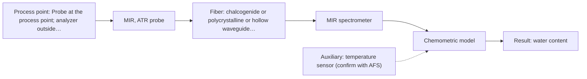

# First technical assessment: Water content in a petroleum stream

## Answer

**Customer request (our summary):** Customer wants to investigate a fiber based measurement closer to a petroleum process for water determination, with the analyzer outside the process area, so changes can be noticed sooner; they ask what to clarify and what a first comparison experiment should establish before selecting equipment.

### Brief answer

Test MIR-ATR first for water in the petroleum stream, because a supplied example shows ATR probes used for water content in petroleum. Compare it with NIR transmission/transflection only if the stream is clear enough and the water range suits a controlled pathlength. The open points are water range, stream phase and turbidity, temperature and pressure, distance to the analyzer and the laboratory reference method; these decide whether a single method is enough.

### Proposal

- **Best current option:** O2 (recommended)
- **Basis:** supplied AFS sources
- **What would change it:** If the stream is clear and the required water range suits a controlled NIR pathlength, or if the distance to the analyzer is beyond a practical MIR fiber link, the NIR option would move up. If the water range is below the detection capability of both single methods, a combined or sample-conditioning approach would need separate review.
- **Next step:** Run the first comparison experiment on representative samples with independent laboratory water values and customer-defined go/no-go criteria.

**Secondary evidence (external, not AFS material):** G1: E02 ¶12, E01 ¶19; G2: no usable external source found; G3: no usable external source found. See Expert detail.

**Decision status:** Provisional feasibility assessment

### Solution options

| ID | Tier | Methods | Confidence | Cost class, S01 Table 1 (p.6) | Ease of use | Maintenance | Performance fit | Sources |
|---|---|---|---|---|---|---|---|---|
| O1 | Simple | M2 NIR, transmission/transflection probe | Low: open question: Q2 (starts at Medium); physical state unknown, sample clarity unknown; uncited auxiliary sensor | average cost (row 7) | simple fiber and detector setup | pathlength and fouling care | fast remote tracking for clear liquids | [1: S01 p.18] [2: S02 p.7] [3: S01 p.18] [4: S01 p.10] |
| O2 | Recommended | M1 MIR, ATR probe | Low: open question: Q2 (starts at Medium); physical state unknown, sample clarity unknown; uncited auxiliary sensor | high cost (row 2) | direct ATR contact, simple optics | crystal cleaning and fouling checks | direct water-in-petroleum precedent, compact probe | [5: S02 p.13] [6: S04 p.4] [7: S01 p.10] [8: S01 p.9] |

*Confidence rates the basis of the advice (how much is known and cited), not a predicted accuracy or probability of success. It starts at High, or at Medium when a key question on the method or the option is open, and drops one level per weakness listed (floor Low).*

*Cost class is the relative rating in S01 Table 1 (p.6) for the in-line method+technique rows named (the highest one for a multi-method option); it is not a price.*

### Setup sketch

*Recommended option O2; drawn by code from the option, a schematic, not a configuration.*

### Key questions

1. What is the physical state and optical behaviour of the petroleum stream at the measurement point — clear liquid, emulsion, opaque, multiphase or gas?
2. What water concentration range and what accuracy or detection limit must the measurement cover?
3. What are the temperature and pressure at the measurement point?

## Expert detail

**Customer enquiry**

> We handle a petroleum stream and currently send samples to a laboratory for water determination. We want to investigate a fiber based measurement closer to the process so that changes can be noticed sooner. The analyzer would be outside the process area. Before selecting equipment, we need to know what to clarify and what a first comparison experiment should establish.

**Decision status:** Provisional feasibility assessment. A shortlist can be justified from a supplied laboratory example of water in petroleum measured with ATR probes and from general fiber-probe statements, but it is not an equipment selection. The water range, stream phase and optical behaviour, temperature and pressure, and distance to the analyzer are open and decide the technique and installation.

### Parameters

| ID | Parameter | Kind | Need | Measured by | Why | Sources |
|---|---|---|---|---|---|---|
| P1 | water content | quantitative | required | Spectroscopy: MIR | Water determination is the stated target and the basis for any calibration or go/no-go decision. | [5: S02 p.13] |
| P2 | sample temperature | quantitative | required | Auxiliary sensor: temperature sensor (engineering judgement: confirm availability with AFS) | Water bands and calibration depend on sample temperature, which is not stated for this stream. | *(no verified source: engineering judgement)* |

### Solution option details

- **O1 cost drivers:** NIR spectrometer, transmission probe, pathlength control, calibration samples
- **O2 cost drivers:** MIR spectrometer, ATR probe, MIR fiber link, calibration samples

### Premise check

- **Supported:** A fiber based measurement closer to the process will allow changes to be noticed sooner. A supplied general statement says online analysis can measure directly in the process without sampling, eliminating delays; it does not state a response time for this stream. [9: S01 p.3]
- **Supported:** The analyzer can be located outside the process area while still making the required measurement. A supplied general statement says ATR fiber probes allow analysis at a significant distance from the spectrometer; the achievable distance and installation for this stream are not stated. [7: S01 p.10]

### Requirements

**Stated by the customer**

- "petroleum stream"
- "send samples to a laboratory for water determination"
- "fiber based measurement closer to the process"
- "changes can be noticed sooner"
- *Further statements: see the customer enquiry above.*

**Key unknowns**

- Water concentration range and required detection limit or accuracy
- Physical state and optical behaviour of the stream: clear liquid, emulsion, opaque, multiphase or gas
- Temperature and pressure at the measurement point
- Distance from the process point to the analyzer outside the process area, and area classification
- Laboratory reference method, sampling frequency and required response time
- Fouling and cleaning behaviour of the process stream

### Clarification questions (most decision-relevant first)

Q1. What is the physical state and optical behaviour of the petroleum stream at the measurement point — clear liquid, emulsion, opaque, multiphase or gas? *Why it matters:* A clear liquid supports a transmission or ATR geometry, whereas an opaque, emulsified or multiphase stream changes which technique can represent the bulk. *(affects: technique)*
Q2. What water concentration range and what accuracy or detection limit must the measurement cover? *Why it matters:* The water range decides whether MIR-ATR or NIR can meet the target at all. *(affects: method)*
Q3. What are the temperature and pressure at the measurement point? *Why it matters:* These conditions affect the probe, crystal and installation that can be used. *(affects: installation)*
Q4. What is the distance from the process point to the analyzer outside the process area, and what area classification applies? *Why it matters:* The distance and classification decide the fiber link and installation layout. *(affects: installation)*
Q5. What laboratory reference method and sampling frequency are used now, and what response time is required? *Why it matters:* This defines the comparison basis and the go/no-go criteria for the first experiment. *(affects: status)*

### Recommendation

- **M1 · Primary candidate: MIR, ATR probe.** MIR-ATR is the most direct single method to test because a supplied example shows ATR probes used for water content in petroleum. ATR suits liquid or soft-solid samples in tight contact with the crystal, and fiber probes can be placed at a significant distance from the spectrometer. *Conditions:* Applies if the stream is a liquid or soft fluid that can contact the ATR crystal and the water range is within the MIR-ATR capability; nominal MIR range is 4000-400 cm-1, but the usable range depends on the instrument, fiber and probe selected. [5: S02 p.13] [6: S04 p.4] [7: S01 p.10] [8: S01 p.9]
- **M2 · Comparison candidate: NIR, transmission/transflection probe.** NIR transmission/transflection is a comparison because a supplied example treats transmission as preferred for clear or semi-transparent liquids and silica fibers can carry NIR over long cables to a remote analyzer. It is only worth testing if the stream is clear enough and a controlled pathlength can be maintained. *Conditions:* Applies if the stream is a clear or semi-transparent liquid and the water range can be covered with a controlled pathlength; nominal NIR range is 780-2500 nm, but the usable range depends on the instrument, fiber and probe selected. [1: S01 p.18] [2: S02 p.7] [3: S01 p.18] [4: S01 p.10]

### Measurement concept

- **Probe and geometry:** MIR-ATR probe in contact with the liquid petroleum stream as the primary concept; NIR transmission or transflection with a controlled pathlength as the comparison for clear or semi-transparent streams.
- **Location:** Probe at the process point; analyzer outside the process area, connected by fiber. The achievable fiber length and installation details are open.
- **Fiber link:** MIR needs a mid-IR fiber family; NIR can use silica fibers. No source states an achievable MIR link length for this layout. *(no verified source: engineering judgement)*

### Spectral range

- **MIR:** nominal MIR range 4000-400 cm-1 (2.5-25 µm); the usable range depends on the instrument, fiber and probe selected [8: S01 p.9] [10: REF §5]
- **NIR:** nominal NIR range 780-2500 nm; the usable range depends on the instrument, fiber and probe selected [4: S01 p.10] [10: REF §5]

### Risks and uncertainty

- If the water concentration is below the detection capability of MIR-ATR or NIR, the shortlist is wrong and sample conditioning or another method would be needed. *(no verified source: engineering judgement)*
- If the stream is opaque, emulsified or multiphase, ATR contact may not represent the bulk and NIR transmission may lose signal, so the technique choice would change. *(no verified source: engineering judgement)*
- The achievable MIR fiber length from the process to an analyzer outside the process area is not stated in the sources, so the installation may not fit the requested layout. *(no verified source: engineering judgement)*
- Temperature, pressure, fouling and area classification are unknown and could require a probe or installation not covered by the supplied material. *(no verified source: engineering judgement)*

### First feasibility experiment

1. **Collect representative petroleum samples across the expected water range, temperature, phase and turbidity states, and record the sampling point and conditions.** Cover the chemical and physical variation that the method must handle. [11: REF §3]
2. **Measure each sample with MIR-ATR first and with NIR transmission/transflection as the comparison, using repeat measurements and probe re-positioning.** Test single methods before any combination. *(no verified source: engineering judgement)*
3. **Obtain independent laboratory water values for the same samples, with blind duplicates and the customer's current reference method.** Provide an independent basis for calibration and comparison. [12: REF §3]
4. **Build and validate a water calibration per method on held-out batches or runs, and compare prediction error with the customer's criteria.** Show whether a single method meets the target before considering a combination. [13: S01 p.5]
5. **Use customer-defined numerical go/no-go criteria for water range, accuracy and response time; only if a single method fails should a combined MIR-ATR plus NIR hypothesis be tested.** Make the decision basis explicit and avoid overbuilding. [14: REF §3]

**Reference measurements:** Independent laboratory water determination using the customer's current method, with blind duplicates.

**Decision basis:** Customer-defined numerical criteria for water range, accuracy and response time; no numerical criteria are invented here.

### Assumptions

- The petroleum stream is a liquid or soft fluid that can contact an ATR crystal or a transmission probe.
- The current laboratory water determination can provide reference values for calibration and validation.
- The analyzer can be connected by fiber to the process point, but the achievable MIR distance is not established.

### Not covered by the supplied sources

- No supplied source states an in-line water detection limit, accuracy or response time for a petroleum stream.
- No supplied source states an achievable MIR fiber length between the process and an analyzer outside the process area.

### Further notes

- **Chemometrics:** Water determination by NIR or MIR will need a matrix-specific calibration built from the customer's laboratory water values; validate it on held-out batches and re-check it after stream or source changes.
- **Real-time tracking:** The intended gain is faster tracking of water changes; define the required time resolution and whether the probe sits in the stream or in a slipstream before comparing methods.
- **Future direction:** If single-method tests show that one method cannot cover the full water range or stream variability, a later hypothesis is a combined MIR-ATR plus NIR option with a fused model, compared against the best single method.

### Secondary evidence (external, not AFS material)

*Found by a literature search for gaps the supplied AFS sources leave open. Not AFS material and not proof for this case; every quote below was verified verbatim against the fetched text.*

*Live search unavailable (library only: cache miss (europepmc); cache miss (openalex)); curated library only.*

**G1 · auxiliary sensor:** In-line measurement of sample temperature with temperature sensor

- **E02 ¶12** The review notes that temperature sensitivity of OH bands is a severe drawback for measuring aqueous solutions in NIR and MIR, making tempered sample holders necessary. *How it applies:* For a MIR ATR water measurement, this suggests sample temperature should be controlled or at least measured, and the first comparison should test whether temperature variation changes the spectra. *Limits and transfer risks:* The source is a review of biopharmaceutical downstream processing and refers to aqueous solutions, not a petroleum stream; it supports testing temperature effects but does not establish an in-line temperature-sensor design. *(supports O2)*
  > "Additionally, the temperature sensitivity of the OH bands is a severe drawback for measuring aqueous solution in NIR and MIR, which makes tempered sample holders necessary [29]."
  > A critical review of recent trends, and a future perspective of optical spectroscopy as PAT in biopharmaceutical downstream processing. (2020) · Analytical and bioanalytical chemistry · doi:10.1007/s00216-020-02407-z · https://europepmc.org/article/PMC/PMC7072065 · retrieved 2026-10-17, full text, licence: cc by, via curated library
- **E01 ¶19** In developing a robust model, the source varied temperature together with acid concentrations and ionic strength. *How it applies:* This supports treating sample temperature as a variable to record and vary in a first comparison, so the assessment can see whether temperature affects the measurement enough to require an auxiliary temperature sensor. *Limits and transfer risks:* The work concerns reactive liquid-liquid extraction in lithium recycling, not petroleum water determination; it is model-development evidence rather than an in-line temperature-sensor validation. *(supports O2)*
  > "The concentrations of nitric acid and hydrochloric acid as well as the ionic strength and temperature were varied to obtain a robust model."
  > Process Analytical Technology-Integrated FT-IR and Raman Spectroscopies for Efficient Reactive Liquid-Liquid Extraction Processing in Lithium Recycling. (2025) · ACS omega · doi:10.1021/acsomega.5c05705 · https://europepmc.org/article/PMC/PMC12573149 · retrieved 2026-10-17, full text, licence: cc by, via curated library

**G2 · not in the supplied sources:** No supplied source states an in-line water detection limit, accuracy or response time for a petroleum stream.

- No usable external source found.

**G3 · not in the supplied sources:** No supplied source states an achievable MIR fiber length between the process and an analyzer outside the process area.

- No usable external source found.

### Evidence (verified quotes)

1. ✓ **S01 p.18** (general): "Transmission is the preferred method for transparent or semi-transparent liquids, such as skim milk, whey, or permeate."
2. ✓ **S02 p.7** (performance figure): "Robust 100-300m cables made with Silica fibers of low OH-content (<0.1ppm OH) enable remote industrial process-control"
3. ✓ **S01 p.18** (general): "the precise control of the optical pathlength (usually 1 - 10 mm); if the pathlength is too wide, the signal is lost to absorption; if too narrow, the sample represents a negligible volume."
4. ✓ **S01 p.10** (general): "NIR spectra (780-2500 nm) contain predominantly overtones and component bands of fundamental vibrations"
5. ✓ **S02 p.13** (application precedent): "Application: measurement of water content in petroleum"
6. ✓ **S04 p.4** (general): "suitability of analyzed samples for ATR measurements, which is true for liquid or soft solid samples and their components, allowing a tight contact with the probe head."
7. ✓ **S01 p.10** (general): "These immersion probes operate on the ATR principle but allow analysis at a significant distance from the spectrometer, without the need for sampling."
8. ✓ **S01 p.9** (general): "Vibrational spectroscopy in the mid-IR range (4000-400 cm-1) is one of the most informative methods of chemical analysis."
9. ✓ **S01 p.3** (general): "It allows for in-process analysis, i.e., directly in the process flow or reactor without sampling, eliminating delays and the risk of sample contamination."
10. ✓ **REF §5** (general): "It is not a product specification: actual spectral coverage, fiber length, component ratings, detection limits and accuracy depend on the configuration and the sample."
11. ✓ **REF §3** (general): "Representative samples or process states"
12. ✓ **REF §3** (general): "independent reference measurements"
13. ✓ **S01 p.5** (general): "construction, validation, and application of predictive models, specifically calibration or classification models."
14. ✓ **REF §3** (general): "basis for the go / no-go decision."

### Verification

- Citations verified: 19 of 19 (exact or whitespace/hyphen-tolerant match on the cited page, scope checked).
- Hard check failures before deterministic corrections: 0; still open: 0; soft warnings: 1; repair rounds: 1.
- External evidence (cache): 2 quote(s) verified verbatim (exact or whitespace/hyphen-tolerant, at most 400 characters and 2 sentences, against the cited paragraph); 0 item(s) dropped.
- External search: 6 query(ies), 0 hit(s), 3 source(s) (3 from the curated library); ⚠ library only: cache miss (europepmc); cache miss (openalex).
- External step: 2 model call(s), 12.7 s extra (cost in the run JSON).

*Run D06-20261018T080635Z-bb83 · models deepseek/deepseek-v4.1-flash-1017*
