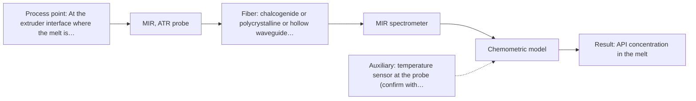
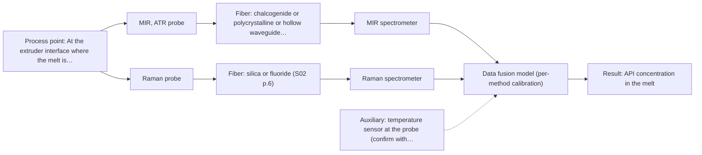

# First technical assessment: API concentration during hot polymer extrusion

## Answer

**Customer request (our summary):** Customer is developing a hot polymer extrusion process incorporating an active pharmaceutical ingredient and wants to investigate whether an optical measurement can detect composition changes in the melt during processing. They have offline assays, note a hot process interface with possible material build-up, and request an initial comparison plan and pre-probe questions.

### Brief answer

Test mid-infrared ATR first: it gives sharp, interpretable bands, and one source describes API in hot polymer measured with a diamond-cone ATR probe on a polymer extrusion line. NIR reflection is the lower-effort comparison and Raman a later addition. Still open: which composition change you must see, the acceptance criteria, the melt's optical behaviour, and the hot-interface and build-up details.

### Proposal

- **Best current option:** O2 (recommended)
- **Basis:** supplied AFS sources
- **What would change it:** If the target change turns out to be a bulk polymer ratio in a strongly scattering melt, NIR reflection (O1) becomes the better first test; if no single method meets the acceptance criteria, the MIR + Raman combination (O3) moves up.
- **Next step:** Run the single-method comparison on representative melt samples against the customer's offline assay, starting with MIR ATR.

**Secondary evidence (external, not AFS material):** G1: E02 ¶19; G2: E03 ¶82, E03 ¶36; G3: no usable external source found; G4: no usable external source found. See Expert detail.

**Decision status:** Provisional feasibility assessment

### Solution options

| ID | Tier | Methods | Confidence | Cost class, S01 Table 1 (p.6) | Ease of use | Maintenance | Performance fit | Sources |
|---|---|---|---|---|---|---|---|---|
| O1 | Simple | M3 NIR, diffuse reflection probe | Low: open question: Q1, Q3 (starts at Medium); sample clarity unknown; uncited auxiliary sensor and a parameter is not measurable in-line | average cost (row 8) | Flush probe, standard silica fibers | Window cleaning and drift checks | Standard in-line route; API bands may be weak | [1: S01 p.10] [2: S01 p.18] [3: S01 p.10] [4: S01 p.16] [5: S02 p.7] |
| O2 | Recommended | M1 MIR, ATR probe | Low: open question: Q1 (starts at Medium); uncited auxiliary sensor and a parameter is not measurable in-line | high cost (row 2) | Contact ATR probe, one instrument | Crystal cleaning and periodic reference checks | Sharp API bands, direct extrusion precedent | [6: S02 p.14] [7: S02 p.14] [8: S01 p.9] [9: S04 p.4] |
| O3 | Extended (multi-method) | M1 MIR, ATR probe; M4 Raman probe + MIR (combination) | Low: open question: Q1 (starts at Medium); uncited auxiliary sensor and a parameter is not measurable in-line; multi-method, fusion benefit not yet shown | high cost (rows 2, 12) | Two instruments on one shared point | Two calibrations; both probes cleaned | Backbone and fingerprint information together | [10: S01 p.8] [11: S01 p.9] [6: S02 p.14] [7: S02 p.14] [8: S01 p.9] [9: S04 p.4] [12: S01 p.11] [13: S02 p.16] [14: S01 p.8] [15: REF §5] |

*Confidence rates the basis of the advice (how much is known and cited), not a predicted accuracy or probability of success. It starts at High, or at Medium when a key question on the method or the option is open, and drops one level per weakness listed (floor Low).*

*Cost class is the relative rating in S01 Table 1 (p.6) for the in-line method+technique rows named (the highest one for a multi-method option); it is not a price.*

### Setup sketch

*Recommended option O2; drawn by code from the option, a schematic, not a configuration.*

### Key questions

1. Which composition change must be detected (for example API concentration, polymer ratio, additive level or a degradation product), and over what concentration range?
2. What accuracy, precision, limit of detection, response time and measurement frequency must the in-line result meet against your offline assay?
3. What is the optical regime of the melt at process temperature (clear, turbid, opaque or strongly scattering), and does it change between formulations?

## Expert detail

**Customer enquiry**

> We are developing a hot polymer extrusion process that incorporates an active pharmaceutical ingredient. We want to investigate whether an optical measurement can detect composition changes while the melt is being processed. We have offline assays, but the process interface is hot and may be exposed to material build up. We need an initial comparison plan and the questions required before choosing a probe.

**Decision status:** Provisional feasibility assessment. MIR ATR passes the method screen and the closest source passage is a polymer-extrusion example in which API in hot polymer was measured with an ATR probe, so a shortlist can be justified. The composition change to be detected, the acceptance criteria and the hot-interface details are still open, so the ranking is conditional on those answers.

### Parameters

| ID | Parameter | Kind | Need | Measured by | Why | Sources |
|---|---|---|---|---|---|---|
| P1 | API concentration in the melt | quantitative | required | Spectroscopy: MIR | This is the composition change the customer wants to see in-line, and it sets which spectral bands and which detection limit matter. | *(no verified source: engineering judgement)* |
| P2 | Melt temperature at the measurement point | quantitative | required | Auxiliary sensor: temperature sensor at the probe (engineering judgement: confirm availability with AFS) | The interface is hot, temperature shifts the spectrum and any model, and the probe rating has to be checked against it. | *(no verified source: engineering judgement)* |
| P3 | Material build-up on the probe interface | qualitative | required | Not measurable in-line by spectroscopy; alternative: Inspection at planned intervals plus a reference-standard spectrum check between runs. | The customer flagged build-up, and a layer on the crystal or window changes the signal and can be mistaken for a composition change. | [16: REF §5] |
| P4 | Polymer grade and formulation identity | qualitative | optional | Reference lab method: Formulation record and the customer's offline assay | It should be available from production records, and it defines the scope of any calibration because the model is matrix-specific. | [17: REF §5] |

### Solution option details

- **O1 cost drivers:** One NIR spectrometer, reflection probe, fiber link and chemometric calibration
- **O2 cost drivers:** FTIR spectrometer, MIR fiber, ATR probe, calibration and validation
- **O3 cost drivers:** Two spectrometers, combined probe, synchronisation, fusion modelling and validation
- **O3 combining methods:** MIR ATR and Raman would share one measurement point, preferably through a combined probe rather than two separate ports. The two acquisitions run at different rates and must be aligned to a common time step, with block scaling so that neither block dominates the model. Each block keeps its own calibration, and the fused model must beat the best single-method model on independent runs, otherwise the second instrument is not worth keeping.

*Extended (multi-method) option O3; drawn by code from the option, a schematic, not a configuration.*

### Premise check

- **Precedent only:** An optical measurement can detect composition changes in a hot polymer melt in-line. One source page describes NIR reflection and MIR ATR used to control polymer extrusion in-line, with spectra of API in hot polymer taken through a diamond-cone ATR probe; that is a reason to test the approach here, not proof that it works for this melt. [7: S02 p.14] [6: S02 p.14]
- **Not covered:** The existing offline assays are sufficient as the reference for an in-line comparison. No supplied source addresses whether assays taken from solidified material are comparable with a measurement made in the melt; that comparability has to be established in the experiment design. *(no verified source: engineering judgement)*
- **Not covered:** An initial comparison plan can be built before the target composition change and the performance requirements are defined. The guidance lists what a feasibility plan must contain, including a go/no-go basis, but does not say whether that basis can be deferred; the numerical criteria still have to come from the customer. *(no verified source: engineering judgement)*

### Requirements

**Stated by the customer**

- "We are developing a hot polymer extrusion process"
- "incorporates an active pharmaceutical ingredient"
- "We have offline assays"
- "process interface is hot"
- "detect composition changes while the melt is being processed"
- *Further statements: see the customer enquiry above.*

**Key unknowns**

- Which composition change must be seen (API loading, polymer ratio, additive level, degradation product) and over what concentration range.
- The accuracy, precision and response time that count as success against the offline assays.
- Whether the melt is clear, turbid or opaque, and whether that changes between formulations.
- Melt temperature and pressure at the mounting point, the geometry available, and the distance from the spectrometer.
- The expected build-up rate on the interface and whether the probe can be cleaned or removed without stopping the line.
- Whether the offline assays are taken from a comparable state to the melt measurement.

### Clarification questions (most decision-relevant first)

Q1. Which composition change must be detected (for example API concentration, polymer ratio, additive level or a degradation product), and over what concentration range? *Why it matters:* The magnitude and spectral nature of the change decide whether MIR ATR, Raman or NIR is worth testing first. *(affects: method)*
Q2. What accuracy, precision, limit of detection, response time and measurement frequency must the in-line result meet against your offline assay? *Why it matters:* These numbers are the go/no-go basis and decide whether any single method can be accepted. *(affects: status)*
Q3. What is the optical regime of the melt at process temperature (clear, turbid, opaque or strongly scattering), and does it change between formulations? *Why it matters:* This decides whether the NIR comparison should use reflection or transmission/transflection, and whether an ATR contact probe sees a representative layer. *(affects: M3)*
Q4. What are the melt temperature and pressure at the proposed mounting point, the available port geometry, and the distance from the spectrometer? *Why it matters:* These set the probe and fiber specification and whether a remote MIR link is feasible. *(affects: installation)*
Q5. How quickly does material build up on the interface, and can the probe be cleaned or removed without stopping the line? *Why it matters:* Build-up can mimic a composition change and determines the maintenance concept for the ATR crystal or window. *(affects: installation)*
Q6. Are the offline assays taken from solidified material or a comparable melt state, and what is their reference uncertainty? *Why it matters:* The reference limits what the comparison can prove, and a state mismatch can bias the calibration. *(affects: status)*

### Recommendation

- **M1 · Primary candidate: MIR, ATR probe.** MIR ATR is the only single method here that both passes the method screen and has a published polymer-extrusion example, including spectra of API in hot polymer from a diamond-cone ATR probe. MIR bands are sharp and well resolved, so a composition change is more likely to be interpretable than with broad overtone spectra. *Conditions:* Applies where the melt can be kept in tight contact with the ATR crystal; the nominal MIR range is 4000-400 cm-1 (2.5-25 µm) and the usable range depends on the fiber and probe selected. [6: S02 p.14] [7: S02 p.14] [8: S01 p.9] [9: S04 p.4]
- **M2 · Comparison candidate: Raman probe.** Raman passes the screen and is complementary to MIR: it carries the molecular backbone and symmetric non-polar groups that MIR sees weakly. Its practical value here is unknown until measured, because a hot polymer may fluoresce over the weak Raman signal. *Conditions:* Applies only where the fluorescence background of the polymer and the API still leaves usable Raman bands. [12: S01 p.11] [18: S01 p.15] [19: S01 p.11]
- **M3 · Conditional candidate: NIR, diffuse reflection probe.** NIR with a reflection probe is the most common in-line fiber-probe method and the least hardware to try. Its bands are broad and overlapping and may be too weak for a small API fraction, so it is a comparison rather than the lead method. *Conditions:* Applies only if the melt is opaque or strongly scattering so that a flush reflection probe fits; for a clear melt the NIR variant would be transmission or transflection instead. [1: S01 p.10] [2: S01 p.18] [3: S01 p.10] [4: S01 p.16] [5: S02 p.7]
- **M4 · Conditional candidate: Raman probe + MIR (combination).** MIR and Raman spectra are complementary, and a combined ATR/Raman fiber system has been built, so the pairing is worth testing. Any gain is a hypothesis: the fused model has to beat the better single method on independent runs. *Conditions:* Applies only after both single methods have been tested and neither meets the customer's criteria. [12: S01 p.11] [13: S02 p.16] [14: S01 p.8] [15: REF §5] Later hypothesis, after single-method tests.

### Measurement concept

- **Probe and geometry:** MIR ATR probe in contact with the melt as the lead; NIR reflection probe flush-mounted as the low-effort comparison; Raman probe only as the later addition, sharing the measurement point if it is combined.
- **Location:** At the extruder interface where the melt is accessible without dead zones, with the spectrometer set back from the hot zone.
- **Fiber link:** MIR needs chalcogenide or polycrystalline infrared fibers; NIR and Raman can use silica fibers. The achievable MIR link length for this installation is not stated in the sources and is an open question. [5: S02 p.7] [20: REF §3]

### Spectral range

- **MIR:** Nominal 4000-400 cm-1 (2.5-25 µm); usable range depends on the fiber, crystal and probe selected. [8: S01 p.9]
- **NIR:** Nominal 780-2500 nm; usable range depends on the instrument, fiber and probe selected. [21: S01 p.10]
- **Raman:** Reported as Raman shift in cm-1, with the laser excitation wavelength stated separately; no excitation wavelength has been chosen for this case. [22: S01 p.11]

### Risks and uncertainty

- Build-up on the ATR crystal or the probe window changes the signal and can look like a composition change. *(rules: R-MIR-3)* [16: REF §5]
- No supplied source states an achievable MIR fiber length, so a mounting point far from the spectrometer may not be reachable with MIR. *(rules: R-FIB-2)* *(no verified source: engineering judgement)*
- If the API fraction is small or its bands overlap the polymer, the change may not be resolvable at the required precision. *(rules: R-NIR-4)* [4: S01 p.16]
- If the offline assays are taken from a different state than the melt, the reference itself limits what the comparison can show. *(no verified source: engineering judgement)*

### First feasibility experiment

1. **Collect representative melt samples and process states: several API loading levels, the polymer grades used, and start-up and steady-state material, from more than one run. Ranges come from the customer.** Representative variation, not convenience samples. [23: REF §3]
2. **Have the customer's offline assay run on every sample as the independent reference, and record sampling point and time so that in-line and offline results can be paired.** Independent reference data and traceability. *(no verified source: engineering judgement)*
3. **Measure the samples with the single methods first, MIR ATR then NIR reflection, at melt temperature in the laboratory before any probe goes on the line.** Single methods first; the melt state is preserved as far as the lab allows. [24: S01 p.3]
4. **Build one calibration per method against the offline assay and validate it on held-out runs or batches, not on held-out spectra from the same run.** Held-out validation at the level that matters for a process. [25: S03 p.14]
5. **Go/no-go: a single method passes if its prediction matches the offline assay within the tolerance the customer sets, on the held-out runs. Only if no single method passes is the MIR + Raman combination tested, and it must then beat the best single method.** A numerical go/no-go basis from the customer, and a fair test for the combination. [15: REF §5]

**Reference measurements:** The customer's existing offline assay on every sample, paired in time and place with the spectral measurement.

**Decision basis:** Agreement with the offline assay within the tolerance the customer states, on runs or batches not used to build the model; no numerical criterion can be set before that tolerance is given.

### Assumptions

- The melt can be brought into contact with an ATR crystal or a window at the available interface without a dead zone.
- The offline assay is precise enough to act as a reference for the composition change in question.
- The polymer matrix stays within one formulation family during the trial, so one calibration per method is meaningful.

### Not covered by the supplied sources

- An achievable MIR fiber length for a hot process installation; the sources give short laboratory cable examples for infrared fibers and long lengths only for silica.
- Probe temperature and pressure ratings for a hot extruder interface.
- Fouling and cleaning behaviour of ATR crystals and windows in a hot polymer melt.
- Whether offline assays on solidified material are comparable with an in-melt measurement.

### Further notes

- **Chemometrics:** Both single-method routes need a calibration built on the customer's own material: broad overlapping NIR bands and matrix-specific calibrations mean reference samples across the composition range, and re-validation whenever the formulation changes.
- **Real-time tracking:** The aim is continuous tracking while the melt flows, so acquisition rate, averaging and the dead time between probes have to be fixed before any combined measurement is attempted.
- **Future direction:** If a single method meets the criteria, a compact dedicated sensor or a single combined probe for the extruder would be the later step, once the informative spectral regions are known.

### Secondary evidence (external, not AFS material)

*Found by a literature search for gaps the supplied AFS sources leave open. Not AFS material and not proof for this case; every quote below was verified verbatim against the fetched text.*

*Live search unavailable (library only: cache miss (europepmc); cache miss (openalex)); curated library only.*

**G1 · auxiliary sensor:** In-line measurement of Melt temperature at the measurement point with temperature sensor at the probe

- **E02 ¶19** Temperature was varied together with concentrations and ionic strength to build a robust model. *How it applies:* This suggests treating melt temperature at the probe as a variable to record and vary in robustness testing for the MIR ATR option, rather than assuming a fixed temperature. *Limits and transfer risks:* The source is an aqueous acid liquid-liquid extraction study, not a hot polymer melt, and it does not describe a probe-integrated temperature sensor or its in-line performance. *(supports O2)*
  > "The concentrations of nitric acid and hydrochloric acid as well as the ionic strength and temperature were varied to obtain a robust model."
  > Process Analytical Technology-Integrated FT-IR and Raman Spectroscopies for Efficient Reactive Liquid-Liquid Extraction Processing in Lithium Recycling. (2025) · ACS omega · doi:10.1021/acsomega.5c05705 · https://europepmc.org/article/PMC/PMC12573149 · retrieved 2026-10-17, full text, licence: cc by, via curated library

**G2 · multi-method:** Combining several spectroscopy methods (data fusion) (MIR ATR and Raman would share one measurement point, preferably through a combined probe rather than two separate ports. The two acquisitions run at different rates and must be aligned to a common time step, with block scaling so that neither block dominates the model. Each block keeps its own calibration, and the fused model must beat the best single-method model on independent runs, otherwise the second instrument is not worth keeping.)

- **E03 ¶82** The review says each dataset's contribution and complementarity should be evaluated before fusing data from multiple sources. *How it applies:* For the combined MIR ATR/Raman option, plan per-block contribution checks and compare the fused model against the best single method on independent runs before keeping the second instrument. *Limits and transfer risks:* This is a general review statement, not a test on hot polymer melt or a specific MIR/Raman probe configuration. *(supports O3)*
  > "Before fusing data from multiple sources, it is essential to evaluate the contribution of each dataset to the model and its complementarity."
  > Challenges and Opportunities of Implementing Data Fusion in Process Analytical Technology-A Review. (2022) · Molecules (Basel, Switzerland) · doi:10.3390/molecules27154846 · https://europepmc.org/article/PMC/PMC9369811 · retrieved 2026-10-17, full text, licence: cc by, via curated library
- **E03 ¶36** A Raman and FT-IR food analytical study is cited where instrument complementarity alone was not sufficient to improve prediction of several CQAs. *How it applies:* This supports making the fused model prove itself against the best single-method model on independent runs; if it does not, the second instrument may not add value. *Limits and transfer risks:* The cited case is food analysis, not polymer extrusion, and uses different instruments and CQAs; the result is a reason to test, not proof for this process. *(supports O3)*
  > "In some situations, instrument complementarity (not data complementarity) was not sufficient to improve the performance of predictive several CQAs, as shown by a Raman and FT-IR data based food analytical study [73]."
  > Challenges and Opportunities of Implementing Data Fusion in Process Analytical Technology-A Review. (2022) · Molecules (Basel, Switzerland) · doi:10.3390/molecules27154846 · https://europepmc.org/article/PMC/PMC9369811 · retrieved 2026-10-17, full text, licence: cc by, via curated library

**G3 · not in the supplied sources:** An achievable MIR fiber length for a hot process installation; the sources give short laboratory cable examples for infrared fibers and long lengths only for silica.

- No usable external source found.

**G4 · not in the supplied sources:** Probe temperature and pressure ratings for a hot extruder interface.

- No usable external source found.

### Evidence (verified quotes)

1. ✓ **S01 p.10** (general): "Near-IR vibrational spectroscopy (NIR) is the most common online analysis method performed using fiber optic probes."
2. ✓ **S01 p.18** (general): "reflection can work well in highly scattering environments but can be less representative for clear liquids."
3. ✓ **S01 p.10** (general): "The broad absorption bands observed in this region overlap, suggesting the use of chemometrics for quantitative and qualitative analysis of spectral data."
4. ✓ **S01 p.16** (general): "may lack the sensitivity to detect trace compounds below 0.1 percent."
5. ✓ **S02 p.7** (general): "Robust 100-300m cables made with Silica fibers of low OH-content (<0.1ppm OH) enable remote industrial process-control"
6. ✓ **S02 p.14** (application precedent): "Spectra of API in hot polymer obtained with Diamond cone ATR probe coupled to iC10 FTIR (MTAC)"
7. ✓ **S02 p.14** (application precedent): "NIR-Reflex & MIR-ATR-spectroscopy to control polymer extrusion in-line"
8. ✓ **S01 p.9** (general): "Vibrational spectroscopy in the mid-IR range (4000-400 cm-1) is one of the most informative methods of chemical analysis."
9. ✓ **S04 p.4** (general): "suitability of analyzed samples for ATR measurements, which is true for liquid or soft solid samples and their components, allowing a tight contact with the probe head."
10. ✓ **S01 p.8** (general): "Ultimately, the measurement data must be normalized to a common time step."
11. ✓ **S01 p.9** (general): "Furthermore, methods containing a larger number of variables have a greater impact on the model."
12. ✓ **S01 p.11** (general): "This property makes mid-IR and Raman spectra complementary, that is, they complement each other."
13. ✓ **S02 p.16** (application precedent): "Combi-Fiber Systems for ATR+Fluo/ Raman spectroscopy"
14. ✓ **S01 p.8** (general): "The use of a combined probe facilitates measurements and allows for the analysis of a smaller sample volume."
15. ✓ **REF §5** (general): "compare with the best single method."
16. ✓ **REF §5** (general): "Usable range limited by fiber and crystal; contact, fouling, compatibility."
17. ✓ **REF §5** (general): "physical variation; calibration specific to the matrix."
18. ✓ **S01 p.15** (general): "NIR detects hydrogen bonds and asymmetric polar groups, while Raman provides information on the molecular backbone and symmetrical non-polar groups."
19. ✓ **S01 p.11** (general): "superposition of luminescence (fluorescence), which has a significantly higher intensity."
20. ✓ **REF §3** (general): "A nominal method range is not the range of a specific instrument, fiber or probe."
21. ✓ **S01 p.10** (general): "NIR spectra (780-2500 nm) contain predominantly overtones and component bands of fundamental vibrations"
22. ✓ **S01 p.11** (general): "The Raman shift is used as the horizontal (spectral) axis in Raman spectroscopy"
23. ✓ **REF §3** (general): "Representative samples or process states, independent reference measurements, what is compared, and the basis for the go / no-go decision."
24. ✓ **S01 p.3** (general): "samples of incompletely known composition, in order to select the most suitable method or combination of methods."
25. ✓ **S03 p.14** (general): "A thorough validation, including full, segmented and random-subset CVs, as well as randomization tests, are recommended in any cases for which important conclusions depend on calibration or discrimination models built on limited experimental material."

### Verification

- Citations verified: 33 of 33 (exact or whitespace/hyphen-tolerant match on the cited page, scope checked).
- Hard check failures before deterministic corrections: 0; still open: 0; soft warnings: 1; repair rounds: 1.
- External evidence (cache): 3 quote(s) verified verbatim (exact or whitespace/hyphen-tolerant, at most 400 characters and 2 sentences, against the cited paragraph); 0 item(s) dropped.
- External search: 5 query(ies), 0 hit(s), 3 source(s) (3 from the curated library); ⚠ library only: cache miss (europepmc); cache miss (openalex).
- External step: 2 model call(s), 28.3 s extra (cost in the run JSON).

*Run D07-20261018T080635Z-56ab · models deepseek/deepseek-v4.1-flash-1017*
