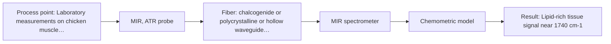
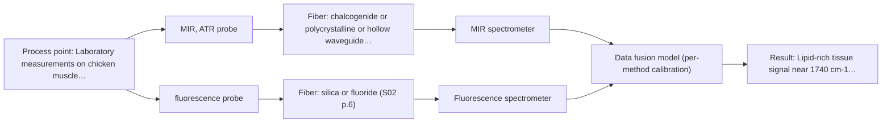

# First technical assessment: Local measurements of heterogeneous model tissues

## Answer

**Customer request (our summary):** Customer wants to compare MIR ATR and fluorescence information for a laboratory classification study of model biological tissues such as chicken muscle, fat and liver, with a first comparison experiment and a clear statement of what its results would demonstrate.

### Brief answer

Start with single-method MIR ATR and fluorescence measurements on the same chicken muscle, fat and liver samples, with several points per sample and independent class labels. Compare each method's classification on held-out samples; only then test a combined MIR ATR/fluorescence probe at the same spot. The results would show whether either method alone separates the three classes and whether combining adds information. The go/no-go accuracy criteria are still open.

### Proposal

- **Best current option:** O2 (recommended)
- **Basis:** supplied AFS sources
- **What would change it:** If fluorescence shows no usable intrinsic signal, M2 and O1 drop out; if either single method meets the customer's classification criteria on held-out samples, the combined O3 is unnecessary. If neither does, the combined-probe test becomes the deciding experiment.
- **Next step:** Agree the reference labels, sample set and go/no-go classification criteria, then run MIR ATR and fluorescence single-method measurements on the same samples before any combined-probe test.

**Secondary evidence (external, not AFS material):** G1: E02 ¶31, E03 ¶16; G2: no usable external source found; G3: no usable external source found. See Expert detail.

**Decision status:** Provisional feasibility assessment

### Solution options

| ID | Tier | Methods | Confidence | Cost class, S01 Table 1 (p.6) | Ease of use | Maintenance | Performance fit | Sources |
|---|---|---|---|---|---|---|---|---|
| O1 | Simple | M2 fluorescence probe | Low: open question: Q2 (starts at Medium); fit for soft solid to be tested, sample clarity unknown, fluorescent target unknown | low cost (row 19) | simple optical fluorescence setup | laser and probe cleaning | quick check of intrinsic fluorescence | [1: S04 p.3] [2: S01 p.5] |
| O2 | Recommended | M1 MIR, ATR probe | Medium: precedent only | high cost (row 2) | ATR contact with standard FTIR | crystal cleaning and contact checks | strong single-method chemical fingerprint | [3: S04 p.3] [4: S04 p.4] |
| O3 | Extended (multi-method) | M1 MIR, ATR probe; M2 fluorescence probe; M3 MIR, ATR probe + Fluorescence (combination) | Low: open question: Q1, Q2 (starts at Medium); fit for soft solid to be tested, sample clarity unknown, fluorescent target unknown; multi-method, fusion benefit not yet shown | high cost (rows 2, 19) | combined probe alignment and timing | two instruments and probe cleaning | same-spot complementarity for three classes | [3: S04 p.3] [4: S04 p.4] [1: S04 p.3] [2: S01 p.5] [5: S04 p.4] [6: S01 p.8] |

*Confidence rates the basis of the advice (how much is known and cited), not a predicted accuracy or probability of success. It starts at High, or at Medium when a key question on the method or the option is open, and drops one level per weakness listed (floor Low).*

*Cost class is the relative rating in S01 Table 1 (p.6) for the in-line method+technique rows named (the highest one for a multi-method option); it is not a price.*

### Setup sketch

*Recommended option O2; drawn by code from the option, a schematic, not a configuration.*

### Key questions

1. What classification performance (for example accuracy or sensitivity/specificity per tissue class) and repeatability must the first experiment reach?
2. Which fluorescent species or indicator is expected, and at what excitation wavelength should fluorescence be measured?
3. What independent reference will define each tissue class and each measurement point?

## Expert detail

**Customer enquiry**

> Our research group is evaluating a spectral measurement interface using model biological tissues such as chicken muscle, fat and liver. We want to compare MIR ATR and fluorescence information, because the material is heterogeneous and sequential measurements may not sample the same location. This is a laboratory classification study. We need a first comparison experiment and a clear statement of what its results would demonstrate.

**Decision status:** Provisional feasibility assessment. A provisional shortlist is justified because MIR ATR suits soft tissue in contact with the crystal, and a published chicken-tissue example shows MIR ATR and fluorescence at one spot; that is precedent, not proof for this laboratory. The fluorescent species, reference standard and go/no-go criteria remain open.

### Parameters

| ID | Parameter | Kind | Need | Measured by | Why | Sources |
|---|---|---|---|---|---|---|
| P1 | Tissue class label | qualitative | required | Reference lab method: histology or prepared sample identity | The classification study needs an independent class label for each measurement. | [7: S04 p.3] |
| P2 | Lipid-rich tissue signal near 1740 cm-1 | qualitative | required | Spectroscopy: MIR | MIR ATR uses the ester carbonyl band near 1740 cm-1 to distinguish lipid-rich fat from other tissues. | [3: S04 p.3] |
| P3 | Porphyrin-related fluorescence near 613 nm | qualitative | required | Spectroscopy: Fluorescence | Fluorescence at 613 nm helped distinguish liver from the other chicken tissues in the published example. | [1: S04 p.3] |

### Solution option details

- **O1 cost drivers:** fluorescence spectrometer, laser, fiber probe, reference labels
- **O2 cost drivers:** FTIR spectrometer, MIR ATR probe, sampling fixtures
- **O3 cost drivers:** two spectrometers, combined probe, synchronisation, fusion calibration
- **O3 combining methods:** Fusion level: low-level concatenation of MIR ATR and fluorescence spectra with per-block scaling. Both channels must sample the same small spot on the same sample, and data must be aligned to a common time step if acquisition rates differ. Each method needs its own calibration, and the fused model must beat the best single method on held-out samples.

*Extended (multi-method) option O3; drawn by code from the option, a schematic, not a configuration.*

### Premise check

- **Supported:** The material heterogeneity and sequential sampling limitation justify comparing MIR ATR and fluorescence information. The sources state that alternating separate probes cannot guarantee that both methods analyse the same spot, so a same-spot comparison is technically motivated. [8: S04 p.2]
- **Precedent only:** MIR ATR and fluorescence information are appropriate to compare for this classification study. A published chicken-tissue study used exactly this combination and found that the concatenated data separated the three tissue classes; this is a reason to test, not proof for the customer's samples. [9: S04 p.4]
- **Precedent only:** Chicken muscle, fat and liver are suitable model biological tissues for this evaluation. The published example used chicken breast, fat and liver as a model system, but that does not establish suitability for the customer's exact study design. [10: S04 p.3]

### Requirements

**Stated by the customer**

- Laboratory classification study using model biological tissues such as chicken muscle, fat and liver.
- Compare MIR ATR and fluorescence information because the material is heterogeneous and sequential measurements may not sample the same location.
- First comparison experiment and a clear statement of what its results would demonstrate.

**Key unknowns**

- Customer's go/no-go classification performance and repeatability criteria
- Identity and excitation/emission of the fluorescent species or indicator
- Independent reference method and class labels for each measurement point
- Sample preparation, freshness, thickness and ATR contact suitability
- Number of independent samples or batches available for held-out validation
- Exact spectral ranges and instrument/probe configuration

### Clarification questions (most decision-relevant first)

Q1. What classification performance (for example accuracy or sensitivity/specificity per tissue class) and repeatability must the first experiment reach? *Why it matters:* This sets the go/no-go basis and decides whether a single method is enough or a combined probe is needed. *(affects: M3)*
Q2. Which fluorescent species or indicator is expected, and at what excitation wavelength should fluorescence be measured? *Why it matters:* Fluorescence only works for species that fluoresce or for a justified indicator, and the published porphyrin example may not transfer. *(affects: M2)*
Q3. What independent reference will define each tissue class and each measurement point? *Why it matters:* Classification models need reference labels that are independent of the spectra. *(affects: status)*
Q4. How will samples be prepared and presented to the probe (fresh, frozen/thawed, thickness, flatness, temperature)? *Why it matters:* ATR needs tight contact, and frozen/thawed tissue can differ from fresh tissue. *(affects: technique)*
Q5. Is the goal a full three-class classification or only a comparison of information content, and how many independent samples or batches are available? *Why it matters:* This determines whether held-out validation and a combined probe are required. *(affects: method)*
Q6. What is the optical regime of the samples: are they optically dense, highly scattering or turbid, and how thick are they? *Why it matters:* The optical regime decides whether fluorescence can be measured with the intended probe geometry and whether sample preparation or a different interface is needed. *(affects: technique)*

### Recommendation

- **M1 · Primary candidate: MIR, ATR probe.** MIR ATR is a suitable single method for soft tissue in contact with the crystal and provides a chemical fingerprint; in the chicken-tissue example it discriminated lipid-rich fat via the ester carbonyl band near 1740 cm-1. It is the best single method to test first. *Conditions:* Applies if the samples allow tight ATR contact and the reference class labels are defined. [3: S04 p.3] [4: S04 p.4]
- **M2 · Comparison candidate: fluorescence probe.** Fluorescence gives a different contrast: in the chicken-tissue example the 613 nm porphyrin-related peak distinguished liver, so it is worth measuring separately. It is conditional because the sample's fluorescent species or indicator is not yet identified. *Conditions:* Applies if the samples contain an intrinsic fluorophore or a justified fluorescent indicator and the excitation wavelength is chosen. [1: S04 p.3] [2: S01 p.5]
- **M3 · Conditional candidate: MIR, ATR probe + Fluorescence (combination).** In the published chicken-tissue example, neither IR nor fluorescence alone separated all three classes, while concatenated IR and fluorescence data did. The same-spot gain is a hypothesis to test after single-method tests, not proof for this laboratory. *Conditions:* Applies only after single-method tests, if neither MIR ATR nor fluorescence meets the customer's classification criteria. [5: S04 p.4] [6: S01 p.8]

### Measurement concept

- **Probe and geometry:** Use an ATR fiber probe for MIR and a fluorescence fiber probe; for the combined case, use a same-spot combined probe if available, otherwise mark positions and accept the risk that separate probes may not sample exactly the same tissue.
- **Location:** Laboratory measurements on chicken muscle, fat and liver samples, with several points per sample to cover heterogeneity.
- **Fiber link:** MIR needs a fiber that transmits the selected mid-IR range; fluorescence needs silica fibers with low polymer-jacket fluorescence. Exact lengths and configuration are not stated in the enquiry and must be checked. [11: S01 p.8]

### Spectral range

- **MIR:** Nominal MIR range 4000-400 cm-1; the usable range depends on the instrument, fiber and ATR probe actually selected. [12: S01 p.9]
- **Fluorescence:** Fluorescence range depends on the fluorescent species and excitation wavelength; no single nominal range applies. *(no verified source: engineering judgement)*

### Risks and uncertainty

- A single method may not separate all three tissue classes, so a negative single-method result would not rule out the combined probe. [5: S04 p.4]
- Intrinsic fluorescence may be weak, absent or masked, and the published porphyrin-related example may not transfer to the customer's samples. *(rules: R-FLU-1, R-FLU-2)* [2: S01 p.5]
- ATR samples only a thin surface layer, so contact, fouling and local heterogeneity can dominate the MIR signal. *(rules: R-MIR-3)* [13: S01 p.13]
- With few samples or no independent batches, classification models can overfit; held-out validation is needed. *(no verified source: engineering judgement)*

### First feasibility experiment

1. **Prepare a balanced sample set of chicken muscle, fat and liver, with at least three independent samples per tissue type and several measurement points per sample to cover heterogeneity; record the reference class independently.** Representative samples across the expected chemical and physical variation. [7: S04 p.3] [14: S04 p.3]
2. **Acquire MIR ATR spectra on all points with the selected probe, including repeat placements and a background check; keep contact pressure and temperature consistent.** Single-method MIR baseline. *(no verified source: engineering judgement)*
3. **Acquire fluorescence spectra on the same samples and, where possible, the same marked points with a defined excitation wavelength; check background, bleaching and signal-to-noise before classification.** Single-method fluorescence baseline. *(no verified source: engineering judgement)*
4. **Build separate MIR and fluorescence classification models with independent reference labels and validate on held-out samples or batches; compare each single method with the best single-method baseline.** Compare single methods before combining. *(no verified source: engineering judgement)*
5. **Only if neither single method meets the customer's go/no-go criteria, measure the combined MIR ATR + fluorescence probe at the same spot, synchronise the data, calibrate each block and test whether the fused model beats the best single method on held-out samples.** Test the combination as a later hypothesis. [6: S01 p.8] [9: S04 p.4]

**Reference measurements:** Independent class labels from prepared sample identity or histology; the exact reference method is still to be agreed with the customer.

**Decision basis:** Customer-defined numerical criteria for classification accuracy or sensitivity/specificity per class and repeatability. No numerical threshold is assumed here.

### Assumptions

- The samples are soft enough for tight ATR contact.
- Chicken breast is an acceptable stand-in for the stated muscle tissue.
- Intrinsic fluorescence may be present, but the fluorescent species is not yet confirmed.
- The study is laboratory classification, not in-line process control or clinical use.

### Not covered by the supplied sources

- The supplied sources do not define the customer's go/no-go classification criteria or reference standard.
- They do not give a validated classification accuracy for the customer's exact samples or instrument configuration.

### Further notes

- **Chemometrics:** Use per-method classification models first (for example PCA or PLS-DA) with independent reference labels and held-out validation; a fused model is only justified if it beats the best single method.

### Secondary evidence (external, not AFS material)

*Found by a literature search for gaps the supplied AFS sources leave open. Not AFS material and not proof for this case; every quote below was verified verbatim against the fetched text.*

*Live search unavailable (library only: cache miss (europepmc); cache miss (openalex)); curated library only.*

**G1 · multi-method:** Combining several spectroscopy methods (data fusion) (Fusion level: low-level concatenation of MIR ATR and fluorescence spectra with per-block scaling. Both channels must sample the same small spot on the same sample, and data must be aligned to a common time step if acquisition rates differ. Each method needs its own calibration, and the fused model must beat the best single method on held-out samples.)

- **E02 ¶31** The source describes low-level data fusion as the simplest way to combine inputs by rearranging variables from different sources into a new data matrix. *How it applies:* This supports assessing O3 as a low-level concatenation approach, but the first comparison should still test whether the fused MIR ATR and fluorescence model outperforms the best single method on held-out samples. *Limits and transfer risks:* This is a general review statement about data fusion, not a study of MIR ATR and fluorescence on chicken muscle, fat or liver; it does not establish that concatenation will improve classification for the customer's samples or instrument. *(supports O3)*
  > "Low-level data fusion (LLDF) is considered the simplest method to achieve a combination of inputs. In this case, the data is rearranged into a new data matrix, where the variables coming from different sources are placed one after the other."
  > Challenges and Opportunities of Implementing Data Fusion in Process Analytical Technology-A Review. (2022) · Molecules (Basel, Switzerland) · doi:10.3390/molecules27154846 · https://europepmc.org/article/PMC/PMC9369811 · retrieved 2026-10-17, full text, licence: cc by, via curated library
- **E03 ¶16** The source notes that block scaling is often recommended for data fusion but can sometimes have a worse effect on results than other pre-processing methods. *How it applies:* For O3 with per-block scaling, this suggests comparing the planned scaling against alternative preprocessing choices and checking the fused model on held-out samples rather than assuming block scaling will help. *Limits and transfer risks:* The statement comes from a dairy-industry review and does not specify MIR ATR or fluorescence data, tissue samples, or the customer's acquisition setup, so the scaling effect may differ here. *(supports O3)*
  > "While block scaling is often recommended for data fusion, sometimes it can have a worse effect on results than other pre-processing methods (17)."
  > Spectroscopic technologies and data fusion: Applications for the dairy industry. (2022) · Frontiers in nutrition · doi:10.3389/fnut.2022.1074688 · https://europepmc.org/article/PMC/PMC9875022 · retrieved 2026-10-17, full text, licence: cc by, via curated library

**G2 · not in the supplied sources:** The supplied sources do not define the customer's go/no-go classification criteria or reference standard.

- No usable external source found.

**G3 · not in the supplied sources:** They do not give a validated classification accuracy for the customer's exact samples or instrument configuration.

- No usable external source found.

### Evidence (verified quotes)

1. ✓ **S04 p.3** (application precedent): "The most selective peak at 613 nm, which can be assigned to porphyrins, has sufficient specificity to distinguish the liver from other measured samples."
2. ✓ **S01 p.5** (general): "However, most chemicals do not exhibit this property."
3. ✓ **S04 p.3** (application precedent): "toward rich in lipids fat samples is related to the stretching vibration band of the ester carbonyl C=O at about 1740 cm-1"
4. ✓ **S04 p.4** (general): "suitability of analyzed samples for ATR measurements, which is true for liquid or soft solid samples and their components, allowing a tight contact with the probe head."
5. ✓ **S04 p.4** (application precedent): "none of the individual techniques was sufficient to completely separate the three sample classes"
6. ✓ **S01 p.8** (general): "It is crucial that the spectral information obtained by different methods-Mid-IR, NIR, Raman, and fluorescence spectra-is collected from the same small, even pinpoint, area of the sample."
7. ✓ **S04 p.3** (application precedent): "three samples of each tissue type were prepared."
8. ✓ **S04 p.2** (general): "Such alternating multispectral measurements cannot guarantee complete coincidence of the spots analyzed by both methods"
9. ✓ **S04 p.4** (application precedent): "At the same time, the PCA model built on the concatenated IR and fluorescence data revealed three distinct groups of samples corresponding to tissue types"
10. ✓ **S04 p.3** (application precedent): "The developed multispectral probe was tested in the practical analysis of biological tissue samples using different organs and parts of the chicken: breast, fat, and liver."
11. ✓ **S01 p.8** (general): "The use of a combined probe facilitates measurements and allows for the analysis of a smaller sample volume."
12. ✓ **S01 p.9** (general): "Vibrational spectroscopy in the mid-IR range (4000-400 cm-1) is one of the most informative methods of chemical analysis."
13. ✓ **S01 p.13** (general): "typically at a depth of few microns"
14. ✓ **S04 p.3** (application precedent): "Each sample was represented by five distributed points."

### Verification

- Citations verified: 22 of 22 (exact or whitespace/hyphen-tolerant match on the cited page, scope checked).
- Hard check failures before deterministic corrections: 0; still open: 0; soft warnings: 1; repair rounds: 1.
- Corrected deterministically after verification (1):
  - ⚠ recommendations[2].combined_with: combined_with normalised to ['Fluorescence'] (duplicates and the entry's own method removed)
- External evidence (cache): 2 quote(s) verified verbatim (exact or whitespace/hyphen-tolerant, at most 400 characters and 2 sentences, against the cited paragraph); 0 item(s) dropped.
- External search: 3 query(ies), 0 hit(s), 3 source(s) (3 from the curated library); ⚠ library only: cache miss (europepmc); cache miss (openalex).
- External step: 2 model call(s), 13.6 s extra (cost in the run JSON).

*Run D08-20261018T080635Z-37cc · models deepseek/deepseek-v4.1-flash-1017*
