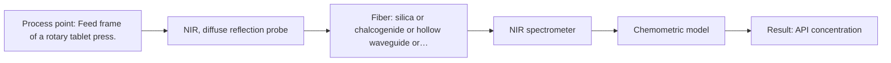
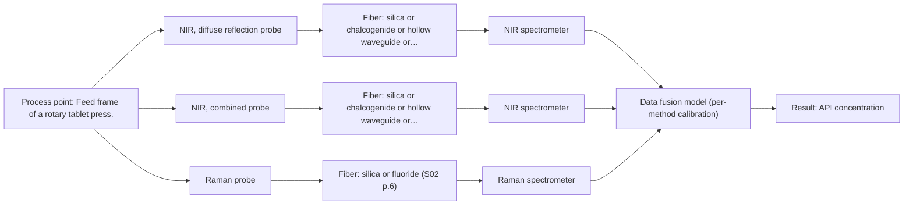

# First technical assessment: Blend potency in a tablet press feed frame

## Answer

**Customer request (our summary):** The customer wants to assess if a fiber-based measurement in the feed frame can track API concentration changes in a powder blend.

### Brief answer

To track API concentration in the tablet press feed frame, start by testing Near-Infrared (NIR) diffuse reflection spectroscopy, which is the established method for powder blend potency monitoring. Alternatively, evaluate Raman spectroscopy to check for fluorescence interference. A pilot laboratory trial using representative powder samples and independent reference assays will determine the optimal single-method or combined optical configuration.

### Proposal

- **Best current option:** O1 (recommended)
- **Basis:** supplied AFS sources
- **What would change it:** If NIR reflection precision is insufficient or fluorescence allows clean Raman spectra, switch to Raman or a combined option.
- **Next step:** Conduct multi-method laboratory trials on representative powder blend samples spanning the target concentration range.

**Secondary evidence (external, not AFS material):** G1: E03 ¶31; G2: no usable external source found. See Expert detail.

**Decision status:** Provisional feasibility assessment

### Solution options

| ID | Tier | Methods | Confidence | Cost class, S01 Table 1 (p.6) | Ease of use | Maintenance | Performance fit | Sources |
|---|---|---|---|---|---|---|---|---|
| O1 | Recommended | M1 NIR, diffuse reflection probe | Low: open question: Q1 (starts at Medium); precedent only | average cost (row 8) | Straightforward NIR reflection setup | Minimal probe cleaning | Standard industrial approach for powder blend potency⚠ *(tier changed by verification so the recommended option is the proposed one)* | [1: S01 p.15] |
| O2 | Simple | M2 Raman probe | Low: open question: Q1, Q3 (starts at Medium); precedent only | high cost (row 12) | Requires laser safety checks | Laser source and probe monitoring | Provides complementary molecular backbone information⚠ *(tier changed by verification so the recommended option is the proposed one)* | [2: S01 p.15] |
| O3 | Extended (multi-method) | M1 NIR, diffuse reflection probe; M3 NIR, combined probe + Raman (combination) | Low: open question: Q1 (starts at Medium); technique not screened for this sample; precedent only; multi-method, fusion benefit not yet shown | high cost (rows 8, 12); not rated in S01 Table 1: NIR, combined probe | Complex dual-instrument setup | High maintenance for two independent optical channels | Combined NIR and Raman data fusion for highest precision | [3: S01 p.15] [1: S01 p.15] |

*Confidence rates the basis of the advice (how much is known and cited), not a predicted accuracy or probability of success. It starts at High, or at Medium when a key question on the method or the option is open, and drops one level per weakness listed (floor Low).*

*Cost class is the relative rating in S01 Table 1 (p.6) for the in-line method+technique rows named (the highest one for a multi-method option); it is not a price.*

### Setup sketch

*Recommended option O1; drawn by code from the option, a schematic, not a configuration.*

### Key questions

1. What are the required accuracy, precision, and concentration range for the API blend potency?
2. What is the expected particle size distribution and powder flow velocity in the feed frame?
3. Does the powder blend exhibit significant fluorescence under laser excitation?

## Expert detail

**Customer enquiry**

> We manufacture tablets from a powder blend containing an active pharmaceutical ingredient and excipients. Laboratory checks tell us whether the blend is on target, but results arrive after the material has moved through the press. We want to assess whether a fiber based measurement in the feed frame could follow API concentration changes. Our first pilot should compare reasonable measurement options before we commit to production equipment.

**Decision status:** Provisional feasibility assessment. Sufficient methodological precedent exists for measuring API blend potency in a tablet press feed frame using NIR reflection or Raman spectroscopy, but specific quantitative targets and powder flow dynamics require empirical verification.

### Parameters

| ID | Parameter | Kind | Need | Measured by | Why | Sources |
|---|---|---|---|---|---|---|
| P1 | API concentration | quantitative | required | Spectroscopy: NIR | Core target of the measurement. | *(no verified source: engineering judgement)* |

### Solution option details

- **O1 cost drivers:** Single NIR spectrometer and reflection probe
- **O2 cost drivers:** Raman spectrometer and specialized probe
- **O3 cost drivers:** Multiple spectrometers, advanced data fusion software
- **O3 combining methods:** Combines NIR and Raman spectra via low-level data fusion from synchronized measurements at the same sampling spot, requiring independent calibration per block and proven outperformance over single methods.

*Extended (multi-method) option O3; drawn by code from the option, a schematic, not a configuration.*

### Requirements

**Stated by the customer**

- Follow API concentration changes in the feed frame

**Key unknowns**

- Required accuracy and precision for API concentration measurements
- Powder flow dynamics and packing density in the feed frame
- Fluorescence background interference level in Raman measurements

### Clarification questions (most decision-relevant first)

Q1. What are the required accuracy, precision, and concentration range for the API blend potency? *Why it matters:* Determines whether single-method NIR/Raman or multi-method data fusion is required. *(affects: method)*
Q2. What is the expected particle size distribution and powder flow velocity in the feed frame? *Why it matters:* Affects probe design and scattering susceptibility. *(affects: technique)*
Q3. Does the powder blend exhibit significant fluorescence under laser excitation? *Why it matters:* Determines feasibility of Raman spectroscopy. *(affects: M2)*

### Recommendation

- **M1 · Primary candidate: NIR, diffuse reflection probe.** NIR reflection is the standard technique for monitoring solid powder blends and API potency in tablet press feed frames. [1: S01 p.15]
- **M2 · Comparison candidate: Raman probe.** Raman spectroscopy provides complementary molecular backbone information and is well-suited for solid powder blends. *Conditions:* If fluorescence background does not swamp the Raman signal. [2: S01 p.15]
- **M3 · Conditional candidate: NIR, combined probe + Raman (combination).** Combining NIR and Raman provides augmented spectral data for higher accuracy in blend potency prediction. *Conditions:* If single-method NIR calibration does not meet required precision. [3: S01 p.15] Later hypothesis, after single-method tests.

### Measurement concept

- **Probe and geometry:** NIR diffuse reflection fiber probe or Raman contact probe flush-mounted in the feed frame wall.
- **Location:** Feed frame of a rotary tablet press.
- **Fiber link:** Standard Vis-NIR silica fibers connecting the probe to the spectrometer located safely away from vibration and dust. [4: S01 p.15]

### Spectral range

- **NIR:** The nominal NIR range is 780-2500 nm; the usable range depends on the instrument, fiber and probe actually used. [5: S01 p.10]
- **Raman:** Raman uses a laser excitation wavelength and measures Raman shift in cm-1. [6: S01 p.11]

### Risks and uncertainty

- Physical variations such as packing density changes or particle size fluctuations in the feed frame can mimic chemical concentration changes in NIR spectra. *(rules: R-GEO-6)* [7: S01 p.17]
- Luminescence or fluorescence background can swamp weak Raman scattering signals. *(rules: R-RAM-1)* [8: S01 p.11]

### First feasibility experiment

1. **Prepare representative powder blend samples spanning the required API concentration range.** Ensure calibration covers expected compositional variation. *(no verified source: engineering judgement)*
2. **Acquire reference laboratory assays for all sample batches.** Provide independent validation data for chemometric models. *(no verified source: engineering judgement)*
3. **Perform single-method NIR diffuse reflection spectral acquisition.** Establish baseline predictive performance for the primary method. *(no verified source: engineering judgement)*
4. **Test Raman scattering acquisition on the same sample set.** Evaluate signal-to-noise ratio and fluorescence interference. *(no verified source: engineering judgement)*
5. **Validate multivariate calibration models on held-out test sets.** Confirm model robustness against physical and chemical variations. *(no verified source: engineering judgement)*

**Reference measurements:** Standard laboratory assay of powder blend composition.

**Decision basis:** Customer-defined target accuracy and precision for API concentration.

### Assumptions

- Powder blend is accessible in the feed frame via a probe port.
- Laboratory reference checks are available for calibration.

### Further notes

- **Chemometrics:** Multivariate calibration (PLS) using scatter correction is required for quantitative prediction of API concentration from broad NIR/Raman spectra.
- **Real-time tracking:** High-speed spectral acquisition enables continuous in-line tracking of powder blend homogeneity in the feed frame.
- **Future direction:** Integration of validated calibration models into automated process control or tablet press feed-forward loops.

### Secondary evidence (external, not AFS material)

*Found by a literature search for gaps the supplied AFS sources leave open. Not AFS material and not proof for this case; every quote below was verified verbatim against the fetched text.*

*Live search unavailable (library only: cache miss (europepmc); cache miss (openalex)); curated library only.*

**G1 · multi-method:** Combining several spectroscopy methods (data fusion) (Combines NIR and Raman spectra via low-level data fusion from synchronized measurements at the same sampling spot, requiring independent calibration per block and proven outperformance over single methods.)

- **E03 ¶31** Low-level data fusion rearranges data from different sources into a new matrix where variables are placed sequentially. *How it applies:* This approach could be evaluated to combine multiple spectral inputs, though its added value should be tested against single-method models. *Limits and transfer risks:* The reviewed data fusion concepts stem from general literature and might not directly transfer to powder blend measurements in a feed frame. *(supports O3)*
  > "Low-level data fusion (LLDF) is considered the simplest method to achieve a combination of inputs. In this case, the data is rearranged into a new data matrix, where the variables coming from different sources are placed one after the other."
  > Challenges and Opportunities of Implementing Data Fusion in Process Analytical Technology-A Review. (2022) · Molecules (Basel, Switzerland) · doi:10.3390/molecules27154846 · https://europepmc.org/article/PMC/PMC9369811 · retrieved 2026-10-17, full text, licence: cc by, via curated library

**G2 · parameter without a source:** Measuring API concentration: Core target of the measurement.

- No usable external source found.

### Evidence (verified quotes)

1. ✓ **S01 p.15** (application precedent): "NIR spectrometer and light source coupled with a NIR reflection probe"
2. ✓ **S01 p.15** (application precedent): "Raman spectrometer and Raman fiber probe for contact measurements with 785 nm excitation wavelength"
3. ✓ (precedent only) **S01 p.15** (method gain): ""low-level data fusion," where the synchronized NIR and Raman spectra are merged into a single augmented matrix."
4. ✓ **S01 p.15** (application precedent): "probes are inserted directly into the process environment, such as the feed frame of a rotary tablet press"
5. ✓ **S01 p.10** (general): "NIR spectra (780-2500 nm) contain predominantly overtones and component bands of fundamental vibrations"
6. ✓ **S01 p.11** (general): "The Raman shift is used as the horizontal (spectral) axis in Raman spectroscopy"
7. ✓ **S01 p.17** (general): "the method is sensitive to the surface characteristics and fat globule size"
8. ✓ **S01 p.11** (general): "superposition of luminescence (fluorescence), which has a significantly higher intensity"

### Verification

- Citations verified: 11 of 11 (exact or whitespace/hyphen-tolerant match on the cited page, scope checked).
- Hard check failures before deterministic corrections: 0; still open: 0; soft warnings: 4; repair rounds: 2.
- Corrected deterministically after verification (1):
  - ⚠ solution_options[0].tier: proposed option O1 had tier simple; tiers swapped with O2 so the recommended option is the proposed one
- External evidence (cache): 1 quote(s) verified verbatim (exact or whitespace/hyphen-tolerant, at most 400 characters and 2 sentences, against the cited paragraph); 0 item(s) dropped.
- External search: 4 query(ies), 0 hit(s), 3 source(s) (3 from the curated library); ⚠ library only: cache miss (europepmc); cache miss (openalex).
- External step: 2 model call(s), 2.0 s extra (cost in the run JSON).

*Run D01-20261018T080635Z-1c98 · models google/gemini-3.5-flash-lite*
