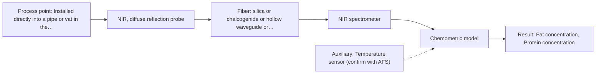

# First technical assessment: Fat and protein monitoring in opaque dairy product

## Answer

**Customer request (our summary):** The customer wants an in-line spectroscopy concept and comparison experiment to monitor composition changes in a flowing, opaque, concentrated milk product.

### Brief answer

For monitoring fat and protein in an opaque, concentrated milk product, NIR diffuse reflection is recommended as the primary method due to its effectiveness with concentrated dairy products. MIR ATR can serve as a comparison method. A feasibility experiment using representative process samples, scatter-corrected chemometric modeling, and laboratory reference checks is proposed to validate accuracy across varying temperature and texture conditions.

### Proposal

- **Best current option:** O1 (recommended)
- **Basis:** supplied AFS sources
- **What would change it:** Results from feasibility trials showing insufficient precision with NIR alone, or severe fouling issues requiring MIR ATR.
- **Next step:** Conduct multi-method laboratory trials on representative samples spanning expected temperature and texture variations.

**Secondary evidence (external, not AFS material):** G1: E02 ¶12; G2: no usable external source found; G3: no usable external source found. See Expert detail.

**Decision status:** Provisional feasibility assessment

### Solution options

| ID | Tier | Methods | Confidence | Cost class, S01 Table 1 (p.6) | Ease of use | Maintenance | Performance fit | Sources |
|---|---|---|---|---|---|---|---|---|
| O1 | Recommended | M1 NIR, diffuse reflection probe | Low: open question: Q1, Q3 (starts at Medium); precedent only; uncited auxiliary sensor | average cost (row 8) | High with automated calibration | Periodic window cleaning | Suitable for bulk fat and protein monitoring via NIR reflection.⚠ *(tier changed by verification so the recommended option is the proposed one)* | [1: S01 p.17] |
| O2 | Simple | M1 NIR, diffuse reflection probe; M2 MIR, ATR probe | Low: open question: Q1, Q3 (starts at Medium); uncited auxiliary sensor | high cost (rows 2, 8) | Moderate with dual method calibration | Window cleaning and optical alignment | Provides robust comparison and verification using complementary NIR and MIR spectral features.⚠ *(tier changed by verification so the recommended option is the proposed one)* | [1: S01 p.17] [2: S01 p.10] |

*Confidence rates the basis of the advice (how much is known and cited), not a predicted accuracy or probability of success. It starts at High, or at Medium when a key question on the method or the option is open, and drops one level per weakness listed (floor Low).*

*Cost class is the relative rating in S01 Table 1 (p.6) for the in-line method+technique rows named (the highest one for a multi-method option); it is not a price.*

### Setup sketch

*Recommended option O1; drawn by code from the option, a schematic, not a configuration.*

### Key questions

1. What are the required accuracy and precision levels for fat and protein determination?
2. What are the inner dimensions and material of the process pipe where the probe will be installed?
3. What is the expected range of temperature and texture/viscosity variations during production?

## Expert detail

**Customer enquiry**

> We produce an opaque, concentrated milk product that flows through a processing line. We currently sample it for fat and protein analysis and would like earlier information about composition changes. Product temperature and texture vary during production. We want an initial spectroscopy concept and a practical comparison experiment, while retaining our laboratory checks.

**Decision status:** Provisional feasibility assessment. NIR diffuse reflection and MIR ATR are suitable candidate methods for concentrated dairy streams, but exact installation interfaces and temperature compensation require experimental verification.

### Parameters

| ID | Parameter | Kind | Need | Measured by | Why | Sources |
|---|---|---|---|---|---|---|
| P1 | Fat concentration | quantitative | required | Spectroscopy: NIR | Core target component for product quality control. | *(no verified source: engineering judgement)* |
| P2 | Protein concentration | quantitative | required | Spectroscopy: NIR | Core target component for product quality control. | *(no verified source: engineering judgement)* |
| P3 | Product temperature | quantitative | required | Auxiliary sensor: Temperature sensor (engineering judgement: confirm availability with AFS) | Temperature varies during production and can affect spectral response. | *(no verified source: engineering judgement)* |

### Solution option details

- **O1 cost drivers:** Single NIR spectrometer and diffuse reflection probe
- **O2 cost drivers:** Spectrometers and probes for both NIR and MIR

### Requirements

**Stated by the customer**

- In-line monitoring of fat and protein in an opaque, concentrated milk product
- Handling product temperature and texture variations during production
- Initial spectroscopy concept and practical comparison experiment
- Retaining laboratory reference checks

**Key unknowns**

- Required accuracy and precision for fat and protein
- Pipe dimensions and optical probe installation interface
- Cleaning and fouling regime in the processing line
- Exact temperature and pressure ranges

### Clarification questions (most decision-relevant first)

Q1. What are the required accuracy and precision levels for fat and protein determination? *Why it matters:* Determines whether single-method NIR or a combined approach is needed to meet analytical targets. *(affects: method, M1)*
Q2. What are the inner dimensions and material of the process pipe where the probe will be installed? *Why it matters:* Determines the mechanical mounting and probe immersion depth. *(affects: installation)*
Q3. What is the expected range of temperature and texture/viscosity variations during production? *Why it matters:* Affects scatter-correction requirements and chemometric model robustness. *(affects: technique, M1)*
Q4. What cleaning-in-place (CIP) and sterilization regimes will the probe encounter? *Why it matters:* Ensures optical window material and sealing compatibility with harsh cleaning chemicals and temperatures. *(affects: installation)*

### Recommendation

- **M1 · Primary candidate: NIR, diffuse reflection probe.** NIR diffuse reflection is the standard approach for opaque, concentrated dairy products, penetrating surface layers to measure major components like fat and protein. [1: S01 p.17]
- **M2 · Comparison candidate: MIR, ATR probe.** MIR ATR provides high selectivity through fundamental molecular vibrations, serving as a comparison method to evaluate against NIR. *Conditions:* If higher chemical specificity is needed or surface layer analysis is preferred. [2: S01 p.10]

### Measurement concept

- **Probe and geometry:** Flush-mounted NIR diffuse reflection fiber probe or MIR ATR immersion probe interacting directly with the flowing medium.
- **Location:** Installed directly into a pipe or vat in the processing line.
- **Fiber link:** Remote fiber-optic cable linking the process probe to spectrometers located safely away from the processing floor. [3: S01 p.17]

### Spectral range

- **NIR:** The nominal NIR range is 780-2500 nm; the usable range depends on the instrument, fiber and probe actually selected. [4: S01 p.10]
- **MIR:** The nominal Mid-IR range is 4000-400 cm-1; the usable range depends on the instrument, fiber and probe actually selected. [5: S01 p.9]

### Risks and uncertainty

- Physical variations such as temperature and fat globule size changes can mimic composition changes in NIR diffuse reflection. *(rules: R-GEO-6, R-CAL-1)* [6: S01 p.17]
- Fouling or deposits on the probe window over time can degrade signal quality. *(rules: R-MIR-3)* [7: REF §5]

### First feasibility experiment

1. **Collect representative process samples across the full expected range of fat, protein, temperature, and texture variations.** Ensure samples capture process variability. *(no verified source: engineering judgement)*
2. **Perform laboratory benchtop spectroscopic measurements using NIR diffuse reflection and MIR ATR.** Evaluate spectral response for both methods. *(no verified source: engineering judgement)*
3. **Obtain independent reference laboratory measurements for fat and protein for each sample.** Provide ground truth for calibration. *(no verified source: engineering judgement)*
4. **Build initial chemometric calibration models with scatter correction and evaluate prediction errors.** Test quantitative prediction performance. *(no verified source: engineering judgement)*
5. **Validate models on held-out sample runs against customer-defined accuracy criteria.** Determine go/no-go readiness. *(no verified source: engineering judgement)*

**Reference measurements:** Standard laboratory reference methods for fat and protein analysis.

**Decision basis:** Go/no-go based on achieving customer-defined target accuracy for fat and protein prediction across varying temperature and texture conditions.

### Assumptions

- The concentrated milk product allows sufficient light interaction for diffuse reflection or ATR measurements.
- Laboratory reference methods are available for calibration.

### Further notes

- **Chemometrics:** Multivariate calibration combined with scatter correction preprocessing is required to handle physical variations like scattering and particle size changes.
- **Real-time tracking:** In-line probe installation enables continuous, real-time tracking of fat and protein changes directly in the processing line.
- **Future direction:** Integration of automated temperature compensation and alarm systems linked to process control.

### Secondary evidence (external, not AFS material)

*Found by a literature search for gaps the supplied AFS sources leave open. Not AFS material and not proof for this case; every quote below was verified verbatim against the fetched text.*

*Live search unavailable (library only: cache miss (europepmc); cache miss (openalex)); curated library only.*

**G1 · auxiliary sensor:** In-line measurement of Product temperature with Temperature sensor

- **E02 ¶12** The text notes that the temperature sensitivity of the OH bands represents a severe drawback for measuring aqueous solutions in NIR and MIR, which requires tempered sample holders. *How it applies:* This indicates that temperature compensation or control should be tested when monitoring aqueous dairy streams to avoid thermal artifacts in the spectra. *Limits and transfer risks:* The cited reference discusses biopharmaceutical downstream processing in general rather than flowing concentrated milk products on an AFS instrument. *(supports O1)*
  > "Additionally, the temperature sensitivity of the OH bands is a severe drawback for measuring aqueous solution in NIR and MIR, which makes tempered sample holders necessary [29]."
  > A critical review of recent trends, and a future perspective of optical spectroscopy as PAT in biopharmaceutical downstream processing. (2020) · Analytical and bioanalytical chemistry · doi:10.1007/s00216-020-02407-z · https://europepmc.org/article/PMC/PMC7072065 · retrieved 2026-10-17, full text, licence: cc by, via curated library

**G2 · parameter without a source:** Measuring Fat concentration: Core target component for product quality control.

- No usable external source found.

**G3 · parameter without a source:** Measuring Protein concentration: Core target component for product quality control.

- No usable external source found.

### Evidence (verified quotes)

1. ✓ **S01 p.17** (application precedent): "NIR Reflection is primarily used for opaque or highly concentrated dairy products, such as yogurt, butter, or whole milk concentrates."
2. ✓ **S01 p.10** (general): "ATR fiber probes (Fig.1) enable the analysis of liquids and solid elastic samples"
3. ✓ **S01 p.17** (general): "Experimentally, the probe is flush-mounted into a pipe or vat to interact directly with the flowing medium."
4. ✓ **S01 p.10** (general): "NIR spectra (780-2500 nm) contain predominantly overtones and component bands of fundamental vibrations"
5. ✓ **S01 p.9** (general): "Vibrational spectroscopy in the mid-IR range (4000-400 cm-1) is one of the most informative methods of chemical analysis."
6. ✓ **S01 p.17** (general): "the method is sensitive to the surface characteristics and fat globule size."
7. ✓ **REF §5** (general): "Usable range limited by fiber and crystal; contact, fouling, compatibility."

### Verification

- Citations verified: 7 of 7 (exact or whitespace/hyphen-tolerant match on the cited page, scope checked).
- Hard check failures before deterministic corrections: 0; still open: 0; soft warnings: 2; repair rounds: 1.
- Corrected deterministically after verification (1):
  - ⚠ solution_options[0].tier: proposed option O1 had tier simple; tiers swapped with O2 so the recommended option is the proposed one
- External evidence (cache): 1 quote(s) verified verbatim (exact or whitespace/hyphen-tolerant, at most 400 characters and 2 sentences, against the cited paragraph); 0 item(s) dropped.
- External search: 4 query(ies), 0 hit(s), 3 source(s) (3 from the curated library); ⚠ library only: cache miss (europepmc); cache miss (openalex).
- External step: 2 model call(s), 2.0 s extra (cost in the run JSON).

*Run D02-20261018T080635Z-23da · models google/gemini-3.5-flash-lite*
