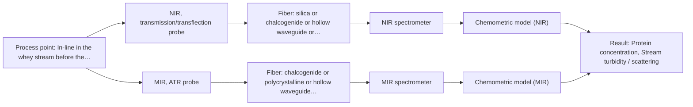

# First technical assessment: A clear whey stream before concentration

## Answer

**Customer request (our summary):** The customer wants to investigate using spectroscopy to track protein concentration in a dairy whey stream that transitions from clear to turbid.

### Brief answer

To track protein in a dairy whey stream transitioning from clear to turbid, we recommend testing an NIR transflection probe as a primary approach, with MIR ATR as a comparison option to handle high turbidity. Feasibility trials using representative whey samples and laboratory references will determine the optimal configuration.

### Proposal

- **Best current option:** O2 (recommended)
- **Basis:** supplied AFS sources
- **What would change it:** If turbidity remains very low, a simple transmission probe (M1) is sufficient.
- **Next step:** Conduct laboratory trials with whey samples covering both clear and turbid operating conditions using NIR transflection and MIR ATR probes.

**Secondary evidence (external, not AFS material):** G1: no usable external source found; G2: no usable external source found. See Expert detail.

**Decision status:** Provisional feasibility assessment

### Solution options

| ID | Tier | Methods | Confidence | Cost class, S01 Table 1 (p.6) | Ease of use | Maintenance | Performance fit | Sources |
|---|---|---|---|---|---|---|---|---|
| O1 | Simple | M1 NIR, transmission/transflection probe | Low: open question: Q1 (starts at Medium); sample clarity unknown | average cost (row 7) | Straightforward optical transflection setup | Regular optical window cleaning | Adequate for moderate clarity and mild turbidity changes | [1: S01 p.18] |
| O2 | Recommended | M1 NIR, transmission/transflection probe; M2 MIR, ATR probe | Low: open question: Q1 (starts at Medium); sample clarity unknown | high cost (rows 2, 7) | Standard immersion probe maintenance | Periodic calibration and clean-in-place | Robust against wide turbidity swings using adaptable probe geometry | [1: S01 p.18] [2: S01 p.16] |

*Confidence rates the basis of the advice (how much is known and cited), not a predicted accuracy or probability of success. It starts at High, or at Medium when a key question on the method or the option is open, and drops one level per weakness listed (floor Low).*

*Cost class is the relative rating in S01 Table 1 (p.6) for the in-line method+technique rows named (the highest one for a multi-method option); it is not a price.*

### Setup sketch

*Recommended option O2; drawn by code from the option, a schematic, not a configuration.*

### Key questions

1. What is the expected range of protein concentration and the degree of turbidity (e.g., optical density or suspended solids) during the transition?
2. Is direct insertion into the process pipe via a standard flange or flow cell preferred?
3. What are the operating temperature and pressure conditions of the whey stream?

## Expert detail

**Customer enquiry**

> Our dairy process includes a relatively clear whey stream before a concentration stage. We want to investigate whether spectroscopy can track protein concentration as the stream changes, with laboratory results used as the reference. The stream can become more turbid under some operating conditions. We need a first measurement concept that handles this change rather than assuming the liquid always remains clear.

**Decision status:** Provisional feasibility assessment. The whey stream transitions from clear to turbid, requiring an optical configuration that accommodates varying scattering without signal saturation. Multi-method evaluation comparing NIR transflection and MIR ATR is recommended to handle these physical state changes.

### Parameters

| ID | Parameter | Kind | Need | Measured by | Why | Sources |
|---|---|---|---|---|---|---|
| P1 | Protein concentration | quantitative | required | Spectroscopy: NIR | Main analytical target to track in-line. | *(no verified source: engineering judgement)* |
| P2 | Stream turbidity / scattering | quantitative | required | Spectroscopy: NIR | Accounts for physical variation between clear and turbid operating conditions. | *(no verified source: engineering judgement)* |

### Solution option details

- **O1 cost drivers:** Single spectrometer and fiber probe
- **O2 cost drivers:** Spectrometer and multi-technique probe options

### Premise check

- **Supported:** A measurement concept can be designed to handle the transition from clear to turbid whey. Dairy process applications in the sources demonstrate that adaptable probe geometries like transflection or multi-technique approaches can manage varying turbidity and fat/solids content. [1: S01 p.18]

### Requirements

**Stated by the customer**

- Track protein concentration in a dairy whey stream
- Handle stream transitions from clear to turbid operating conditions
- Use laboratory results as reference

**Key unknowns**

- Protein concentration range in the whey stream
- Exact turbidity range (optical density) during turbid operating conditions
- Pipe dimensions and installation constraints
- Cleaning and fouling management requirements

### Clarification questions (most decision-relevant first)

Q1. What is the expected range of protein concentration and the degree of turbidity (e.g., optical density or suspended solids) during the transition? *Why it matters:* Determines whether NIR transflection or MIR ATR is more robust against signal saturation. *(affects: method, technique)*
Q2. Is direct insertion into the process pipe via a standard flange or flow cell preferred? *Why it matters:* Defines the mechanical installation and probe mounting requirements. *(affects: installation)*
Q3. What are the operating temperature and pressure conditions of the whey stream? *Why it matters:* Ensures proper material and seal selection for the probe. *(affects: installation)*

### Recommendation

- **M1 · Primary candidate: NIR, transmission/transflection probe.** NIR transflection is well-suited for dairy process streams, accommodating both clear and moderately scattering states with controlled pathlengths. *Conditions:* Applies if the turbidity increase remains within the penetration limits of a controlled optical pathlength. [1: S01 p.18]
- **M2 · Comparison candidate: MIR, ATR probe.** Mid-IR ATR uses an evanescent wave probing a few micrometres, avoiding bulk scattering limitations when turbidity increases significantly. *Conditions:* Applies if high turbidity or suspended solids cause signal loss in transmission configurations. [2: S01 p.16]

### Measurement concept

- **Probe and geometry:** NIR transflection probe or MIR-ATR immersion probe inserted flush into the process stream.
- **Location:** In-line in the whey stream before the concentration stage.
- **Fiber link:** Standard Vis-NIR silica fibers or CIR/PIR fibers connecting the probe to the spectrometer outside the process vibration area. [1: S01 p.18]

### Spectral range

- **NIR:** Nominal range 780-2500 nm; usable range depends on the instrument, fiber, and probe actually selected. [3: S01 p.10]
- **MIR:** Nominal range 4000-400 cm-1; usable range depends on the instrument, fiber, and probe actually selected. [4: S01 p.9]

### Risks and uncertainty

- Transition to high turbidity may cause optical saturation in transmission modes if pathlength is uncontrolled. *(rules: R-GEO-2, R-GEN-4)* [5: S01 p.18]
- Fouling or protein deposition on the probe crystal or window over time. *(rules: R-MIR-3)* [6: S01 p.13]

### First feasibility experiment

1. **Collect representative whey samples across clear and turbid operating conditions.** Capture physical and chemical variation. *(no verified source: engineering judgement)*
2. **Perform reference laboratory measurements for protein concentration on all samples.** Establish ground truth. *(no verified source: engineering judgement)*
3. **Test NIR transflection and MIR ATR probes on the sample set.** Compare method performance under turbidity changes. *(no verified source: engineering judgement)*

**Reference measurements:** Standard laboratory protein reference analysis.

**Decision basis:** Go/no-go based on achieving the customer's required prediction accuracy for protein across both clear and turbid states.

### Assumptions

- Laboratory reference data will be provided for model calibration.
- Temperature fluctuations in the whey stream can be compensated by chemometric preprocessing.

### Further notes

- **Chemometrics:** Multivariate calibration (PLS) is required due to overlapping spectral bands in NIR and MIR regions.
- **Real-time tracking:** High-speed spectral acquisition enables real-time concentration tracking in the flowing whey stream.

### Secondary evidence (external, not AFS material)

*Found by a literature search for gaps the supplied AFS sources leave open. Not AFS material and not proof for this case; every quote below was verified verbatim against the fetched text.*

*Live search unavailable (library only: cache miss (europepmc); cache miss (openalex)); curated library only.*

**G1 · parameter without a source:** Measuring Protein concentration: Main analytical target to track in-line.

- No usable external source found.

**G2 · parameter without a source:** Measuring Stream turbidity / scattering: Accounts for physical variation between clear and turbid operating conditions.

- No usable external source found.

### Evidence (verified quotes)

1. ✓ **S01 p.18** (general): "In some cases, a Transflection probe can already be a combined solution working well for low-fat and high-fat containing milk products."
2. ✓ **S01 p.16** (general): "extremely short path length that enables the measurement of "black" or highly scattering fluids without dilution."
3. ✓ **S01 p.10** (general): "NIR spectra (780-2500 nm) contain predominantly overtones and component bands of fundamental vibrations"
4. ✓ **S01 p.9** (general): "Vibrational spectroscopy in the mid-IR range (4000-400 cm-1) is one of the most informative methods of chemical analysis."
5. ✓ **S01 p.18** (general): "if the pathlength is too wide, the signal is lost to absorption; if too narrow, the sample represents a negligible volume."
6. ✓ **S01 p.13** (general): "typically at a depth of few microns"

### Verification

- Citations verified: 8 of 8 (exact or whitespace/hyphen-tolerant match on the cited page, scope checked).
- Hard check failures before deterministic corrections: 0; still open: 0; soft warnings: 1; repair rounds: 0.
- Removed 1 intake item(s) not quoted verbatim from the enquiry:
  - intake.sample.optical_regime: slot value without a verbatim enquiry quote; reset to unknown
- External evidence (cache): 0 quote(s) verified verbatim (exact or whitespace/hyphen-tolerant, at most 400 characters and 2 sentences, against the cited paragraph); 0 item(s) dropped.
- External search: 4 query(ies), 0 hit(s), 3 source(s) (3 from the curated library); ⚠ library only: cache miss (europepmc); cache miss (openalex).
- External step: 2 model call(s), 1.7 s extra (cost in the run JSON).

*Run D03-20261018T080635Z-a8da · models google/gemini-3.5-flash-lite*
