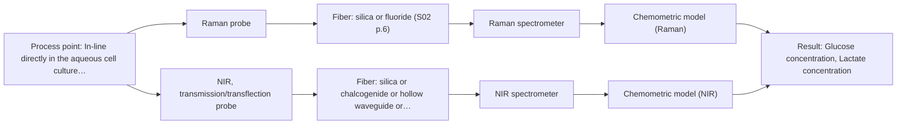

# First technical assessment: Glucose and lactate trends in an aqueous bioprocess

## Answer

**Customer request (our summary):** The customer wants to explore an in situ spectroscopy pilot to monitor glucose and lactate in a cell culture process, replacing delayed lab measurements.

### Brief answer

To monitor glucose and lactate in your cell culture without sampling delays, start with multi-method laboratory trials testing Raman and NIR spectroscopy. Raman is well-suited for aqueous media due to low water interference. You will need to pair in-line spectral acquisition with independent laboratory reference measurements to build robust chemometric calibration models as the cell population changes.

### Proposal

- **Best current option:** O2 (recommended)
- **Basis:** supplied AFS sources
- **What would change it:** Definitive testing results showing clear superiority of one method or specific reactor geometric constraints ruling out probe options.
- **Next step:** Conduct multi-method laboratory trials comparing Raman and NIR probes on representative cell culture samples against reference lab assays.

**Secondary evidence (external, not AFS material):** G1: no usable external source found; G2: no usable external source found; G3: E02 ¶20; G4: no usable external source found. See Expert detail.

**Decision status:** Insufficient information for a method choice

### Solution options

| ID | Tier | Methods | Confidence | Cost class, S01 Table 1 (p.6) | Ease of use | Maintenance | Performance fit | Sources |
|---|---|---|---|---|---|---|---|---|
| O1 | Simple | M1 Raman probe | Low: open question: Q1, Q3 (starts at Medium); status: insufficient information | high cost (row 12) | Standard immersion Raman probe setup | Routine optical window cleaning | Directly measures metabolites with low water interference | [1: S01 p.16] |
| O2 | Recommended | M1 Raman probe; M2 NIR, transmission/transflection probe | Low: open question: Q1, Q3 (starts at Medium); sample clarity unknown; status: insufficient information | high cost (rows 7, 12) | Configurable multi-method evaluation setup | Probe maintenance and chemometric model upkeep | Allows comparative testing of Raman and NIR to find the best fit for aqueous cell culture | [1: S01 p.16] [2: S01 p.18] |

*Confidence rates the basis of the advice (how much is known and cited), not a predicted accuracy or probability of success. It starts at High, or at Medium when a key question on the method or the option is open, and drops one level per weakness listed (floor Low).*

*Cost class is the relative rating in S01 Table 1 (p.6) for the in-line method+technique rows named (the highest one for a multi-method option); it is not a price.*

### Setup sketch

*Recommended option O2; drawn by code from the option, a schematic, not a configuration.*

### Key questions

1. What are the expected concentration ranges and required detection limits for glucose and lactate in the cell culture medium?
2. What are the physical dimensions and port standards of the bioreactor available for probe installation?
3. Are there existing reference lab methods (such as HPLC or enzymatic assays) available to generate training data for chemometric calibration?

## Expert detail

**Customer enquiry**

> We run a cell culture process in an aqueous medium. Glucose and lactate are measured from samples, and the delay makes it difficult to see changes promptly. We are exploring an in situ spectroscopy pilot that can be checked against those existing laboratory measurements. The medium and cell population change during the run; we have not yet selected a probe or a calibration strategy.

**Decision status:** Insufficient information for a method choice. The customer is exploring an in situ spectroscopy pilot for glucose and lactate in a cell culture but has not yet selected a technique, probe, or calibration strategy, requiring initial clarification and comparative testing.

### Parameters

| ID | Parameter | Kind | Need | Measured by | Why | Sources |
|---|---|---|---|---|---|---|
| P1 | Glucose concentration | quantitative | required | Spectroscopy: Raman | Core target analyte to monitor nutrient depletion in real time. | *(no verified source: engineering judgement)* |
| P2 | Lactate concentration | quantitative | required | Spectroscopy: Raman | Core target analyte to monitor metabolic byproduct accumulation. | *(no verified source: engineering judgement)* |

### Solution option details

- **O1 cost drivers:** Single Raman spectrometer and laser probe hardware
- **O2 cost drivers:** Spectrometer evaluation package and chemometric software

### Requirements

**Stated by the customer**

- In situ spectroscopy pilot for a cell culture process in an aqueous medium
- Measure glucose and lactate to replace delayed laboratory measurements
- Check against existing laboratory measurements
- Account for changing medium and cell population during the run

**Key unknowns**

- Target concentration ranges for glucose and lactate
- Process temperature, pressure, and bioreactor port compatibility
- Exact spectroscopic technique and probe geometry
- Calibration strategy and reference measurement frequency
- Presence of fluorescent metabolites or background interferences

### Clarification questions (most decision-relevant first)

Q1. What are the expected concentration ranges and required detection limits for glucose and lactate in the cell culture medium? *Why it matters:* Concentration levels determine the required sensitivity and pathlength or optical configuration for the spectroscopy method. *(affects: method, technique)*
Q2. What are the physical dimensions and port standards of the bioreactor available for probe installation? *Why it matters:* Reactor constraints dictate whether immersion probes or flow cells can be physically installed. *(affects: installation, technique)*
Q3. Are there existing reference lab methods (such as HPLC or enzymatic assays) available to generate training data for chemometric calibration? *Why it matters:* Quantitative in-line spectroscopy requires independent reference measurements to build and validate calibration models. *(affects: status, method)*
Q4. Does the cell culture exhibit significant autofluorescence or turbidity changes that could interfere with optical measurements? *Why it matters:* High fluorescence can swamp weak Raman signals or require specialized optical filtering. *(affects: technique, method)*

### Recommendation

- **M1 · Primary candidate: Raman probe.** Raman spectroscopy is particularly well-suited for aqueous environments because water exhibits low absorbance for water molecules compared to infrared methods, enabling direct metabolite tracking. [1: S01 p.16]
- **M2 · Comparison candidate: NIR, transmission/transflection probe.** NIR transmission or transflection probes can be deployed for aqueous liquid process streams, providing an alternative vibrational spectroscopy approach. *Conditions:* Applies if the sample turbidity and optical pathlength can be maintained without signal saturation. [2: S01 p.18]

### Measurement concept

- **Probe and geometry:** Immersion Raman probe or NIR transmission/transflection probe mounted directly into the bioreactor vessel.
- **Location:** In-line directly in the aqueous cell culture process flow or reactor.
- **Fiber link:** Fiber optic cable connecting the bioreactor probe to the spectrometer located safely away from process vibration and moisture. [3: S01 p.3] [4: S01 p.15]

### Spectral range

- **Raman:** Raman scattering measured using a laser excitation wavelength and Raman shift expressed in cm-1; actual usable range depends on the specific spectrometer and probe configuration. [5: S01 p.11]
- **NIR:** Nominal NIR range is 780-2500 nm; usable range depends on the instrument, fiber and probe actually selected. [6: S01 p.10]

### Risks and uncertainty

- Raman signals are weak and can be swamped by fluorescence background from the cell culture medium. *(rules: R-RAM-1)* [7: S01 p.11]
- Changes in cell population and medium composition over time can cause physical variations that affect spectral baselines, requiring robust chemometric calibration. *(rules: R-CAL-1)* [8: S01 p.5]

### First feasibility experiment

1. **Collect representative sample spectra across the expected range of cell culture states, nutrient levels, and metabolic variations.** Capture the chemical and physical variability of the live process. *(no verified source: engineering judgement)*
2. **Acquire independent reference measurements for glucose and lactate using existing laboratory methods for each sampled time point.** Provide ground truth data for calibration model development. *(no verified source: engineering judgement)*
3. **Test single-method spectroscopic configurations (Raman vs. NIR) to evaluate signal quality and absence of interferences.** Determine the optimal single method before considering combinations. *(no verified source: engineering judgement)*
4. **Build initial partial least-squares (PLS) calibration models and validate them using cross-validation or held-out validation batches.** Assess prediction accuracy against customer-defined criteria. *(no verified source: engineering judgement)*

**Reference measurements:** Independent laboratory reference measurements of glucose and lactate from extracted samples.

**Decision basis:** Go/no-go based on achieving customer-defined prediction error thresholds and calibration robustness across changing cell populations.

### Assumptions

- The cell culture medium is accessible via standard bioreactor optical ports or immersion probes.
- Laboratory reference measurements for glucose and lactate are sufficiently frequent and accurate to train calibration models.

### Not covered by the supplied sources

- Specific customer bioreactor dimensions, target concentration numerical ranges, and operating temperatures.

### Further notes

- **Chemometrics:** Calibration models using partial least-squares (PLS) regression must be developed using spectra paired with independent reference measurements, and re-validated as the cell population changes.
- **Real-time tracking:** In-line fiber probes enable real-time tracking of glucose and lactate directly in the bioreactor, bypassing sampling delays.
- **Future direction:** Integration of supplementary biomass tracking using UV-Vis turbidity or fluorescence once the primary metabolite models are established.

### Secondary evidence (external, not AFS material)

*Found by a literature search for gaps the supplied AFS sources leave open. Not AFS material and not proof for this case; every quote below was verified verbatim against the fetched text.*

*Live search unavailable (library only: cache miss (europepmc); cache miss (openalex)); curated library only.*

**G1 · decision status:** insufficient information: The customer is exploring an in situ spectroscopy pilot for glucose and lactate in a cell culture but has not yet selected a technique, probe, or calibration strategy, requiring initial clarification and comparative testing.

- No usable external source found.

**G2 · not in the supplied sources:** Specific customer bioreactor dimensions, target concentration numerical ranges, and operating temperatures.

- No usable external source found.

**G3 · parameter without a source:** Measuring Glucose concentration: Core target analyte to monitor nutrient depletion in real time.

- **E02 ¶20** Raman spectroscopy is frequently applied in upstream processing due to its high selectivity and low water interference despite long measurement times. *How it applies:* This suggests testing Raman spectroscopy for real-time monitoring of glucose to evaluate if low water interference benefits sugar tracking in aqueous media. *Limits and transfer risks:* The literature finding comes from general upstream processing reviews rather than the specific cell culture matrix or instrument scale proposed here. *(supports O2)*
  > "Raman spectroscopy is frequently applied in upstream processing in research and industry due to its high selectivity and low water interference [55] despite the relatively long measurement times."
  > A critical review of recent trends, and a future perspective of optical spectroscopy as PAT in biopharmaceutical downstream processing. (2020) · Analytical and bioanalytical chemistry · doi:10.1007/s00216-020-02407-z · https://europepmc.org/article/PMC/PMC7072065 · retrieved 2026-10-17, full text, licence: cc by, via curated library

**G4 · parameter without a source:** Measuring Lactate concentration: Core target analyte to monitor metabolic byproduct accumulation.

- No usable external source found.

### Evidence (verified quotes)

1. ✓ **S01 p.16** (general): "Raman is particularly well-suited for aqueous environments, as it exhibits low absorbance for water molecules compared to infrared methods."
2. ✓ **S01 p.18** (general): "Transmission is the preferred method for transparent or semi-transparent liquids, such as skim milk, whey, or permeate."
3. ✓ **S01 p.3** (general): "It allows for in-process analysis, i.e., directly in the process flow or reactor without sampling, eliminating delays and the risk of sample contamination."
4. ✓ **S01 p.15** (general): "The use of fiber optics is critical here, as it allows the sensitive spectrometers to be located safely away from the vibration and dust of the manufacturing floor."
5. ✓ **S01 p.11** (general): "The difference between the observed frequencies and the laser frequency is called the Raman shift, expressed in units of frequency-wavenumbers (cm-1)."
6. ✓ **S01 p.10** (general): "NIR spectra (780-2500 nm) contain predominantly overtones and component bands of fundamental vibrations"
7. ✓ **S01 p.11** (general): "Furthermore, observing Raman bands is often complicated by light scattering from the illuminating laser, and for many organic compounds, by the superposition of luminescence (fluorescence), which has a significantly higher intensity."
8. ✓ **S01 p.5** (general): "Extracting the information necessary for quantitative and qualitative analysis from optical spectra requires special methods for analyzing multidimensional data, called the above-mentioned term chemometrics."

### Verification

- Citations verified: 8 of 8 (exact or whitespace/hyphen-tolerant match on the cited page, scope checked).
- Hard check failures before deterministic corrections: 0; still open: 0; soft warnings: 1; repair rounds: 1.
- Removed 1 intake item(s) not quoted verbatim from the enquiry:
  - intake.facts_stated[2]: enquiry_quote not found verbatim in the enquiry
- External evidence (cache): 1 quote(s) verified verbatim (exact or whitespace/hyphen-tolerant, at most 400 characters and 2 sentences, against the cited paragraph); 0 item(s) dropped.
- External search: 4 query(ies), 0 hit(s), 3 source(s) (3 from the curated library); ⚠ library only: cache miss (europepmc); cache miss (openalex).
- External step: 2 model call(s), 2.7 s extra (cost in the run JSON).

*Run D04-20261018T080635Z-3c8c · models google/gemini-3.5-flash-lite*
