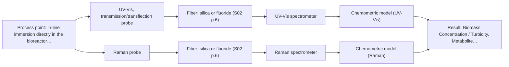

# First technical assessment: Biomass related monitoring during yeast fermentation

## Answer

**Customer request (our summary):** The customer wants an optical measurement to monitor yeast fermentation growth and changes, and needs help defining targets for a feasibility study.

### Brief answer

To follow yeast growth and metabolic changes during fermentation, start with UV-Vis spectroscopy for biomass turbidity and Raman spectroscopy for direct metabolite detection. Because broth optical density increases over time, test both transmission and immersion probe configurations in initial laboratory trials against independent reference measurements.

### Proposal

- **Best current option:** O2 (recommended)
- **Basis:** engineering judgement
- **What would change it:** Customer defining specific metabolic targets or optical density limits.
- **Next step:** Conduct multi-method laboratory trials using representative fermentation broth samples.

**Secondary evidence (external, not AFS material):** G1: no usable external source found; G2: E02 ¶20. See Expert detail.

**Decision status:** Provisional feasibility assessment

### Solution options

| ID | Tier | Methods | Confidence | Cost class, S01 Table 1 (p.6) | Ease of use | Maintenance | Performance fit | Sources |
|---|---|---|---|---|---|---|---|---|
| O1 | Simple | M1 UV-Vis, transmission/transflection probe | Low: open question: Q1, Q2 (starts at Medium); precedent only | low cost (row 16) | High ease of use for biomass | Low maintenance optical probes | Tracks biomass turbidity simply and effectively | [1: S01 p.16] |
| O2 | Recommended | M1 UV-Vis, transmission/transflection probe; M2 Raman probe | Low: open question: Q1, Q2 (starts at Medium); precedent only | high cost (rows 12, 16) | Moderate setup complexity | Standard probe cleaning and calibration | Covers both biomass growth and specific metabolic signals | [1: S01 p.16] [2: S01 p.16] |

*Confidence rates the basis of the advice (how much is known and cited), not a predicted accuracy or probability of success. It starts at High, or at Medium when a key question on the method or the option is open, and drops one level per weakness listed (floor Low).*

*Cost class is the relative rating in S01 Table 1 (p.6) for the in-line method+technique rows named (the highest one for a multi-method option); it is not a price.*

### Setup sketch

*Recommended option O2; drawn by code from the option, a schematic, not a configuration.*

### Key questions

1. What specific metabolites (e.g., glucose, acetate, lactate, ethanol) or metabolic classes should the metabolic signal target?
2. Is a fluorescent indicator or intrinsic fluorophore (such as NADH, tryptophan, or riboflavin) available for fluorescence tracking?
3. What is the expected range of optical density or solids loading during the fermentation run?

## Expert detail

**Customer enquiry**

> We would like an optical measurement during yeast fermentation to help us follow growth and notice changes earlier. Our team has mentioned both a biomass signal and a metabolic signal, but these have not been defined as separate targets. The broth becomes more optically dense as the run develops. We need help turning this request into an initial feasibility study with useful reference measurements.

**Decision status:** Provisional feasibility assessment. The customer enquiry outlines monitoring yeast fermentation for biomass growth and metabolic changes with increasing optical density, but specific chemical definitions and optical parameters require initial laboratory testing and clarification.

### Parameters

| ID | Parameter | Kind | Need | Measured by | Why | Sources |
|---|---|---|---|---|---|---|
| P1 | Biomass Concentration / Turbidity | quantitative | required | Spectroscopy: UV-Vis | Tracks yeast growth and cell density during fermentation. | *(no verified source: engineering judgement)* |
| P2 | Metabolite Concentration | quantitative | required | Spectroscopy: Raman | Provides early indication of metabolic changes or stress during the run. | *(no verified source: engineering judgement)* |

### Solution option details

- **O1 cost drivers:** Single UV-Vis spectrometer and transmission/transflection probe
- **O2 cost drivers:** UV-Vis and Raman spectrometers with dedicated probes

### Requirements

**Stated by the customer**

- Follow yeast growth via a biomass signal
- Notice metabolic changes earlier via a metabolic signal
- Adapt to increasing optical density of the broth

**Key unknowns**

- Exact chemical or physical definitions of the biomass and metabolic targets
- Process temperature and pressure
- Reactor scale and installation point
- Cleaning and fouling requirements
- Required accuracy, detection limits, and response times
- Reference methods to be used

### Clarification questions (most decision-relevant first)

Q1. What specific metabolites (e.g., glucose, acetate, lactate, ethanol) or metabolic classes should the metabolic signal target? *Why it matters:* Defines the required spectroscopic specificity and confirms whether Raman or fluorescence is most appropriate. *(affects: method, M1, M2)*
Q2. Is a fluorescent indicator or intrinsic fluorophore (such as NADH, tryptophan, or riboflavin) available for fluorescence tracking? *Why it matters:* Determines if fluorescence spectroscopy is viable since most chemicals do not exhibit fluorescence naturally. *(affects: method)*
Q3. What is the expected range of optical density or solids loading during the fermentation run? *Why it matters:* Governs the choice between transmission and ATR probe geometries to prevent signal saturation. *(affects: technique, installation)*
Q4. What offline reference methods will be used to calibrate and validate biomass and metabolite concentrations? *Why it matters:* Ensures that reference data matches the requirements for multivariate chemometric model building. *(affects: status)*

### Recommendation

- **M1 · Primary candidate: UV-Vis, transmission/transflection probe.** UV-Vis turbidity in cell suspensions correlates well with cell density to track biomass growth in real time. *Conditions:* For low to moderate optical density; high optical density requires short-path ATR. [1: S01 p.16]
- **M2 · Comparison candidate: Raman probe.** Raman spectroscopy provides a molecular fingerprint for direct detection of specific metabolites in aqueous environments. *Conditions:* When specific chemical identification of metabolites beside biomass is required. [2: S01 p.16]
- **M3 · Conditional candidate: fluorescence probe + NIR (combination).** Fluorescence offers high-sensitivity detection of critical intracellular cofactors and amino acids. *Conditions:* Applies only if specific fluorescent markers or cofactors such as NADH or riboflavin are targeted. [3: S01 p.16] Later hypothesis, after single-method tests.

### Measurement concept

- **Probe and geometry:** UV-Vis transmission or transflection probe for biomass turbidity, and Raman probe or UV-ATR probe for high optical density phases.
- **Location:** In-line immersion directly in the bioreactor or process flow.
- **Fiber link:** Silica fiber cables connecting probes to spectrometers safely away from process disturbances. [1: S01 p.16]

### Spectral range

- **UV-Vis:** Nominal range in UV-Vis region (190-360 nm and visible); actual usable range depends on instrument, fiber, and probe configuration. [4: S01 p.5]
- **Raman:** Raman shift in cm-1 with laser excitation wavelength stated separately; usable range depends on spectrometer and optical filters. [5: S01 p.11]

### Risks and uncertainty

- Increasing optical density and turbidity during fermentation can saturate standard transmission signals. *(rules: R-UV-2, R-GEN-3)* [6: S01 p.16]
- Raman signals are extremely weak and can be affected by fluorescence background or scattering. *(rules: R-RAM-1)* [7: S01 p.11]
- Spectroscopic calibration models are specific to the matrix and require re-validation upon process changes. *(rules: R-CAL-1)* [8: REF §5]

### First feasibility experiment

1. **Collect representative broth samples across various growth phases and optical densities.** Capture expected chemical and physical variation of the fermentation process. *(no verified source: engineering judgement)*
2. **Perform independent reference measurements for biomass and key metabolites.** Establish reliable baseline reference data for model calibration. *(no verified source: engineering judgement)*
3. **Test single-method setups (UV-Vis for biomass turbidity and Raman for metabolites) independently.** Evaluate individual method performance against process changes. *(no verified source: engineering judgement)*
4. **Validate calibration models on independent batches or held-out fermentation runs.** Ensure model robustness and predictive accuracy. *(no verified source: engineering judgement)*

**Reference measurements:** Independent offline reference measurements such as dry cell weight or optical density for biomass, and HPLC or enzymatic assays for key metabolites.

**Decision basis:** Go/no-go based on customer-defined numerical accuracy and detection limits for biomass and metabolic concentration tracking.

### Assumptions

- Yeast fermentation broth is aqueous.
- Independent reference laboratory methods are available for calibration.

### Further notes

- **Chemometrics:** Multivariate calibration (such as PLS) is required to extract biomass and metabolite concentrations from overlapping spectra and changing optical density.
- **Real-time tracking:** In-line fiber-optic probes enable real-time monitoring of fermentation dynamics without sampling.
- **Future direction:** Explore advanced multi-method data fusion if single-method models require higher specificity for complex metabolic states.

### Secondary evidence (external, not AFS material)

*Found by a literature search for gaps the supplied AFS sources leave open. Not AFS material and not proof for this case; every quote below was verified verbatim against the fetched text.*

*Live search unavailable (library only: cache miss (europepmc); cache miss (openalex)); curated library only.*

**G1 · parameter without a source:** Measuring Biomass Concentration / Turbidity: Tracks yeast growth and cell density during fermentation.

- No usable external source found.

**G2 · parameter without a source:** Measuring Metabolite Concentration: Provides early indication of metabolic changes or stress during the run.

- **E02 ¶20** The source notes that Raman spectroscopy is frequently applied in upstream processing due to its high selectivity and low water interference. *How it applies:* This suggests testing Raman probes for monitoring metabolic changes to see if low water interference helps track components effectively during fermentation. *Limits and transfer risks:* The finding stems from general biopharmaceutical reviews rather than yeast fermentation specifically, and conditions at scale may differ from laboratory findings. *(supports O2)*
  > "Raman spectroscopy is frequently applied in upstream processing in research and industry due to its high selectivity and low water interference [55] despite the relatively long measurement times."
  > A critical review of recent trends, and a future perspective of optical spectroscopy as PAT in biopharmaceutical downstream processing. (2020) · Analytical and bioanalytical chemistry · doi:10.1007/s00216-020-02407-z · https://europepmc.org/article/PMC/PMC7072065 · retrieved 2026-10-17, full text, licence: cc by, via curated library

### Evidence (verified quotes)

1. ✓ **S01 p.16** (application precedent): "UV/Vis spectroscopy can be deployed as a low-cost, robust tool for real-time biomass monitoring, as cell suspension turbidity correlates well with cell density."
2. ✓ **S01 p.16** (application precedent): "Raman spectroscopy can be used in the same reactor to provide a "molecular fingerprint" for direct detection of specific metabolites like glucose, acetate, or lactate."
3. ✓ **S01 p.16** (general): "Fluorescence spectroscopy can be used for high-sensitivity detection (down to the nM-μM range) of critical cofactors and amino acids like NADH, tryptophan, and riboflavin."
4. ✓ **S01 p.5** (general): "It has very high sensitivity, especially in the UV region (190-360 nm)"
5. ✓ **S01 p.11** (general): "The Raman shift is used as the horizontal (spectral) axis in Raman spectroscopy"
6. ✓ **S01 p.16** (general): "transmission setup becomes saturated because the light cannot penetrate the bulk of the sample."
7. ✓ **S01 p.11** (general): "signals, which are several orders of magnitude weaker than IR absorption peaks"
8. ✓ **REF §5** (general): "Weak signal, fluorescence background; calibration specific to the matrix."

### Verification

- Citations verified: 9 of 9 (exact or whitespace/hyphen-tolerant match on the cited page, scope checked).
- Hard check failures before deterministic corrections: 0; still open: 0; soft warnings: 1; repair rounds: 0.
- Corrected deterministically after verification (1):
  - ⚠ clarification_questions[1].affects: affects normalised to ['method']; dropped ['Fluorescence'] (not method, technique, installation, status, an M id or an O id)
- External evidence (cache): 1 quote(s) verified verbatim (exact or whitespace/hyphen-tolerant, at most 400 characters and 2 sentences, against the cited paragraph); 0 item(s) dropped.
- External search: 4 query(ies), 0 hit(s), 3 source(s) (3 from the curated library); ⚠ library only: cache miss (europepmc); cache miss (openalex).
- External step: 2 model call(s), 2.0 s extra (cost in the run JSON).

*Run D05-20261018T080635Z-15e1 · models google/gemini-3.5-flash-lite*
