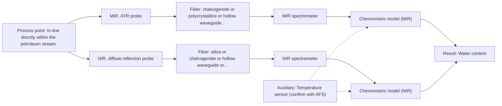

# First technical assessment: Water content in a petroleum stream

## Answer

**Customer request (our summary):** The customer wants to investigate a fiber-based measurement system to determine water content in a petroleum stream with the analyzer located outside the process area.

### Brief answer

To monitor water in a petroleum stream with an analyzer located outside the process area, mid-infrared ATR spectroscopy is the primary method to test first, supported by literature precedents. Key details such as the required detection limits, process conditions, and exact fiber run distance must be clarified. A first feasibility experiment should test representative samples against independent laboratory reference measurements.

### Proposal

- **Best current option:** O2 (recommended)
- **Basis:** supplied AFS sources
- **What would change it:** Clarification of water concentration ranges and exact fiber run distances.
- **Next step:** Conduct multi-method laboratory trials using representative petroleum samples with varying water content.

**Secondary evidence (external, not AFS material):** G1: E02 ¶12; G2: no usable external source found; G3: no usable external source found. See Expert detail.

**Decision status:** Provisional feasibility assessment

### Solution options

| ID | Tier | Methods | Confidence | Cost class, S01 Table 1 (p.6) | Ease of use | Maintenance | Performance fit | Sources |
|---|---|---|---|---|---|---|---|---|
| O1 | Simple | M1 MIR, ATR probe | Low: open question: Q1 (starts at Medium); precedent only | high cost (row 2) | Straightforward in-line ATR probe operation | Periodic cleaning of ATR crystal | Direct vibrational measurement of water in petroleum | [1: S02 p.13] |
| O2 | Recommended | M1 MIR, ATR probe; M2 NIR, diffuse reflection probe | Low: open question: Q1 (starts at Medium); sample clarity unknown | high cost (rows 2, 8) | Configurable probe with chemometric software | Routine optical checks and probe cleaning | Optimizes method selection through initial comparative trials | [2: S01 p.3] [1: S02 p.13] [3: S01 p.10] |

*Confidence rates the basis of the advice (how much is known and cited), not a predicted accuracy or probability of success. It starts at High, or at Medium when a key question on the method or the option is open, and drops one level per weakness listed (floor Low).*

*Cost class is the relative rating in S01 Table 1 (p.6) for the in-line method+technique rows named (the highest one for a multi-method option); it is not a price.*

### Setup sketch

*Recommended option O2; drawn by code from the option, a schematic, not a configuration.*

### Key questions

1. What is the required water concentration range and detection limit?
2. What is the exact distance between the inline measurement point and the analyzer location outside the process area?
3. What are the process temperature and pressure conditions at the measurement point?

## Expert detail

**Customer enquiry**

> We handle a petroleum stream and currently send samples to a laboratory for water determination. We want to investigate a fiber based measurement closer to the process so that changes can be noticed sooner. The analyzer would be outside the process area. Before selecting equipment, we need to know what to clarify and what a first comparison experiment should establish.

**Decision status:** Provisional feasibility assessment. A provisional assessment points to mid-infrared ATR spectroscopy for water determination in petroleum streams, supported by literature precedents, but key process conditions and fiber run distances must be clarified.

### Parameters

| ID | Parameter | Kind | Need | Measured by | Why | Sources |
|---|---|---|---|---|---|---|
| P1 | Water content | quantitative | required | Spectroscopy: MIR | Primary target for process monitoring and quality control. | [1: S02 p.13] |
| P2 | Process temperature | quantitative | optional | Auxiliary sensor: Temperature sensor (engineering judgement: confirm availability with AFS) | Temperature variations can affect spectral baselines and instrument stability. | *(no verified source: engineering judgement)* |

### Solution option details

- **O1 cost drivers:** Mid-infrared spectrometer and ATR fiber probe hardware
- **O2 cost drivers:** Multispectral laboratory evaluation equipment and fiber probes

### Premise check

- **Supported:** A fiber-based measurement closer to the process will allow changes to be noticed sooner. Online fiber-optic probes integrated directly into process streams eliminate sampling delays and provide near real-time results. [4: S01 p.2]

### Requirements

**Stated by the customer**

- water determination
- petroleum stream
- analyzer outside the process area

**Key unknowns**

- Required water concentration range and detection limit
- Process temperature and pressure
- Exact distance between the measurement point and the analyzer outside the process area
- Required response time and measurement accuracy

### Clarification questions (most decision-relevant first)

Q1. What is the required water concentration range and detection limit? *Why it matters:* Determines whether mid-infrared ATR or an alternative spectroscopic method provides sufficient sensitivity. *(affects: method, M1, O1)*
Q2. What is the exact distance between the inline measurement point and the analyzer location outside the process area? *Why it matters:* Fiber attenuation and transmission characteristics limit the maximum cable length for specific spectral regions. *(affects: installation)*
Q3. What are the process temperature and pressure conditions at the measurement point? *Why it matters:* Determines probe material selection, sealing integrity, and mechanical stability. *(affects: installation)*
Q4. Is the petroleum stream optically clear or turbid/multiphasic? *Why it matters:* Dictates whether ATR or transmission/reflection geometry is most appropriate. *(affects: technique)*

### Recommendation

- **M1 · Primary candidate: MIR, ATR probe.** Mid-infrared ATR spectroscopy provides direct fundamental vibrational information suited for water determination in petroleum. [1: S02 p.13]
- **M2 · Comparison candidate: NIR, diffuse reflection probe.** Near-infrared spectroscopy can be evaluated as a comparison method if broader penetration or alternative overtone bands are desired. *Conditions:* If water levels and scattering properties permit NIR analysis. [3: S01 p.10]

### Measurement concept

- **Probe and geometry:** ATR fiber probe with zirconium dioxide or diamond ATR tip sealed in a PEEK shaft.
- **Location:** In-line directly within the petroleum stream.
- **Fiber link:** Infrared fiber optic cables connecting the probe to an analyzer located outside the process area. [1: S02 p.13]

### Spectral range

- **MIR:** Nominal mid-infrared range is 4000-400 cm-1 (2.5-25 µm); usable range depends on the instrument, fiber, and probe configuration. [5: S01 p.9]
- **NIR:** Nominal near-infrared range is 780-2500 nm; usable range depends on the instrument, fiber, and probe configuration. [6: S01 p.10]

### Risks and uncertainty

- Fouling or deposition on the ATR crystal surface can interfere with accurate water measurement in petroleum streams. *(rules: R-MIR-3)* [7: S01 p.13]
- Fiber transmission limits and optical losses over long distances to an external analyzer location must be verified. *(rules: R-FIB-2)* [8: S02 p.9]

### First feasibility experiment

1. **Prepare representative petroleum samples across the expected water concentration range.** To cover expected chemical and physical variations. *(no verified source: engineering judgement)*
2. **Perform independent reference laboratory measurements for each sample.** To establish baseline reference values. *(no verified source: engineering judgement)*
3. **Acquire ATR spectra using a mid-infrared probe.** To evaluate spectral response and signal-to-noise ratio. *(no verified source: engineering judgement)*
4. **Build and cross-validate a chemometric calibration model correlating spectral data with reference water concentrations.** To verify quantitative prediction accuracy. *(no verified source: engineering judgement)*

**Reference measurements:** Standard laboratory water determination methods used by the customer.

**Decision basis:** Go/no-go based on customer-defined precision, accuracy, and detection limit criteria.

### Assumptions

- The petroleum stream is compatible with ATR probe materials such as PEEK and ZrO2.
- The distance to the external analyzer allows proper fiber coupling.

### Not covered by the supplied sources

- Exact distance to the external analyzer
- Customer's required numerical detection limits and accuracy

### Further notes

- **Chemometrics:** Multivariate calibration (PLS) is required to correlate mid-infrared spectral features with water concentration in petroleum.
- **Real-time tracking:** In-line fiber probes enable continuous monitoring of water concentration changes directly in idols of the process stream.
- **Future direction:** Integration of automated cleaning systems or multi-point multiplexing for expanded plant coverage.

### Secondary evidence (external, not AFS material)

*Found by a literature search for gaps the supplied AFS sources leave open. Not AFS material and not proof for this case; every quote below was verified verbatim against the fetched text.*

*Live search unavailable (library only: cache miss (europepmc); cache miss (openalex)); curated library only.*

**G1 · auxiliary sensor:** In-line measurement of Process temperature with Temperature sensor

- **E02 ¶12** The text notes that the temperature sensitivity of the OH bands represents a severe drawback for measuring aqueous solution in both NIR and MIR, requiring tempered sample holders. *How it applies:* This highlights why tracking process temperature might be critical when evaluating option O2, as temperature fluctuations could impact spectral bands related to water content. *Limits and transfer risks:* The cited study reviews biopharmaceutical downstream processing rather than a petroleum stream, so the magnitude of temperature sensitivity may differ due to the different sample matrix. *(supports O2)*
  > "Additionally, the temperature sensitivity of the OH bands is a severe drawback for measuring aqueous solution in NIR and MIR, which makes tempered sample holders necessary [29]."
  > A critical review of recent trends, and a future perspective of optical spectroscopy as PAT in biopharmaceutical downstream processing. (2020) · Analytical and bioanalytical chemistry · doi:10.1007/s00216-020-02407-z · https://europepmc.org/article/PMC/PMC7072065 · retrieved 2026-10-17, full text, licence: cc by, via curated library

**G2 · not in the supplied sources:** Exact distance to the external analyzer

- No usable external source found.

**G3 · not in the supplied sources:** Customer's required numerical detection limits and accuracy

- No usable external source found.

### Evidence (verified quotes)

1. ✓ **S02 p.13** (application precedent): "Application: measurement of water content in petroleum ATR-Probes with ATR-tips from ZrO2 (& Diamond, etc.) sealed in PEEK-shaft and protected by PEEK-tubing can be used in microwave furnaces"
2. ✓ **S01 p.3** (general): "The ability to test various optical spectroscopy approaches is crucial for solving complex analytical problems"
3. ✓ **S01 p.10** (general): "Near-IR vibrational spectroscopy (NIR) is the most common online analysis method performed using fiber optic probes."
4. ✓ **S01 p.2** (general): "enabling on-site online analysis and obtaining results in near real time"
5. ✓ **S01 p.9** (general): "Vibrational spectroscopy in the mid-IR range (4000-400 cm-1) is one of the most informative methods of chemical analysis."
6. ✓ **S01 p.10** (general): "NIR spectra (780-2500 nm) contain predominantly overtones and component bands of fundamental vibrations"
7. ✓ **S01 p.13** (general): "typically at a depth of few microns"
8. ✓ **S02 p.9** (general): "CIR- & PIR-Fibers vs Hollow Waveguides for Mid IR-Photonics"

### Verification

- Citations verified: 11 of 11 (exact or whitespace/hyphen-tolerant match on the cited page, scope checked).
- Hard check failures before deterministic corrections: 0; still open: 0; soft warnings: 0; repair rounds: 0.
- External evidence (cache): 1 quote(s) verified verbatim (exact or whitespace/hyphen-tolerant, at most 400 characters and 2 sentences, against the cited paragraph); 0 item(s) dropped.
- External search: 1 query(ies), 0 hit(s), 3 source(s) (3 from the curated library); ⚠ library only: cache miss (europepmc); cache miss (openalex).
- External step: 2 model call(s), 2.3 s extra (cost in the run JSON).

*Run D06-20261018T080635Z-4e1a · models google/gemini-3.5-flash-lite*
